# HTML + CSS + 移动 Web 学习笔记

> 本笔记由课程 `day01` ~ `day15` 的分散笔记合并整理而成，按 **3 个部分 / 13 章** 重新编排，已去掉项目实战与综合案例部分；图片统一存放在 `images/` 目录，原有笔记文件未做改动。

> 补充说明：第 0 章及部分 HTML / CSS 小节参考语雀《HTML5》《CSS3》两篇文档补充，主要补齐了 Web 前端背景、浏览器内核与互联网基础、HTML 发展史与开发工具、URL / iframe / base / progress 等标签，以及字间距、列表属性、属性选择器通配符等零散知识点。

> 阶段目标：掌握 HTML、CSS 常用布局技巧，能够独立制作网页。
# 目录

**第一部分 · HTML 基础**

- [0. Web 前端入门](#ch00) — Web 前端概念、浏览器内核、互联网三大基石、HTML 发展史、开发工具与 VS Code
- [1. HTML 基础与常用标签](#ch01) — 标签语法、HTML 骨架、文本与多媒体标签、路径、超链接与锚点链接、URL 与域名解析、iframe / base / progress
- [2. 列表、表格与表单](#ch02) — 列表、表格属性与合并单元格、表单控件与常用属性、表单提交格式、语义化标签、网页头部与 SEO、字符实体

**第二部分 · CSS 基础与布局**

- [3. CSS 基础](#ch03) — CSS 引入方式与优先级、基础选择器、CSS 单位与颜色、文字控制属性（含字间距）、调试工具
- [4. CSS 进阶](#ch04) — 复合选择器（含属性选择器与伪类）、继承 / 层叠 / 优先级、Emmet 写法、背景属性、显示模式与元素隐藏、列表属性
- [5. 盒子模型](#ch05) — 结构伪类与伪元素选择器、盒子模型与内外边距、清除默认样式、文字溢出省略号、圆角与阴影、版心居中
- [6. 浮动与 Flex 布局](#ch06) — 标准流与脱标、浮动与清除浮动、Flex 主轴 / 侧轴对齐、弹性伸缩比、order 排序与 gap 间距
- [7. CSS 高级技巧](#ch07) — 定位（含粘性定位）与 z-index、CSS 精灵图与字体图标、过渡完整写法、垂直对齐 / 透明度 / 三角形等修饰

**第三部分 · 移动 Web 开发**

- [8. 2D 转换与渐变](#ch08) — 平移 / 旋转 / 缩放 / 倾斜、转换原点、线性与径向渐变
- [9. 3D 转换与动画](#ch09) — 空间转换与立体呈现、动画实现步骤、animation 复合与拆分属性、精灵动画
- [10. 移动端适配：rem 与 Less](#ch10) — 视口、分辨率、二倍图、适配方案、rem + flexible.js、Less 语法、移动端常见问题
- [11. vw/vh 适配方案](#ch11) — vw / vh 基本使用、适配完整流程、vw 与 rem 方案对比
- [12. 响应式布局与 Bootstrap](#ch12) — 媒体查询完整写法与常用断点、Bootstrap 栅格系统与组件

---

# 第一部分 · HTML 基础

<a id="ch00"></a>

## 0. Web 前端入门

> 本章是学习 HTML 之前的背景知识，对应语雀《HTML5》文档的前几节，了解即可，面试中偶尔会问到浏览器内核和三大基石。

### 0.1 为什么要学习 Web 前端

目前软件的形式主要有两种：

* **C/S 架构**（Client/Server，客户端/服务器模式）：需要安装客户端软件，例如 QQ、微信电脑版。
* **B/S 架构**（Browser/Server，浏览器/服务器模式）：只需要浏览器就能使用，例如网页版淘宝、在线文档。

B/S 架构的页面都离不开 Web 前端。一个网站由多个网页组成，每个网页又由三部分组成：

| 技术 | 作用 | 类比 |
| --- | --- | --- |
| HTML | 结构，决定网页的结构和内容 | 骨架 |
| CSS | 表现（样式），设定网页的外观 | 皮肤 |
| JavaScript | 行为，实现交互 | 肌肉 |

> 记忆：先把房子的结构建好（HTML），再装修（CSS），最后开灯才看得见（JavaScript）。

### 0.2 常见浏览器与内核

浏览器内核 = **渲染引擎** + **JavaScript 引擎**。渲染引擎负责解析 HTML/CSS、渲染页面视觉内容；JS 引擎负责解析和执行 JavaScript。

| 浏览器 | 渲染引擎 | JavaScript 引擎 |
| --- | --- | --- |
| Google Chrome | Blink | V8 |
| Microsoft Edge | Blink | V8 |
| Opera | Blink | V8 |
| Mozilla Firefox | Gecko | SpiderMonkey |
| Safari | WebKit | JavaScriptCore |

市场份额（2023 年参考数据）：Blink 系（Chrome + Edge + Opera）约 **85%+**，WebKit（Safari）约 **8% ~ 10%**，Gecko（Firefox）约 **3% ~ 5%**。

> 提示：写页面时优先保证 Chrome / Edge 下的效果，再兼顾其他浏览器。

### 0.3 互联网三大基石

互联网的三大基石通常被认为是 **TCP/IP、HTTP、HTML**。

#### 0.3.1 TCP/IP

TCP/IP 模型是一个四层的实用网络通信架构：

| 层次 | 作用 | 代表协议 |
| --- | --- | --- |
| 网络接口层 | 在本地网络中通过物理信号（网线、Wi-Fi）传输数据帧 | 以太网、Wi-Fi |
| 网络层 | 给数据包写上收发 IP 地址并进行路由，让它能找到目标 | IP、ICMP（ping） |
| 传输层 | 负责端到端的通信控制 | TCP（可靠传输）、UDP（高效传输） |
| 应用层 | 面向用户的具体协议 | HTTP、FTP、DNS、SMTP |

> 类比：TCP/IP 模型是「建筑设计图纸」，TCP/IP 协议族是按图纸施工时用到的具体材料和规范。

#### 0.3.2 HTTP

HTTP 定义客户端（浏览器）与服务器之间的通信规则，用于传输网页、图片等资源。

* Browser → Server：**请求**（request）
* Server → Browser：**响应**（response）

> 记忆：HTTP 是「有连接、无状态」的协议。

#### 0.3.3 HTML

HTML 定义网页的结构和内容，是浏览器渲染页面的基础。

#### 0.3.4 三大基石的协作流程

1. **TCP/IP**：建立设备间的物理连接（例如你的电脑 → 服务器）。
2. **HTTP**：浏览器通过 HTTP 请求服务器上的 HTML 文件。
3. **HTML**：服务器返回 HTML，浏览器解析并渲染页面。

### 0.4 HTML 发展史与标准组织

#### 0.4.1 HTML 是什么

HTML（HyperText Markup Language，超文本标记语言）主要通过标记描述网页中的文本、图片、声音等内容。它**不是编程语言**，而是标记语言。

「超文本」不仅指用标记描述内容，还指文本中包含「超链接」——通过超链接把网页与网页、网页元素连接起来，构成丰富多彩的 Web 页面。

#### 0.4.2 标准化组织

| 组织 | 成立 / 角色 | 贡献 |
| --- | --- | --- |
| W3C（万维网联盟） | 1994 年，蒂姆·伯纳斯-李创立 | 主导 HTML4、XHTML 1.0 等标准，推动 CSS、XML 标准化 |
| WHATWG（Web 超文本应用技术工作组） | 2004 年，Apple、Mozilla、Opera 等浏览器厂商组建 | 提出 HTML5 草案，成为现代 Web 标准的基础 |
| IETF（互联网工程任务组） | 早期参与 HTML 1.0 ~ 2.0 的标准化（RFC 1866） | 后续专注底层协议（HTTP、TCP/IP） |

> 总结：早期由 W3C 主导，现代由 **WHATWG 负责技术迭代、W3C 负责官方认证**。HTML 不断加入的新功能主要来自浏览器厂商的创新和开发者 / 用户反馈，而不是某个标准委员会凭空决定的。

#### 0.4.3 版本历程

| 版本 | 时间 | 说明 |
| --- | --- | --- |
| HTML 1.0 | 1993-06 | IETF 工作草案（并非正式标准） |
| HTML 2.0 | 1995-11 | 作为 RFC 1866 发布，后被 RFC 2854 宣布过时 |
| HTML 3.2 | 1996-01 | W3C 推荐标准 |
| HTML 4.0 | 1997-12 | W3C 推荐标准 |
| HTML 4.01 | 1999-12 | W3C 推荐标准 |
| XHTML 1.0 | 2000-01 | W3C 推荐标准，2002-08 修订后重新发布 |
| XHTML 1.1 | 2001-05 | 发布 |
| HTML5 | 2014-10-28 | W3C 宣布标准规范制定完成 |

#### 0.4.4 XHTML 与 HTML 的区别

* **HTML**：语法宽松（标签可以省略闭合），兼容性强，是互联网页面的基础。
* **XHTML**：HTML 的严格 XML 版本，标签必须闭合、属性必须加引号、标签名必须小写，追求标准化，但已被 HTML5 取代。

> 提示：现代网页统一写 HTML5 的 `<!DOCTYPE html>`，不要再使用 XHTML 的 DOCTYPE。

### 0.5 HTML 开发工具与 VS Code

#### 0.5.1 文件扩展名与运行

* HTML 文件的扩展名是 `.html` 或 `.htm`，通常使用 `.html`。
* 用任意文本编辑器即可开发，保存后直接用浏览器打开就能渲染。
* 学习 HTML 可以参考官方文档 [MDN Web Docs](https://developer.mozilla.org/zh-CN/)。

#### 0.5.2 常见 IDE

| 工具 | 特点 | 适用场景 |
| --- | --- | --- |
| VS Code | 轻量、免费开源、插件生态丰富，内置 HTML/CSS/JS 智能提示和 Emmet | 所有前端开发者的首选 |
| WebStorm | JetBrains 专业前端 IDE，功能强大但付费（学生可免费），重构和代码分析能力强 | 企业级复杂项目 |
| HBuilderX | 国产 IDE，专注中文开发者，内置浏览器预览，对 UniApp 深度优化 | 国内小程序、混合 App |

#### 0.5.3 VS Code 开发步骤

1. 新建一个文件夹（例如 `code`），用来存放 HTML 文件。
2. 打开 VS Code → File → Open Folder... 打开该文件夹。
3. 新建 `.html` 文件，输入 `!` 后按 Enter / Tab 生成 HTML 骨架，然后编写代码。

#### 0.5.4 常用快捷键

| 快捷键 | 作用 |
| --- | --- |
| `Ctrl + /` | 添加 / 删除注释 |
| `Shift + Alt + A` | 块注释（HTML / JS 多行） |
| `Alt + Shift + ↓` | 向下复制一行 |
| `Shift + Delete` | 删除一行 |
| `Alt + 单击` | 多光标编辑 |
| `Ctrl + B` | 显示 / 隐藏侧边栏 |
| `Ctrl + ,` | 打开设置 |
| `` Ctrl + ` `` | 打开终端 |

> 提示：安装 **open in browser** 插件后，在 HTML 文件中右键 → Open In Default Browser 即可用浏览器打开；安装 **Live Server** 插件后，页面会通过本地服务器打开，更接近生产环境。

#### 0.5.5 推荐插件与中文包

* HTML / CSS：Auto Rename Tag、Auto Close Tag、HTML CSS Support、CSS Peek、Path Intellisense
* 效率：Prettier、ESLint、Error Lens、Code Spell Checker、Live Server
* 框架与主题：Vue - Official、GitLens、Material Icon Theme / vscode-icons

> 中文包：安装简体中文插件后，按 `Ctrl + Shift + P`，执行 `Configure Display Language`，选择「简体中文」。

<a id="ch01"></a>
## 1. HTML 基础与常用标签

> 目标：掌握标签基本语法，能够独立布局文章页。
### 1.1 标签语法

HTML 超文本标记语言——HyperText Markup Language。

* 超文本：链接
* 标记：标签，带尖括号的文本

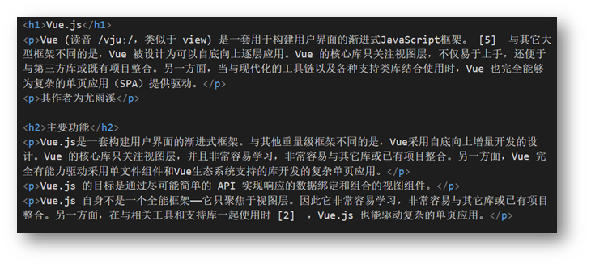

### 1.2 标签结构

* 标签要成对出现，中间包裹内容
* <>里面放英文字母（标签名）
* 结束标签比开始标签多 /
* 标签分类：双标签和单标签

```html
<strong>需要加粗的文字<strong>
<br>
<hr>
```

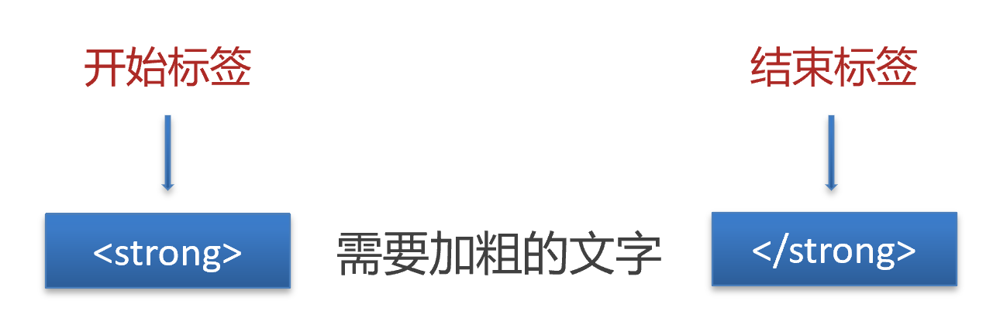

### 1.3 HTML 骨架

* html：整个网页
* head：网页头部，用来存放给浏览器看的信息，例如 CSS
  * title：网页标题
* body：网页主体，用来存放给用户看的信息，例如图片、文字

```html
<html>
  <head>
    <title>网页标题</title>
  </head>
  <body>
    网页主体
  </body>
</html>
```

> 提示
>
> VS Code 可以快速生成骨架：在 HTML 文件（.html）中，!（英文）配合 Enter / Tab 键

### 1.4 标签的关系

> 作用：明确标签的书写位置，让代码格式更整齐

* 父子关系（嵌套关系）：子级标签换行且缩进（Tab键）

  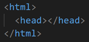

* 兄弟关系（并列关系）：兄弟标签换行要对齐

  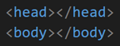

### 1.5 注释

概念：注释是对代码的解释和说明，能够提高程序的可读性，方便理解、查找代码。

注释不会再浏览器中显示。

在 VS Code 中，**添加 / 删除**注释的快捷键：**Ctrl + /**

```html
<!-- 我是 HTML 注释 -->
```

### 1.6 标题标签

一般用在新闻标题、文章标题、网页区域名称、产品名称等等。

```html
<h1>一级标题</h1>
<h2>二级标题</h2>
<h3>三级标题</h3>
<h4>四级标题</h4>
<h5>五级标题</h5>
<h6>六级标题</h6>
```

显示特点：

* 文字加粗
* 字号逐渐减小
* 独占一行（换行）

> 经验
>
> 1. h1 标签在一个网页中只能用一次，用来放新闻标题或网页的 logo
> 2. h2 ~ h6 没有使用次数的限制

### 1.7 段落标签

一般用在新闻段落、文章段落、产品描述信息等等。

```html
<p>段落</p>
```

显示特点：

* 独占一行
* 段落之间存在间隙

### 1.8 换行与水平线

* 换行：br
* 水平线：hr

```html
<br>
<hr>
```

### 1.9 文本格式化标签

作用：为文本添加特殊格式，以突出重点。常见的文本格式：加粗、倾斜、下划线、删除线等。

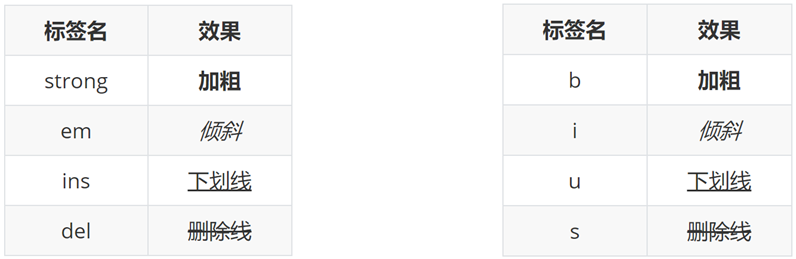

> 提示：strong、em、ins、del 标签自带强调含义（语义）。

补充几个不常用但需要认识的格式标签：

| 标签 | 效果 | 说明 |
| --- | --- | --- |
| pre | 预格式化文本 | 保留源码中的空格和换行，字体为等宽字体，常用于展示代码 |
| small | 小号字 | 表示免责声明、版权信息、法律条款等次要内容 |
| sup | 上标 | 例如 a²、脚注编号 |
| sub | 下标 | 例如 H₂O |
| abbr | 缩写 | 配合 title 属性给出全称，鼠标悬停时显示 |

```html
<pre>
for (int i = 0; i < 10; i++) {
  System.out.println("i = " + i);
}
</pre>

<p>(a-b)<sup>2</sup> = a<sup>2</sup> - 2ab + b<sup>2</sup></p>
<p>H<sub>2</sub>O</p>
<p><abbr title="中华人民共和国">中国</abbr>的首都是北京。</p>
<p><small>© 2026 公司名称。保留所有权利。</small></p>
```

> 注意：`<b>`、`<i>`、`<u>`、`<s>` 只有视觉效果；`<strong>`、`<em>`、`<ins>`、`<del>` 同时还带有语义（强调、新增、删除）。

### 1.10 图像标签

作用：在网页中插入图片

```html

```

src用于指定图像的位置和名称，是 `` 的必须属性。

#### 1.10.1 属性语法

* 属性名="属性值"
* 属性写在尖括号里面，标签名后面，标签名和属性之间用空格隔开，不区分先后顺序

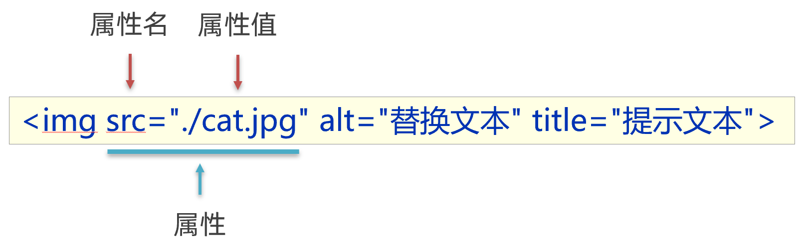

#### 1.10.2 图像属性

| 属性 | 说明 |
| --- | --- |
| src | 图片的路径，必须属性 |
| alt | 图片无法显示时的替换文字，也是给搜索引擎和屏幕阅读器看的文字 |
| title | 鼠标悬停在图片上时的提示文字 |
| width / height | 设置图片的宽高，只写一个时另一个会等比例缩放 |

```html

```

> 经验：alt 属性一定要写。图片加载失败时会显示 alt 里的文字，用户能知道这里本来是什么内容。

> 注意：实际开发中图片的宽高一般用 CSS 的 width / height 设置，很少写在 HTML 属性里。

### 1.11 路径

概念：路径指的是查找文件时，从**起点**到**终点**经历的**路线**。

路径分类：

* 相对路径：从当前文件位置出发查找目标文件
* 绝对路径：从盘符出发查找目标文件
  * Windows 电脑从盘符出发
  * Mac 电脑从根目录出发

#### 1.11.1 相对路径

查找方式：从**当前文件位置**出发查找目标文件

特殊符号：

* **/** 表示进入某个文件夹里面          → 文件夹名/
* **. ** 表示当前文件所在文件夹           → ./
* **..** 表示当前文件的上一级文件夹 → ../

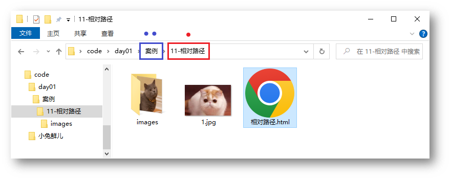

#### 1.11.2 绝对路径

查找方式：Windows 电脑从盘符出发；Mac 电脑从根目录（/）出发

```html

```

> 提示
>
> 1. Windows 默认是 \ ，其他系统是 /，建议统一写为 /
> 2. 特殊的绝对路径 → 文件的在线网址：<https://www.itheima.com/images/logo.png> "，应用场景：网页底部**友情链接**

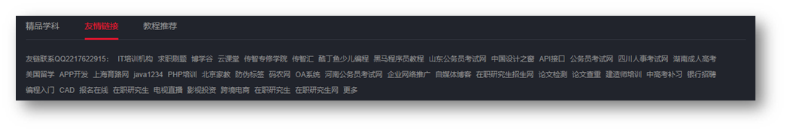

### 1.12 超链接标签

作用：点击跳转到其他页面。

```html
<a href="https://www.baidu.com">跳转到百度</a>
```

**href 属性值是跳转地址，是超链接的必须属性。**

超链接默认是在当前窗口跳转页面，添加 **target="_blank"** 实现**新窗口**打开页面。

拓展：开发初期，不确定跳转地址，则 href 属性值写为 **#**，表示**空链接**，页面不会跳转，在当前页面刷新一次。

```html
<a href="https://www.baidu.com/">跳转到百度</a>

<!-- 跳转到本地文件：相对路径查找 -->
<!-- target="_blank" 新窗口跳转页面 -->
<a href="./01-标签的写法.html" target="_blank">跳转到01-标签的写法</a>

<!-- 开发初期，不知道超链接的跳转地址，href属性值写#，表示空链接，不会跳转 -->
<a href="#">空链接</a>
```

#### 1.12.1 锚点链接

作用：点击链接，跳转到**当前页面**的指定位置。

实现步骤：

1. 给目标标签设置 **id** 属性
2. 超链接的 href 属性值写 **#id名**

```html
<a href="#two">跳转到第二章节</a>
...

<h2 id="two">第二章节</h2>
```

> 提示：href 属性值为 **#** 时是空链接，页面不跳转；写成 **#top** 或 **#** 点击后回到页面顶部。

#### 1.12.2 URL 的组成与域名解析

URL（Uniform Resource Locator，统一资源定位符）用来定位网络中的某个资源。

组成部分：**协议 + IP 地址（域名）+ 端口号 + 资源路径**。

以 `http://192.168.137.100:80/index.html` 为例：

| 部分 | 含义 |
| --- | --- |
| `http://` | 使用的协议，浏览器和服务器按 HTTP 规定好的格式通信 |
| `192.168.137.100` | 服务器 IP 地址 |
| `80` | Web 服务器软件的端口号，HTTP 默认端口是 80 |
| `/index.html` | 资源在服务器中的具体路径 |

域名解析：`www.baidu.com` 这样的域名更好记，发送请求时由 **DNS（域名解析器）** 把域名解析成对应的 IP 地址。可以用 `ping www.baidu.com` 查看域名对应的 IP。

> 提示：协议默认端口可以省略，所以 `http://www.baidu.com` 等价于 `http://www.baidu.com:80/`。

#### 1.12.3 target 的 5 个取值

| 取值 | 含义 |
| --- | --- |
| `_blank` | 新窗口 / 新标签页中打开 |
| `_self` | 当前窗口打开（默认值） |
| `_top` | 在顶级窗口中打开，跳出所有 iframe |
| `_parent` | 在父级窗口中打开，跳出当前 iframe |
| iframe 的 name 值 | 在指定的内联框架中打开 |

#### 1.12.4 name 属性锚点（旧写法）

除了用 `id` 设置锚点，还可以用 `a` 标签的 `name` 属性（HTML5 已不推荐，了解即可）：

```html
<a name="top"></a>
...
<a href="#top">回到顶部</a>
```

#### 1.12.5 图片超链接

超链接的内容不一定是文字，也可以是图片：

```html
<a href="https://www.baidu.com">
  
</a>
```

> 提示：旧版浏览器会给图片超链接加上蓝色边框，可以用 `img { border: 0; }` 去掉。

### 1.13 音频标签

```html
<audio src="音频的 URL"></audio>
```

常用属性

> 拓展：书写 HTML5 属性时，如果属性名和属性值相同，可以简写为一个单词。

```html
<!-- 在 HTML5 里面，如果属性名和属性值完全一样，可以简写为一个单词 -->
<audio src="./media/music.mp3" controls loop autoplay></audio>
```

### 1.14 视频标签

```html
<video src="视频的 URL"></video>
```

常用属性

```html
<!-- 在浏览器中，想要自动播放，必须有 muted 属性 -->
<video src="./media/vue.mp4" controls loop muted autoplay></video>
```

### 1.15 音频与视频的兼容写法

不同浏览器支持的音视频格式不同，可以书写多个 **source** 标签，浏览器会依次查找能播放的格式。

```html
<video controls muted>
  <source src="./media/vue.mp4" type="video/mp4">
  <source src="./media/vue.webm" type="video/webm">
  您的浏览器不支持 video 标签。
</video>
```

常用属性和取值：

| 属性 | 取值 | 说明 |
| --- | --- | --- |
| controls | controls | 显示播放控件（播放、进度条、音量等） |
| autoplay | autoplay | 自动播放，视频必须配合 muted 才生效 |
| loop | loop | 循环播放 |
| muted | muted | 静音 |
| preload | none / metadata / auto | 预加载方式，none 表示不预加载 |
| poster | 图片路径 | 视频未播放时显示的封面图，只有 video 支持 |

> 提示：标签中间的文字是**降级提示**，浏览器不支持该标签时才会显示。

### 1.16 iframe 内联框架

作用：在当前网页中嵌入另一个独立的网页（Inline Frame）。

```html
<iframe src="https://example.com" width="600" height="400" name="myFrame"></iframe>
```

| 属性 | 作用 |
| --- | --- |
| src | 内嵌页面的 URL（必填） |
| width / height | 宽高，可以是像素或百分比 |
| name | 框架名称，供 `<a target="myFrame">` 使用 |

```html
<a href="https://www.baidu.com" target="myFrame">在框架中打开百度</a>
<iframe src="about:blank" name="myFrame" width="100%" height="300"></iframe>
```

> 提示：现在很少用 iframe 做整体布局（不利于 SEO、性能和安全性），常见用途是嵌入地图、视频、第三方支付页面等。

### 1.17 base 与 progress 标签

#### 1.17.1 base 基准路径

`<base>` 为页面上所有相对 URL 指定一个基准地址，必须写在 `<head>` 中，一个文档只能有一个。

```html
<head>
  <base href="https://www.example.com/images/">
</head>
<body>
  <!-- 实际加载 https://www.example.com/images/pic.jpg -->
  

  <!-- 实际跳转到 https://www.example.com/images/page.html -->
  <a href="page.html">链接</a>
</body>
```

#### 1.17.2 progress 进度条

HTML5 的 `<progress>` 用来显示任务进度，例如文件上传、下载或任务完成度。

```html
<!-- 确定进度：50% -->
<progress value="50" max="100"></progress>

<!-- 不确定进度：不写 value，显示动态滚动效果 -->
<progress max="100"></progress>
```

| 属性 | 说明 |
| --- | --- |
| value | 当前进度值，确定型进度条必填 |
| max | 总进度值，默认值为 1 |

### 1.18 过渡属性（了解）

早期 HTML 提供了一些直接控制样式的属性，现在都建议用 CSS 代替，见到认识即可：

| 用法 | 作用 | 现代写法 |
| --- | --- | --- |
| `<h1 align="center">`、`<p align="center">` | 水平对齐 | `text-align: center` |
| `<hr size="3" width="90%" color="red" align="center">` | 水平线的高度、宽度、颜色、对齐 | 用 CSS 设置 `height`、`width`、`border-color` |
| `<body background="bg.jpg">` | 页面背景图 | `background-image` |
| `<body bgcolor="yellow">` | 页面背景色 | `background-color` |
| `<ul type="square">`、`<ol type="A">` | 列表项目符号 | `list-style-type` |

> 注意：这些属性在 HTML5 中已被废弃，但浏览器为了兼容旧网页仍然支持，新项目一律使用 CSS。

<a id="ch02"></a>

## 2. 列表、表格与表单

> 目标：掌握嵌套关系标签的写法，使用列表标签布局网页

### 2.1 列表

作用：布局内容排列整齐的区域。

列表分类：无序列表、有序列表、定义列表。

#### 2.1.1 无序列表

作用：布局排列整齐的**不需要规定顺序**的区域。

标签：ul 嵌套 li，ul 是无序列表，li 是列表条目。

```html
<ul>
  <li>第一项</li>
  <li>第二项</li>
  <li>第三项</li>
  ……
</ul>
```

> 注意事项：
>
> * ul 标签里面只能包裹 li 标签
> * li 标签里面可以包裹任何内容

#### 2.1.2 有序列表

作用：布局排列整齐的**需要规定顺序**的区域。

标签：ol 嵌套 li，ol 是有序列表，li 是列表条目。

```html
<ol>
  <li>第一项</li>
  <li>第二项</li>
  <li>第三项</li>
  ……
</ol>
```

> 注意事项：
>
> * ol 标签里面只能包裹 li 标签
> * li 标签里面可以包裹任何内容

#### 2.1.3 定义列表

标签：dl 嵌套 dt 和 dd，dl 是定义列表，dt 是定义列表的标题，dd 是定义列表的描述 / 详情。

```html
<dl>
  <dt>列表标题</dt>
  <dd>列表描述 / 详情</dd>
   ……
</dl>
```

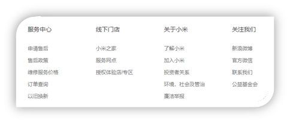

> 注意事项：
>
> * dl 里面只能包含dt 和 dd
> * dt 和 dd 里面可以包含任何内容

### 2.2 表格

网页中的表格与 Excel 表格类似，用来展示数据。

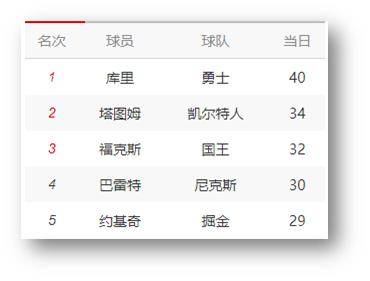

#### 2.2.1 基本使用

标签：table 嵌套 tr，tr 嵌套 td / th。

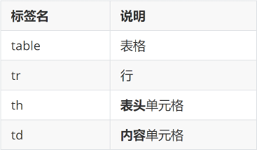

> 提示：在网页中，**表格默认没有边框线**，使用 **border 属性**可以为表格添加边框线。

其他常用的表格属性（了解，实际开发用 CSS 代替）：

| 属性 | 作用 |
| --- | --- |
| border | 表格边框的宽度，例如 `border="1"` |
| cellpadding | 单元格内容与单元格边框之间的空白，单位像素 |
| cellspacing | 单元格之间的空白；设为 `0` 时单元格紧贴，默认的双线边框看起来会变成实线 |
| width | 表格宽度，可以是像素或百分比 |
| align | 表格相对周围元素的对齐方式：left / center / right（已废弃） |

```html
<table border="1">
  <tr>
    <th>姓名</th>
    <th>语文</th>
    <th>数学</th>
    <th>总分</th>
  </tr>
  <tr>
    <td>张三</td>
    <td>99</td>
    <td>100</td>
    <td>199</td>
  </tr>
  <tr>
    <td>李四</td>
    <td>98</td>
    <td>100</td>
    <td>198</td>
  </tr>
  <tr>
    <td>总结</td>
    <td>全市第一</td>
    <td>全市第一</td>
    <td>全市第一</td>
  </tr>
</table>
```

#### 2.2.2 表格结构标签（了解）

作用：用表格结构标签把内容划分区域，让表格结构更清晰，语义更清晰。

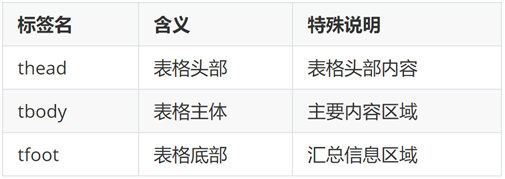

> 提示：表格结构标签可以省略。

三个结构标签的具体规则：

| 标签 | 作用 | 规则 |
| --- | --- | --- |
| thead | 表头分组，通常包含 th | 一个表格只能有一个；浏览器会把它置顶显示 |
| tbody | 表格主体，包含主要数据 td | 可以有多个，用于逻辑分组（如按月分块）；不写时浏览器会自动把非 thead / tfoot 的内容包进 tbody |
| tfoot | 表尾分组，通常放汇总行 | 一个表格只能有一个；HTML 规范要求写在 tbody **之前**，但渲染时显示在底部 |

```html
<table border="1">
  <caption>2026 年销售报表</caption>
  <thead>
    <tr><th>月份</th><th>销售额</th></tr>
  </thead>
  <tfoot>
    <tr><td>总计</td><td>¥50,000</td></tr>
  </tfoot>
  <tbody>
    <tr><td>1 月</td><td>¥10,000</td></tr>
    <tr><td>2 月</td><td>¥15,000</td></tr>
  </tbody>
</table>
```

> 注意：表格简单时可以省略 thead / tfoot，只保留 tbody。

#### 2.2.3 合并单元格

作用：将多个单元格合并成一个单元格，以合并同类信息。

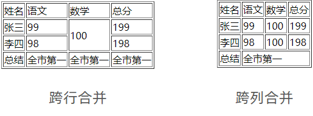

合并单元格的步骤：

1. 明确合并的目标
2. 保留**最左最上**的单元格，添加属性（取值是**数字**，表示需要**合并的单元格数量**）
   * **跨行合并**，保留最上单元格，添加属性 **rowspan**
   * **跨列合并**，保留最左单元格，添加属性 **colspan**
3. 删除其他单元格

```html
<table border="1">
  <thead>
    <tr>
      <th>姓名</th>
      <th>语文</th>
      <th>数学</th>
      <th>总分</th>
    </tr>
  </thead>
  <tbody>
    <tr>
      <td>张三</td>
      <td>99</td>
      <td rowspan="2">100</td>
      <td>199</td>
    </tr>
    <tr>
      <td>李四</td>
      <td>98</td>
      <!-- <td>100</td> -->
      <td>198</td>
    </tr>
  </tbody>
  <tfoot>
    <tr>
      <td>总结</td>
      <td colspan="3">全市第一</td>
      <!-- <td>全市第一</td>
      <td>全市第一</td> -->
    </tr>
  </tfoot>
</table>
```

> 注意：不能跨表格结构标签合并单元格（thead、tbody、tfoot）。

#### 2.2.4 表格标题与边框合并

表格标题：使用 **caption** 标签，写在 table 标签内部的**第一行**，默认显示在表格上方居中。

边框合并：表格默认是**双线边框**，给 table 设置 **border-collapse: collapse** 可以合并为**单线边框**。

```html
<style>
  table {
    /* 合并相邻边框线 */
    border-collapse: collapse;
  }

  th, td {
    border: 1px solid #000;
    /* 单元格内容与边框的距离 */
    padding: 10px 20px;
    text-align: center;
  }
</style>

<table>
  <caption>学生成绩表</caption>
  <tr>
    <th>姓名</th>
    <th>语文</th>
  </tr>
  <tr>
    <td>张三</td>
    <td>99</td>
  </tr>
</table>
```

> 提示：单元格内容垂直居中可以设置 **vertical-align: middle**，文字靠左可以设置 text-align: left（th 默认居中加粗）。

### 2.3 表单

作用：收集用户信息。

使用场景：

* 登录页面
* 注册页面
* 搜索区域

#### 2.3.1 input 标签

input 标签 type 属性值不同，则功能不同。

```html
<input type="..." >
```

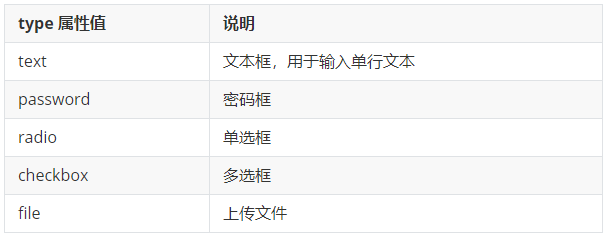

基础 type 取值及要点：

| type | 控件 | 要点 |
| --- | --- | --- |
| text | 文本框 | 用户填写的值就是 value；`maxlength` 限制最多输入的字符数 |
| password | 密码框 | 输入内容显示为圆点，同样通过 value 提交 |
| radio | 单选按钮 | **同组 name 必须相同**才能单选；`checked` 默认选中；value 必须由程序员设置 |
| checkbox | 复选框 | 同组 name 建议一致；`checked` 默认选中；value 必须由程序员设置 |
| file | 文件上传 | 加 `multiple` 可多选；提交时 form 必须 `method="post"`、`enctype="multipart/form-data"` |
| hidden | 隐藏域 | 页面不显示，但会随表单提交，适合传 id 等用户不需要看到的数据 |

#### 2.3.2 占位文本

占位文本：提示信息，文本框和密码框都可以使用。

```html
<input type="..." placeholder="提示信息">
```

#### 2.3.3 单选框

常用属性

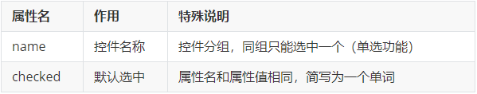

```html
<input type="radio" name="gender" checked> 男
<input type="radio" name="gender"> 女
```

> 提示：name 属性值自定义。

#### 2.3.4 上传文件

默认情况下，文件上传表单控件只能上传一个文件，添加 multiple 属性可以实现文件多选功能。

```html
<input type="file" multiple>
```

#### 2.3.5 多选框

多选框也叫复选框，默认选中：checked。

```html
<input type="checkbox" checked> 敲前端代码
```

#### 2.3.6 下拉菜单

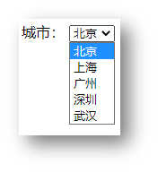

标签：select 嵌套 option，select 是下拉菜单整体，option是下拉菜单的每一项。

```html
<select>
  <option>北京</option>
  <option>上海</option>
  <option>广州</option>
  <option>深圳</option>
  <option selected>武汉</option>
</select>
```

> 默认显示第一项，**selected** 属性实现**默认选中**功能。

其他属性：

* **size**：设置下拉列表默认显示几项（默认只显示一项）。
* **multiple**：允许按住 Ctrl 多选；多选时提交的数据是多个同名的值。

#### 2.3.7 文本域

作用：多行输入文本的表单控件。

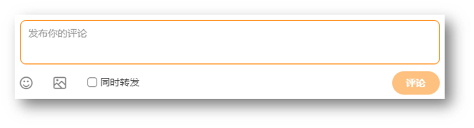

```html
<textarea>默认提示文字</textarea>
```

* **cols**：文本域的可见宽度（字符数）。
* **rows**：文本域的可见行数。

```html
<textarea name="content" cols="50" rows="10" placeholder="请填写您的反馈..."></textarea>
```

> 注意点：
>
> * 实际开发中，使用 CSS 设置 文本域的尺寸
> * 实际开发中，一般禁用右下角的拖拽功能

#### 2.3.8 label 标签

作用：网页中，某个标签的说明文本。

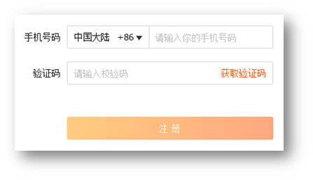

经验：用 label 标签绑定文字和表单控件的关系，增大表单控件的点击范围。

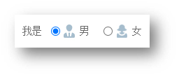

* 写法一
  * label 标签只包裹内容，不包裹表单控件
  * 设置 label 标签的 for 属性值 和表单控件的 id 属性值相同

```html
<input type="radio" id="man">
<label for="man">男</label>
```

* 写法二：使用 label 标签包裹文字和表单控件，不需要属性

```html
<label><input type="radio"> 女</label>
```

> 提示：支持 label 标签增大点击范围的表单控件：文本框、密码框、上传文件、单选框、多选框、下拉菜单、文本域等等。

#### 2.3.9 按钮

```html
<button type="">按钮</button>
```

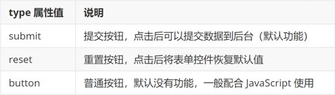

```html
<!-- form 表单区域 -->
<!-- action="" 发送数据的地址 -->
<form action="">
  用户名：<input type="text">
  <br><br>
  密码：<input type="password">
  <br><br>

  <!-- 如果省略 type 属性，功能是 提交 -->
  <button type="submit">提交</button>
  <button type="reset">重置</button>
  <button type="button">普通按钮</button>
</form>
```

> 提示：按钮需配合 form 标签（表单区域）才能实现对应的功能。

#### 2.3.10 表单域与提交数据

form 标签把表单控件包裹起来，提交数据时会把表单控件里的数据发送给服务器。

| 属性 | 说明 |
| --- | --- |
| action | 提交数据的地址，不写时提交到当前页面 |
| method | 提交方式，**get**（默认，数据跟在地址后面）或 **post**（数据放在请求体里） |
| enctype | 提交数据的编码类型，默认 `application/x-www-form-urlencoded`；文件上传必须用 `multipart/form-data` |
| name | 表单域名称 |
| id | 表单的 id |
| target | 在哪个窗口打开，_blank 表示新窗口 |

> 注意 1：**表单控件必须设置 name 属性**，否则这个控件的数据不会被提交。

> 注意 2：HTTP 规定表单提交数据的格式为 **name=value&name=value&name=value...**，其中 name 和 value 都是表单控件的属性值。

文件上传必须同时满足三个条件：

1. `<input type="file">`
2. `method="post"`
3. `enctype="multipart/form-data"`

浏览器向服务器发送请求，目前学过的三种方式：

1. 直接在地址栏输入 URL 并回车
2. 点击超链接
3. 提交表单

#### 2.3.11 常用表单属性

| 属性           | 说明                          |
| ------------ | --------------------------- |
| value        | 表单控件的值（要提交的数据）              |
| name         | 表单控件的名称，提交数据时必须设置           |
| readonly     | 只读，数据可以提交                   |
| disabled     | 禁用，数据**不会提交**，样式也会变灰        |
| required     | 必填，内容为空时无法提交                |
| autofocus    | 自动获取焦点                      |
| maxlength    | 允许输入的最大字符个数                 |
| autocomplete | 是否记录之前输入过的内容，取值 on（默认）/ off |
|              |                             |

```html
<form action="">
  用户名：<input type="text" name="username" value="张三" maxlength="10" required>
  学号：<input type="text" name="id" value="001" readonly>
  城市：<input type="text" name="city" value="北京" disabled>
  <button type="submit">提交</button>
</form>
```

> 经验：**readonly 和 disabled 的区别**是高频考点 —— readonly 的数据会提交，disabled 的数据不会提交。

#### 2.3.12 HTML5 新增的 input 类型

| type 取值                      | 作用                        |
| ---------------------------- | ------------------------- |
| email                        | 邮箱，提交时会校验格式               |
| url                          | 网址                        |
| tel                          | 电话                        |
| number                       | 数字，配合 min / max / step 使用 |
| search                       | 搜索框，右侧带清除按钮               |
| date / time / datetime-local | 日期、时间、日期时间                |
| month / week                 | 月、周                       |
| color                        | 颜色选择器                     |
| range                        | 滑块，配合 min / max / step 使用 |
|                              |                           |

```html
邮箱：<input type="email" name="email">
数量：<input type="number" name="num" min="1" max="10" value="1">
日期：<input type="date" name="birth">
评分：<input type="range" name="score" min="0" max="100" step="10">
```

> 提示：这些控件在手机上会调起对应的键盘（邮箱键盘、数字键盘等），是做移动端表单时最省事的写法。

#### 2.3.13 表单分组与数据列表（了解）

* **fieldset / legend**：给表单分组，legend 是这一组的标题
* **datalist**：输入框的下拉提示列表，配合 input 的 list 属性使用

```html
<form action="">
  <fieldset>
    <legend>用户信息</legend>
    用户名：<input type="text" name="username">
    城市：<input list="citys" name="city">
    <datalist id="citys">
      <option value="北京">北京</option>
      <option value="上海">上海</option>
    </datalist>
  </fieldset>
</form>
```

### 2.4 语义化

#### 2.4.1 无语义的布局标签

作用：布局网页（划分网页区域，摆放内容）

* div：独占一行
* span：不换行

```html
<div>div 标签，独占一行</div>
<span>span 标签，不换行</span>
```

#### 2.4.2 有语义的布局标签

常用的语义化布局标签：

| 标签 | 语义 |
| --- | --- |
| header | 网页头部 / 某个区域的头部 |
| nav | 导航栏 |
| footer | 网页底部 / 某个区域的底部 |
| aside | 侧边栏 |
| section | 区块，通常带标题 |
| article | 文章内容，独立完整的一块 |
| main | 页面主体内容，一个页面只能用一次 |

```html
<header>网页头部</header>
<nav>导航栏</nav>
<main>
  <article>文章内容</article>
  <aside>侧边栏</aside>
</main>
<footer>网页底部</footer>
```

> 提示：语义化标签的**显示效果和 div 完全一样**，只是多了语义。作用是让代码结构更清晰、方便团队协作和维护，也有利于搜索引擎优化（SEO）。

> 经验：header、footer 在页面里可以出现多次（不同区域的头部、底部），**main 只能出现一次**。

### 2.5 网页头部常见设置

head 标签里存放的是「给浏览器看的信息」，常见设置有字符编码、视口、网页标题、搜索引擎关键词等。

```html
<head>
  <!-- 字符编码，中文网页必须是 UTF-8，否则会乱码 -->
  <meta charset="UTF-8">
  <!-- 视口，移动端适配的第一步 -->
  <meta name="viewport" content="width=device-width, initial-scale=1.0">

  <!-- SEO 三大标签：title、description、keywords -->
  <title>小兔鲜儿-新鲜、健康、便捷的生鲜电商平台</title>
  <meta name="description" content="小兔鲜儿提供新鲜的水果、蔬菜、海鲜等生鲜食品，产地直发，当日送达。">
  <meta name="keywords" content="小兔鲜儿,生鲜,水果,蔬菜,海鲜">

  <!-- 网页图标，显示在浏览器标签页上 -->
  <link rel="shortcut icon" href="./favicon.ico" type="image/x-icon">
</head>
```

| 标签 | 作用 | 书写要求 |
| --- | --- | --- |
| title | 网页标题，显示在浏览器标签页上 | 网站名称（产品名称）- 网站介绍，一般不超过 30 个字 |
| description | 网页描述 | 一句话概括网站的主要内容，一般不超过 120 个字 |
| keywords | 网页关键词 | 用逗号隔开，一般 6 ~ 8 个关键词 |

> 提示：
>
> * SEO 三大标签是**给搜索引擎看**的，用来提高网页在搜索结果里的排名
> * 网页图标一般命名为 **favicon.ico** 放在网站根目录，浏览器会自动查找
> * Google 从 2009 年起已完全忽略 `keywords`（容易被堆砌滥用），现代 SEO 更看重 `description` 带来的点击率，而不是排名
> * `head` 中可以出现的子标签有 title、meta、link、script、style 等，它们描述文档的属性和信息，绝大多数不会显示给用户

### 2.6 字符实体

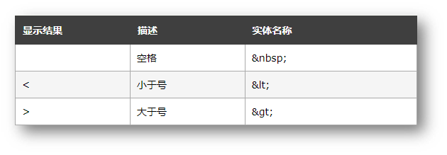

常用字符实体：

| 显示结果 | 描述 | 实体名称 |
| --- | --- | --- |
| （一个空格） | 空格 | `&nbsp;` |
| `<` | 小于号 | `&lt;` |
| `>` | 大于号 | `&gt;` |
| `&` | 和号 | `&amp;` |
| `"` | 双引号 | `&quot;` |
| `©` | 版权 | `&copy;` |
| `¥` | 人民币 | `&yen;` |
| `×` | 乘号 | `&times;` |
| `÷` | 除号 | `&divide;` |

> 注意：字符实体以 **&** 开头、以 **;** 结尾。HTML 中连续多个空格只会显示成一个，需要用 **&nbsp;** 占位。

---

# 第二部分 · CSS 基础与布局

<a id="ch03"></a>

## 3. CSS 基础

> 目标：掌握 CSS 属性基本写法，能够使用文字相关属性美化文章页。

### 3.1 CSS 初体验

层叠样式表 (Cascading Style Sheets，缩写为 CSS），是一种 **样式表** 语言，用来**描述 HTML 文档的呈现**（**美化内容**）。

书写位置：**title 标签下方添加 style 双标签，style 标签里面书写 CSS 代码**。

```html
<title>CSS 初体验</title>
<style>
  /* 选择器 { } */
  p {
    /* CSS 属性 */
    color: red;
  }
</style>

<p>体验 CSS</p>
```

> 提示：属性名和属性值成对出现 → 键值对。

CSS 的主要功能：

1. **美化页面**：文字颜色、字体、大小、对齐；背景色、背景图、渐变；间距和边框。
2. **布局设计**：多栏布局、响应式设计、定位、Flex / Grid 排版。
3. **交互增强**：`:hover`、`:active` 等状态样式；配合 JavaScript 实现过渡和动画。

CSS 的优势：

* **结构与样式分离**：改外观不用动 HTML，便于维护和协作。
* **复用性强**：一套样式可以应用于多个页面或元素。
* **支持响应式设计**：网页能自动适配不同设备屏幕尺寸与分辨率。

### 3.2 CSS 引入方式

* **内部**样式表：学习使用
  * CSS 代码写在 style 标签里面
* **外部**样式表：开发使用
  * CSS 代码写在单独的 CSS 文件中（**.css**）
  * 在 HTML 使用 link 标签引入

```html
<link rel="stylesheet" href="./my.css">
```

* **行内**样式：配合 JavaScript 使用
  * CSS 写在标签的 style 属性值里

```html
<div style="color: red; font-size:20px;">这是 div 标签</div>
```

三种引入方式的优先级：

* **行内样式优先级最高**（但它只能作用于当前标签，不利于复用）。
* **内部样式和外部样式优先级相同**，谁在文档中**后面出现**谁生效。
* 开发中推荐使用外部样式：结构样式分离、可复用、能被浏览器缓存。

### 3.3 基础选择器

作用：**查找标签**，设置样式。

#### 3.3.1 标签选择器

标签选择器：使用**标签名**作为选择器 → 选中**同名标签设置相同的样式**。

例如：p, h1, div, a, img......

```html
<style>
  p {
    color: red;
  }
</style>

```

> 注意：标签选择器**无法差异化**同名标签的显示效果。

#### 3.3.2 类选择器

作用：查找标签，**差异化**设置标签的显示效果。

步骤：

* 定义类选择器 → **.类名**
* 使用类选择器 → 标签添加 **class="类名"**

```html
<style>
  /* 定义类选择器 */
  .red {
    color: red;
  }
</style>

<!-- 使用类选择器 -->
<div class="red">这是 div 标签</div>
<div class="red size">div 标签</div>
```

注意：

* 类名**自定义**，不要用纯数字或中文，尽量用英文命名
* 一个类选择器**可以供多个标签使用**
* **一个标签可以使用多个类名**，类名之间用**空格**隔开

> 开发习惯：类名见名知意，多个单词可以用 - 连接，例如：news-hd。

#### 3.3.3 id 选择器

作用：查找标签，差异化设置标签的显示效果。

场景：id 选择器一般**配合 JavaScript** 使用，很少用来设置 CSS 样式

步骤：

* 定义 id 选择器 → #id名
* 使用 id 选择器 → 标签添加 id= "id名"

```html
<style>
  /* 定义 id 选择器 */
  #red {
    color: red;
  }
</style>

<!-- 使用 id 选择器 -->
<div id="red">这是 div 标签</div>
```

> 规则：同一个 id 选择器在一个页面只能使用一次。

#### 3.3.4 通配符选择器

作用：查找页面**所有**标签，设置相同样式。

通配符选择器： ***，不需要调用**，浏览器自动查找页面所有标签，设置相同的样式

```css
* {
  color: red;
}
```

> 经验：通配符选择器可以用于**清除标签的默认样式**，例如：标签默认的外边距、内边距。

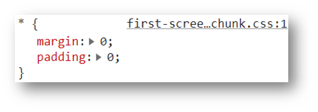

### 3.4 盒子尺寸与背景色

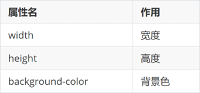

### 3.5 文字控制属性

#### 3.5.1 字体大小

* 属性名：**font-size**
* 属性值：文字尺寸，PC 端网页最常用的单位 **px**

```css
p {
  font-size: 30px;
}
```

> 经验：谷歌浏览器默认字号是16px。

#### 3.5.2 字体样式（是否倾斜）

作用：清除文字默认的倾斜效果

属性名：**font-style**

属性值

* 正常（不倾斜）：**normal**
* 倾斜：**italic**

#### 3.5.3 字体粗细

属性名：**font-weight**

属性值：

* 正常：**normal**（等价于 400）
* 加粗：**bold**（等价于 700）
* 数字：100 ~ 900 的整百数，数字越大越粗

```css
p {
  font-weight: 700;
  /* 与上面等价 */
  font-weight: bold;
}
```

> 经验：开发中常用 **font-weight: normal** 清除标题标签（h1 ~ h6）自带的加粗效果。

#### 3.5.4 行高

作用：设置多行文本的间距

属性名：line-height

属性值

* 数字 + px
* 数字（当前标签font-size属性值的倍数）

```css
line-height: 30px;


/* 当前标签字体大小为16px */
line-height: 2;
```

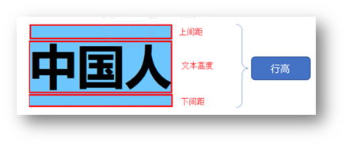

> 行高的测量方法：从一行文字的最顶端（最底端）量到下一行文字的最顶端（最底端）。

__单行文字垂直居中__ 

垂直居中技巧：**行高属性值等于盒子高度属性值**

注意：该技巧适用于单行文字垂直居中效果

```css
div {
  height: 100px;
  background-color: skyblue;

  /* 注意：只能是单行文字垂直居中 */
  line-height: 100px;
}
```

#### 3.5.5 字体族

属性名：**font-family**

属性值：字体名

```css
font-family: 楷体;
```

> 拓展（了解）：font-family属性值可以书写多个字体名，各个字体名用逗号隔开，执行顺序是从左向右依次查找
>
> *  font-family 属性最后设置一个字体族名，网页开发建议使用无衬线字体

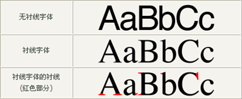

```css
font-family: Microsoft YaHei, Heiti SC, tahoma, arial, Hiragino Sans GB, "\5B8B\4F53", sans-serif;
```

#### 3.5.6 font 复合属性

使用场景：设置网页文字公共样式

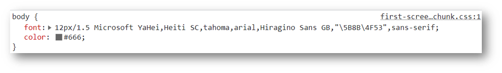

复合属性：属性的简写方式，**一个属性对应多个值的写法**，各个属性值之间用**空格**隔开。

**font: 是否倾斜  是否加粗  字号/行高 字体（必须按顺序书写）**

```css
div {
  font: italic 700 30px/2 楷体;
}
```

> 注意：字号和字体值必须书写，否则 font 属性不生效 。

#### 3.5.7 文本缩进

属性名：**text-indent**

属性值：

* 数字 + px
* **数字 + em**（推荐：**1em = 当前标签的字号大小**）

```css
p {
  text-indent: 2em;
}
```

#### 3.5.8 文本对齐方式

作用：控制内容水平对齐方式

属性名：**text-align**

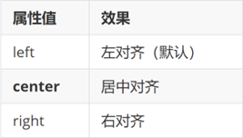

```css
text-align: center;
```

> text-align本质是控制内容的对齐方式，属性要设置给内容的父级。

```html
<style>
  div {
    text-align: center;
  }
</style>

<div>
  
</div>
```

#### 3.5.9 文本修饰线

属性名： **text-decoration**

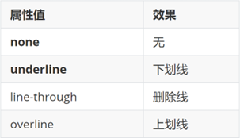

| 取值 | 效果 |
| --- | --- |
| none | 无装饰线（默认），常用于去掉 a 标签的下划线 |
| underline | 下划线 |
| overline | 上划线 |
| line-through | 删除线 |

```css
a {
  text-decoration: none;
}

.old-price {
  text-decoration: line-through;
}
```

#### 3.5.10 color 文字颜色

常见的颜色表示方式：

| 表示方式 | 写法 | 说明 |
| --- | --- | --- |
| 关键字 | `red`、`pink`、`skyblue` | 预定义的颜色名，不推荐大量使用 |
| 十六进制 | `#ff0000`、`#f00` | 前两位红、中间两位绿、后两位蓝，两两相同时可以简写 |
| RGB | `rgb(255, 0, 0)` | 三个数值范围都是 0 ~ 255 |
| RGBA | `rgba(255, 0, 0, 0.5)` | 比 RGB 多了一位透明度，范围 0 ~ 1 |
| 透明 | `transparent` | 完全透明 |

```css
div {
  color: #f00;
  color: #ff0000;
  color: rgb(255, 0, 0);
  /* 最后一位是透明度，0.5 表示半透明 */
  color: rgba(255, 0, 0, 0.5);
  background-color: transparent;
}
```

> 提示：**rgba 只让颜色透明**，元素里的文字和子元素不受影响；**opacity 会让整个元素**（包括内容和子元素）一起透明。

> 提示：只要属性值为颜色，都可以使用上述四种颜色表示方式，例如：背景色。

#### 3.5.11 字间距、词间距与大小写

| 属性 | 作用 | 常用值 |
| --- | --- | --- |
| **letter-spacing** | 字与字之间的间距（中文同样生效） | 2px、0.1em |
| **word-spacing** | 英文单词之间的间距 | 5px |
| **text-transform** | 英文大小写转换 | uppercase、lowercase、capitalize |

```css
.title {
  /* 标题文字之间拉开 2px，常用于大标题 */
  letter-spacing: 2px;
}

.en {
  word-spacing: 5px;
  text-transform: uppercase;
}
```

> 提示：`letter-spacing` 会在每个字符后面都加间距（包括最后一个字符），所以文字居中时可能看起来略微偏左，可以用 `padding-left` 补偿。

### 3.6 CSS 单位

CSS 里的长度单位分为**绝对单位**和**相对单位**。

| 单位 | 类型 | 说明 |
| --- | --- | --- |
| px | 绝对单位 | 像素，PC 端最常用 |
| % | 相对单位 | 相对于父元素的对应属性值 |
| em | 相对单位 | 相对于**当前元素的字号**，1em = 当前标签的 font-size |
| rem | 相对单位 | 相对于 **HTML 根标签的字号**，1rem = html 的 font-size |
| vw / vh | 相对单位 | 相对于视口宽度 / 高度，1vw = 1/100 视口宽度 |
| deg | 角度单位 | 旋转角度（配合 transform 使用） |

```css
.box {
  /* 当前标签字号是 20px，那么 1em = 20px */
  font-size: 20px;
  /* 2em = 40px，首行缩进两个字 */
  text-indent: 2em;
  /* 1rem = html 标签的字号，一般不设置时是 16px */
  width: 10rem;
}
```

> 经验：
>
> * 文字缩进用 **em**，因为 1em 就是当前文字的大小，将来改字号不用改缩进值
> * PC 端网页用 **px**，移动端适配用 **rem** 或 **vw**
> * % 用在宽度上相对的是**父级宽度**，用在 font-size 上相对的是**父级字号**

> 注意：em 会**逐层累积**（父级字号变了，子级用 em 的尺寸也跟着变），rem 只认 html 的字号、不会累积，所以移动端适配用 rem。

### 3.7 调试工具

作用：检查、调试代码；帮助程序员发现代码问题、解决问题

1. 打开调试工具

* 浏览器窗口内任意位置 / 选中标签 → 鼠标右键 → 检查
* F12

2. 使用调试工具

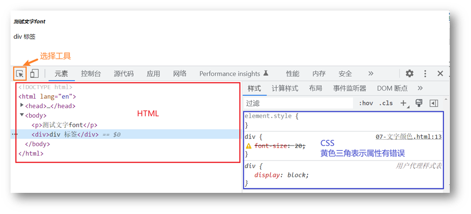

<a id="ch04"></a>

## 4. CSS 进阶

> 目标：掌握复合选择器作用和写法；使用background属性添加背景效果

### 4.1 复合选择器

定义：由两个或多个基础选择器，通过不同的方式组合而成。

作用：更准确、更高效的选择目标元素（标签）。

#### 4.1.1 后代选择器

后代选择器：**选中某元素的后代元素**。

选择器写法：父选择器  子选择器 { CSS 属性}，父子选择器之间用**空格**隔开。

```html
<style>
  div span {
    color: red;
  }
</style>

<span> span 标签</span>
<div>
  <span>这是 div 的儿子 span</span >
</div>
```

#### 4.1.2 子代选择器

子代选择器：选中某元素的子代元素（**最近的子级**）。

选择器写法：父选择器 > 子选择器 { CSS 属性}，父子选择器之间用 **>** 隔开。

```html
<style>
  div > span {
    color: red;
  }
</style>

<div>
  <span>这是 div 里面的 span</span>
  <p>
    <span>这是 div 里面的 p 里面的 span</span>
  </p>
</div>

```

#### 4.1.3 并集选择器

并集选择器：选中**多组标签**设置**相同**的样式。

选择器写法：选择器1, 选择器2, …, 选择器N { CSS 属性}，选择器之间用 **,** 隔开。

```html
<style>
  div,
  p,
  span {
    color: red;
  }
</style>

<div> div 标签</div>
<p>p 标签</p>
<span>span 标签</span>
```

#### 4.1.4 交集选择器

交集选择器：选中**同时满足多个条件**的元素。

选择器写法：选择器1选择器2 { CSS 属性}，选择器之间连写，没有任何符号。

```html
<style>
  p.box {
  color: red;
}
</style>

<p class="box">p 标签，使用了类选择器 box</p>
<p>p 标签</p>
<div class="box">div 标签，使用了类选择器 box</div>
```

> 注意：如果交集选择器中有标签选择器，标签选择器必须书写在最前面。

#### 4.1.5 属性选择器

作用：根据标签的**属性**查找元素。

| 写法 | 含义 |
| --- | --- |
| `[属性名]` | 选中带有该属性的标签 |
| `[属性名="值"]` | 选中该属性值正好等于指定值的标签 |
| `[属性名^="值"]` | 选属性值以指定值**开头**的标签 |
| `[属性名$="值"]` | 选属性值以指定值**结尾**的标签 |
| `[属性名*="值"]` | 选属性值**包含**指定值的标签 |
| `[属性名~="值"]` | 选属性值中包含指定**独立单词**的标签（以空格分隔），如 `class="text highlight"` |
| `[属性名\|="值"]` | 选属性值**等于**该值或**以「值-」开头**的标签，常用于 `lang="en"` / `lang="en-US"` |

```html
<style>
  /* 选中所有 type 属性值为 text 的 input */
  input[type="text"] {
    background-color: pink;
  }

  /* 选中 href 以 http 开头的 a 标签 */
  a[href^="http"] {
    color: red;
  }
</style>

<input type="text">
<input type="password">
<a href="https://www.baidu.com">百度</a>
```

> 经验：属性选择器最常用来统一设置表单控件的样式，例如 input[type="text"]、input[type="checkbox"]。

#### 4.1.6 伪类选择器

伪类选择器：伪类表示元素**状态**，选中元素的某个状态设置样式。

鼠标悬停状态：**选择器:hover { CSS 属性 }**

```html
<style>
  a:hover {
    color: red;
  }
  .box:hover {
    color: green;
  }
</style>

<a href="#">a 标签</a>
<div class="box">div 标签</div>
```

##### 4.1.6.1 超链接伪类

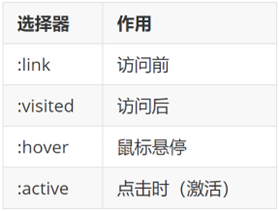

> 提示：如果要给超链接设置以上四个状态，需要按 LVHA 的顺序书写。
>
> 经验：工作中，一个 a 标签选择器设置超链接的样式， hover状态特殊设置

```css
a {
  color: red;
}

a:hover {
  color: green;
}
```

##### 4.1.6.2 其他常用伪类

| 伪类 | 含义 | 常用场景 |
| --- | --- | --- |
| :hover | 鼠标悬停 | 悬停变色、出现遮罩 |
| :active | 鼠标按下 | 按钮按下的效果 |
| :focus | 获得焦点 | 输入框被选中时的样式 |
| :checked | 被选中 | 单选框、多选框选中后的样式 |
| :disabled | 被禁用 | 禁用状态的样式 |
| :not(选择器) | 否定，选中除某个元素之外的元素 | 给「最后一个之外」的 li 统一加间距 |

```css
/* 鼠标按下时 */
button:active {
  color: red;
}

/* 输入框获得焦点时 */
input:focus {
  border-color: skyblue;
}

/* 多选框被选中时的样式 */
input:checked {
  outline: 2px solid red;
}
```

> 提示：伪类可以连写，例如 a:hover、div:hover::after（悬停时改变伪元素的内容）。

### 4.2 CSS 三大特性

CSS特性：化简代码 / 定位问题，并解决问题

* 继承性
* 层叠性
* 优先级

#### 4.2.1 继承性

继承性：子级默认继承父级的**文字控制属性**。

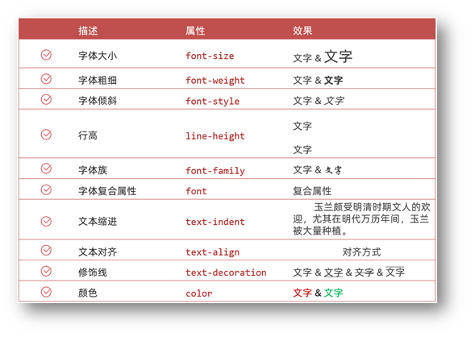

> 注意：如果标签有默认文字样式会继承失败。 例如：a 标签的颜色、标题的字体大小。

常用样式是否可继承：

| 可继承 | 不可继承 |
| --- | --- |
| color、font-family、font-size、font-weight、font-style | width / height、margin、padding、border、background、display |
| line-height、text-align、text-indent、letter-spacing、word-spacing、text-transform | position、top / right / bottom / left、float、clear |
| list-style-type、list-style-position、visibility、cursor | overflow、z-index、opacity |

```html
<style>
  .tag > span {
    color: red;
    font-size: 30px;
    border: 1px solid #000;
  }
</style>

<div class="tag">
  <span>spanA
    <span>spanA1</span>
  </span>
</div>
```

> 分析：`border` 只加在直接子元素 spanA 上，spanA1 没有边框，说明 **border 不可继承**；但 spanA1 的文字是红色的，说明 **color 可以继承**。这就是「子元素看起来也有父级样式」的原因。

#### 4.2.2 层叠性

特点：

* 相同的属性会覆盖：**后面的 CSS 属性覆盖前面的 CSS 属性**
* 不同的属性会叠加：**不同的 CSS 属性都生效**

```html
<style>
  div {
    color: red;
    font-weight: 700;
  }
  div {
    color: green;
    font-size: 30px;
  }
</style>

<div>div 标签</div>
```

> 注意：选择器类型相同则遵循层叠性，否则按选择器优先级判断。

#### 4.2.3 优先级

优先级：也叫权重，当一个标签**使用了多种选择器时**，基于不同种类的选择器的**匹配规则**。

```html
<style>
  div {
    color: red;
  }
  .box {
    color: green;
  }
</style>

<div class="box">div 标签</div>
```

##### 4.2.3.1 基础选择器

规则：选择器**优先级高的样式生效**。

公式：**通配符选择器 < 标签选择器 < 类选择器 < id选择器 < 行内样式 < !important**

​           **（选中标签的范围越大，优先级越低）**

##### 4.2.3.2 复合选择器（叠加）

叠加计算：如果是复合选择器，则需要**权重叠加**计算。

公式：（每一级之间不存在进位）

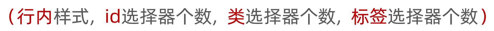

规则：

* 从左向右依次比较选个数，同一级个数多的优先级高，如果个数相同，则向后比较
* **!important 权重最高**
* 继承权重最低

### 4.3 Emmet 写法

Emmet写法：代码的**简写**方式，输入缩写 VS Code 会自动生成对应的代码。

* HTML标签

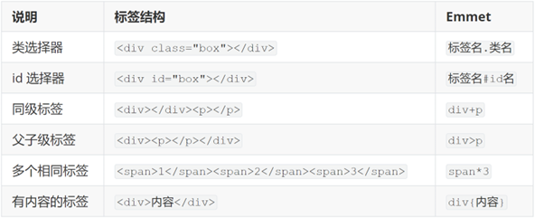

* CSS：大多数简写方式为属性单词的**首字母**

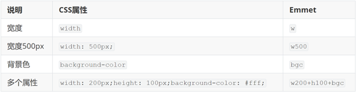

### 4.4 背景属性

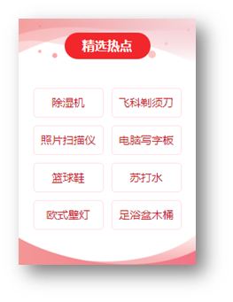

#### 4.4.1 背景图

网页中，使用背景图实现装饰性的图片效果。

* 属性名：**background-image**（bgi）
* 属性值：url(背景图 URL)

```css
div {
  width: 400px;
  height: 400px;

  background-image: url(./images/1.png);
}
```

> 提示：背景图默认有**平铺（复制）效果**。

#### 4.4.2 平铺方式

属性名：**background-repeat**（bgr）

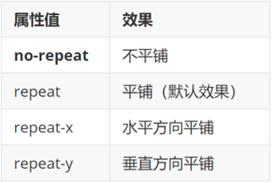

```css
div {
  width: 400px;
  height: 400px;
  background-color: pink;
  background-image: url(./images/1.png);

  background-repeat: no-repeat;
}
```

#### 4.4.3 背景图位置

属性名：**background-position**（bgp）

属性值：水平方向位置 垂直方向位置

* 关键字

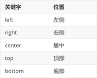

* 坐标
  * 水平：正数向右；负数向左
  * 垂直：正数向下；负数向上

```css
div {
  width: 400px;
  height: 400px;
  background-color: pink;
  background-image: url(./images/1.png);
  background-repeat: no-repeat;

  background-position: center bottom;
  background-position: 50px -100px;
  background-position: 50px center;
}
```

> 提示：
>
> * 关键字取值方式写法，可以颠倒取值顺序
> * 可以只写一个关键字，另一个方向默认为居中；数字只写一个值表示水平方向，垂直方向为居中

#### 4.4.4 背景图缩放

作用：设置背景图大小

属性名：**background-size**（bgz）

常用属性值：

* 关键字
  *  cover：等比例缩放背景图片以完全覆盖背景区，可能背景图片部分看不见
  * contain：等比例缩放背景图片以完全装入背景区，可能背景区部分空白

* 百分比：根据盒子尺寸计算图片大小
* 数字 + 单位（例如：px）

```css
div {
  width: 500px;
  height: 400px;
  background-color: pink;
  background-image: url(./images/1.png);
  background-repeat: no-repeat;

  background-size: cover;
  background-size: contain;
}
```

> 提示：工作中，**图片比例与盒子比例相同**，使用 cover 或 contain 缩放背景图效果相同。

#### 4.4.5 背景图固定

作用：背景不会随着元素的内容滚动。

属性名：**background-attachment**（bga）

属性值：**fixed**

```css
body {
  background-image: url(./images/bg.jpg);
  background-repeat: no-repeat;
  background-attachment: fixed;
}
```

#### 4.4.6 背景复合属性

属性名：**background**（bg）

属性值：背景色 背景图 背景图平铺方式 背景图位置/背景图缩放  背景图固定（**空格隔开各个属性值，不区分顺序**）

```css
div {
  width: 400px;
  height: 400px;

  background: pink url(./images/1.png) no-repeat right center/cover;
}
```

### 4.5 显示模式

显示模式：标签（元素）的显示方式。


作用：布局网页的时候，根据标签的显示模式选择合适的标签摆放内容。

#### 4.5.1 块级元素

特点：

* 独占一行
* 宽度默认是父级的100%
* 添加宽高属性生效

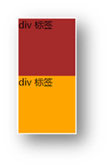

#### 4.5.2 行内元素

特点：

* 一行可以显示多个
* 设置宽高属性不生效
* 宽高尺寸由内容撑开

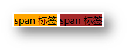

#### 4.5.3 行内块元素

特点：

* 一行可以显示多个
* 设置宽高属性生效
* 宽高尺寸也可以由内容撑开

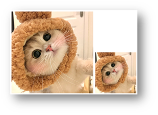

#### 4.5.4 转换显示模式

属性：**display**

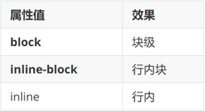

#### 4.5.5 元素显示与隐藏

| 属性 | 效果 | 是否占位置 | 能否过渡动画 |
| --- | --- | --- | --- |
| display: none | 元素隐藏，好像不存在一样 | 不占位 | 不能 |
| visibility: hidden | 元素隐藏，位置上留一块空白 | 占位 | 不能 |
| opacity: 0 | 元素完全透明，看不见但仍在那里 | 占位 | 可以（配合 transition） |

```css
.box1 {
  display: none;
}

.box2 {
  visibility: hidden;
}

/* 鼠标悬停时缓慢显示 */
.box3 {
  opacity: 0;
  transition: all 0.5s;
}

.box3:hover {
  opacity: 1;
}
```

> 经验：display 在 none 和 block 之间切换时会**脱离标准流并重新计算布局**，做不了淡入淡出；要实现淡入淡出效果就用 **opacity**。

### 4.6 列表属性

`list-style-type` 用来设置列表项标记的样式：

| 取值 | 效果 |
| --- | --- |
| disc | 实心圆点（无序列表默认值） |
| circle | 空心圆点 |
| square | 实心方块 |
| decimal | 数字 1、2、3（有序列表默认值） |
| lower-roman / upper-roman | 小写 / 大写罗马数字 |
| lower-alpha / upper-alpha | 小写 / 大写英文字母 |
| none | 不显示标记 |

```css
ul {
  list-style-type: square;
}

ol {
  list-style-type: lower-alpha;
}

/* 实际开发最常用：去掉列表默认的项目符号 */
ul {
  list-style: none;
}
```

> 提示：`list-style` 是复合属性，可以同时设置类型、位置和标记图片。最常见的用法就是 `list-style: none;`，去掉项目符号后再用其他方式美化。

<a id="ch05"></a>

## 5. 盒子模型

> 目标：掌握盒子模型组成部分，使用盒子模型布局网页区域

### 5.1 结构伪类选择器

#### 5.1.1 基本使用

作用：根据元素的**结构关系**查找元素。

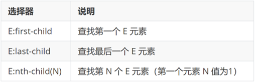

```css
li:first-child {
  background-color: green;
}
```

#### 5.1.2 :nth-child(公式)

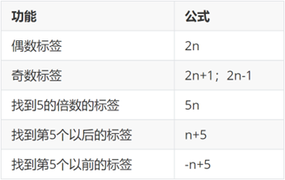

> 提示：公式中的n取值从 **0** 开始。

#### 5.1.3 :nth-child 与 :nth-of-type 的区别

| 选择器 | 查找方式 |
| --- | --- |
| :nth-child(n) | 先找父级的**第 n 个子元素**，再判断它是不是指定的标签，是才生效 |
| :nth-of-type(n) | 先按**标签类型**分组，再找同类型标签中的第 n 个 |

```html
<style>
  /* 找第 2 个子元素，如果它是 p 标签才生效 */
  p:nth-child(2) {
    color: red;
  }

  /* 找同类型（p 标签）中的第 2 个，一定生效 */
  p:nth-of-type(2) {
    color: green;
  }
</style>

<div class="box">
  <span>span1</span>
  <p>p1</p>
  <p>p2</p>
</div>
```

> 提示：结构伪类还有 :first-of-type、:last-of-type、:only-child（父级唯一的子元素）等，用法与同类型的写法一致。

### 5.2 伪元素选择器

作用：创建**虚拟元素**（伪元素），用来**摆放装饰性的内容**。

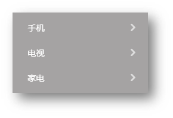

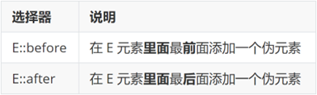

```css
div::before {
  content: "before 伪元素";
}
div::after {
  content: "after 伪元素";
}
```

注意点：

* 必须设置 **content: ””属性**，用来 设置伪元素的内容，如果没有内容，则**引号留空**即可
* 伪元素默认是**行内**显示模式
* **权重和标签选择器相同**

#### 5.2.1 其他常用伪元素

| 伪元素 | 作用 |
| --- | --- |
| ::before | 在元素内容的**最前面**添加内容 |
| ::after | 在元素内容的**最后面**添加内容 |
| ::first-letter | 选中第一个字 |
| ::first-line | 选中第一行文字 |
| ::selection | 鼠标划选文字时的样式 |
| ::placeholder | 输入框提示文字的样式 |

```css
/* 划选文字时，文字变白、背景变蓝 */
::selection {
  background-color: blue;
  color: #fff;
}

/* 修改提示文字的颜色 */
input::placeholder {
  color: #999;
}
```

> 注意：::before 和 ::after 前面写**两个冒号**（CSS2 时代是一个冒号），两个冒号是更规范的写法。

### 5.3 PxCook 标注工具

PxCook（像素大厨） 是一款切图设计工具软件。支持PSD文件的文字、颜色、距离自动智能识别。

* 开发面板（自动智能识别）
* 设计面板（手动测量尺寸和颜色）

使用方法：创建项目 → 输入 项目名称、项目类型 Web → 单击按钮【创建项目】 → 单击按钮【添加】，导入设计稿

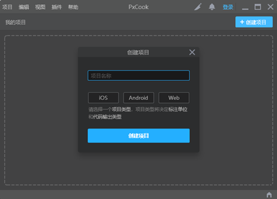

### 5.4 盒子模型

作用：布局网页，摆放盒子和内容。

#### 5.4.1 盒子模型的组成

* 内容区域 – width & height
* 内边距 – padding（出现在内容与盒子边缘之间）
* 边框线 – border
* 外边距 – margin（出现在盒子外面）

```css
div {
  margin: 50px;
  border: 5px solid brown;
  padding: 20px;
  width: 200px;
  height: 200px;
  background-color: pink;
}
```

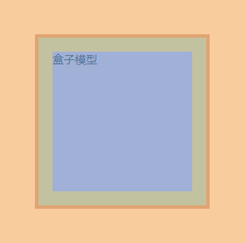

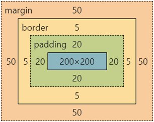

#### 5.4.2 边框线

##### 5.4.2.1 四个方向

属性名：**border**（bd）

属性值：边框线粗细  线条样式  颜色（不区分顺序）

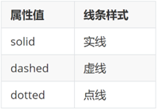

```css
div {
  border: 5px solid brown;
  width: 200px;
  height: 200px;
  background-color: pink;
}
```

##### 5.4.2.2 单方向边框线

属性名：**border-方位名词**（bd+方位名词首字母，例如，bdl）

属性值：边框线粗细  线条样式  颜色（不区分顺序）

```css
div {
  border-top: 2px solid red;
  border-right: 3px dashed green;
  border-bottom: 4px dotted blue;
  border-left: 5px solid orange;
  width: 200px;
  height: 200px;
  background-color: pink;
}
```

#### 5.4.3 内边距

作用：设置 内容 与 盒子边缘 之间的距离。

* 属性名：padding / padding-方位名词

```css
div {
  /* 四个方向 内边距相同 */
  padding: 30px;
  /* 单独设置一个方向内边距 */
  padding-top: 10px;
  padding-right: 20px;
  padding-bottom: 40px;
  padding-left: 80px;
  width: 200px;
  height: 200px;
  background-color: pink;
}
```

> 提示：添加 padding 会撑大盒子。

* padding 多值写法

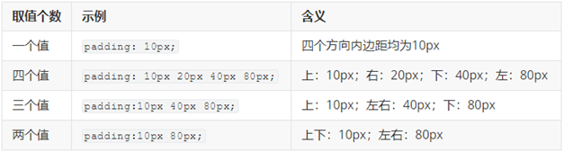

> 技巧：从**上**开始**顺时针**赋值，当前方向没有数值则与**对面取值相同**。

#### 5.4.4 盒子尺寸计算


默认情况：盒子尺寸 = 内容尺寸 + border 尺寸 + 内边距尺寸

结论：给盒子加 border / padding 会撑大盒子

解决：

* 手动做减法，减掉 border / padding 的尺寸
* 內减模式：**box-sizing: border-box**

#### 5.4.5 尺寸的常见设置

| 属性 | 说明 |
| --- | --- |
| width / height | 盒子的宽高 |
| min-width / min-height | 最小宽高，内容再多也不会小于这个值 |
| max-width / max-height | 最大宽高，内容再少也不会大于这个值 |

```css
div {
  /* 高度不写，交给内容撑开 */
  min-height: 100px;
  /* 版心：最大宽度 1226px，屏幕变小时跟着缩小 */
  max-width: 1226px;
  margin: 0 auto;
}
```

> 经验：
>
> * 盒子宽度固定、高度由内容决定时，**只写 width 不写 height**，避免内容变多时溢出
> * 版心用 **max-width + margin: 0 auto** 比写死 width 更适合响应式

#### 5.4.6 外边距

作用：拉开两个盒子之间的距离

属性名：**margin**

提示：与 padding 属性值写法、含义相同

#### 5.4.7 版心居中


左右 margin 值 为 auto（盒子要有宽度）

```css
div {
  margin: 0 auto;
  width: 1000px;
  height: 200px;
  background-color: pink;
}
```

#### 5.4.8 清除默认样式


清除标签默认的样式，比如：默认的内外边距。


```css
/* 清除默认内外边距 */
* {
  margin: 0;
  padding: 0;
  box-sizing: border-box;
}
/* 清除列表项目符号 */
li {
  list-style: none;
}
```

#### 5.4.9 清除默认样式的补充写法

除内外边距外，这些标签的默认样式也建议一起清除：

```css
/* 清除列表的项目符号 */
ul, ol {
  list-style: none;
}

/* 清除 a 标签的下划线，颜色继承父级 */
a {
  text-decoration: none;
  color: inherit;
}

/* 去掉图片底部默认的空白间隙 */
img {
  vertical-align: middle;
}

/* 表单控件重置：去掉默认边框、背景和轮廓线，并继承文字样式 */
input, button, textarea {
  border: none;
  background: none;
  font-family: inherit;
  color: inherit;
}

/* 去掉输入框获得焦点时的轮廓线 */
input:focus {
  outline: none;
}
```

> 提示：
>
> * 图片默认是行内块元素，底部的空白间隙是**基线对齐**造成的，设置 vertical-align 或 display: block 都可以去掉
> * outline 不建议全局清除，只针对输入框处理更稳妥，否则键盘 Tab 切换焦点时用户看不出焦点在哪
> * 项目符号还可以用 **list-style-type** 单独设置，例如 decimal（数字）、lower-alpha（小写字母）

#### 5.4.10 元素溢出

作用：控制溢出元素的内容的显示方式。

属性名：**overflow**


#### 5.4.11 单行与多行文字溢出省略号

单行省略号：三个属性配合使用

```css
.box {
  /* 1. 溢出部分隐藏 */
  overflow: hidden;
  /* 2. 文字不换行 */
  white-space: nowrap;
  /* 3. 溢出部分用省略号代替 */
  text-overflow: ellipsis;

  width: 200px;
}
```

多行省略号：使用 webkit 私有属性，移动端常用

```css
.box {
  display: -webkit-box;
  /* 超出几行显示省略号 */
  -webkit-line-clamp: 2;
  /* 排列方向，必须写 */
  -webkit-box-orient: vertical;
  overflow: hidden;
}
```

> 提示：省略号生效的三个条件是「**设置了宽度**、**不换行**（或限制行数）、**溢出隐藏**」，少一个都不生效。

> 经验：新闻列表的标题、商品描述的摘要都靠这个小节实现，是移动端布局里最常见的写法之一。

#### 5.4.12 外边距问题

##### 5.4.12.1 合并现象

场景：**垂直**排列的兄弟元素，上下 **margin** 会**合并**

现象：取两个 margin 中的**较大值生效**


```css
.one {
  margin-bottom: 50px;
}
.two {
  margin-top: 20px;
}
```

##### 5.4.12.2 外边距塌陷

场景：父子级的标签，子级的添加 **上外边距** 会产生**塌陷**问题

现象：**导致父级一起向下移动**

```css
.son {
  margin-top: 50px;
  width: 100px;
  height: 100px;
  background-color: orange;
}
```


解决方法：

* 取消子级margin，父级设置padding
* 父级设置 overflow: hidden
* 父级设置 border-top

#### 5.4.13 行内元素的内外边距

场景：行内元素添加 margin 和 padding，无法改变元素垂直位置

解决方法：给行内元素添加 **line-height** 可以改变垂直位置

```css
span {
  /* margin 和 padding 属性，无法改变垂直位置 */
  margin: 50px;
  padding: 20px;
  /* 行高可以改变垂直位置 */
  line-height: 100px;
}
```

#### 5.4.14 圆角

作用：设置元素的外边框为圆角。

属性名：**border-radius**

属性值：数字+px / 百分比

提示：属性值是圆角半径


* 多值写法


> 技巧：从左上角开始顺时针赋值，当前角没有数值则与对角取值相同。

* 正圆形状：给正方形盒子设置圆角属性值为 **宽高的一半 / 50%**

```css
img {
  width: 200px;
  height: 200px;

  border-radius: 100px;
  border-radius: 50%;
}
```


* 胶囊形状：给长方形盒子设置圆角属性值为 盒子高度的一半

```css
div {
  width: 200px;
  height: 80px;
  background-color: orange;
  border-radius: 40px;
}
```


#### 5.4.15 盒子阴影（拓展）

作用：给元素设置阴影效果

属性名：**box-shadow**

属性值：X 轴偏移量  Y 轴偏移量  模糊半径  扩散半径  颜色  内外阴影

注意：

* X 轴偏移量 和 Y 轴偏移量 必须书写
* 默认是外阴影，内阴影需要添加 inset

```css
div {
  width: 200px;
  height: 80px;
  background-color: orange;
  box-shadow: 2px 5px 10px 0 rgba(0, 0, 0, 0.5) inset;
}
```

<a id="ch06"></a>

## 6. 浮动与 Flex 布局

> 目标：熟练使用 Flex 完成结构化布局

### 6.1 标准流

标准流也叫文档流，指的是标签在页面中**默认的排布规则**，例如：块元素独占一行，行内元素可以一行显示多个。


#### 6.1.1 脱标（脱离文档流）

元素一旦**浮动**或**定位**，就可能脱离标准流的排布规则，称为**脱标**：

| 方式 | 是否脱标 | 说明 |
| --- | --- | --- |
| float: left / right | 半脱离 | 元素浮起来，不占标准流位置，但文字会环绕它 |
| position: absolute / fixed | 完全脱离 | 不占标准流位置，后面的元素会直接补上来 |
| position: relative | 不脱标 | 仍保留原来的位置，只是视觉上发生偏移 |

> 提示：脱标元素可能互相遮挡，用 `z-index` 控制层叠顺序；清除浮动就是为了解决子元素浮动后父元素**高度塌陷**的问题。

### 6.2 浮动

#### 6.2.1 基本使用

作用：让块元素水平排列。

属性名：**float**

属性值

* **left**：左对齐
* **right**：右对齐

```html
<style>
  /* 特点：顶对齐；具备行内块显示模式特点；浮动的盒子会脱标 */
  .one {
    width: 100px;
    height: 100px;
    background-color: brown;

    float: left;
  }

  .two {
    width: 200px;
    height: 200px;
    background-color: orange;

    /* float: left; */

    float: right;
  }
</style>

<div class="one">one</div>
<div class="two">two</div>
```

特点：

* 浮动后的盒子**顶对齐**
* 浮动后的盒子具备**行内块**特点
* 浮动后的盒子**脱标**，**不占用标准流的位置**

#### 6.2.2 产品区域布局


##### 6.2.2.1 HTML 结构

```html
<!-- 版心：左右，右面：8个产品 → 8个 li -->
<div class="product">
  <div class="left"></div>
  <div class="right">
    <ul>
      <li></li>
      <li></li>
      <li></li>
      <li></li>
      <li></li>
      <li></li>
      <li></li>
      <li></li>
    </ul>
  </div>
</div>
```

##### 6.2.2.2 CSS 样式

```html
<style>
  * {
    margin: 0;
    padding: 0;
  }

  li {
    list-style: none;
  }

  .product {
    margin: 50px auto;
    width: 1226px;
    height: 628px;
    background-color: pink;
  }

  .left {
    float: left;
    width: 234px;
    height: 628px;
    background-color: skyblue;
  }

  .right {
    float: right;
    width: 978px;
    height: 628px;
    background-color: brown;
  }

  .right li {
    float: left;
    margin-right: 14px;
    margin-bottom: 14px;
    width: 234px;
    height: 300px;
    background-color: orange;
  }

  /* 第四个li和第八个li 去掉右侧的margin */
  .right li:nth-child(4n) {
    margin-right: 0;
  }

  /* 细节：如果父级宽度不够，浮动的盒子会掉下来 */
</style>
```

#### 6.2.3 清除浮动

场景：浮动元素会脱标，如果**父级没有高度**，**子级无法撑开父级高度**（可能导致页面布局错乱）

解决方法：**清除浮动**（清除浮动带来的影响）

##### 6.2.3.1 场景搭建


```html
<style>
  .top {
    margin: 10px auto;
    width: 1200px;
    /* height: 300px; */
    background-color: pink;
  }

  .left {
    float: left;
    width: 200px;
    height: 300px;
    background-color: skyblue;
  }

  .right {
    float: right;
    width: 950px;
    height: 300px;
    background-color: orange;
  }

  .bottom {
    height: 100px;
    background-color: brown;
  }

</style>

<div class="top">
  <div class="left"></div>
  <div class="right"></div>
</div>
<div class="bottom"></div>
```

##### 6.2.3.2 额外标签法

在**父元素内容的最后**添加一个**块级**元素，设置 CSS 属性 **clear: both**

```html
<style>
.clearfix {
  clear: both;
}
</style>

<div class="father">
  <div class="left"></div>
  <div class="right"></div>
  <div class="clearfix"></div>
</div>
```

##### 6.2.3.3 单伪元素法

1. 准备 after 伪元素

```css
.clearfix::after {
  content: "";
  display: block;
  clear: both;
}
```

2. 父级使用 clearfix 类

```html
<div class="father clearfix"></div>
```

##### 6.2.3.4 双伪元素法

1. 准备 after 和 before 伪元素

```css
/* before 解决外边距塌陷问题 */
/* 双伪元素法 */
.clearfix::before,
.clearfix::after {
  content: "";
  display: table;
}

/* after 清除浮动 */
.clearfix::after {
  clear: both;
}
```

2. 父级使用 clearfix 类

```html
<div class="father clearfix"></div>
```

##### 6.2.3.5 overflow 法

```css
.father {
  margin: 10px auto;
  width: 1200px;
  /* height: 300px; */
  background-color: pink;

  overflow: hidden;
}
```

### 6.3 Flex 布局

Flex 布局也叫**弹性布局**，是浏览器**提倡的布局模型**，非常适合**结构化**布局，提供了强大的空间分布和对齐能力。

Flex 模型不会产生浮动布局中脱标现象，布局网页更简单、更灵活。


#### 6.3.1 Flex 组成

设置方式：给**父**元素设置 **display: flex**，子元素可以自动挤压或拉伸

组成部分：

* 弹性容器
* 弹性盒子
* 主轴：默认在**水平**方向
* 侧轴 / 交叉轴：默认在**垂直**方向


#### 6.3.2 主轴对齐方式

属性名：**justify-content**

主轴对齐方式（justify-content）取值：

| 取值 | 效果 |
| --- | --- |
| flex-start | 从主轴起点开始排列（默认） |
| center | 沿主轴居中 |
| flex-end | 从主轴终点开始排列 |
| space-between | 两端对齐，中间等分剩余空间 |
| space-around | 每个盒子**两侧**间距相同 |
| space-evenly | 所有盒子之间的间距**完全相等** |

#### 6.3.3 侧轴对齐方式

* align-items：当前弹性容器内**所有**弹性盒子的侧轴对齐方式（给**弹性容器**设置）
* align-self：单独控制**某个弹性盒子**的侧轴对齐方式（给**弹性盒子**设置）


侧轴对齐方式取值（align-items）：

| 取值 | 效果 |
| --- | --- |
| stretch | 拉伸（默认，弹性盒子不写高度时被拉伸到和父级一样高） |
| flex-start | 侧轴起点 |
| center | 侧轴居中 |
| flex-end | 侧轴终点 |
| baseline | 第一行文字的基线对齐 |

> 经验：**让盒子垂直居中最省事的写法**就是给弹性容器加 `align-items: center`。

#### 6.3.4 修改主轴方向

**主轴默认在水平方向，侧轴默认在垂直方向**

属性名：**flex-direction**


#### 6.3.5 弹性伸缩比

作用：控制弹性盒子的主轴方向的尺寸。

属性名：**flex**

属性值：整数数字，表示占用**父级剩余尺寸的份数**。

#### 6.3.6 flex 属性的完整写法

flex 是三个属性的简写：

| 属性 | 作用 | 默认值 |
| --- | --- | --- |
| flex-grow | 剩余空间的分配份数（放大） | 0（不放大） |
| flex-shrink | 空间不足时的缩小比例 | 1（等比缩小） |
| flex-basis | 在主轴方向上的初始尺寸 | auto（由内容决定） |

```css
.item {
  /* 依次是 放大倍数 缩小倍数 初始尺寸 */
  flex: 1 1 0%;
}

/* 只写一个值：flex: 1 等价于 flex: 1 1 0%，表示平分剩余空间 */
```

> 经验：实际开发里最常用 **flex: 1**（占满剩余空间）和 **flex: 3 / flex: 7**（按份数分配宽度），很少逐个写三个值。

#### 6.3.7 弹性盒子的排列顺序

属性名：**order**

属性值：整数数字，默认是 0，**数字越小排列越靠前**。

```css
/* 让第 2 个盒子排到最前面 */
li:nth-child(2) {
  order: -1;
}
```

#### 6.3.8 弹性盒子换行

弹性盒子可以自动挤压或拉伸，默认情况下，所有弹性盒子都在一行显示。

属性名：**flex-wrap**

属性值

* wrap：换行
* nowrap：不换行（默认）

#### 6.3.9 行内对齐方式

属性名：**align-content**


> 注意：该属性对**单行**弹性盒子模型**无效**。

#### 6.3.10 弹性盒子之间的间距

属性名：**gap**（也可以拆开写 row-gap / column-gap）

作用：一次性设置弹性盒子之间的间距，不用再给最后一个盒子单独去掉 margin。

```css
.box {
  display: flex;
  /* 弹性盒子之间的间距 */
  gap: 10px;
  /* 两个值：第一个是行间距，第二个是列间距 */
  gap: 10px 20px;
}
```

> 提示：gap 只在 **flex 布局**（或 grid 布局）里生效，写在普通标准流的父级上是无效的。

> 经验：以前要写 `li { margin-right: 10px }` 再加一条 `li:nth-child(4n) { margin-right: 0 }` 去掉最后一列的间距，现在直接在父级写 gap 就够了。

<a id="ch07"></a>

## 7. CSS 高级技巧

> 目标：掌握定位的作用及特点；掌握 CSS 高级技巧

### 7.1 定位

作用：灵活的改变盒子在网页中的位置

实现：

1.定位模式：position

2.边偏移：设置盒子的位置

* left
* right
* top
* bottom

#### 7.1.1 相对定位

**position: relative**

特点：

* 不脱标，占用自己原来位置
* 显示模式特点保持不变
* 设置边偏移则相对自己原来位置移动

```css
div {
  position: relative;
  top: 100px;
  left: 200px;
}
```

#### 7.1.2 绝对定位

**position: absolute**

使用场景：子级绝对定位，父级相对定位（**子绝父相**）

特点：

* 脱标，不占位
* 显示模式具备行内块特点
* 设置边偏移则相对最近的已经定位的祖先元素改变位置
* 如果祖先元素都未定位，则相对浏览器可视区改变位置

```css
.father {
  position: relative;
}

.father span {
  position: absolute;
  top: 0;
  right: 0;
}
```

#### 7.1.3 定位居中


实现步骤：

1. 绝对定位
2. 水平、垂直边偏移为 50%
3. 子级向左、上移动自身尺寸的一半

* 左、上的外边距为 –尺寸的一半
* transform: translate(-50%, -50%)

```css
img {
  position: absolute;
  left: 50%;
  top: 50%;

  /* margin-left: -265px;
  margin-top: -127px; */

  /* 方便： 50% 就是自己宽高的一半 */
  transform: translate(-50%, -50%);
}
```

#### 7.1.4 固定定位

**position: fixed**

场景：元素的位置在网页滚动时不会改变

特点：

* 脱标，不占位
* 显示模式具备行内块特点
* 设置边偏移相对浏览器窗口改变位置

```css
div {
  position: fixed;
  top: 0;
  right: 0;

  width: 500px;
}
```

#### 7.1.5 粘性定位

**position: sticky**

场景：元素滚动到指定位置之前跟随标准流，到达后**固定住**，最典型的应用是导航栏吸顶。

特点：

* 不脱标，占有原来的位置
* 以**最近的有滚动条的祖先元素**（一般是浏览器可视区）为参照
* 必须设置 top / bottom / left / right 中的**至少一个**，否则不生效
* 只能在父级范围内粘住，父级滚动到底部时它会跟着走

```css
.nav {
  position: sticky;
  /* 距离顶部 0 的位置吸附住 */
  top: 0;

  height: 50px;
  background-color: pink;
  z-index: 1;
}
```

> 注意：祖先元素设置了 **overflow: hidden / auto / scroll** 时，粘性定位会失效。

#### 7.1.6 堆叠层级 z-index


默认效果：按照标签书写顺序，后来者居上

作用：设置定位元素的层级顺序，改变定位元素的显示顺序

属性名：**z-index**

属性值：**整数数字**（默认值为0，取值越大，层级越高）

```css
.box1 {
  background-color: pink;
  /* 取值是整数，默认是0，取值越大显示顺序越靠上 */
  z-index: 1;
}

.box2 {
  background-color: skyblue;
  left: 100px;
  top: 100px;

  z-index: 2;
}
```

### 7.2 精灵图与字体图标

#### 7.2.1 CSS 精灵图

CSS 精灵，也叫 **CSS Sprites**，是一种网页**图片应用处理方式**。把网页中**一些背景图片**整合到**一张图片**文件中，再**background-position** 精确的定位出背景图片的位置。


优点：减少服务器被请求次数，减轻服务器的压力，提高页面加载速度


实现步骤：

1. 创建盒子，**盒子尺寸**与**小图**尺寸**相同**
2. 设置盒子**背景图**为精灵图
3. 添加 **background-position** 属性，改变**背景图位置**

​       3.1 使用 PxCook 测量小图片**左上角坐标**

​       3.2 取**负数**坐标为 background-position 属性值（向左上移动图片位置）

#### 7.2.2 字体图标


字体图标：**展示的是图标，本质是字体**

作用：在网页中添加**简单的、颜色单一**的小图标

优点

* **灵活性**：灵活地修改样式，例如：尺寸、颜色等
* **轻量级**：体积小、渲染快、降低服务器请求次数
* **兼容性**：几乎兼容所有主流浏览器
* **使用方便**：先下载再使用

##### 7.2.2.1 下载字体

iconfont 图标库：<https://www.iconfont.cn/>

登录 → 素材库 → 官方图标库 → 进入图标库 → 选图标，加入购物车 → 购物车，添加至项目，确定 → 下载至本地


##### 7.2.2.2 使用字体

1. 引入字体样式表（iconfont.css）


2. 标签使用字体图标类名
   * iconfont：字体图标基本样式（字体名，字体大小等等）
   * icon-xxx：图标对应的类名


##### 7.2.2.3 上传矢量图

作用：项目特有的图标上传到 iconfont 图标库，生成字体


上传步骤：上传 → 上传图标 → 选择 svg 矢量图，打开 → 提交 → 系统审核

### 7.3 CSS 修饰属性

#### 7.3.1 垂直对齐方式


属性名：vertical-align


#### 7.3.2 过渡

作用：可以为一个元素在不同状态之间切换的时候添加**过渡效果**

属性名：**transition（复合属性）**

属性值：**过渡的属性  花费时间 (s)**

提示：

* 过渡的属性可以是具体的 CSS 属性
* 也可以为 all（两个状态属性值不同的所有属性，都产生过渡效果）
* transition 设置给元素本身

```css
img {
  width: 200px;
  height: 200px;
  transition: all 1s;
}

img:hover {
  width: 500px;
  height: 500px;
}
```

过渡的拆分写法：

| 属性 | 作用 |
| --- | --- |
| transition-property | 过渡的属性，all 表示所有属性 |
| transition-duration | 花费时间，单位 s / ms，**必须写** |
| transition-timing-function | 速度曲线，默认 ease |
| transition-delay | 延迟时间，默认 0s |

速度曲线常用取值：

| 取值 | 效果 |
| --- | --- |
| linear | 匀速 |
| ease | 慢 → 快 → 慢（默认） |
| ease-in | 慢速开始 |
| ease-out | 慢速结束 |
| ease-in-out | 慢速开始和结束 |
| steps(n) | 分 n 步完成（配合精灵动画使用） |
| cubic-bezier(n,n,n,n) | 自定义速度曲线 |

```css
.box {
  /* 顺序：属性  时长  速度曲线  延迟 */
  transition: width 2s linear 0.5s;

  /* 多个属性用逗号隔开 */
  transition: width 2s, height 1s;
}
```

> 技巧：拿不准用什么速度曲线时，可以在浏览器调试工具里点击 transition 属性前面的小图标，可视化拖动调整。

#### 7.3.3 透明度 opacity

作用：设置**整个元素的透明度**（包含背景和内容）

属性名：opacity

属性值：0 – 1

* 0：完全透明（元素不可见）
* 1：不透明
* 0-1之间小数：半透明

#### 7.3.4 光标类型 cursor

作用：鼠标悬停在元素上时指针显示样式

属性名：cursor


#### 7.3.5 CSS 三角形

原理：盒子的边框线在四个角相接的地方是**斜线**，把盒子的宽高设为 0，只保留一个方向的边框，剩下的就是一个三角形。

```css
div {
  width: 0;
  height: 0;
  /* 上边框有颜色，其他三个方向透明，得到一个向下的三角形 */
  border-top: 50px solid pink;
  border-right: 50px solid transparent;
  border-bottom: 50px solid transparent;
  border-left: 50px solid transparent;
}
```

> 提示：三角形的方向由**有色边框的方向**决定 —— border-top 有颜色得到的是**向下**的三角形，三角形的高就是这个方向边框的宽度。

> 经验：常见场景是气泡框的小尖角，也可以再配合 transform: rotate() 做成下拉菜单的箭头。

#### 7.3.6 文字阴影（拓展）

属性名：**text-shadow**

属性值：X 轴偏移量  Y 轴偏移量  模糊半径  颜色

```css
h1 {
  /* 前两个值必须写，模糊半径和颜色可以省略 */
  text-shadow: 2px 2px 5px rgba(0, 0, 0, 0.3);

  /* 多重阴影：用逗号隔开 */
  text-shadow: 2px 2px 5px pink, -2px -2px 5px skyblue;
}
```

---

# 第三部分 · 移动 Web 开发

<a id="ch08"></a>

## 8. 2D 转换与渐变

> 目标：使用位移、缩放、旋转、渐变效果丰富网页元素的呈现方式。

### 8.1 平面转换

#### 8.1.1 简介

作用：为元素添加动态效果，一般与过渡配合使用

概念：改变盒子在平面内的形态（位移、旋转、缩放、倾斜）


> 提示：
>
> * transform 只改变元素的**视觉呈现**，不影响其他元素的位置
> * transform 对**行内元素无效**，需要先用 display 转成块级或行内块元素
> * 多个转换连写时**顺序会影响结果**，所以多重转换要「先平移再旋转」

平面转换也叫 2D 转换，属性是 **transform**

#### 8.1.2 平移

```css
transform: translate(X轴移动距离, Y轴移动距离);
```

* 取值
  * 像素单位数值
  * 百分比（参照**盒子自身尺寸**计算结果）
  * **正负**均可
* 技巧
  * translate() **只写一个值**，表示沿着 **X** 轴移动
  * 单独设置 X 或 Y 轴移动距离：translateX() 或 translateY()

#### 8.1.3 定位居中

* 方法一：margin


* 方法二：平移 → 百分比参照盒子自身尺寸计算结果


#### 8.1.4 旋转

```css
transform: rotate(旋转角度);
```

* 取值：角度单位是 **deg**
* 技巧
  * 取值正负均可
  * 取值为正，顺时针旋转
  * 取值为负，逆时针旋转

#### 8.1.5 转换原点

> 默认情况下，转换原点是盒子中心点

```css
transform-origin: 水平原点位置 垂直原点位置;
```

取值：

* **方位名词**（left、top、right、bottom、center）
* 像素单位数值
* 百分比

#### 8.1.6 多重转换

多重转换技巧：先平移再旋转

```css
transform: translate() rotate();
```

* 多重转换原理：以第一种转换方式坐标轴为准转换形态
  * 旋转会改变网页元素的坐标轴向
  * 先写旋转，则后面的转换效果的轴向以旋转后的轴向为准，会影响转换结果

#### 8.1.7 缩放

```css
transform: scale(缩放倍数);
transform: scale(X轴缩放倍数, Y轴缩放倍数);
```

* 技巧
  * 通常，只为 scale() 设置一个值，表示 X 轴和 Y 轴等比例缩放
  * 取值大于1表示放大，取值小于1表示缩小

#### 8.1.8 倾斜

```css
transform: skew();
```

取值：角度度数 deg

### 8.2 渐变

渐变是多个颜色逐渐变化的效果，一般用于设置盒子背景

分类：

* 线性渐变


* 径向渐变


#### 8.2.1 线性渐变

```css
background-image: linear-gradient(
  渐变方向,
  颜色1 终点位置,
  颜色2 终点位置,
  ......
);
```

取值：

* 渐变方向：可选
  * to 方位名词
  * 角度度数
* 终点位置：可选
  * 百分比

#### 8.2.2 径向渐变

```css
background-image: radial-gradient(
  半径 at 圆心位置,
  颜色1 终点位置,
  颜色2 终点位置,
  ......
);
```

取值：

* 半径可以是2条，则为椭圆
* 圆心位置取值：像素单位数值 / 百分比 / 方位名词

<a id="ch09"></a>

## 9. 3D 转换与动画

### 9.1 空间转换

#### 9.1.1 空间转换简介

* 空间：是从坐标轴角度定义的 X 、Y 和 Z 三条坐标轴构成了一个立体空间，Z 轴位置与视线方向相同。
* 空间转换也叫 3D转换
* 属性：transform


#### 9.1.2 平移

 ```css
transform: translate3d(x, y, z);
transform: translateX();
transform: translateY();
transform: translateZ();
 ```

> 取值与平面转换相同
>
> 默认情况下，Z 轴平移没有效果，原因：电脑屏幕默认是平面，无法显示 Z 轴平移效果

#### 9.1.3 视距

作用：指定了观察者与 Z=0 平面的距离，为元素添加透视效果

透视效果：近大远小、近实远虚

属性：(添加给父级，取值范围 800-1200)

```css
perspective: 视距;
```


#### 9.1.4 旋转

* Z 轴：rotateZ()


* X 轴：rotateX()


* Y 轴：rotateY()


#### 9.1.5 左手法则

作用：根据旋转方向确定取值正负

使用：左手握住旋转轴, 拇指指向正值方向, 其他四个手指弯曲方向为旋转正值方向


#### 9.1.6 rotate3d（了解）

* rotate3d(x, y, z, 角度度数) ：用来设置自定义旋转轴的位置及旋转的角度
* x，y，z 取值为0-1之间的数字

#### 9.1.7 立体呈现

作用：设置元素的子元素是位于 3D 空间中还是平面中

属性名：transform-style

属性值：

* flat：子级处于平面中
* preserve-3d：子级处于 3D 空间

#### 9.1.8 缩放

```css
transform: scale3d(x, y, z);
transform: scaleX();
transform: scaleY();
transform: scaleZ();
```

### 9.2 动画

* 过渡：实现两个状态间的变化过程
* 动画：实现多个状态间的变化过程，动画过程可控（重复播放、最终画面、是否暂停）

#### 9.2.1 动画实现步骤

1. 定义动画

```css
/* 方式一 */
@keyframes 动画名称 {
  from {}
  to {}
}

/* 方式二 */
@keyframes 动画名称 {
  0% {}
  10% {}
  ......
  100% {}
}
```

2. 使用动画

```css
animation: 动画名称 动画花费时长;
```

#### 9.2.2 animation 复合属性


提示：

* 动画名称和动画时长必须赋值
* 取值不分先后顺序
* 如果有两个时间值，第一个时间表示动画时长，第二个时间表示延迟时间

#### 9.2.3 animation 拆分写法

常用拆分属性：

| 属性 | 作用 | 常用取值 |
| --- | --- | --- |
| animation-name | 动画名称 | 自定义名称 |
| animation-duration | 动画时长 | 数字 + s / ms，**必须写** |
| animation-timing-function | 速度曲线 | ease、linear、steps(n) |
| animation-delay | 延迟时间 | 数字 + s / ms |
| animation-iteration-count | 播放次数 | 数字、infinite（无限循环） |
| animation-direction | 播放方向 | normal（默认）、alternate（往返）、reverse（反向） |
| animation-fill-mode | 动画结束后的状态 | none（默认）、**forwards**（保留最后一帧）、backwards（第一帧） |
| animation-play-state | 播放状态 | running（默认）、paused（暂停） |

```css
div {
  animation-name: move;
  animation-duration: 2s;
  /* 无限循环、往返播放 */
  animation-iteration-count: infinite;
  animation-direction: alternate;
  /* 动画结束后停在最后一帧，不弹回初始状态 */
  animation-fill-mode: forwards;
}

/* 鼠标悬停时暂停动画 */
div:hover {
  animation-play-state: paused;
}
```

> 经验：**animation-fill-mode: forwards** 是高频搭配，动画停在最后一帧、不要弹回去时全靠它。

#### 9.2.4 精灵动画

* 核心


* 制作步骤

  1.准备显示区域

  盒子尺寸与一张精灵小图尺寸相同

  2.定义动画

  移动背景图（移动距离 = 精灵图宽度）

  3.使用动画

  steps(N)，N 与精灵小图个数相同

```css
div {
  width: 140px;
  height: 140px;
  border: 1px solid #000;
  background-image: url(./images/bg.png);
  animation: run 1s steps(12) infinite;
}

@keyframes run {
  from {
    background-position: 0 0;
  }
  to {
    background-position: -1680px 0;
  }
}
```

#### 9.2.5 多组动画

```css
animation:
  动画一,
  动画二,
  ... ...
;
```

<a id="ch10"></a>

## 10. 移动端适配：rem 与 Less

### 10.1 移动 Web 基础知识

#### 10.1.1 谷歌模拟器

模拟移动设备，方便查看页面效果


#### 10.1.2 屏幕分辨率

分类：

* 物理分辨率：硬件分辨率（出厂设置）
* 逻辑分辨率：软件 / 驱动设置

结论：**制作网页参考 逻辑分辨率**


#### 10.1.3 视口

作用：显示 HTML 网页的区域，用来约束 HTML 的尺寸

```html
<!DOCTYPE html>
<html lang="en">
<head>
  <meta charset="UTF-8">
  <meta http-equiv="X-UA-Compatible" content="IE=edge">

  <!– 视口标签 -->
  <meta name="viewport" content="width=device-width, initial-scale=1.0">

  <title>Document</title>
</head>
<body>

</body>
</html>
```

* width=device-width：视口宽度 = 设备宽度
* initial-scale=1.0：缩放1倍（不缩放）

#### 10.1.4 二倍图

概念：设计稿里面每个元素的尺寸的倍数

作用：防止图片在高分辨率屏幕下模糊失真

使用方法：


#### 10.1.5 适配方案

* 宽度适配：宽度自适应
  * 百分比布局
  * Flex 布局

* 等比适配：宽高等比缩放
  * rem
  * vw

### 10.2 rem 适配

#### 10.2.1 简介

* rem单位，是相对单位
* rem单位是相对于HTML标签的字号计算结果
* 1rem = 1HTML字号大小

> 提示：**em 和 rem 的区别**
>
> * em 相对**当前元素的字号**，父级字号改变时子级会跟着变（逐层累积）
> * rem 相对 **HTML 根标签的字号**，与父级无关，所以移动端适配统一用 rem

#### 10.2.2 媒体查询

媒体查询能够检测视口的宽度，然后编写差异化的 CSS 样式

当某个条件成立, 执行对应的CSS样式


```css
@media (width:320px) {
  html {
    background-color: green;
  }
}
```

#### 10.2.3 rem 布局

目前rem布局方案中，将网页等分成10份， HTML标签的字号为视口宽度的 1/10。


#### 10.2.4 flexible.js

flexible.js 是手淘开发出的一个用来适配移动端的 js 库。

核心原理就是根据不同的视口宽度给网页中 html 根节点设置不同的 font-size。

```html
<body>
  ......
  <script src="./js/flexible.js"></script>
</body>
```

#### 10.2.5 rem 移动适配

rem单位尺寸

1.  确定基准根字号

* 查看设计稿宽度 → 确定参考设备宽度(视口宽度) → 确定基准根字号（1/10视口宽度）

2.  rem单位的尺寸

* **rem单位的尺寸 = px单位数值 / 基准根字号**

### 10.3 Less

Less是一个CSS预处理器, Less文件后缀是.less。扩充了 CSS 语言, 使 CSS 具备一定的逻辑性、计算能力

注意：浏览器不识别 Less 代码，目前阶段，网页要引入对应的 CSS 文件

VS Code 插件：Easy LESS，保存 less文件后自动生成对应的 CSS 文件


#### 10.3.1 注释

* 单行注释
  * 语法：// 注释内容
  * 快捷键：ctrl + /
* 块注释
  * 语法：/* 注释内容 */
  * 快捷键： Shift + Alt + A

#### 10.3.2 运算

* 加、减、乘直接书写计算表达式
* 除法需要添加 小括号 或 .
* 表达式存在多个单位以第一个单位为准


#### 10.3.3 嵌套

作用：快速生成后代选择器


提示：用 & 表示当前选择器，不会生成后代选择器，通常配合伪类或伪元素使用


#### 10.3.4 变量

概念：容器，存储数据

作用：存储数据，方便使用和修改

语法：

* 定义变量：@变量名: 数据;
* 使用变量：CSS属性：@变量名;

```less
// 定义变量
@myColor: pink;
// 使用变量
.box {
  color: @myColor;
}
a {
  color: @myColor;
}
```

#### 10.3.5 混合

作用：把重复的代码片段定义成一个「混合」，在需要的地方调用，还可以传入参数。

* 无参数混合：定义时写成 `.混合名() { }`，调用时写 `.混合名();`
* 有参数混合：定义时在括号里写形参，调用时传实参

```less
// 定义无参数混合（括号必须有，否则混合本身也会被编译成 CSS 里的类）
.rounded() {
  border-radius: 50%;
  border: 1px solid #ccc;
}

// 定义有参数混合
.border(@color) {
  border: 1px solid @color;
}

.box {
  width: 100px;
  height: 100px;
  // 调用混合
  .rounded();
  // 传入参数
  .border(red);
}
```

> 提示：定义混合时加上括号 **()**，混合本身就不会被编译成 CSS 文件里的类选择器，只作为代码片段被调用。

#### 10.3.6 导入

作用：导入 less 公共样式文件

语法：导入: @import “文件路径”;

提示：如果是 less 文件可以省略后缀

```less
@import './base.less';
@import './common';
```

#### 10.3.7 导出

写法：在 less 文件的第一行添加 // out: 存储URL

提示：文件夹名称后面添加 /

```less
// out: ./index.css
// out: ./css/
```

#### 10.3.8 禁止导出

写法：在 less 文件第一行添加:  // out: false


### 10.4 移动端常见问题

#### 10.4.1 1px 边框变粗

在 2 倍 / 3 倍屏上，CSS 里的 1px 会被渲染成 2 ~ 3 个物理像素，看起来比较粗。解决办法是用 **transform 缩放**：

```css
.line::after {
  content: "";
  position: absolute;
  left: 0;
  bottom: 0;
  width: 100%;
  height: 1px;
  background-color: #ccc;
  /* 在 2 倍屏上缩放一半，看起来就是 1 个物理像素 */
  transform: scaleY(0.5);
  transform-origin: bottom;
}
```

#### 10.4.2 点击延迟与点击高亮

* 移动端浏览器为了判断是单击还是双击缩放，默认有约 **300ms 的点击延迟**。加上视口标签 `width=device-width, initial-scale=1.0` 后，现代浏览器会自动去掉这个延迟
* 手机上点击链接、按钮时会出现**灰色高亮**，可以用 -webkit-tap-highlight-color 去掉

```css
a, button {
  /* 去掉点击时的高亮背景 */
  -webkit-tap-highlight-color: transparent;
}
```

#### 10.4.3 输入框聚焦自动放大

iOS 上，输入框的 font-size **小于 16px** 时，聚焦后页面会自动放大。解决办法是把字号写到 16px 及以上：

```css
input, textarea, select {
  font-size: 16px;
}
```

#### 10.4.4 禁止用户选中与长按弹出菜单

```css
body {
  /* 禁止长按选中文字 */
  -webkit-user-select: none;
  user-select: none;
}

img {
  /* 禁止长按弹出系统菜单 */
  -webkit-touch-callout: none;
}
```

#### 10.4.5 隐藏滚动条

```css
/* 隐藏滚动条，但保留滚动效果 */
::-webkit-scrollbar {
  display: none;
}
```

#### 10.4.6 刘海屏适配

全面屏手机顶部有刘海、底部有横条，可以用 **safe-area** 相关变量避开：

```html
<!-- viewport-fit=cover 让页面铺满整个屏幕 -->
<meta name="viewport" content="width=device-width, initial-scale=1.0, viewport-fit=cover">
```

```css
.footer {
  /* 在底部横条上方留出安全距离 */
  padding-bottom: env(safe-area-inset-bottom);
}
```

#### 10.4.7 移动端书写习惯小结

> 经验：
>
> * 布局多用 **flex**，少用浮动
> * 尺寸用 **rem / vw**，不要用 px 写死
> * 图片给 **max-width: 100%**，防止超出屏幕
> * 页面主体不要设固定高度，交给内容撑开

<a id="ch11"></a>

## 11. vw/vh 适配方案

### 11.1 vw 和 vh 基本使用

vw和vh是相对单位，相对视口尺寸计算结果

* vw：viewport width（1vw = 1/100视口宽度 ）
* vh：lviewport height ( 1vh = 1/100视口高度 )

### 11.2 vw 布局

vw单位的尺寸 = px 单位数值 / ( 1/100 视口宽度 )

### 11.3 vw 适配的完整流程

1. 确定设计稿宽度（一般是 375px 或 750px）
2. 计算 1vw 等于多少 px：**1vw = 设计稿宽度 / 100**
3. 元素尺寸换算：**元素的 vw 值 = 设计稿上的 px 数值 / 1vw 的值**

例如设计稿宽度是 375px：

* 1vw = 375 / 100 = 3.75px
* 设计稿上宽 150px 的盒子 → 150 / 3.75 = 40vw

```css
.box {
  /* 设计稿上是 150px */
  width: 40vw;
  /* 设计稿上是 75px */
  height: 20vw;
  font-size: 8vw;
}
```

> 提示：开发中不需要手算，使用 VS Code 插件（例如 cssrem）可以在写 px 时自动换算成 vw / rem。

### 11.4 vmin 与 vmax

| 单位 | 含义 |
| --- | --- |
| vmin | 视口宽度和高度中**较小**的那个的 1/100 |
| vmax | 视口宽度和高度中**较大**的那个的 1/100 |

> 场景：需要兼容横竖屏切换时，用 vmin / vmax 比 vw / vh 更稳定。

### 11.5 vw 与 rem 方案怎么选

| 方案 | 优点 | 缺点 |
| --- | --- | --- |
| rem | 兼容性好，配合 flexible.js 自动计算 | 需要引入 js，字号还要额外处理 |
| vw | 纯 CSS，不需要 js | 低版本安卓（4.4 以下）兼容性差，部分设备有 1px 偏差 |

> 经验：新项目大多直接用 **vw** 适配，需要兼容老安卓的项目仍然使用 **rem + flexible.js**。

### 11.6 vh 问题

vh是1/100视口高度，全面屏视口高度尺寸大，如果混用可能会导致盒子变形

<a id="ch12"></a>

## 12. 响应式布局与 Bootstrap

响应式布局方案

* 媒体查询
* Bootstrap框架

### 12.1 媒体查询

#### 12.1.1 基本写法


* max-width：最大宽度（小于等于）
* min-width：最小宽度（大于等于）

#### 12.1.2 书写顺序

* min-width（从小到大）
* max-width（从大到小）

#### 12.1.3 常用断点

| 设备 | 屏幕宽度 |
| --- | --- |
| 手机 | < 768px |
| 平板 | 768px ~ 992px |
| 中等屏幕（小笔记本） | 992px ~ 1200px |
| 大屏幕（大桌面显示器） | ≥ 1200px |

```css
/* 先写大屏默认样式，再用 max-width 向下覆盖 */
.container {
  width: 1200px;
}

/* 中等屏幕 */
@media (max-width: 1200px) {
  .container { width: 992px; }
}

/* 平板 */
@media (max-width: 992px) {
  .container { width: 768px; }
}

/* 手机 */
@media (max-width: 768px) {
  .container { width: 100%; }
}
```

> 概念：**移动优先** —— 先写小屏幕（手机）的样式，再用 **min-width** 从小到大逐级覆盖大屏幕的样式。这样小屏设备只需要加载基础样式，代码更简洁。

#### 12.1.4 媒体查询：完整写法


##### 12.1.4.1 关键词 / 逻辑操作符

* and
* only
* not

##### 12.1.4.2 媒体类型

媒体类型用来区分设备类型

* screen：屏幕设备
* 打印预览：print
* 阅读器：speech
* 不区分类型：all

##### 12.1.4.3 媒体特性

* 视口宽高：width / height
* 视口最大宽高：max-width ；max-height
* 视口最小宽高：min-width；min-height
* 屏幕方向：orientation
  * protrait：竖屏
  * landscape：横屏

#### 12.1.5 媒体查询：外部 CSS


### 12.2 Bootstrap

#### 12.2.1 简介

Bootstrap 是由 Twitter 公司开发维护的前端 UI 框架，它提供了大量编写好的 CSS 样式，允许开发者结合一定 HTML 结构及JavaScript，快速编写功能完善的网页及常见交互效果。

中文官网: <https://www.bootcss.com/>

#### 12.2.2 使用步骤

##### 12.2.2.1 下载

下载：Bootstrap V5中文文档 → 进入中文文档 → 下载 →下载 Bootstrap 生产文件


##### 12.2.2.2 使用

1. 引入 Bootstrap CSS 文件

```html
<link rel="stylesheet" href="./Bootstrap/css/bootstrap.min.css">
```

2. 调用类名： container 响应式布局版心类

```html
<div class="container">测试</div>
```

#### 12.2.3 栅格系统

作用：响应式布局

栅格化是指将整个网页的宽度分成12等份，每个盒子占用的对应的份数

例如：一行排4个盒子，则每个盒子占 3份 即可（12 / 4 = 3）


* row 类：行，可以让内容在一行排（flex布局）

栅格类名的组成：**col-断点-份数**，不写断点表示所有屏幕都适用。

| 断点 | 类名前缀 | 适用屏幕 |
| --- | --- | --- |
| 超小屏 | col- | < 576px（手机） |
| 小屏 | col-sm- | ≥ 576px |
| 中屏 | col-md- | ≥ 768px（平板） |
| 大屏 | col-lg- | ≥ 992px（桌面） |
| 超大屏 | col-xl- | ≥ 1200px |
| 特大屏 | col-xxl- | ≥ 1400px |

```html
<!-- 手机一行 1 个、平板一行 2 个、桌面一行 4 个 -->
<div class="row">
  <div class="col-12 col-md-6 col-lg-3">盒子 1</div>
  <div class="col-12 col-md-6 col-lg-3">盒子 2</div>
  <div class="col-12 col-md-6 col-lg-3">盒子 3</div>
  <div class="col-12 col-md-6 col-lg-3">盒子 4</div>
</div>
```

> 提示：
>
> * 一行 12 份必须分配完，多出来的列会自动换行
> * 栅格系统要放在 **container** 里面，row 的直接子元素写 col 类名
> * 常用间距类名：`g-数字`（行列间距）、`m-md-3`（断点 + 外边距），需要时查官方文档

#### 12.2.4 全局样式

##### 12.2.4.1 按钮


类名

* btn：默认样式
* btn-success：成功
* btn-warning：警告
* ……
* 按钮尺寸：btn-lg / btn-sm

##### 12.2.4.2 表格


表格类：

* table：默认样式
* table-striped：隔行变色
* table-success：表格颜色
* ……

#### 12.2.5 组件

1.引入样式表

2.引入 js 文件

3.复制结构，修改内容

#### 12.2.6 字体图标

##### 12.2.6.1 下载

导航 / Extend：图标库 → 安装 → 下载安装包 → [bootstrap-icons-1.X.X.zip](https://github.com/twbs/icons/releases/download/v1.10.3/bootstrap-icons-1.10.3.zip)

##### 12.2.6.2 使用

1. 复制 fonts 文件夹到项目目录
2. 网页引入 bootstrap-icons.css 文件
3. 调用 CSS 类名（图标对应的类名）

```html
<i class="bi-android2"></i>
```

---

# 附录 · 章节与原文件对照

| 章节 | 原文件 |
| --- | --- |
| 1. HTML 基础与常用标签 | `day01/day01-HTML基础.md` |
| 2. 列表、表格与表单 | `day02/day02-HTML进阶.md` |
| 3. CSS 基础 | `day03/day03-CSS基础.md` |
| 4. CSS 进阶 | `day04/day04-CSS进阶.md` |
| 5. 盒子模型 | `day05/day05-盒子模型.md` |
| 6. 浮动与 Flex 布局 | `day06/day06-Flex布局.md` |
| 7. CSS 高级技巧 | `day08/day08-CSS高级.md` |
| 8. 2D 转换与渐变 | `day11/移动web第一天.md` |
| 9. 3D 转换与动画 | `day12/移动Web第二天.md` |
| 10. 移动端适配：rem 与 Less | `day13/移动Web第三天.md` |
| 11. vw/vh 适配方案 | `day14/移动Web第四天.md` |
| 12. 响应式布局与 Bootstrap | `day15/移动Webday05.md` |
