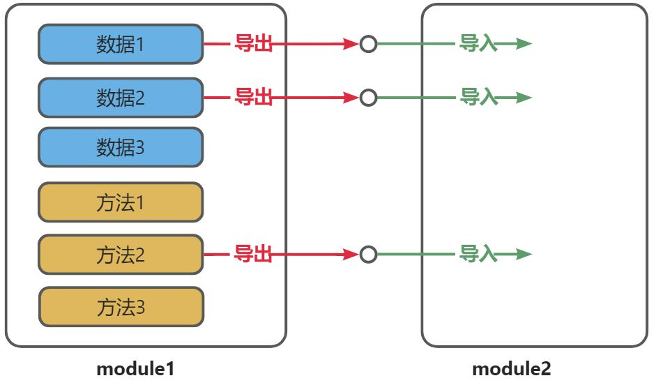
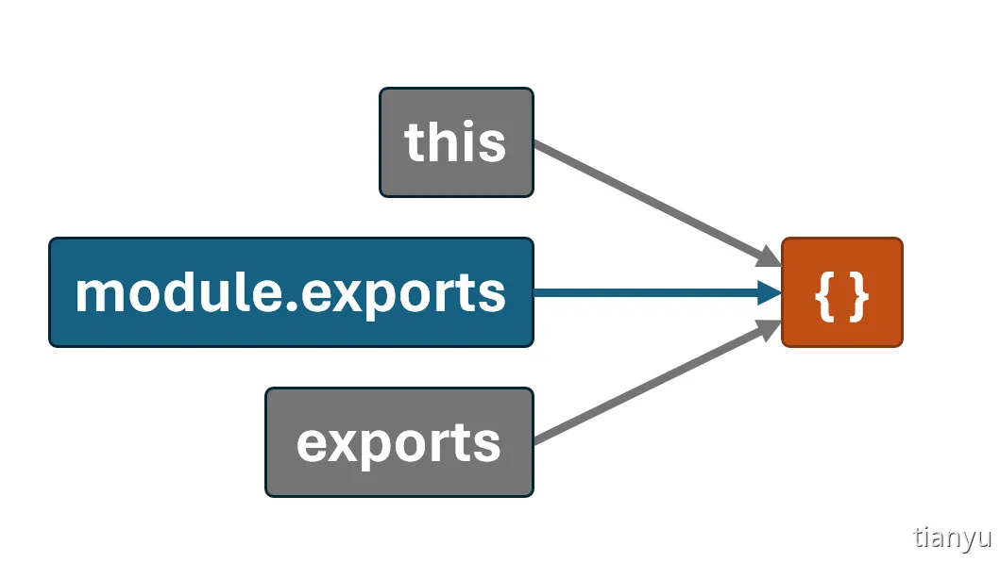
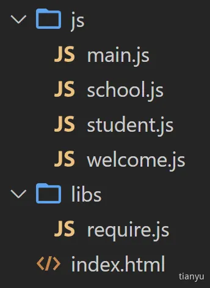
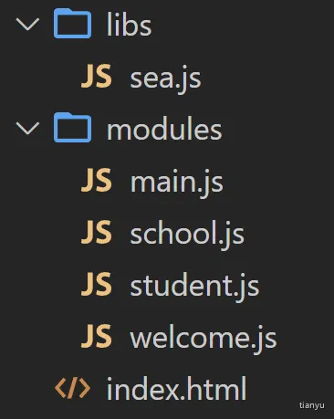

## 1. 模块化概述

### 1.1. 什么是模块化？

将程序文件依据一定规则拆分成多个文件，这种编码方式就是模块化的编码方式。

拆分出来每个文件就是一个模块，模块中的数据都是私有的，模块之间互相隔离。

同时也能通过一些手段，可以把模块内的指定数据“交出去”，供其他模块使用。

### 1.2. 为什么需要模块化？

随着应用的复杂度越来越高，其代码量和文件数量都会急剧增加，会逐渐引发以下问题：

1. 全局污染问题

2. 依赖混乱问题

3. 数据安全问题

## 2. 有哪些模块化规范？

历史背景( 了解即可)：2009 年，随着 Node.js 的出现，JavaScript 在服务器端的应用逐渐增多，为了让 Node.js 的代码更好维护，就必须要制定一种 Node.js 环境下的模块化规范，来自Mozilla 的工程师 Kevin Dangoor 提出了 CommonJS 规范（CommonJS 初期的名字叫ServerJS），随后 Node.js 社区采纳了这一规范。

随着时间的推移，针对 JavaScript 的不同运行环境，相继出现了多种模块化规范，按时间排序，分别为：

1. CommonJS —— 服务端应用广泛

2. AMD

3. CMD

4. ES6 模块化 —— 浏览器端应用广泛

## 3. 导入与导出的概念

模块化的核心思想就是：模块之间是隔离的，通过导入和导出进行数据和功能的共享。

导出（暴露）：模块公开其内部的一部分（如变量、函数等），使这些内容可以被其他模块使用。

导入（引入）：模块引入和使用其他模块导出的内容，以重用代码和功能。



## 4. CommonJS 规范

### 4.1. 初步体验

1. 「创建 school.js」

```js
const name = '尚硅谷 '
const slogan = '让天下没有难学的技术！'
function getTel (){
return '010-56253825'
}
function getCities(){
return ['北京 ','上海 ','深圳 ','成都 ','武汉','西安 ']
}
// 通过给 exports对象添加属性的方式，来导出数据（注意：此处没有导出 getCities）
exports.name = name
exports.slogan = slogan
exports.getTel = getTel
```

2. 「创建 student.js」

```js
const name = '张三 '
const motto = '相信明天会更好！'
function getTel (){
return '13877889900'
}
function getHobby(){
return ['抽烟 ','喝酒 ','烫头 ']
}
// 通过给 exports对象添加属性的方式，来导出数据（注意：此处没有导出 getHobby）
exports.name = name
exports.slogan = slogan
exports.getTel = getTel
```

3. 「创建 index.js」

```js
// 引入 school模块暴露的所有内容
const school = require('./school')
// 引入 student模块暴露的所有内容
const student = require('./student')
```

### 4.2. 导出数据

在 CommonJS 标准中，导出数据有两种方式：

第一种方式：module.exports = value

第二种方式：exports.name = value

注意点如下：

1. 每个模块内部的：this、exports、modules.exports在初始时，都指向同一个空对象，该空对象就是当前模块导出的数据，如下图：



2. 无论如何修改导出对象，最终导出的都是 module.exports的值。

3. exports是对 module.exports的初始引用，仅为了方便给导出象添加属性，所以不能使用 exports = value的形式导出数据，但是可以使用 module.exports= xxxx导出数据。

### 4.3. 导入数据

在 CJS模块化标准中，使用内置的 require函数进行导入数据

```js
// 直接引入模块
const school = require('./school')
// 引入同时解构出要用的数据
const { name, slogan, getTel } = require('./school')
// 引入同时解构 +重命名
const {name:stuName,motto,getTel:stuTel} = require('./student')
```

### 4.4. 扩展理解

一个 JS 模块在执行时，是被包裹在一个内置函数中执行的，所以每个模块都有自己的作用域，我们可以通过如下方式验证这一说法：

```js
console.log(arguments)
console.log(arguments.callee.toString())
```

内置函数的大致形式如下：

```js
function (exports, require, module, __filename, __dirname){
/*********************/
}
```

### 4.5. 浏览器端运行

Node.js 默认是支持 CommonJS 规范的，但浏览器端不支持，所以需要经过编译，步骤如下：

第一步：全局安装 browserify ：npm i browserify -g

第二步：编译

```js
browserify index.js -o build.js
```

备注：index.js 是源文件，build.js 是输出的目标文件

第三步：页面中引入使用

```js
<script type="text/javascript" src="./build.js"></script>
```

## 5. ES6 模块化规范

ES6 模块化规范是一个官方标准的规范，它是在语言标准的层面上实现了模块化功能，是目前最流行的模块化规范，且浏览器与服务端均支持该规范。

### 5.1. 初步体验

1. 「创建 school.js」

```js
// 导出 name
export let name = {str:'尚硅谷 '}
// 导出 slogan
export const slogan = '让天下没有难学的技术！'
// 导出 name
export function getTel (){
return '010-56253825'
}
function getCities(){
return ['北京 ','上海 ','深圳 ','成都 ','武汉','西安 ']
}
```

2. 「创建 student.js」

```js
// 导出 name
export const name = '张三 '
// 导出 motto
export const motto = '相信明天会更好！'
// 导出 getTel
export function getTel (){
return '13877889900'
}
function getHobby(){
return ['抽烟 ','喝酒 ','烫头 ']
}
```

3. 「创建 index.js」

```js
// 引入 school模块暴露的所有内容
import * as school from './school.js'
// 引入 student模块暴露的所有内容
import * as student from './student.js'
```

4. 「页面中引入 index.js」

```js
<script type="module" src="./index.js"></script>
```

### 5.2. Node 中运行 ES6 模块

Node.js中运行 ES6模块代码有两种方式：

方式一：将 JavaScript文件后缀从 .js 改为 .mjs，Node 则会自动识别 ES6 模块。

方式二：在 package.json中设置 type属性值为 module。

### 5.3. 导出数据

ES6 模块化提供 3 种导出方式：①分别导出、②统一导出、③默认导出

1. 「分别导出」

备注：在上方【初步体验中】环节，我们使用的导出方式就是【分别导出】

```js
// 导出 name
export let name = {str:'尚硅谷 '}
// 导出 slogan
export const slogan = '让天下没有难学的技术！'
// 导出 getTel
export function getTel (){
return '010-56253825'
}
```

2. 「统一导出」

```js
const name = {str:'尚硅谷 '}
const slogan = '让天下没有难学的技术！'
function getTel (){
return '010-56253825'
}
function getCities(){
return ['北京 ','上海 ','深圳 ','成都 ','武汉','西安 ']
}
// 统一导出了：name,slogan,getTel
export {name,slogan,getTel}
```

3. 「默认导出」

```js
const name = '张三 '
const motto = '走自己的路，让别人五路可走！'
function getTel (){
return '13877889900'
}
function getHobby(){
return ['抽烟 ','喝酒 ','烫头 ']
}
//默认导出：name,motto,getTel
export default {name,motto,getTel}
```

备注 :「上述多种导出方式，可以同时使用」

```js
// 导出 name ———— 分别导出
export const name = {str:'尚硅谷 '}
const slogan = '让天下没有难学的技术！'
function getTel (){
return '010-56253825'
}
function getCities(){
return ['北京 ','上海 ','深圳 ','成都 ','武汉','西安 ']
}
// 导出 slogan ———— 统一导出
export {slogan}
// 导出 getTel ———— 默认导出
export default getTel
```

### 5.4. 导入数据

对于 ES6 模块化来说，使用何种导入方式，要根据导出方式决定。

1. 「导入全部」( 通用)可以将模块中的所有导出内容整合到一个对象中。

```js
import * as school from './school.js'
```

2. 「命名导入」( 对应导出方式：分别导出、统一导出)

导出数据的模块

```js
//分别导出
export const name = {str:'尚硅谷 '}
//分别导出
export const slogan = '让天下没有难学的技术！'
function getTel (){
return '010-56253825'
}
function getCities(){
return ['北京 ','上海 ','深圳 ','成都 ','武汉','西安 ']
}
//统一导出
export { getTel }
```

命名导入：

```js
import { name,slogan,getTel } from './school.js'
```

通过 as重命名:

```js
import { name as myName,slogan,getTel } from './school.js'
```

3. 「默认导入」( 对应导出方式：默认导出)

导出数据的模块

```js
const name = '张三 '
const motto = '走自己的路，让别人五路可走！'
function getTel (){
return '13877889900'
}
function getHobby(){
return ['抽烟 ','喝酒 ','烫头 ']
}
//使用默认导出的方式，导出一个对象，对象中包含着数据
export default { name,motto,getTel }
```

默认导入：

```js
import student from './student.js' //默认导出的名字可以修改，不是必须为 student
```

4. 「命名导入 与 默认导入可以混合使用」

导出数据的模块

```js
//分别导出
export const name = {str:'尚硅谷 '}
//分别导出
export const slogan = '让天下没有难学的技术！'
function getTel (){
return '010-56253825'
}
function getCities(){
return ['北京 ','上海 ','深圳 ','成都 ','武汉','西安 ']
}
//统一导出
export default getTel
```

「命名导入」与「默认导入」混合使用，且默认导入的内容必须放在前方：

```js
import getTel,{name,slogan} from './school.js'
```

5. 「动态导入」( 通用)允许在运行时按需加载模块，返回值是一个 Promise。

```js
const school = await import('./school.js');
console.log(school)
```

6. import 可以不接收任何数据例如只是让 mock.js 参与运行

```js
import './mock.js'
```

此时，我们感受到模块化确实解决了：① 全局污染问题、②依赖混乱问题、③数据安全问题。

### 5.5. 数据引用问题

思考1： 如下代码的输出结果是什么？（不要想太多，不涉及模块化相关知识）

```js
function count (){
let sum = 1
function increment(){
sum += 1
}
return {sum,increment}
}
const {sum,increment} = count()
console.log(sum)
increment()
increment()
console.log(sum)
```

思考2：使用 CommonJS 规范，编写如下代码，输出结果是什么？

```js
let sum = 1
function increment (){
sum += 1
}
module.exports = {sum,increment}
const {sum,increment} = require('./count.js')
console.log(sum)
increment()
increment()
console.log(sum)
```

思考3：使用 ES6 模块化规范，编写如下代码，输出结果是什么？

```js
let sum = 1
function increment(){
sum += 1
}
export {sum,increment}
import {sum,increment} from './count.js'
console.log(sum) //1
increment()
increment()
console.log(sum) //3
```

使用原则：导出的常量，务必用 const定义

## 6. AMD 模块化规范（了解）

### 6.1. 环境准备

第一步：准备文件结构：



文件说明：

1. js 文件夹中存放业务逻辑代码，main.js用于汇总各模块。

2. libs 中存放的是第三方库，例如必须要用的 require.js。

第二步：在 index.html中配置 main.js与 require.js

```js
<script data-main="./js/main.js" src="./libs/require.js"></script>
```

第三步：在 main.js中编写模块配置对象，注册所有模块。

```js
/*AMD_require.js模块化的入口文件，要编写配置对象，并且有固定的写法 */
requirejs.config({
//基本路径
baseUrl: "./js",
//模块标识名与模块路径映射
paths: {
school: "school",
student: "student",
welcome: "welcome",
}
})
```

### 6.2. 导出数据

AMD 规范使用 define函数来定义模块和导出数据

```js
define(function(){
const name = '张三 '
const motto = '走自己的路，让别人五路可走！'
function getTel (){
return '13877889900'
}
function getHobby(){
return ['抽烟 ','喝酒 ','烫头 ']
}
// 导出数据
return {name,motto,getTel}
})
```

### 6.3. 导入数据

如需导入数据，则需要 define传入两个参数，分别为：依赖项数组、回调函数

```js
schoolJavaScript
// ['welcome']表示当前模块要依赖的模块名字
// 回调接收到的 welcome是模块导出的数据
define(['welcome'],function(welcome){
let name = {str:'尚硅谷 '}
const slogan = '让天下没有难学的技术！'+ welcome
function getTel (){
return '010-56253825'
}
function getCities(){
return ['北京 ','上海 ','深圳 ','成都 ','武汉','西安 ']
}
// 导出数据
return {name,slogan,getTel}
})
```

### 6.4. 使用模块

```js
requirejs(['school','student'],function(school,student){
console.log('main',school)
console.log('main',student)
})
```

## 7. CMD 模块化规范（了解）

### 7.1. 环境准备

第一步：准备环境



文件说明：

1. js 文件夹中存放业务逻辑代码，main.js用于汇总各模块。

2. libs 中存放的是第三方库，例如必须要用的 sea.js。

第二步：在 index.html中配置 main.js与 sea.js

```js
<script type="text/javascript" src="./libs/sea.js"></script>
<script type="text/javascript">
seajs.use('./modules/main.js')
</script>
```

### 7.2. 导出数据

CMD 中同样使用 define函数定义模块并导出数据

```js
/*
收到的三个参数分别为：require、exports、module
1. require用于引入其他模块
2. exports、module用于导出数据
*/
define(function(require,exports,module){
const name = '尚硅谷 '
const slogan = '让天下没有难学的技术！'
function getTel (){
return '010-56253825'
}
function getCities(){
return ['北京 ','上海 ','深圳 ','成都 ','武汉','西安 ']
}
// 导出数据
module.exports = {name,slogan,getTel}
})
```

### 7.3. 导入数据

CMD 规范中使用收到的 require参数进行模块导入

```js
define(function(require,exports,module){
const name = '张三 '
const motto = '相信明天会更好！'
// 引入 welcome模块
const welcome = require('./welcome')
console.log(welcome)
function getTel (){
return '13877889900'
}
function getHobby(){
return ['抽烟 ','喝酒 ','烫头 ']
}
exports.name = name
exports.motto = motto
exports.getTel = getTel
})
```

### 7.4. 使用模块

```js
define(function(require){
const school = require('./school')
const student = require('./student')
// 使用模块
console.log(school)
console.log(student)
})
```
